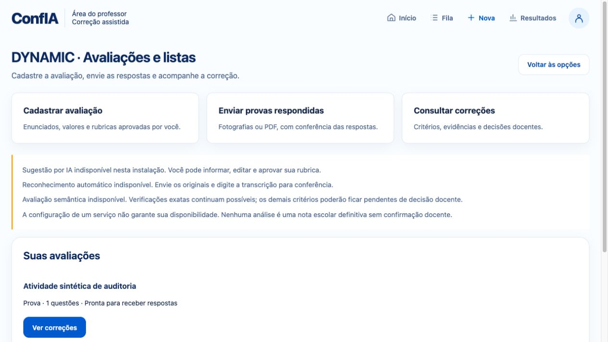
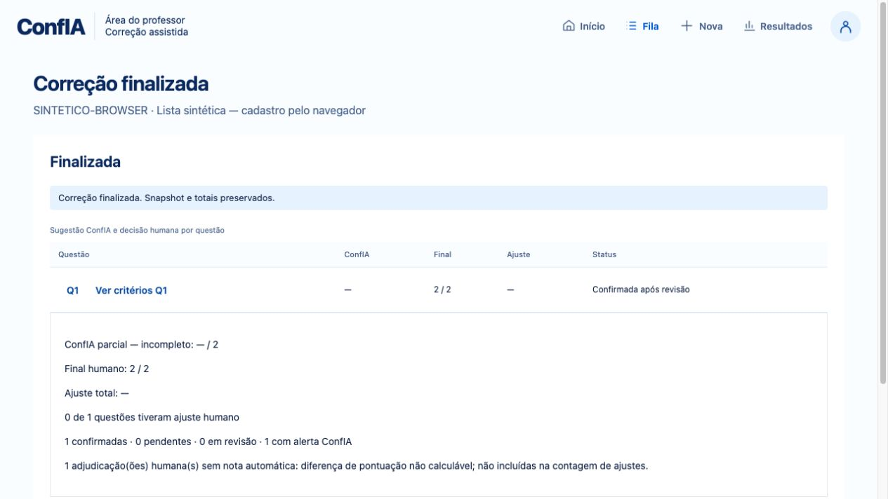
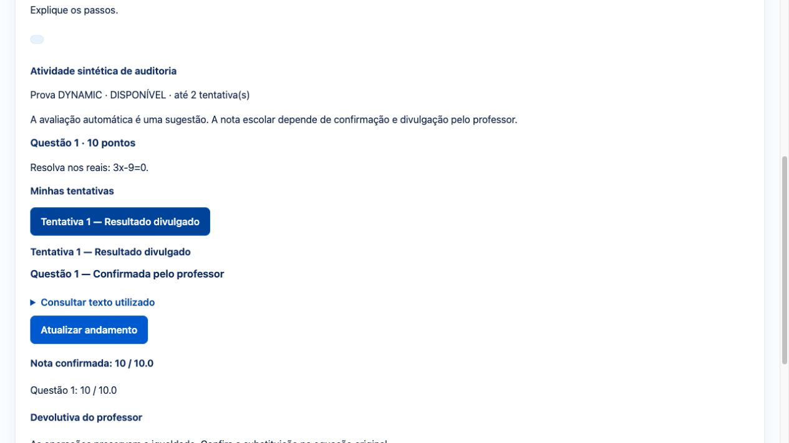
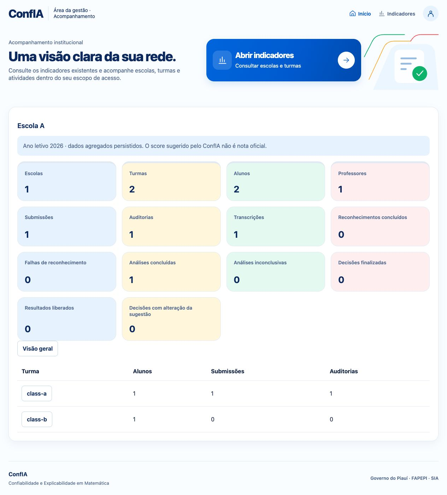

# ConfIA — auditoria funcional e matemática independente

**Base:** `main` em `923bf3acbd9994af9662bcdff6b18eac1b6d4df9`. **Data:** 27/11/2026, America/Fortaleza. **Branch:** `codex/audit-functional-pre10dez-2026`. Auditoria em worktree novo e isolado. Este PR contém somente relatório, instrumentos de observação e evidências sintéticas; não corrige produção e não deve ser confundido com validação científica.

**Parecer:** há fluxos funcionais reais, inclusive cadastro docente, correção determinística limitada, decisão humana, publicação institucional e preservação de versões. Não há evidência suficiente para aprovar correção escolar autônoma. Provider desligado impede a revisão semântica e a preparação do estudo autônomo; mocks aprovados não resolvem essa lacuna. Foi reproduzido um bloqueio P1 de encaminhamento de evidência explícita no ITA, além de limitações de indicadores e de apresentação; os resultados completos de regressão estão abaixo.

## 1. Escopo, isolamento e limites

- Código e pautas fixos no SHA acima; nenhum merge, alteração de motor, rubrica, contrato, referência ou tag científica.
- Tag `SPECIALIZED-TME2-RC1`: objeto anotado `0c64e318a26e21f71fe3097c66ee17a5206dd8a3`, commit `c03403fe5b83d9db9df172882bd69af3dfa2d027`. Não foi recriada nem movida. A main auditada é uma evolução posterior; seus hashes não devem ser apresentados como o fingerprint da RC1.
- Stores e logs novos em `runtime/audit-pre10dez/`, ignorado pelo Git. Contas, escolas, participantes e enunciados criados para o teste são sintéticos. Nenhuma base operacional de alunos foi usada. OCR real e integração OCR fora do escopo.
- `OPENAI_API_KEY` e outras chaves de provider indisponíveis aos subprocessos. `CONFIA_DYNAMIC_LLM_ENABLED=0`, `CONFIA_SEMANTIC_LLM_ENABLED=0`, `CONFIA_ENABLE_LLM_FORMAL_STEPS=0`. Nenhuma chamada paga. Preparação/Grader/Reviewer com provider simulado somente nos testes explicitamente classificados como tal.
- A suíte histórica usa `tests/conftest.py::legacy_protocol_mode`: política `legacy` por padrão; testes atuais optam por `dynamic-semantic.v1`/`semantic-b-minimal.v1`. Os probes desta auditoria usam explicitamente as políticas atuais. Passar toda a suíte não significa que todos os testes executam a política atual.
- As fixtures estruturadas SPECIALIZED não são soluções independentes. A referência de nota foi usada apenas para comparar resultados depois da execução. Os probes não passam `expected_score`, gold ou nota-alvo ao corretor.

O inventário [inventory.json](assets/functional-pre10dez-2026/inventory.json) registra branches e worktrees sem alterar nenhum deles. A main local estava em `97c84bb`; a referência remota autorizada estava em `923bf3a`, utilizada no worktree da auditoria.

Ambiente e hashes: [environment.json](assets/functional-pre10dez-2026/environment.json), [source-hashes.json](assets/functional-pre10dez-2026/source-hashes.json). Python 3.9.6, Node 24.15.0, Lean 4.28.0, Lake 5.0.0-src+7e01a1b, Mathlib `8f9d9cff6bd728b17a24e163c9402775d9e6a365`. Cache de pacotes Lean copiado para o worktree, sem `lake update` e sem compartilhar diretório de build gravável com outro checkout.

## 2. Resultados de execução

| Execução nesta auditoria | Resultado | Limite |
|---|---|---|
| Python integral, 3.650 casos coletados | **3595 passed, 52 skipped, 2 failed, 1 xfailed**; exit 1 | Duas falhas iniciais de ambiente descritas abaixo; não ocultadas. |
| JavaScript integral | **631 pass, 0 fail, 0 skip**; exit 0 | Integração/UI simulada, não inferência real. |
| Build Lean | **PASS**, 8.038 jobs | Toolchain/manifests fixos. |
| Certificados Lean, teste isolado | **1 pass** | Proposições e adulteração descritas abaixo. |
| Reteste após build local | **2 pass** | Mesmos casos inicialmente falhos; não somados como casos novos. |
| Replay P1 arquivado + diagnósticos | **29 pass, 5 skip** | Arquivos locais de piloto ausentes; replay portátil executado. |

Detalhamento por arquivo, falhas e motivos individuais de skips: [python-regressions.json](assets/functional-pre10dez-2026/python-regressions.json). Comandos, durações e hashes dos logs originais: [summary.json](assets/functional-pre10dez-2026/summary.json).


Os **52 skips** se distribuem em: 21 verificações dependentes da execução real do gate independente ainda não realizada; 19 testes dependentes de pacotes/saídas DEV congelados ausentes; 11 leituras de artefatos históricos/piloto locais ausentes; e 1 corpus sintético local ausente. Os dois skips de `test_tme_model_compat.py` estão incluídos nos 19, não são a totalidade da cobertura ausente nesta suíte ampliada. Houve 2 avisos de compatibilidade `record_property`/JUnit xunit2, sem falha de produto. O xfail é AUD-04, descrito abaixo. A execução integral durou 5.660,77 s (94 min 20 s).

O primeiro pytest foi iniciado antes de existir o build local `ConfiaLeanAuditor.olean`. Duas variantes de `test_common_catalog_preserves_real_pipeline_credit_and_attribution` falharam com `unknown module prefix 'ConfiaLeanAuditor'`. Após `lake build`, ambas passaram no reteste isolado (124,17 s), sem mudar fonte, fixture ou asserção. São falhas de preparação do ambiente desta auditoria, não defeitos matemáticos comprovados. O resultado inicial não foi apagado nem reclassificado como uma execução integral verde. Os erros Lean originais e o reteste estão em [environment-failures.json](assets/functional-pre10dez-2026/environment-failures.json).

Uma coleta auxiliar sem restringir `tests/` seguiu symlinks propositalmente criados pelos testes de integridade dentro de `runtime/` e teve quatro erros. Isso é contaminação da descoberta pela saída temporária da auditoria. A coleta explícita de `tests/` identificou 3.650 testes. Para reproduzir em diretório já utilizado, usar `pytest tests`; não apagar artefatos para esconder os eventos.

Os primeiros rascunhos dos probes HTTP também tinham suposições erradas: idempotência retorna HTTP 200, o endpoint de questão de prova exige `execution_key` e retorna projeção sem campo `result`. Os probes foram ajustados ao contrato existente, com novas amostras sintéticas. Esses erros dos instrumentos não são defeitos do produto. Nenhum código de produção foi alterado.

Os probes registraram aproximadamente 28 s para 28 entradas DYNAMIC, 44 s para 33 entradas TME sem Lean nesse lote e 251 s para o primeiro lote de oito entradas ITA com Lean. São tempos agregados locais, com concorrência da regressão; não são latência de produção, benchmark isolado nem estimativa de custo de LLM. O custo/latência de providers reais continua não medido.

### Lean efetivamente executado

`lake build` terminou com sucesso: **8.038 jobs**, 84,48 s. O teste isolado `tests/test_tme_accepted_integration.py::test_real_local_lean_status_certificates_preserved` passou em 33,99 s. Foram verificados:

- a proposição aritmética `4! = 24`;
- a refutação `¬ (2^4 = 8)` sobre inteiros.

O teste preservou duas cópias obrigatórias de certificados; adulterou somente a cópia temporária do primeiro e confirmou `ResultIntegrityError`. O hash diferente desse arquivo é **o resultado esperado do teste de adulteração**, não corrupção histórica. Fontes e hashes em [lean-verified-propositions.json](assets/functional-pre10dez-2026/lean-verified-propositions.json) e [lean-certificates.json](assets/functional-pre10dez-2026/lean-certificates.json).

Os probes ITA também executaram Lean real. Certificados `generated_reference` permanecem distintos das verificações atribuídas à expressão do estudante. Nenhuma dessas execuções formaliza globalmente as soluções geométricas/combinatórias dos cinco TME ou qualquer questão arbitrária DYNAMIC.

## 3. Arquitetura realmente exercitada

| Área | Entrada e componentes reais | Evidência / limite |
|---|---|---|
| SPECIALIZED ITA | `main.py::execute_audit` → extração/microclaims → `lean/` → avaliação de rubrica → `semantic_policy/ita.py::apply` → agregação/relatório | 9 entradas controladas com Lean real e fallback indisponível. Não confundir prova de referência com autoria estudantil. |
| SPECIALIZED TME | `tme/accepted_audit.py::audit_accepted_tme_transcription` → `tme/registry.py::audit_tme` → checkers/bridge → `semantic_policy/tme.py::apply` → `rubric/pauta/engine.py::PautaEngine` | 33 entradas pela API autenticada, aceitação, AuditService, persistência. Lean explicitamente desligado nesse lote; verificações determinísticas reais. Teste Lean separado acima. |
| Rubricas DYNAMIC | `dynamic/store.py`, `models.py`, `preparation.py::PreparationService`, `assessment_service.py` | Versões, aprovação explícita, aviso de preparação não certificada e ativação verificadas. Geração por LLM real não executada. |
| Grader | `dynamic/grader.py::DynamicSolutionGrader.grade`, `verification.py`, `semantic.py::augment` | Parser fechado de equações reais lineares/quadráticas e descrições de critérios. Fora desse escopo, fallback ou pendência. Não é resolvedor universal. |
| Reviewer | `dynamic/reviewer.py::blind_input`, `review_service.py::DynamicReviewService.execute`, `semantic.py::review_phase` | Entrada independente sem decisões/pontos do Grader; verificações novas da fonte. Comparação ocorre depois da fase A. Cegamento estrutural não garante independência estatística entre LLMs. |
| Reconciliação | `dynamic/reconciliation_service.py::ReconciliationService`, `semantic.py::reconcile`, `reconciliation.py` | Desacordo numérico, níveis parciais, falha técnica e crédito exato cobertos por testes com mocks e por provider OFF. Não concede nota final porque um provider falhou. |
| Provas/decisão humana | `dynamic/product_adapter.py`, `tme/question_review.py`, `tme/human_decisions.py`, serviços de fechamento | Sugestão automática separada da adjudicação por critério; fechamento explícito; original e parecer automático preservados. |
| Aluno institucional | `dynamic/school_service.py`, `school_router.py`, `static/dynamic-student.js` | Matrícula/escopo, versão publicada, tentativa digitada, ocultação e divulgação docente testadas com autenticação real. |
| Estudo autônomo | `dynamic/study_service.py::evaluate`, `study_feedback.py`, `study_router.py`, `static/dynamic-self-study.js` | Reutiliza DynamicSolutionGrader, blind_input, review_phase, compare_review e reconcile_criteria. Projeção qualitativa privada/pública separada. Sem PautaEngine e sem Lean nesse caminho. Preparação real bloqueada por provider OFF. |
| TutorIA | `static/tutoria*.js`, `static/demo/`, caderno compartilhado `/capture` | Notebook e tentativa textual reais; feedback observado é ilustrativo e rotulado. Não é auditoria matemática da tentativa. |
| Gestão | `management/router.py::_metrics` | Agregados de escolas/turmas/submissões/AuditRuns reais; não agrega decisões `tme/human_decisions`. |
| Autorização/integridade | `auth/`, `institutional/`, `submissions/`, `submission_audits/service.py::AuditService` | Sessões reais, códigos 401/403/404, origens, vínculos, hashes, versões e leitura de artefatos cobertos. Não equivale a pentest completo. |

### Política matemática e atribuição

O Grader DYNAMIC usa aritmética racional e polinômios de escopo limitado; crédito intermediário depende de regra/nível aprovado. Não há Lean genérico executado para questões inéditas nos probes. `semantic.py` preserva decisões exatas e encaminha pendências; o provider decide estados fundamentados, e o código aplica a rubrica. Citações literais e offsets sustentam proveniência textual, mas não demonstram a verdade da justificativa.

No TME, PautaEngine é a origem da pontuação, com regras aditivas, caminhos alternativos, faixas e carry-forward. Geometria preparada, equivalência canônica e provas aritméticas são tipos distintos de suporte. Em P4, por exemplo, `tme/p4_geometry.py` contém relações do contrato geométrico; o fato de uma identidade algébrica compilar não prova que o desenho do aluno estabelece essas relações. Em P5, `lean/student_claim_checkers/tme2_p5.py` reconhece estruturas e equivalências preparadas; não há tradução geral de demonstrações em linguagem natural.

`needs_review=True` e o `verdict` legado não implicam automaticamente uma pendência que muda a nota ou exigência humana explícita. A projeção `tme-review-diagnostics.v1` foi calculada sobre os novos resultados sem reexecutar ou alterar a pontuação. Os cinco resultados integrais preparados têm nota determinada de 20 e flags legadas de revisão; consultar o diagnóstico e o caminho efetivamente selecionado. Flags isoladas não foram classificadas como defeitos.

## 4. Probes matemáticos e resultados

### TME P1–P5

| Problema | Fixture completa, pontos por item | Nota | Parcial/erro/contexto/alternativa |
|---|---|---:|---|
| P1 | 3 + 5 + 6 + 6 | 20/20 | Parcial e erro mantêm pendências; hipóteses/citações/rejeições não ganham os créditos da solução integral. |
| P2 | 5 + 7 + 8 | 20/20 | Mesma distinção entre suporte, refutação e pendência. |
| P3 | 4 + 8 + 8 | 20/20 | Método de árvore reconhecido no item b: 8/8; demais itens não enviados permanecem pendentes. |
| P4 | 4 + 6 + 10 | 20/20 | Método do paralelogramo reconhecido no item b: 6/6; não prova cobertura de toda linguagem geométrica. |
| P5 | 6 + 4 + 6 + 4 | 20/20 | Método geral reconhecido no item c: 6/6; outras obrigações continuam pendentes. |

33 entradas: 5 completas, 5 parciais, 5 incorretas, 15 variantes de hipótese/citação/tentativa rejeitada e 3 alternativas. Pontuação por item, fatos usados, obrigações e diagnósticos em [specialized-offline.json](assets/functional-pre10dez-2026/specialized-offline.json). A ausência de itens não virou nota final zero: a projeção pública manteve `score=null` quando havia item matematicamente indeterminado. Créditos independentes permaneceram visíveis sem apresentar subtotal como nota final.

O P1 acima **não é** o replay histórico de 17/20. A regressão portátil do replay com pareceres GPT arquivados foi executada separadamente: `test_tme_archived_quote_scope.py` e `test_tme_review_diagnostics.py` (29 pass, 5 skips de arquivos locais opcionais ausentes). Nenhuma nova inferência; não se usou referência 18/20 como alvo. O registro histórico da falha intermitente P3 permanece uma limitação; um teste atual aprovado não demonstra sua causa resolvida.

### ITA2025F2Q1

| Entrada | Resultado observado |
|---|---|
| Solução preparada completa | 10/10 = 3+3+2+2, com Lean real. |
| Apenas resposta final correta | Nota total pendente, somente 2 pontos da resposta decididos. |
| Desenvolvimento sem resto reduzido | Nota total pendente; 3+2 pontos confirmados. |
| Resposta final errada | Critério final 0, demais pendentes; não há zero global artificial. |
| Hipótese / citação não adotada / tentativa descartada | Critério final pendente; não herda os 2 pontos da resposta citada. |
| `x^57=1`, resto errado, conclusão correta | Redução refutada (0), final 2 conforme critério independente; total pendente. |
| Desenvolvimento alternativo por congruências no anel quociente | Matematicamente correto por inspeção do auditor; só resposta final 2 e total pendente. Além do provider OFF, o critério do resto não é encaminhado ao fallback mesmo com provider simulado disponível (AUD-03). Não há gold independente para esta amostra. |

[ita-offline.json](assets/functional-pre10dez-2026/ita-offline.json) distingue certificados de referência e checks de claims. O crédito da resposta final não constitui crédito pelo desenvolvimento inválido. Não foram observados falsos créditos nos contextos adversariais controlados testados; isso não mede a taxa de falsos créditos em soluções independentes.

### DYNAMIC — seis enunciados novos, provider OFF

28 entradas: equação linear, quadrática, frações, perímetro, probabilidade e função afim. Rubricas manuais aprovadas pelo fluxo real; métodos, respostas, parciais, alternativas, erros de sinal, hipóteses/citações e etapa falsa. [dynamic-offline.json](assets/functional-pre10dez-2026/dynamic-offline.json).

- Linear `3x−9=0` com `3x=9; x=3`: Grader 10/10.
- Quadrática `x²−9x+20=0` com fatoração correta e conjunto `{4,5}`: Grader 10/10.
- Fatoração falsa `(x−4)(x−6)` seguida do conjunto correto `{4,5}`: método 0, resposta 4; crédito independente permitido pela rubrica do probe, não validação do argumento falso.
- Uma única raiz correta: 2 dos 4 pontos do critério de raízes, com regra proporcional explicitamente aprovada; desenvolvimento pendente mantém total pendente.
- Métodos expressos fora do parser, frações, geometria, probabilidade e funções: avaliação automática pendente. Não se conclui que as soluções estão erradas.
- **0/28 notas reconciliadas disponíveis** com o Reviewer semântico desabilitado, inclusive quando o Grader exato tinha 10/10. `TECHNICAL_ERROR`, `REVIEW_ONLY` e pontuação reconciliada nula são coerentes com a política atual. Operacionalmente, uma instalação sem provider exige decisão humana; não demonstra correção dinâmica geral offline.
- Entradas registradas da fase A não contêm decisões/pontos do Grader. Testes de desacordo 5/10 versus 10/10, parcial/integral/zero, quotes, falhas, dependências e preservação exata são **MOCK_ONLY quanto ao juízo semântico**; a lógica de integração/validação/persistência executada é real.

## 5. Plataforma e segurança

[HTTP institucional](assets/functional-pre10dez-2026/institutional-http.json), [retomada](assets/functional-pre10dez-2026/resume-http.json) e [observações de navegador](assets/functional-pre10dez-2026/browser-observations.json).

| Cenário | Estado | Observação |
|---|---|---|
| Cadastro docente, rubrica e aprovação | PASS | API e navegador; tentativa antes da aprovação retorna 409; botões de ativação/aprovação bloqueados no estado inválido. |
| Aluno institucional e resposta digitada | PASS | Atividade de turma, autoria, fonte e versão preservadas. |
| Reconciliação sem provider | PASS de abstenção; BLOCKED para nota automática | Não converte indisponibilidade em erro matemático/zero. |
| Adjudicação e fechamento | PASS | 10/10 no caso de equação e 2/2 no perímetro foram decisões humanas sintéticas explícitas; não pontuações automáticas simuladas. |
| Divulgação institucional | PASS | Resultado nulo antes da divulgação, inclusive após fechamento; aluno não pode divulgar (403). |
| Isolamento | PASS nos casos exercitados | Outro aluno 404; professor de outra escola 403; aluno no workspace docente 403; anônimo 401; gestor em outra escola 403. |
| Retomada entre processos | PASS | Processo encerrado após análise e antes da revisão; novo processo obtém mesma execução idempotente. Edição cria revisão 2, novo AuditRun; anterior fica stale, bytes antigos intactos. |
| Estudo autônomo | PARTIAL / BLOCKED_PROVIDER_OFF | Cadastro e conferência reais; preparação não concluída. Feedback progressivo, ocultação de notas e novas tentativas são testados com providers simulados, não ao vivo. |
| TutorIA | PARTIAL | Caderno/entrada textual funcionam; feedback desta experiência explicitamente demonstrativo, sem análise automática da tentativa. |
| Gestão | PARTIAL | Submissão/auditoria/transcrição conferem; decisões TME/DYNAMIC não são agregadas. |
| Navegação e sessão | PASS nos percursos observados | Login por Enter redireciona aos três módulos; retorno ao início respeita perfil; reload mantém decisão e sessão. |
| SPECIALIZED na interface | PARTIAL | Catálogo e navegação abertos; execução matemática/relatórios verificados por API/serviço, não um ciclo completo de escrita digital no navegador. |

A confirmação técnica de uma entrada digitada não foi descrita como revisão humana de manuscrito. Nenhuma captura manuscrita/OCR real foi exercitada para cumprir este escopo. A suíte geral inclui regressões de reconhecimento com mocks; isso não constitui auditoria da integração OCR. Tampouco foram testadas rejeição física de palma, dispositivo móvel ou inferência real de feedback.

Capturas sintéticas:






## 6. Defeitos reproduzidos e limites operacionais

Nenhum P0 foi reproduzido nos cenários controlados desta auditoria. Isso não é prova de ausência de vulnerabilidades, pentest completo ou certificação matemática. Os achados abaixo distinguem defeito novo reproduzido, limitação preexistente e comportamento intencional.

### AUD-01 — P2 — Indicadores omitem decisões docentes TME/DYNAMIC

**Reprodução:** executar `probe_school.py`: publicar uma atividade, submeter texto como aluno, produzir pendência automática, adjudicar, finalizar e divulgar. Consultar `/management/overview` e os stores sintéticos.

**Obtido:** `submissions_count=1`, `audit_runs_count=1`, `transcriptions_count=1`; há uma decisão em `tme_cases/.../human_decisions/`, fechamento e resultado divulgado. Entretanto `decisions_finalized_count=0`, `decisions_released_count=0` e `override_count=0`. Navegador confirmou os zeros.

**Causa:** `management/router.py::_metrics` consulta exclusivamente `teacher_decisions.store.decision_store()` por submissão. Não consulta a decisão da questão/prova compartilhada nem a divulgação de `dynamic/school_service.py`. Não é perda de dados ou permissão incorreta; é agregação incompleta. O contador de inconclusivas olha `AuditRun.result.score`, não o estado da reconciliação: seu escopo é a primeira avaliação. A consulta deste probe ocorreu após adjudicação humana; o valor 0 não prova, por si só, uma pendência humana omitida naquele instante. A omissão comprovada está nos contadores de decisões finalizadas/divulgadas.

**Próximo ajuste mínimo, em PR separado:** definir escopos dos indicadores e agregar decisões/fechamentos/divulgações das duas famílias sem dupla contagem. Incluir regressão com uma decisão genérica e uma DYNAMIC. Não alterar pontuação.

### AUD-02 — P3 — Shell da Gestão tenta carregar catálogo sem permissão

**Reprodução:** login `manager.a` → `/#management/home`. **Obtido:** painel funcional, mas console registra `ConfIA: carregamento de questões Error: Não foi possível carregar as questões` em `static/app.js::loadProblems`. `/problems` não é permitido ao gestor. A restrição de autorização está correta; a inicialização compartilhada faz uma solicitação desnecessária.

**Próximo ajuste:** restringir o carregamento do catálogo aos contextos que o usam. Não ampliar a permissão do gestor como contorno.

### Limitação confirmada — resumo docente não representa todas as provas

A home inicialmente mostrou zero casos apesar da tentativa institucional finalizada. `tme/home_summary.py::rebuild_index` exclui explicitamente casos com `exam_submission_id` porque provas completas têm roster próprio. Isso é comportamento intencional do índice, não desaparecimento das correções. Entretanto os rótulos amplos da home podem sugerir cobertura total; o usuário precisa consultar a avaliação DYNAMIC. Recomenda-se explicitar o escopo ou integrar projeções, sem recomputar decisões matemáticas. A leitura posterior confirmou cinco casos de prova, duas decisões humanas e contadores da home todos iguais a zero: [projections.json](assets/functional-pre10dez-2026/projections.json).

### Não classificados como defeitos comprovados

- `needs_review=True` com 20/20: pode refletir alternativas dispensáveis; diagnóstico derivado é o instrumento adequado.
- Provider OFF, abstenção e `score=null` com obrigação relevante: comportamento conservador, não prova de erro matemático. O bloqueio de elegibilidade com evidência explícita, reproduzido em AUD-03, é uma falha distinta.
- Nota humana diferente/independente da sugestão: legítima se explícita, fundamentada e versionada.
- Duas falhas iniciais de módulo Lean ausente: resolvidas no reteste após preparação do ambiente.
- Eventos de erro nos rascunhos dos probes: incompatibilidades do instrumento, documentadas na seção 2.

### AUD-03 — P1 — ITA: expressão explícita do resto não chega ao fallback

**Entrada sintética:** `No anel quociente por x²-x+1, temos x²=x-1 e x³=-1. Como 57=3*19, x^57=(-1)^19=-1. Como x^6=1, x^14=x^2=x-1 e x^7=x. Assim p(x) ≡ -1+a(x-1)+bx+1 = (a+b)x-a. Comparando com 2x+1: -a=1 e a+b=2. Logo a=-1 e b=3.` A cadeia é matematicamente válida: redução módulo x²−x+1 e comparação de coeficientes. A pauta original exige obter justamente o resto `(a+b)x-a`.

**Esperado:** validar a correspondência da expressão escrita ou disponibilizar o trecho literal pertinente ao avaliador semântico; uma decisão eventual deve seguir a rubrica, não uma nota-alvo. **Obtido:** extração identifica `f2q1_student_reduced_form`, mas grounding fica `unresolved`, checker `CLAIM_NOT_GROUNDED`; a obrigação `reduced_polynomial_form` termina `review/no_eligible_evidence`, sem chamada ao provider.

**Cadeia causal comprovada:**

1. `student_claims/grounding.py::representation_matches` usa `_math_fragment` para o resto. `_math_fragment` rejeita a fórmula quando o último caractere antes dela é `=`. O contraste isolado confirma `... = (a+b)x-a.` → false, enquanto `Resto: (a+b)x-a.` → true. Esse contraste só testa sintaxe, não muda a solução persistida nem julga sua verdade.
2. `rubric/secondary_candidates.py::build_candidates` tenta recuperar contexto por interseção de palavras com três ou mais letras. Os termos do critério (resto, geral e rótulos ingleses) não coincidem com os termos da solução; a fórmula matemática explícita não contribui para essa interseção. O único candidato é `bounded_context`, limitado à primeira frase, sem o desenvolvimento do resto.
3. `semantic_policy/ita.py::apply` aceita `local_context`/`criterion_evidence`, mas não `bounded_context`. Como também não há claim/check atribuído, registra `no_eligible_evidence` e não chama o avaliador para esse critério.

**Reprodução adicional:** `probe_ita_routing.py` reutiliza os checks reais desta auditoria e copia a rubrica em memória. Provider explicitamente simulado responde somente aos critérios que chegam até ele: `power_reductions` e `coefficient_system`. O resto continua sem avaliação e a soma continua nula, embora os demais itens estejam decididos. Isso prova o bloqueio de roteamento, **não** a acurácia de um GPT nem uma nota final real. Os bytes do resultado original permanecem iguais. [ita-routing.json](assets/functional-pre10dez-2026/ita-routing.json).

**Impacto:** uma escrita algébrica comum pode impedir conclusão mesmo com fallback disponível. Não é zero indevido ou falsa prova Lean; é perda de cobertura de evidência e bloqueio do fluxo central. O gatilho sintático afeta o adaptador ITA examinado; não foi inferida a mesma falha para todo TME/DYNAMIC.

**Correção mínima a discutir em outro PR:** revisar a correspondência de fórmulas no lado direito/cadeias e a recuperação de trechos matemáticos, preservando controles de hipótese, citação, rejeição e proveniência. Cobrir esta entrada e contraexemplos de equações falsas antes de aceitar crédito. Não resolver concedendo pontos por mera presença de fórmula, liberando todo contexto indiscriminadamente ou programando 10/10.


### AUD-04 — P2 preexistente — F2Q6: identificação dos máximos ausente na extração legada

A regressão real `tests/test_f2q6_strong_certificate.py::test_f2q6_correct_solution_includes_strong_certificate` atingiu o `xfail` já documentado no código: a redação com fórmula correta, análise da razão (crescimento, empate em 6, decrescimento) e conclusão `n=6 e n=7` não produz `maximizers_identification`. Observado: 3+3+pendente+2, subtotal 8/8 avaliado, nota global nula; três checks estudantis verificados e nenhum certificado forte global indevido.

O caminho `claims/extractors/ita2025f2q6.py::extract_claims_ita2025f2q6` só cria o claim quando `detect_features()['has_maximizers']` é verdadeiro; esta redação não satisfaz a detecção. [ita-f2q6-known-xfail.json](assets/functional-pre10dez-2026/ita-f2q6-known-xfail.json) registra a execução real, política `SCORE-POLICY-02` selecionada pelo modo legado da suíte. **Não é um PASS**, nem um novo defeito descoberto nesta auditoria. Não foi testado o comportamento dessa mesma redação com fallback atual disponível; não generalizar o resultado para todas as políticas. Próximo passo: reproduzir a cobertura sob a política atual antes de propor alteração de extração, preservando contexto e autoria.

### Risco histórico não revalidado — gate independente de suficiência

`tests/test_sufficiency_dev_regressions.py` declara 21 ocorrências DEV históricas: **15 de falso crédito e 6 de falsa atribuição**. O teste de inventário passou, mas as 21 asserções de eliminação dessas falhas foram puladas porque as saídas da execução real independente (`shadow`) não existem neste worktree. Portanto, **esta auditoria não demonstra que essas falhas históricas foram eliminadas**, nem que se reproduzem exatamente na configuração atual. Não substituímos os pareceres ausentes por mocks, não acessamos outro split e não executamos providers pagos. Esse ponto é uma limitação relevante de confiabilidade a resolver antes de alegações científicas; não deve ficar escondido sob a expressão “skips de ambiente”. A regressão portátil e as fixtures completas aprovadas não substituem essa avaliação independente.

## 7. Protocolo prospectivo: 60 soluções independentes

Não executado nesta auditoria. Não reutilizar fixtures que orientaram o desenvolvimento como holdout.

1. **30 SPECIALIZED:** cinco soluções por problema TME P1–P5 (correta, parcial, incorreta, alternativa, caso de interpretação/atribuição) e cinco soluções ITA distribuídas nas mesmas categorias. Equilibrar amostra conforme rubricas antes de abrir o holdout.
2. **30 DYNAMIC:** seis novos enunciados de Educação Básica — álgebra linear/quadrática, frações/proporcionalidade, geometria, probabilidade e funções — com cinco soluções por enunciado nas categorias acima. Professores aprovam rubricas completas e regras de crédito/dependências antes da execução. Problemas diferentes dos probes deste PR.
3. Dois matemáticos avaliam independentemente, cegos aos resultados do agente e um ao outro. Registrar critério, pontos, validade de cada passo, evidência textual e justificativa. Terceiro avaliador resolve discordâncias; preservar ambos os pareceres e consenso.
4. Gold em armazenamento separado, não montado no processo corretor, não incluído em prompts, rubricas geradas, exemplos ou preparação. Fixar enunciados/rubricas, hashes, prompts, modelos, configuração e regras de abstinência antes de abrir os resultados.
5. Relatar por motor, domínio, tipo de solução, item e critério: erro absoluto de nota (também normalizado pela máxima), falso crédito, crédito omitido, concordância ponderada entre humanos e agente, citações inválidas, cobertura, abstenções técnicas/matemáticas separadas, divergências Grader–Reviewer, qualidade/adequação pedagógica das justificativas e consentimento dos níveis de ajuda.
6. Após autorização específica de providers reais: registrar chamadas, tokens, latência por etapa e ponta a ponta (mediana/p95), custo calculado pelo modelo efetivo e tabela de preços fixada. Interromper ao limite de chamadas/custo previamente aprovado. Não enviar gold aos providers.
7. Gates propostos para o experimento: zero exposição de nota no estudo autônomo, zero acesso entre estudantes/escolas, zero publicação sem docente, zero falsa certificação Lean, zero falha técnica convertida em nota conclusiva. Falhas desses gates bloqueiam continuidade. Limiares de erro matemático e omissão devem ser pré-registrados com a equipe; 60 soluções são uma triagem exploratória, insuficiente para certificar uso escolar autônomo.

## 8. Veredito e prioridades

**Demonstração de 10/12: GO restrito aos fluxos offline supervisionados efetivamente exercitados**, com aviso claro de provider indisponível e feedback demonstrativo. Demonstrar determinismo preparado, versões, pendências, decisão docente e divulgação; não anunciar correção semântica real ou indicadores completos. O cenário alternativo ITA de AUD-03 não está apto a uma demonstração de correção automática concluída. Para demonstração de DYNAMIC automático em problemas inéditos: **NO-GO com a configuração OFF desta auditoria**; requer smoke real autorizado e resultados revistos antes da apresentação.

**Correção escolar autônoma: NÃO VALIDADA / NO-GO.** A existência do fluxo, testes de contrato e mocks não comprova segurança matemática ou pedagógica em resoluções independentes.

Prioridades: (1) corrigir e regredir o bloqueio ITA AUD-03 em PR separado; (2) corrigir agregação e rótulos de escopo em PR separado; (3) smoke semântico supervisionado com orçamento autorizado, ainda sem OCR nesta frente; (4) corpus independente e gold cego; (5) avaliar custo/latência e modos de falha antes de qualquer promessa de escala. Nenhuma correção está incluída neste PR.

## 9. Reprodução e integridade da entrega

Usar clone/worktree novo no SHA fixado, Python conforme manifesto e constraints versionadas. O runner está em `docs/audits/assets/functional-pre10dez-2026/run_offline.py`; substitua `$PY` pelo interpretador provisionado, não por um Python presumido.

```sh
PY=/caminho/do/ambiente/validado/bin/python
A=docs/audits/assets/functional-pre10dez-2026
mkdir -p runtime/audit-pre10dez
# Provisionar cache do toolchain/manifests fixos; não usar lake update.
"$PY" "$A/run_offline.py" lake_build lake build
"$PY" "$A/run_offline.py" python_full "$PY" -m pytest tests -q -rs --junitxml=runtime/audit-pre10dez/python_full.xml --basetemp=runtime/audit-pre10dez/pytest_full
"$PY" "$A/run_offline.py" javascript node --test tests/js/*.cjs
"$PY" "$A/run_offline.py" lean_certificates "$PY" -m pytest -q -rs tests/test_tme_accepted_integration.py::test_real_local_lean_status_certificates_preserved --basetemp=runtime/audit-pre10dez/pytest_cert
"$PY" "$A/run_offline.py" textual "$PY" "$A/probe_textual.py"
"$PY" "$A/run_offline.py" specialized "$PY" "$A/probe_specialized.py"
"$PY" "$A/run_offline.py" ita "$PY" "$A/probe_ita.py"
"$PY" "$A/run_offline.py" ita_routing "$PY" "$A/probe_ita_routing.py"
"$PY" "$A/run_offline.py" school "$PY" "$A/probe_school.py"
"$PY" "$A/run_offline.py" resume_create "$PY" "$A/probe_resume.py" create
"$PY" "$A/run_offline.py" resume_continue "$PY" "$A/probe_resume.py" resume
```

Para repetir a inspeção no navegador após `probe_school.py`, executar o runner com `serve_synthetic.py` e abrir `http://127.0.0.1:8876`. O login usa exclusivamente as contas sintéticas definidas em `tests/test_core_auth.py`; não substituir por uma base real. O servidor desta auditoria foi encerrado deliberadamente com SIGTERM após os percursos; sua saída −15 não é falha de regressão.

Os probes de cadastro pressupõem stores novos. Para repetir, usar outro worktree ou diretório descartável explicitamente separado; não apagar/mutar registros operacionais. IDs, datas, latências e hashes de logs variam; comparar contratos, decisões e hashes de fontes fixadas, não esperar bytes idênticos de novas execuções.

`summary.json` registra comandos/exit codes/totais/hashes de logs, cenários e severidades. Logs extensos e stores ficam locais e ignorados; as evidências versionadas são sintéticas e sanitizadas. Todos os arquivos adicionados estão sob `docs/audits/`. Nenhuma modificação em `app/`, `tests/`, pautas, formalizações ou workflows integra este PR. A tag científica, a main e as outras branches permanecem preservadas; publicação somente da branch de auditoria, sem merge.

Verificação somente de leitura do bundle publicado: `python docs/audits/assets/functional-pre10dez-2026/verify_evidence.py`. Compara hashes das evidências e fontes auditadas; não representa nova execução dos motores.
