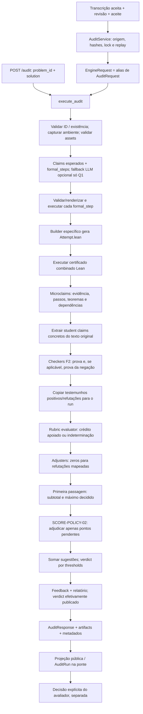
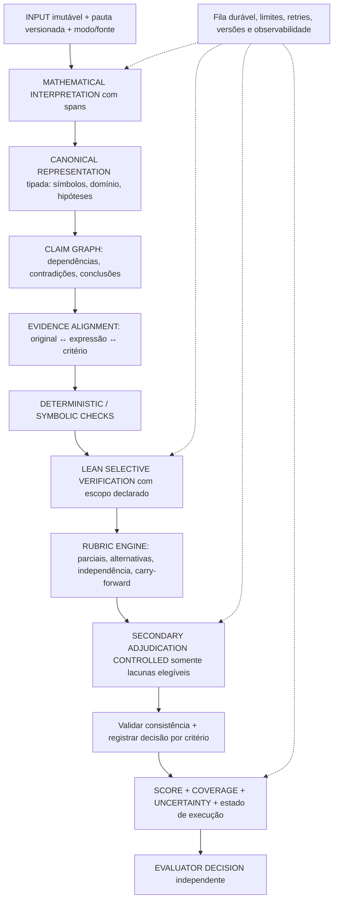

# Auditoria do Motor Corretor ConfIA

## 1. Resumo executivo

**Veredito: PARCIALMENTE PREPARADO.** Há uma base consistente para um piloto supervisionado de questões cadastradas, com pontuação sugerida e registros de evidência. O estado atual **não sustenta a liberação de 1.000 correções discursivas variadas como operação confiável e autônoma**. Não foi realizado teste de carga nem medida de acurácia nesta auditoria.

Três forças:

1. Separação entre sugestão ConfIA e decisão humana, com aceite de transcrição, vínculos de origem, hashes e publicação controlada.
2. Verificação Lean seletiva com testemunhos de prova/negação; falha de prova e erro técnico não são tratados automaticamente como falsidade.
3. Rubricas estruturadas e scoring aditivo que preserva a primeira passagem, a indeterminação e a origem dos pontos secundários.

Cinco riscos principais:

1. **P0 — atribuir ao estudante uma afirmação que ele não fez.** No smoke, F2Q1 conclui a=-1,b=3, mas a extração monta a=3,b=2; Lean refuta essa proposição e o adjuster zera o critério.
2. **P0 — transformar reconhecimento lexical em crédito apoiado.** Parte dos extractors preenche afirmações canônicas e evidências descritivas após detectar palavras/fragmentos; o certificado correspondente não comprova o alinhamento ao texto.
3. **P1 — segunda passagem sem calibração matemática real.** Schema e substring validam formato/origem textual, não a correção da nota. O adjudicador ainda não foi validado nos 18 casos com serviço real.
4. **P1 — operação síncrona e sem orçamento global de execução.** Múltiplos processos Lean e chamadas externas não têm fila durável, limites globais de concorrência/custo ou retomada interna por etapa.
5. **P1 — lacunas entre scoring, UI e governança.** UI mantém decisões da política anterior; o manifesto não identifica integralmente código dirty nem a configuração da adjudicação secundária.

| Dimensão | Maturidade atual | Interpretação |
|---|---|---|
| Lean | MÉDIA na integração; ALTA confiança condicional em proposições comprovadas | Escopo formal heterogêneo; não prova interpretação do texto nem toda solução |
| Extractors | BAIXA para variedade discursiva | Regras específicas, valores canônicos, falta de spans e resolução global de conflitos |
| Rubrica | MÉDIA | Boa estrutura para dez problemas; critérios binários, dependências prescritivas, sem carry-forward |
| Scoring | MÉDIA | Separação correta de campos; garantia numérica condicionada ao serviço externo |
| Secondary adjudicator | Risco ALTO | Útil como fallback controlado; não deve ser promovido a verificação matemática |
| 1.000 correções | Não pronto para liberação irrestrita | Piloto supervisionado condicionado a correções P0, validação e controles operacionais |

**Recomendação sobre o adjudicador: B — manter, mas restringir**, com uso como fallback controlado, validação em conjunto humano, rastreabilidade por tentativa e encaminhamento a revisão. Não remover a necessidade operacional de nota: distinguir nota determinada, sugestão inferida e tarefa ainda não concluída por indisponibilidade.

Top 5 prioridades: alinhamento texto→claim; representação matemática e equivalência reutilizáveis; validação humana de scoring/adjudicação; fila e execução limitada; contrato completo de proveniência e apresentação da incerteza. Detalhes na seção 23.

## 2. Escopo e estado do repositório

Data de referência: **28/10/2026, America/Fortaleza**. Auditoria do working tree real, incluindo alterações não commitadas. O smoke de referência foi executado em 27/10/2026, antes de SCORE-POLICY-02.

- `pwd`: `/Users/LinMarcolino/Documents/confia-lean-auditor`.
- Branch: `feat/tme-dual-input`.
- HEAD: `f607bf5691d9f0472b68287a1b88c11d993a937e`.
- SHA-256 de `git diff --no-ext-diff --no-textconv --binary`: `5437f9b5e7104db081ba4ab159a3c5970b9db20c22a7e563f7d04d123ec39dff`.
- SHA-256 do diff staged: `e3b0c44298fc1c149afbf4c8996fb92427ae41e4649b934ca495991b7852b855` — vazio.
- `git diff --check` inicial: sem saída, sucesso.
- Diff rastreado inicial: 29 arquivos, 510 inserções e 395 exclusões. Não representa sozinho o motor: há módulos não rastreados.
- Inventário técnico: **126 arquivos centrais** de código/configuração/assets examinados por conteúdo integral, trechos relevantes ou estrutura; não significa revisão linha a linha de todos. Inclui 30 JSONs de problemas e dez Statements Lean. Complementos: inspeção da suíte, 18 resultados e seis arquivos de refutação existentes.
- A seção 4 mapeia **40 funções/classes de entrada ou coordenação**, além das famílias específicas por questão.
- Inventário estático da suíte: 76 arquivos Python, 512 definições `test_*`, 38 arquivos JS. Parametrizações aumentam os casos efetivos; esses números não são testes executados.
- Nenhum teste, caso, batch, compilação Lean ou chamada externa foi executado nesta tarefa. Evidências empíricas são exclusivamente artifacts preexistentes. A única criação desta auditoria é este Markdown.

Limite da conclusão: esta é uma auditoria arquitetural e de evidências, não certificação de acurácia, segurança exaustiva, validade pedagógica da pauta ou desempenho de produção. Contagens do smoke não são estimativas de erro contra gold.

Histórico consultado: `git log`/`git blame` identificam `d73fbf9` (09/10/2026) como introdução da abstenção em critérios não decididos e da separação de falhas/provas. SCORE-POLICY-02 está no working tree, incluindo arquivos novos. A canonicalização afim também está entre as alterações atuais: não se deve descrever apenas HEAD.

O estado completo de `git status --short` e a verificação de imutabilidade estão ao fim da seção 24.

## 3. Arquitetura atual

A arquitetura é um **orquestrador genérico com dez implementações específicas de problema**. Não há um único registry declarativo que contenha todas as capacidades. Catálogo, dispatch de extração, builders, renderizadores, student checkers e adjusters precisam permanecer sincronizados.

| Camada pedida | Componentes | Fronteira e mistura de responsabilidades |
|---|---|---|
| PEDAGÓGICA | Descrições das pautas, exemplos, feedback e relatório | Templates já interpretam evidências e atribuem confiabilidade; nem toda descrição é um trecho literal |
| MATEMÁTICA | Normalização, representação afim, claims, checkers | Extractors frequentemente conhecem a resposta correta, misturando interpretação e julgamento |
| LEAN / FORMALIZAÇÃO | Renderizadores, Statements, subprocessos, provas/negações | Templates formalizam afirmações canônicas; a seleção do template depende de heurística textual |
| ENGENHARIA | FastAPI, arquivos, locks, publicação, schemas | `execute_audit` agrega validação, execução formal, scoring e IO; falta uma máquina de estados de execução |
| AVALIAÇÃO | Rubric evaluator, adjusters, assessment e scoring | Ajustes negativos dependem de tabelas externas ao asset; segunda passagem interpreta critérios em linguagem natural |
| INSTITUCIONAL | Assessment, vínculos de aluno/professor, TeacherDecision | Nota oficial permanece humana; TME piloto tem ciclo mais simples |
| GOVERNANÇA / ÉTICA | Aceite, hashes, proveniência, projeção pública | Boa integridade local; faltam evidência alinhada, configuração completa da LLM e controles explícitos do envio secundário |

Não há erro em especializar o domínio de uma questão. O problema é manter **a mesma verdade matemática duplicada** em texto JSON, detector, valores de checker, código Lean e prompt sem validação cruzada suficiente.

## 4. Pipeline real

O caminho textual não começa por AuditService. `POST /audit` chama diretamente `execute_audit`, retornando projeção pública. A ponte de transcrição aceita usa AuditService e, depois de validar a origem, chama o mesmo motor.



A ordem relevante está em [execute_audit](/Users/LinMarcolino/Documents/confia-lean-auditor/app/confia_lean_auditor/main.py:169): student claims vêm **depois** dos microclaims canônicos; não há uma única sequência de interpretação que alimenta tudo. Microclaims são calculados antes do ajuste por refutação e não são recompostos depois. Matching é principalmente por string de tipo/ID, não por alinhamento de um grafo semântico.

Mapa de 40 entradas principais. Os caminhos apontam ao arquivo real; linhas são omitidas quando a entrada representa a classe inteira.

| # | Camada | Arquivo | Função/classe | Entrada → saída | Responsabilidade |
|---:|---|---|---|---|---|
| 1 | Engenharia | [main](/Users/LinMarcolino/Documents/confia-lean-auditor/app/confia_lean_auditor/main.py:169) | execute_audit | AuditRequest → AuditResponse | Orquestrar motor e artifacts |
| 2 | Engenharia | [schemas](/Users/LinMarcolino/Documents/confia-lean-auditor/app/confia_lean_auditor/core/schemas.py:10) | AuditRequest / EngineRequest | ID+solution → objeto | EngineRequest é alias, não motor separado |
| 3 | Engenharia | [service](/Users/LinMarcolino/Documents/confia-lean-auditor/app/confia_lean_auditor/submission_audits/service.py:20) | AuditService.execute | submissão/revisão/aceite → AuditRunView | Origem, replay, integridade |
| 4 | Governança | [source](/Users/LinMarcolino/Documents/confia-lean-auditor/app/confia_lean_auditor/submission_audits/source.py) | build_source | revisão aceita → AuditSource | Congelar origem e digest |
| 5 | Engenharia | [source](/Users/LinMarcolino/Documents/confia-lean-auditor/app/confia_lean_auditor/submission_audits/source.py) | convert_segments | segmentos → texto/warnings | Ordenar páginas; marcar diagramas não analisados |
| 6 | Engenharia | [paths](/Users/LinMarcolino/Documents/confia-lean-auditor/app/confia_lean_auditor/core/paths.py) | get_problem_dir | root/ID → diretório | Conter resolução de caminho |
| 7 | Avaliação | [assets](/Users/LinMarcolino/Documents/confia-lean-auditor/app/confia_lean_auditor/core/problem_assets.py) | validate_problem_assets | três JSONs → ProblemAssets | Contratos e invariantes estruturais |
| 8 | Engenharia | [catalog](/Users/LinMarcolino/Documents/confia-lean-auditor/app/confia_lean_auditor/core/problem_catalog.py) | list_problem_catalog | root → dez entradas | Catálogo UI, metadados e exemplos |
| 9 | Matemática | [dispatch](/Users/LinMarcolino/Documents/confia-lean-auditor/app/confia_lean_auditor/claims/extract_claims.py:41) | extract_claims | ID/texto → ClaimExtraction | Dispatch de dez extractors |
| 10 | Matemática | [Q1](/Users/LinMarcolino/Documents/confia-lean-auditor/app/confia_lean_auditor/claims/extractors/ita2025q1.py:117) | extract_claims_ita2025q1 | texto → claims/passos | Exemplo de detector canônico + fallback |
| 11 | Matemática | [projection](/Users/LinMarcolino/Documents/confia-lean-auditor/app/confia_lean_auditor/core/audit_math_projection.py:41) | project_audit_math | LaTeX → projeção textual | Converter sintaxe limitada |
| 12 | Matemática | [projection](/Users/LinMarcolino/Documents/confia-lean-auditor/app/confia_lean_auditor/core/audit_math_projection.py:135) | canonicalize_equality | igualdade → tupla racional | Forma afim exata |
| 13 | Matemática | [projection](/Users/LinMarcolino/Documents/confia-lean-auditor/app/confia_lean_auditor/core/audit_math_projection.py:171) | has_equivalent_equality | texto/alvo → bool | Equivalência no domínio suportado |
| 14 | Interpretação | [LLM](/Users/LinMarcolino/Documents/confia-lean-auditor/app/confia_lean_auditor/llm/formal_step_extractor.py:228) | extract_q1_semantic_data_with_llm | texto Q1 → JSON | Extração externa opcional |
| 15 | Formalização | [formal steps](/Users/LinMarcolino/Documents/confia-lean-auditor/app/confia_lean_auditor/lean/formal_step_evaluator.py) | evaluate_formal_steps | FormalStep[] → resultados | Validar, renderizar, executar |
| 16 | Formalização | [safe step](/Users/LinMarcolino/Documents/confia-lean-auditor/app/confia_lean_auditor/lean/safe_formal_step.py) | validate_formal_step | expressões/método → aceite/erro | Restrição sintática |
| 17 | Formalização | [builder dispatch](/Users/LinMarcolino/Documents/confia-lean-auditor/app/confia_lean_auditor/lean/build_attempt.py) | build_attempt | claims/passos → arquivo/teoremas | Selecionar template específico |
| 18 | Lean | [runner](/Users/LinMarcolino/Documents/confia-lean-auditor/app/confia_lean_auditor/lean/run_lean.py) | run_lean_file | arquivo → status/diagnósticos | lake env lean, timeout |
| 19 | Formalização | [microclaims](/Users/LinMarcolino/Documents/confia-lean-auditor/app/confia_lean_auditor/lean/microclaim_evaluator.py) | evaluate_microclaims | config/claims/provas → MicroclaimResult[] | Dependências e disponibilidade |
| 20 | Matemática | [student registry](/Users/LinMarcolino/Documents/confia-lean-auditor/app/confia_lean_auditor/student_claims/registry.py) | extract_student_claims | texto → StudentClaim[] | Cinco extractors F2 |
| 21 | Matemática | [checker registry](/Users/LinMarcolino/Documents/confia-lean-auditor/app/confia_lean_auditor/lean/student_claim_checkers/registry.py) | check_student_claims_for_problem | claims → checks | Dispatch F2 |
| 22 | Lean | [student proof](/Users/LinMarcolino/Documents/confia-lean-auditor/app/confia_lean_auditor/lean/student_proof.py) | evaluate_student_proof | proposição/provas → StudentClaimCheck | Prova positiva/negativa separadas |
| 23 | Lean | [student proof](/Users/LinMarcolino/Documents/confia-lean-auditor/app/confia_lean_auditor/lean/student_proof.py) | failure_outcome | processo → categoria | Separar técnico de não provado |
| 24 | Avaliação | [evaluator](/Users/LinMarcolino/Documents/confia-lean-auditor/app/confia_lean_auditor/rubric/rubric_evaluator.py) | evaluate_rubric | claims/microclaims/pauta → itens | Crédito inicial ou null |
| 25 | Avaliação | [adjusters](/Users/LinMarcolino/Documents/confia-lean-auditor/app/confia_lean_auditor/rubric/adjusters/registry.py) | apply_student_claim_adjustments | checks/rubrica → rubrica | Refutação seletiva por questão |
| 26 | Avaliação | [assessment](/Users/LinMarcolino/Documents/confia-lean-auditor/app/confia_lean_auditor/rubric/assessment.py) | refresh_assessment | itens → subtotal/status | Primeira passagem |
| 27 | Avaliação | [scoring](/Users/LinMarcolino/Documents/confia-lean-auditor/app/confia_lean_auditor/rubric/scoring_policy.py:15) | apply_scoring_policy | texto/assets/evidências → sugestão | Segunda passagem e agregação |
| 28 | Avaliação | [secondary](/Users/LinMarcolino/Documents/confia-lean-auditor/app/confia_lean_auditor/rubric/secondary_adjudicator.py:70) | adjudicate | payload → decisões/metadados | API externa |
| 29 | Avaliação | [secondary](/Users/LinMarcolino/Documents/confia-lean-auditor/app/confia_lean_auditor/rubric/secondary_adjudicator.py:51) | validate_decisions | JSON/texto/pauta → decisões/erro | Valores, IDs e citações |
| 30 | Pedagógica | [report](/Users/LinMarcolino/Documents/confia-lean-auditor/app/confia_lean_auditor/reports/report_builder.py:22) | verdict_from_score | score/max → rótulo | Thresholds |
| 31 | Pedagógica | [report](/Users/LinMarcolino/Documents/confia-lean-auditor/app/confia_lean_auditor/reports/report_builder.py) | build_feedback | rubrica/Lean → texto | Feedback determinístico |
| 32 | Pedagógica | [report](/Users/LinMarcolino/Documents/confia-lean-auditor/app/confia_lean_auditor/reports/report_builder.py) | build_pedagogical_report | evidências/score → relatório | Explicação, confiabilidade e verdict |
| 33 | Engenharia | [schemas](/Users/LinMarcolino/Documents/confia-lean-auditor/app/confia_lean_auditor/core/schemas.py) | AuditResponse | resultados → contrato | Serialização compatível |
| 34 | Governança | [public boundary](/Users/LinMarcolino/Documents/confia-lean-auditor/app/confia_lean_auditor/core/public_audit.py) | public_audit_response | resultado → HTTP | Projeção sem caminhos/logs internos |
| 35 | Governança | [collector](/Users/LinMarcolino/Documents/confia-lean-auditor/app/confia_lean_auditor/reproducibility/collector.py) | collect | ambiente/assets → snapshot | Identidade de execução |
| 36 | Governança | [repro service](/Users/LinMarcolino/Documents/confia-lean-auditor/app/confia_lean_auditor/reproducibility/service.py) | publish | snapshot → manifesto | Persistência imutável e verificação |
| 37 | Governança | [artifacts](/Users/LinMarcolino/Documents/confia-lean-auditor/app/confia_lean_auditor/submission_audits/artifacts.py) | capture_manifest | resultado → inventário | Hash de arquivos obrigatórios |
| 38 | Institucional | [teacher service](/Users/LinMarcolino/Documents/confia-lean-auditor/app/confia_lean_auditor/teacher_decisions/service.py:51) | audit_snapshot | run/escala → sugestão vinculada | Normalização e filtros |
| 39 | Institucional | [teacher service](/Users/LinMarcolino/Documents/confia-lean-auditor/app/confia_lean_auditor/teacher_decisions/service.py:140) | finalize | rascunho humano → FINALIZED | Nota oficial explícita |
| 40 | Institucional | [TME router](/Users/LinMarcolino/Documents/confia-lean-auditor/app/confia_lean_auditor/tme/router.py:354) | decide | pedido do avaliador → decisão | Registro humano do piloto TME |

## 5. Problem assets

**Fonte de verdade operacional distribuída**, não um objeto único: três JSONs em cada pasta de [problemas](/Users/LinMarcolino/Documents/confia-lean-auditor/problems), Statements em [biblioteca Lean](/Users/LinMarcolino/Documents/confia-lean-auditor/ConfiaLeanAuditor/Problems), extractors e checkers específicos.

- `problem.json`: id, title, statement, answer_type, correct_answer, max_score, assessment_notes, source opcional.
- `rubric.json`: pesos máximos, descriptions, claim_type e required_microclaim_ids.
- `microclaims.json`: theorem, claim_types, formal step types, dependências e itens apoiados.
- Exemplos de solução ficam em `examples`; não há campo estrutural obrigatório “solução de referência completa”. `correct_answer` tampouco substitui uma demonstração.
- Não há registry de aliases matemáticos ou aliases de problem_id no contrato carregado. Há variantes sintáticas espalhadas nos extractors.
- O certificado duplicado em [Q1/certificate](/Users/LinMarcolino/Documents/confia-lean-auditor/problems/ITA2025Q1/certificate/Statement.lean) atende ao runner legado; o motor principal gera Attempt e importa a biblioteca.

Validações existentes: JSON objeto, schemas com campos extras proibidos, IDs coerentes entre arquivos, IDs únicos, referências de microclaim/item existentes, pesos não negativos, soma de pesos = máximo e máximo coerente entre problema e rubrica.

Validações ausentes ou incompletas: coerência semântica de enunciado/resposta/Lean, existência dos claim types no extractor, theorem/step implementados, reciprocidade de supports_rubric_items, ciclos de dependência no carregamento, presença mínima de itens, finitude numérica explícita e parciais/carry-forward. Ciclos acabam rejeitados como dependência não verificada no avaliador, não diagnosticados na carga. Os assets atuais são finitos e somam dez; a lacuna de finitude é do contrato, não uma ocorrência observada.

Rubrica e claims **podem divergir**: validador não compara suas semânticas. F2Q1 declara a,b reais; parte importante da biblioteca/checkers trabalha com inteiros. Isso restringe o alcance da prova formal em relação ao problema.

## 6. Extração de claims

Há duas representações:

- **ExtractedClaim**: tipo esperado, texto descritivo, evidence, confidence e mapa normalized. Em grande parte significa “reconheceu um padrão associado a um marco da solução-modelo”.
- **StudentClaim**: raw_text, normalized_text, context, data, method e confidence. Pode carregar valores errados do estudante para uma verificação independente. Existe somente para cinco problemas F2 no registry atual.

Detecção: regex, substrings, remoção de acentos/espaços, listas de valores e frases; Q1 pode chamar LLM para o passo de determinante se a extração local não o produz e `CONFIA_ENABLE_LLM_FORMAL_STEPS=1`. Não há LLM geral para todos os claims. F2Q3 acrescenta parser afim limitado.

Confidence é predominantemente constante definida pelo código (por exemplo 0,86/0,95/0,98), não probabilidade calibrada. Rubric evaluator não exige limiar de confiança.

Não há span canônico `start/end` associado ao texto original. `raw_text` pode ser reconstruído; context pode usar índices da versão normalizada ou simplesmente início do texto. Não há resolução uniforme de duplicatas/conflitos: rubric evaluator usa o primeiro claim de cada tipo; alguns extractors retornam o primeiro padrão; F2Q1 usa últimas atribuições independentes; F2Q6 usa cues prioritárias e conjunto de números; F2Q8 concatena famílias de extração. Isso não é um grafo consistente da solução.

Conclusão final: heurísticas como “logo”, “portanto”, “resposta”, últimos matches, presença do valor canônico; não há distinção geral entre hipótese, conta intermediária, conclusão abandonada, citação e resposta final.

Classificação de genericidade:

| Componente | Classe | Evidência/riscos |
|---|---|---|
| Schemas, IO, agregação, executor | GENÉRICO | Independentes da matemática específica |
| Rubric evaluator, microclaim evaluator | PARAMETRIZADO POR PROBLEMA | Operam IDs/configs, mas dependem de implementações externas |
| Statements e formalizações | ESPECÍFICO POR PROBLEMA | Especialização legítima se escopo for explícito |
| Extractors/valores esperados/ajustes | ESPECÍFICO; vários HARDCODES FRÁGEIS | Respostas conhecidas, frases, sinais e formas sintáticas |
| Canonicalização afim | GENÉRICO dentro de domínio limitado | Ainda integrado pontualmente em F2Q3 |
| Secondary adjudicator | GENÉRICO no transporte; PARAMETRIZADO na pauta | Semântica dos critérios julgada por modelo |

Exemplos de overfitting: Q4 exige testemunhas 1/8 e 3/8 mesmo quando a descrição diz “por exemplo”; Q3 aceita “expoente” junto de uma expressão para emitir a forma canônica; Q8 reconhece “estudo de sinais” sem representar o estudo; F2Q8 bloqueia sequências literais de keyword soup, uma proteção pontual, não análise semântica de adversarialidade.

## 7. Normalização matemática

**Resposta ao exemplo solicitado: SIM, no estado atual e dentro do domínio afim suportado.** `canonicalize_equality` transforma ambos os lados em uma diferença de expressões afins, com coeficientes racionais exatos, remove fator racional não nulo e compara tuplas. Assim reconhece cos β = sin β + 1/2 e cos β − sin β = 1/2. `detect_features` e `_extract_beta_difference` de F2Q3 usam essa capacidade. [Testes existentes](/Users/LinMarcolino/Documents/confia-lean-auditor/tests/test_audit_math_canonicalization.py) cobrem esse par, mudança de lados, escala e negativos.

Isso **não é equivalência simbólica geral**:

- AST Python permitido, sem eval; Fraction para constantes inteiras/racionais.
- Soma/subtração, escala constante, divisão por constante, nomes e sin/cos como átomos.
- Não demonstra identidades trigonométricas; não cancela denominadores variáveis; rejeita produtos não afins, potências, radical genérico e floats no parser afim.
- Extração de cláusulas separa delimitadores e remove alguns prefixos de prosa. Nem toda equação inserida em linguagem natural é parseável.
- A projeção LaTeX converte comandos conhecidos e preserva desconhecidos; não mantém um mapa reversível de offsets.

Outras normalizações: normalize/compact em dez extractors e cinco student extractors; normalize_algebraic_expr e leanize_polynomial_expr em Q1; conversão decimal escalada em F2Q5; limpeza/classificação aritmética e fórmulas enumeradas em F2Q8; canonical JSON/hash é apenas serialização, não matemática.

Não foi encontrado uso de SymPy ou CAS geral no código produtivo. Há **parser afim e normalização racional reais**, prova algébrica Lean em domínios definidos e substituição finita em alguns checkers. Substrings “parecem fórmula” não equivalem a esses mecanismos.

## 8. Checks determinísticos

| Família | Entrada → saída | Domínio/hipóteses | Limitações e FP/FN |
|---|---|---|---|
| Canonicalização afim | igualdade → forma comparável/bool | Expressões afins e racionais; trigonometria atômica | FN fora da gramática; não verifica verdade nem contexto |
| Q1 formal step | lhs/rhs → igualdade Lean | Polinômios reais em a; método permitido | Pode validar identidade desconectada do determinante se extração/alinhamento falha |
| Q3 formal step | forma de expoente → desigualdade Lean | i,j inteiros; 11−2i−2j ≠ 0 | Prova paridade da forma escolhida, não derivação textual completa |
| Q4 formal steps | testemunhas codificadas → igualdade/desigualdade | Aritmética real dos dois exemplos canônicos | FN com outras testemunhas; ponte ao texto dependente de regex |
| Q5/Q8 templates | tipos detectados → prova canônica | Fatoração, soma de extremos etc. | Conteúdo da prova não é derivado genericamente da solução |
| F2Q1 student checker | valores/potências/form_kind → prova/negação | Resto representado por pares; a,b inteiros | Recebe valores corrompidos no caso conhecido; formas finitas |
| F2Q3 student checker | valor enumerado → igualdade de candidatos | sqrt7 e candidatos fixos; allowlist | Não resolve genericamente trigonometria nem qualquer expressão equivalente |
| F2Q5 student checker | decimais escalados/dígito → igualdade/ordem | Inteiros escalados de aproximações oficiais | Normalização/atribuição de números exige contexto; dígito compara com 5 |
| F2Q6 student checker | formula_kind/ratio_kind/valores → conjunção Lean | Fórmula em n=6,7; razão em n=4…9; candidatos 6,7 | Verificações finitas não são prova universal da fórmula textual |
| F2Q8 student checker | fórmula enumerada/contagem/aritmética → Lean | Determinante em k=1…8; soma e pares inteiros | Mesma limitação de amostras; true local arithmetic ≠ solução global correta |

FP/FN são riscos arquiteturais, não taxas medidas. O caso de entrada corrompida em F2Q1 é observado, não hipotético. F2Q6 e F2Q8 também têm teoremas canônicos mais fortes na biblioteca; isso não transforma automaticamente os checks finitos sobre claims concretos em prova geral desses claims.

## 9. Lean / verificação formal

Fluxos distintos: passos individuais; Attempt combinado de teoremas canônicos selecionados; checks dinâmicos de afirmações concretas.

1. Renderer/builder gera proposição a partir de expressão validada ou template.
2. Grava arquivo Lean.
3. Executa `lake env lean arquivo`.
4. Registra exit code, status, compiled e diagnósticos.
5. Microclaims combinam evidência textual, teorema gerado, passos e dependências.
6. Student proof, em falha não técnica, tenta **arquivo separado com negação**.

| Resultado | Significado operacional |
|---|---|
| compiled=true | Processo terminou com exit code zero; isoladamente não basta se houver tokens proibidos/sorry |
| verified | Compilou sem os bloqueios tratados pelo runner; vale para a proposição gerada |
| refuted | Negação compilou; exige refutation_verified e arquivo de testemunho |
| unsolved goals / tactic failed / synthesis failed | Não provado; não demonstra falsidade |
| timeout | technical_error; não refutação |
| unknown identifier / elaboração / módulo ausente / processo | Falha técnica de formalização/ambiente |
| unsupported / invalid formal step | Afirmação fora do escopo/restrição; sem conclusão matemática negativa |

Runner geral tem timeout de 30 s por arquivo; student checks usam 90 s compartilhados entre prova e negação. Não existe deadline único de toda auditoria. `verification_state` mantém disponibilidade separada da verdade.

Pontos fortes: proposição e prova materializadas; proibição de sorry/admit/unsafe/axiom no arquivo gerado; guardas sintáticas; negação explícita. Limites: imports e toolchain integram a base de confiança; não foi realizada reconstrução/verificação de binários nesta auditoria. Statements de origem e .olean efetivamente importados não são atestados como equivalentes pelo manifesto atual.

Escopo por domínio: Q1 formaliza geometria/álgebra canônica; Q3 paridade de expoentes; Q4 testemunho de não injetividade; Q5 fatoração/forma geométrica; Q8 apenas fatoração/soma de extremos, não todo estudo de domínio e maximalidade. F2Q1 tem cálculo de resto/uniquidade sobre inteiros; F2Q3 candidatos, equações e seleção de sinais; F2Q5 acrescenta intervalo exato de 3^100; F2Q6 identidade de razão e limiares, não uma formalização geral da modelagem probabilística do aluno; F2Q8 tem ponte matricial e fórmula universal do determinante, além da soma.

**Lean não garante que a proposição pertence ao texto original.** A seção 20 examina as seis negações efetivamente gravadas.

## 10. Evidências

“Evidence” não tem uma única semântica no sistema:

- ExtractedClaim.evidence: frequentemente frase produzida pelo template, não citação.
- StudentClaim.raw_text/context: fragmento ou reconstrução; não há offsets confiáveis uniformes.
- FormalStep.evidence: descrição de passo reconhecido.
- Microclaim.textual_evidence: **booleano de presença dos tipos requeridos**, não span.
- RubricItemResult.evidence/claim_id: cópia do primeiro claim daquele tipo.
- StudentClaimCheck: proposição, saída e testemunho formal.
- Secondary scoring_evidence: lista de substrings literais fornecidas pelo modelo.

Um critério pode ser supported com evidence vazia: o evaluator verifica presença de claim e microclaims, não conteúdo não vazio de evidence. O schema exige string no claim, mas não comprimento mínimo. Os extractors normalmente fornecem frases não vazias; isso não prova que sejam citações.

A rastreabilidade é **boa para saber qual regra/arquivo foi usado**, insuficiente para garantir “este trecho do estudante implica exatamente esta proposição”. É o principal elo ausente. O relatório pode exibir como “Trecho” um raw_text reconstruído, como a=3,b=2 no F2Q1.

## 11. Rubrica

`claims_by_type.setdefault` mantém o primeiro claim. Para cada item, `detected = has_claim and has_required_microclaims`. Os microclaims requeridos precisam ter textual_evidence, status verified_by_lean/verified_by_formal_steps e dependencies_verified.

- detected → supported e points = máximo.
- Falta de claim/microclaim → indeterminate, points=null, disponibilidade partial ou technical_error.
- O evaluator não produz refuted; essa decisão entra por adjusters.
- Itens sem required_microclaim_ids podem ser pontuados só por claim textual.
- O grafo de microclaims restringe o caminho aceito. Exemplo: etapas posteriores podem depender da redução anterior mesmo se uma solução alternativa chegar legitimamente ao resultado.

Microclaims existem para ligar marcos pedagógicos a teoremas/passos e impedir que só a conclusão obtenha crédito de desenvolvimento. São obrigatórios apenas quando referenciados pelo item. Um microclaim final pode existir e não ser obrigatório para os pontos finais: F2Q1, F2Q5, F2Q6 e outros dão crédito final por claim sem toda cadeia.

As dez pautas são binárias **por critério** no formato atual. Pesos 2,5 e 1,5 em Q8/F2Q8 são máximos fracionários, não níveis internos de crédito. Não há campo de partial-credit nem descrição operacional explícita de faixas internas. Zero/máximo é compatível com o contrato implementado; não demonstra que essa pauta simplificada represente toda a correção humana oficial.

## 12. Adjusters

Todos usam `is_mathematically_refuted`: status refuted + flag verdadeira + caminho de prova. Não reexecutam ou verificam hash desse arquivo no ajuste; a ponte verifica seu manifesto posteriormente. Não acrescentam pontos. Zeros podem substituir tanto crédito prévio quanto null; detected e claim_id não são recompostos.

| Problema | Função | Mapeamento/efeito |
|---|---|---|
| F2Q1 | apply_f2q1_student_claim_adjustments | power_reduction→power_reductions; reduced_form→reduced_polynomial_form; coefficient_system→coefficient_system; final_answer→final_answer |
| F2Q3 | apply_f2q3_student_claim_adjustments | beta_difference→beta_difference; candidate_value→candidate_values; final_sin_sum→final_sin_sum; final_answer→final_answer |
| F2Q5 | apply_f2q5_student_claim_adjustments | decomposição, mantissa, limites, comparação e dígito → respectivos cinco itens |
| F2Q6 | apply_f2q6_student_claim_adjustments | fórmula→probability_formula; razão→ratio_comparison e maximizers_identification; resposta→final_answer |
| F2Q8 | apply_f2q8_student_claim_adjustments | det_formula→determinant_formula; resposta/soma/contagem/redução de pares→final_answer |

Arquivos na [pasta de adjusters](/Users/LinMarcolino/Documents/confia-lean-auditor/app/confia_lean_auditor/rubric/adjusters). Condição e efeito são uniformes: refutação mapeada gera points=0, mathematical_status=refuted, verification_status=available, student_check_adjusted=true, notas e refresh_assessment.

Classificação: **correção matemática legítima se extração, proposição e mapeamento estiverem corretos**; simultaneamente **compensação arquitetural** da separação entre reconhecimento positivo canônico e checks de afirmações reais. Tabelas e textos são específicos, com risco de dependência excessiva do caminho-modelo. F2Q6 propaga o erro de razão a outro critério; F2Q8 concentra diversos erros em final_answer. Não existe política geral de carry-forward/independência para justificar cada propagação.

Por que vêm depois? O rubric evaluator só conhece claims esperados e microclaims. As refutações dinâmicas são outro canal, integrado como correção posterior. Um futuro avaliador de evidências unificado deve resolver essa composição sem apagar a origem das decisões.

## 13. Scoring

A nova política **separa corretamente campos de estado e de pontos**, mas ainda não garante nota numérica para toda entrada auditável em condições operacionais adversas.

| Campo | Semântica efetiva |
|---|---|
| item.points | Pontos decididos pela primeira passagem, após adjusters; null se pendente |
| item.verified_points | Cópia de points; nome não implica que todos esses pontos foram provados em Lean |
| item.suggested_points | points preservado ou valor secundário permitido |
| evaluated_score | Soma de points não nulos |
| evaluated_max_score | Soma dos máximos dos critérios com points não nulos, incluindo os refutados com zero |
| coverage | evaluated_max_score / max_score; cobertura ponderada da primeira passagem |
| score | Soma de suggested_points, se todos resolvidos; não é nota oficial |
| estimated_points | score − evaluated_score; crédito concedido pela segunda passagem |
| assessment_status | complete/partial/indeterminate da primeira passagem; pode continuar indeterminate com score numérico |
| needs_review | True com pendências originais, estados técnicos ou checks não verificados/refutados |
| unscorable_reason | Motivo explícito de indisponibilidade da sugestão global |

Consequências:

- Nota máxima e coverage=0 podem coexistir legitimamente no contrato: toda a nota foi inferida. Isso exige comunicação explícita.
- estimated_points=0 **não prova ausência de adjudicação**: todos os critérios secundários podem ter recebido zero.
- coverage=1 **não é certeza matemática**: inclui reconhecimento textual e zeros de refutação, cuja ligação ao texto pode estar errada.
- needs_review não calibra probabilidade de erro e não detecta, por si só, uma extração incorreta que foi formalmente refutada.
- Critérios decided/refuted não são reabertos. Preserva evidência forte, mas também congela o erro de atribuição conhecido de F2Q1.
- Atualização dos pending só ocorre depois de validar a resposta completa, evitando aplicação parcial de resposta inválida.

**Null atual:** texto vazio, rubrica vazia/máximo não positivo, chave ausente, falha de rede/autorização/limite/timeout/request, resposta incompleta/inválida ou citações/IDs/pontos rejeitados. Problema inexistente/assets inválidos/erros anteriores continuam HTTP 400/404/500/501/503, conforme categoria, sem AuditResponse fictício.

Portanto, “unscorable” reúne duas coisas distintas: entrada sem condições de correção e **execução incapaz de concluir uma entrada válida**. Para o requisito operacional, a segunda deve virar tarefa pendente/reexecutável ou adjudicação humana, sem converter indisponibilidade em zero. A política não faz isso ainda.

A verificação de texto vazio ocorre só após extração e etapas Lean. O custo evitável permanece. Erros não capturados antes/durante a montagem do payload podem abortar o pipeline; por exemplo, importação do SDK fica fora do try do adjudicador. Isso não é refutação, mas também não produz necessariamente unscorable_reason.

## 14. Secondary adjudication

Implementação em [scoring_policy.py](/Users/LinMarcolino/Documents/confia-lean-auditor/app/confia_lean_auditor/rubric/scoring_policy.py:37) e [secondary_adjudicator.py](/Users/LinMarcolino/Documents/confia-lean-auditor/app/confia_lean_auditor/rubric/secondary_adjudicator.py:70).

**Gatilho:** ao menos um item.points=null, após avaliação e adjusters. Não é acionado apenas em casos raros: os 18 artifacts antigos têm pendências, portanto todos satisfariam o gatilho se reprocessados sem outras diferenças. Isso é análise do código, não reexecução.

**Payload:** problema completo, incluindo correct_answer e notes/source se presentes; pauta completa; texto integral; critérios pendentes com [0,max]; todos os resultados da primeira passagem; claims/formal steps extraídos; microclaims; subset de checks com raw/normalized text, proposição, status, failure_category e refutation_verified. Não envia deliberadamente notas sintéticas, decisões humanas, stdout/stderr ou caminhos dos checks. O texto integral pode conter dados pessoais; não existe redator automático de PII nesse caminho.

**Prompt:** pede julgamento do critério, considera equivalências/métodos alternativos, proíbe inventar parciais, completar solução, mudar claims/status ou alegar prova Lean. Proíbe zero apenas por falha do extractor/verificador. Texto do estudante é declarado dado não confiável.

**API:** OpenAI Responses; default gpt-4o-mini, override CONFIA_SECONDARY_MODEL, store=false; schema estrito por ID; 4.000 tokens de saída; timeout 45 s por requisição; SDK max_retries=1; até duas tentativas semânticas quando a resposta não passa na validação local. Não há orçamento total de parede/custo da auditoria nem controle central de rate limit.

**Validação:** IDs exatos, chaves exatas, número int/float não bool e contido em allowed_points; evidence é lista não vazia de strings não vazias, cada uma satisfazendo **e in solution_text**; rationale é string não vazia. Valores arbitrários ou critérios decided são rejeitados. Schema não valida a lógica matemática da rationale.

### Evidência literal

“Literal” significa **substring exata**, sensível a caracteres, espaços, pontuação e normalização Unicode. Não é span com offsets e não é verificação de entailment. A evidence é escolhida pelo modelo. Pode citar a solução toda ou um fragmento existente mas irrelevante e ainda passar na validação estrutural.

Uma formulação matematicamente alternativa pode receber pontos se o modelo reconhecer sua validade e citar o texto original. Porém uma citação normalizada/equivalente, diferente dos bytes/caracteres originais, é rejeitada. Isso pode causar null mesmo quando a avaliação semântica seria utilizável. A segunda tentativa acrescenta uma instrução de correção, sem guardar a resposta rejeitada.

### Matriz de risco solicitada

| Possibilidade | Avaliação | Motivo |
|---|---|---|
| A. Reparar falha de extração | Benefício real em potencial; risco MÉDIO | Lê diretamente texto e pauta; F2Q5 é candidato claro, ainda sem validação real |
| B. Mascarar falha estrutural | ALTO | Score numérico pode esconder coverage baixa e dependência sistemática do modelo |
| C. Nota correta por motivo errado | ALTO | Rationale e relevância da citação não são verificadas matematicamente |
| D. Nova avaliação não formalizada | ALTO, explícito no desenho | Modelo julga pontos, sem prova formal; exige calibração e revisão |
| E. Sobrescrever evidência forte | BAIXO diretamente; ALTO nas relações | Não altera decided; pode pontuar critério relacionado a uma premissa refutada; não há checagem de consistência global |
| F. Aumentar falsos positivos | ALTO | Crédito integral em pendências, resposta oficial no contexto e ausência de conjunto gold de validação |

**Risco global: ALTO.** Pode tornar-se crítico se a sugestão for divulgada como decisão automática confiável ou se revisão/cobertura forem ocultadas. A fronteira humana atual reduz esse risco, mas não valida a nota sugerida.

### Zero ou máximo

Compatível com as pautas binárias implementadas, inclusive máximos 1,5/2,5. Não foi encontrada pauta atual com faixa interna formalmente codificada que o adjudicador esteja ignorando. Adequação à avaliação discursiva oficial é outra questão: critérios de múltiplas etapas podem merecer parciais, mas o asset não os expressa. Não se deve inventar isso no modelo sem revisão da pauta.

### Limitações adicionais de proveniência e erro

- request_sha256 é calculado **antes** de acrescentar a instrução de correção da segunda tentativa; não identifica exatamente o prompt efetivamente enviado nessa tentativa.
- response_sha256 cobre as decisões parseadas, não a resposta bruta integral.
- Erros após duas respostas inválidas colapsam para ADJUDICATOR_INVALID_RESPONSE; respostas rejeitadas e motivo específico final não são preservados.
- Não registra usage/custo/latência por tentativa. requests e prompt completo não são congelados como artifacts autossuficientes.
- Prompt tem versão e modelo resolvido é registrado no sucesso: pontos positivos, insuficientes para reprodução exata.
- Não há autorização de envio por instituição/prova nesse módulo: possuir chave e ter pendência basta para disparar a chamada no fluxo atual.

**Decisão recomendada:** manter com restrições. Estabelecer critérios de elegibilidade, evidência alinhada, verificação de contradições/dependências, conjunto humano com métodos alternativos, trilha completa das tentativas e apresentação obrigatória da origem dos pontos. Não deixar o fallback substituir silenciosamente a melhoria da interpretação.

## 15. Verdict e relatório pedagógico

Thresholds atuais: score/max ≥0,9 → correto; ≥0,5 → parcialmente_correto; >0 → insuficiente; zero → incorreto; null → inconclusivo.

São categorias de **pontuação sugerida**, não teoremas sobre a solução. “Correto” com cobertura zero pode ser semanticamente enganoso quando isolado. Recomenda-se comunicar “sugestão na faixa correto” ou equivalente contextual, sempre junto da cobertura e revisão; nenhuma mudança foi feita.

O relatório é determinístico: usa score, rubrica, student claims/checks, microclaims, evidências, ajustes e disponibilidade formal. O summary novo informa subtotal, coverage, estimated_points, natureza sugerida e revisão. Evidências secundárias recebem rótulo “pontuação sugerida” e confiabilidade baixa. Não há outra chamada LLM para escrever o relatório.

Riscos residuais:

1. “Esta afirmação foi reconhecida no texto” e notas de refutação confiam no raw_text; F2Q1 mostra que isso pode ser falso.
2. Frases de evidence geradas por detector podem ser apresentadas como “trecho textual correspondente”.
3. “As etapas centrais reconhecidas também passaram por verificação formal interna” é adicionado se há algum verified_internal e verdict correto; não exige que todas as etapas centrais tenham sido formalizadas.
4. Confiabilidade usa thresholds de confidence constante e uma agregação qualitativa: não é medida estatística.
5. Deduplicação de evidence pode suprimir o item pedagógico secundário se a evidence antiga coincide com um check, pois o continue ocorre antes do branch secondary. Os metadados continuam na rubrica.
6. O total “pontos atribuídos por adjudicação” é o crédito concedido, não o peso total dos critérios examinados pelo modelo.

## 16. AuditResponse e decisão do avaliador

Campos relevantes: score, max_score, verdict, scoring_policy, evaluated_score, evaluated_max_score, coverage, estimated_points, needs_review, unscorable_reason, extracted_claims, formal_steps, microclaims, student_claims, student_claim_checks, rubric_assessment, feedback, pedagogical_report, artifact_dir e reproducibility.

Por critério: points, verified_points, suggested_points, mathematical_status, verification_status, scoring_basis/evidence/rationale, claim_id, adjustment_notes. A serialização omite campos novos ausentes em resultados antigos, preservando seu formato histórico.

A projeção pública remove artifact_dir, diagnósticos e caminhos locais e emite referências controladas/no-store. Hash público descreve o registro interno, não a projeção redigida. Não há alteração retroativa de hashes na apresentação.

**UI ainda parcial para a nova política.** [audit-view.js](/Users/LinMarcolino/Documents/confia-lean-auditor/app/confia_lean_auditor/static/audit-view.js:196) mostra points e estado matemático, mas não usa diretamente suggested_points, coverage, estimated_points ou needs_review como campos estruturados. O summary novo pode explicá-los em texto. Com zero critérios decididos e score numérico, o ternário do cabeçalho pode mostrar **“Conclusiva · 0 de N critérios decididos”**. O motivo de null ainda fala genericamente de pendências, sem priorizar o erro do adjudicador.

**TeacherDecision:** DRAFT → FINALIZED → RELEASED. Exige teacher_final_points fornecido pelo professor; override requer justificativa quando há sugestão elegível; nota oficial é exposta ao estudante apenas após RELEASED. Snapshot mantém score bruto, escala, sugestão normalizada e hashes. Finalização revalida fonte e snapshot. SCORE-POLICY-02 não escreve esses campos finais.

**TME piloto:** EvaluatorDecision exige final_points e max_points do avaliador, registra autor/data/hashes/sugestão e CaseStore passa a DECIDED. Não possui o mesmo ciclo DRAFT/FINALIZED/RELEASED de TeacherDecision. A decisão é registrada uma vez. Não confundir esses dois contratos.

**Incompatibilidade operacional preservada:** audit_snapshot considera assessment_status=indeterminate ou estados técnicos como impedimento da sugestão normalizada. Assim um score bruto numérico totalmente secundário pode ser mostrado no TME enquanto suggested_points do snapshot humano permanece null. O botão de usar sugestão usa score bruto; critérios de elegibilidade divergem. Isso não transforma a sugestão em decisão oficial automaticamente, mas prejudica coerência e tratamento de override.

## 17. Rastreabilidade e reprodutibilidade

### Implementado e ativo

| Elemento | Estado observado |
|---|---|
| AuditSource/source_hash | Na ponte: revisão exata, aceite, receipt, origem, texto convertido e warnings; hash canônico |
| AuditRun/result_sha256 | Na ponte: hash do resultado, status COMPLETED/FAILED, execution_key e vínculo de origem |
| Manifesto formal | Arquivos de exportação, Attempt, passos verified, provas positivas e negações; hashes e tamanhos verificados na leitura |
| Metadados GOV-01 | capture/publish ativos em execute_audit; 18/18 resultados antigos têm reproducibility.status=recorded |
| Git | Commit, dirty e build ID quando disponíveis; não congela todo o working tree |
| Python | Versão/plataforma e manifesto de nomes/versões instalados com digest |
| Lean/Lake/Mathlib | Toolchain, versões quando identificáveis, revisão Mathlib/dependências do lake-manifest |
| Assets | Hashes de problem/rubric/microclaims, Statement principal e arquivos de configuração |
| Históricos | Aceites e resultados preservados; projeção pública separada; hashes não são assinatura digital |

Ambiente declarado: Lean v4.28.0; Mathlib no manifest `8f9d9cff6bd728b17a24e163c9402775d9e6a365`. Snapshot do smoke registra Python 3.9.6. Nenhuma dependência foi instalada ou atualizada.

**Limitações importantes:** dirty_fingerprint_sha256 existe no schema, mas o collector não o preenche; ele próprio declara que commit não identifica todo código executado. O fingerprint ampliado do runner de smoke é externo ao contrato regular do motor. Não captura todos os módulos Python/prompt/builders, nem atesta binários ou .olean. Configuração de execução GOV-01 cobre LLM de formal steps, não CONFIA_SECONDARY_MODEL/adjudicador. A captura ocorre antes da leitura/execução e não bloqueia mudanças concorrentes.

No caminho direto /audit não há automaticamente o mesmo envelope AuditSource/AuditRun/result_sha256 da ponte. Há artifacts e reproducibility, mas integridade de origem e replay são contratos adicionais da ponte.

### Idempotência e observabilidade

Camadas locais são em grande parte determinísticas para o mesmo texto/código/assets. Lean pode variar entre conclusão e timeout conforme recursos; biblioteca/ambiente importados também importam. LLM é não determinístico e o alias de modelo pode mudar. IDs, timestamps e manifest UUID tornam bytes do resultado diferentes mesmo com a mesma nota.

AuditService deduplica mesma origem+execution_key por lock e retorna resultado persistido; **isso é replay, não nova avaliação determinística**. A identidade não inclui versão do motor/modelo/assets. Mudança de código não reexecuta automaticamente a mesma origem sem nova execution_key. Resultados FAILED também são persistidos.

“Por que recebeu 7?” é parcialmente reconstruível: somar pontos por item, examinar basis/rationale/evidence, claim_id, microclaims, checks, proposições e testemunhos. Faltam alinhamento textual exato, avaliação de relevância, regra formal do parcial e razão matemática validada da adjudicação. Não basta conseguir reproduzir a soma.

### APIs externas e governança

| Chamada | Quando / conteúdo | Finalidade e minimização | Registro/limites |
|---|---|---|---|
| OpenAI formal-step Q1 | Flag habilitada e passo local ausente; texto integral + prompt específico | Extrair determinante; possível reduzir a trecho alinhado no futuro | Erro fixo; JSON semântico convertido em passos; não há store=false explícito nem timeout local explícito nesse adapter |
| OpenAI secondary | Pending após adjusters; solução, problema/pauta, claims e checks selecionados | Sugerir pontos; payload atual inclui toda pauta e resposta oficial | store=false, erros categorizados, hashes/modelo no sucesso; sem trilha completa das tentativas ou gate institucional |
| Mathpix strokes | Reconhecimento manuscrito anterior ao corretor; coordenadas dos traços por página | Transcrever escrita; só páginas com traços | Credenciais via env, improve_mathpix=false, metadados de provider/deadline |
| Mathpix image | Reconhecimento de imagem anterior ao corretor; bytes de páginas e opções de layout | Transcrever imagem; conteúdo visual pode conter identificação | Até três páginas no adapter, limites de bytes, trust_env=false, erros categorizados/provenance |
| Outras | Nenhuma outra API de conteúdo encontrada no caminho do corretor textual inspecionado | Lean/Git são processos locais | Não confundir eventuais downloads de instalação com execução avaliada |

O corretor textual opera parcialmente sem API: extração determinística, assets, Lean, primeira passagem, relatório e pontuação quando completa. Q1 perde o fallback opcional; pendências não podem ser concluídas pela nova camada secundária. Mathpix não é chamado por execute_audit.

Não foram lidas nem expostas credenciais. Chaves não integram o payload explícito. store=false e improve_mathpix=false são parâmetros de requisição, **não prova de retenção zero ou política contratual do fornecedor**. Para escala institucional, definir autorização de envio, minimização, retenção local/remota, acesso aos artifacts e versão de política. Esses controles não devem ser inferidos da existência de uma chave.

### Testes e golden cases

Os 44 exemplos em [problemas](/Users/LinMarcolino/Documents/confia-lean-auditor/problems) incluem correct_solution, answer_only e omissões/erros por questão. [test_mvp_ita_10_questions.py](/Users/LinMarcolino/Documents/confia-lean-auditor/tests/test_mvp_ita_10_questions.py) espera máximo nos dez exemplos corretos e contratos de incompletude nos outros. É um **golden set de engenharia**, não corpus humano independente representativo.

| Categoria | Exemplos existentes | Avaliação da cobertura |
|---|---|---|
| Unit/contratos | problem_assets, evaluator_architecture, router_coverage | Estrutura e dispatch; não garantem semântica |
| Integração/API | submission_audits, public_audit_boundary, gov01_public_api | Fonte, privacidade, integridade e execução compartilhada |
| Regressão/Lean | test_ita*level*, test_f2*strong*, student_claim_checks | Casos-modelo e erros enumerados, provas seletivas |
| Scoring | test_score_policy, test_score_policy_api | Soma, cobertura, refutação, null, preservação de status e API |
| Adjudicador | FakeClient/fake_provider, respostas inválidas | Validação estrutural, não acurácia semântica real |
| TME/humano | teacher_decisions, tme_pilot, JS/workspace | Independência, lifecycle, fluxo e interface |
| Equivalência | test_audit_math_canonicalization | Afim exato, negativos, expressão não suportada |
| Concorrência | test_submission_audits double-click | Deduplicação de uma origem; não teste de carga multissolução |

Negativos: conclusão errada e erros técnicos têm cobertura específica; determinante errado com conclusão correta tem teste Q1; injeção/irrelevância têm exemplos pontuais; vazio tem teste novo; contradições globais/métodos alternativos amplos não têm suíte representativa encontrada; equivalência está concentrada no domínio afim. O teste F2Q5 original usa provedor injetado e pode ser skipped se o artifact local estiver ausente. Não valida o modelo real.

conftest remove OPENAI_API_KEY: isso evita chamadas externas, mas vários testes antigos de partial/wrong continuam passando com null por indisponibilidade do secundário. Não demonstram nota numérica real para esses textos. Testes anteriores reportados na tarefa de implementação não foram repetidos aqui. Os labels do dataset sintético não foram tratados como gold.

## 18. Performance e escala

Evidência medida preexistente: 18 auditorias em 399,02 s; mediana 19,86 s; máximo 52,72 s. Esse tempo **não inclui a adjudicação secundária nova**. Não se deve projetá-lo como throughput atual.

Custos identificados: snapshot de ambiente por auditoria; leitura de assets; recomputação de features em alguns extractors; processo Lean por passo; Attempt adicional; processo positivo e possível negação por student claim; importação/elaboração de bibliotecas; cópia/hash de artifacts. O maior tempo observado foi F2Q5_S003_L04 (52,72 s); Q1_S016_L01 atingiu timeout do certificado (30,25 s total). Não há telemetria por etapa suficiente para atribuir percentuais precisos.

| Volume | Gargalos qualitativos | Condição operacional |
|---|---|---|
| 100 | Revisão manual, processos Lean repetidos, rede e armazenamento | Piloto com fila limitada e monitoramento; não assumir segurança matemática pelo baixo volume |
| 1.000 | Rate limits/custos, concorrência CPU/memória, reexecuções, listagens/validação de arquivos | Fila durável, limites de workers, idempotência versionada, métricas e revisão escalável |
| 10.000 | Amplificação de IO/manifests, retenção, locks locais, recuperação e observabilidade | Armazenamento/indexação/transações apropriados, particionamento e capacidade medida |

Não há throughput numérico inferido para esses volumes.

### Concorrência

| Área | Classificação | Motivo |
|---|---|---|
| AuditService, mesma origem/execution_key | CONDITIONALLY SAFE | flock por identidade, revalidação de origem e publicação sem substituir; depende do filesystem/processos cooperarem |
| Origem/decisão humana | CONDITIONALLY SAFE | Locks e validações locais; não garantia de transação distribuída |
| execute_audit direto | CONDITIONALLY SAFE, não comprovado sob carga | Run ID por timestamp com microssegundos, mkdir exist_ok=True; sem reserva exclusiva/UUID ou admission control |
| Student checkers isolados com run_id omitido | UNSAFE para simultâneos no mesmo segundo | Diretório default por segundo e filenames por índice podem colidir |
| Assets/configuração durante execução | UNSAFE para mutação concorrente | Snapshot não congela ambiente; leitura e importação podem divergir |
| Uso coordenado com código imutável e IDs únicos | CONDITIONALLY SAFE | Arquivos de prova separados, mas CPU/memória e limites ainda sem teste de carga |

CHECK_DIR/ROOT_DIR dos student checkers são globais derivados do local do módulo; não seguem necessariamente CONFIA_LEAN_AUDITOR_ROOT usado em outros caminhos. Um root alternativo pode dividir assets/certificado e checks entre ambientes.

O runner de smoke tem lock/checkpoints e seleção fixa, úteis para aquele experimento; não constitui uma fila de produção. O endpoint síncrono e o engine não implementam orçamento global, cancelamento completo, circuit breaker, quotas por prova ou cache semântico validado. AuditService.list percorre runs e valida resultados/manifests antes de filtrar submissão, custo que cresce com o acervo.

TME grava decisão e atualização do caso em arquivos separados; locks reduzem corrida, mas uma interrupção entre escritas pode deixar estado parcialmente publicado. Isso é risco de recuperação operacional, sem evidência de nota já corrompida nos artifacts examinados.

## 19. Questões ITA implementadas

Registry efetivo: **dez questões**, união conferida em assets, catálogo, dispatch de claims/builders/renderers. Cada uma tem três JSONs, extractor e Statement Lean; cinco F2 têm student checker e adjuster. A nomenclatura das famílias segue o ID em minúsculas nos diretórios já ligados nas seções 4/12.

“Exigência formal” abaixo é peso de critérios que **exigem microclaims** no asset; não uma medida de acurácia nem prova de cobertura de todos os raciocínios possíveis.

| problem_id | Assets / itens | Extractor | Student checker | Lean / exigência formal | Adjuster | Testes principais |
|---|---:|---|---|---|---|---|
| ITA2025Q1 | 3 JSON / 5 | ita2025q1 | Não | Statement+builder+steps; 10/10 | Não | level2, MVP |
| ITA2025Q3 | 3 / 5 | ita2025q3 | Não | Paridade; 9/10 | Não | level1, MVP |
| ITA2025Q4 | 3 / 5 | ita2025q4 | Não | Testemunhos/implicação; 9/10 | Não | level1/level2, MVP |
| ITA2025Q5 | 3 / 4 | ita2025q5 | Não | Diferenças/fatoração; 9/10 | Não | level1, MVP |
| ITA2025Q8 | 3 / 5 | ita2025q8 | Não | Fatoração/soma; 4/10 | Não | level1, MVP |
| ITA2025F2Q1 | 3 / 4 | ita2025f2q1 | F2Q1 | Resto/inteiros; 8/10 | F2Q1 | level1, checker, adjuster, strong |
| ITA2025F2Q3 | 3 / 4 | ita2025f2q3 + afim | F2Q3 | Candidatos/sinais; 10/10 | F2Q3 | level1, canonicalization, checker, strong |
| ITA2025F2Q5 | 3 / 5 | ita2025f2q5 | F2Q5 | Escala/intervalo exato; 8/10 | F2Q5 | level1, checker, adjuster, strong, score regression |
| ITA2025F2Q6 | 3 / 4 | ita2025f2q6 | F2Q6 | Razão/limiares; 8/10 | F2Q6 | level1, checker, adjuster, strong |
| ITA2025F2Q8 | 3 / 4 | ita2025f2q8 | F2Q8 | Ponte matricial/fórmula/soma; 10/10 | F2Q8 | level1, checker, adjuster, strong |

Readiness é julgamento técnico **para variedade de soluções**, não classificação do teorema isolado. MEDIUM significa elegível a piloto supervisionado dentro do escopo, não liberação para 1.000.

| Questão | Extractor | Rubrica | Checks determinísticos | Lean no escopo canônico | Fraqueza principal | Overall |
|---|---|---|---|---|---|---|
| Q1 | LOW | MEDIUM | MEDIUM | HIGH | Det/ordem textual, fallback opcional, timeout observado | LOW |
| Q3 | LOW | MEDIUM | MEDIUM | MEDIUM | Padrões de expoentes/paridade, caminhos alternativos | LOW |
| Q4 | LOW | MEDIUM | MEDIUM | HIGH | Testemunhas fixas; diferença de escopo com parte do corpus | LOW |
| Q5 | LOW | MEDIUM | MEDIUM | MEDIUM | Forma c q^n e indexação prescritas; variedade não medida | MEDIUM |
| Q8 | LOW | MEDIUM | LOW | LOW para solução inteira | Sinais/domínio/maior intervalo principalmente textuais | LOW |
| F2Q1 | LOW | MEDIUM | MEDIUM | MEDIUM | Erro real de extração→refutação; domínio inteiro | LOW |
| F2Q3 | MEDIUM em beta; LOW no restante | MEDIUM | MEDIUM | MEDIUM | Candidatos enumerados; equivalência limitada | MEDIUM |
| F2Q5 | LOW | MEDIUM | MEDIUM | HIGH | Dígito expresso naturalmente não detectado | LOW |
| F2Q6 | LOW | MEDIUM | MEDIUM | MEDIUM | Extração da conclusão e checagens finitas de fórmulas | LOW |
| F2Q8 | LOW | MEDIUM | MEDIUM | HIGH | Fórmulas/linguagem enumeradas; método alternativo | MEDIUM |

## 20. Evidências do smoke test

Fonte: [resultados existentes](/Users/LinMarcolino/Documents/confia-lean-auditor/artifacts/evaluations/ita1000_v1_2/smoke_20261027_stage2/results) e [summary.json](/Users/LinMarcolino/Documents/confia-lean-auditor/artifacts/evaluations/ita1000_v1_2/smoke_20261027_stage2/summary.json). **Nenhum caso foi reexecutado.**

18/18 completados, zero erros de execução, 18 score=null/inconclusivo na política anterior; 20 critérios supported, seis refuted e 58 indeterminate. Três casos sem expected claims, quatro sem critérios decididos, um timeout. Coverage média reconstruída pelo peso decidido: **28,33%**. Não é resultado da política nova.

| ID | Claims esperados | Supported / refuted / indeterminate | Subtotal / máximo decidido | Tempo s |
|---|---:|---|---:|---:|
| ITA2025Q1_S016_L01 | 2 | 0 / 0 / 5 | 0 / 0 | 30,25 |
| ITA2025Q1_S001_L04 | 5 | 2 / 0 / 3 | 3 / 3 | 9,35 |
| ITA2025Q1_S014_L04 | 1 | 1 / 0 / 4 | 2 / 2 | 7,93 |
| ITA2025Q3_S004_L01 | 1 | 0 / 0 / 5 | 0 / 0 | 8,02 |
| ITA2025Q3_S002_L01 | 3 | 2 / 0 / 3 | 4 / 4 | 7,70 |
| ITA2025Q3_S001_L04 | 3 | 2 / 0 / 3 | 4 / 4 | 7,67 |
| ITA2025Q4_S003_L04 | 5 | 3 / 0 / 2 | 5 / 5 | 15,25 |
| ITA2025Q4_S002_L02 | 3 | 1 / 0 / 4 | 1 / 1 | 15,84 |
| ITA2025Q4_S002_L04 | 0 | 0 / 0 / 5 | 0 / 0 | 7,90 |
| ITA2025F2Q1_S001_L04 | 1 | 0 / 1 / 3 | 0 / 2 | 30,44 |
| ITA2025F2Q1_S003_L02 | 0 | 0 / 0 / 4 | 0 / 0 | 7,67 |
| ITA2025F2Q1_S002_L04 | 1 | 0 / 1 / 3 | 0 / 2 | 38,17 |
| ITA2025F2Q5_S003_L04 | 4 | 4 / 0 / 1 | 8 / 8 | 52,72 |
| ITA2025F2Q5_S005_L04 | 3 | 2 / 0 / 3 | 4 / 4 | 37,68 |
| ITA2025F2Q5_S024_L04 | 0 | 0 / 2 / 3 | 0 / 4 | 38,51 |
| ITA2025F2Q6_S006_L04 | 3 | 1 / 0 / 3 | 2 / 2 | 23,88 |
| ITA2025F2Q6_S001_L04 | 1 | 1 / 1 / 2 | 3 / 5 | 29,94 |
| ITA2025F2Q6_S017_L04 | 1 | 1 / 1 / 2 | 3 / 5 | 30,11 |

### Seis refutações: leitura do texto, proposição e testemunho

| Caso / claim | O que o texto diz | O que foi refutado | Classificação |
|---|---|---|---|
| F2Q1_S001_L04 final | “a = -1”; “b = 2 - a = 3”; conclusão “a vale -1 e b vale 3” | candidateA=3 e candidateB=2 | **Erro de extração posteriormente refutado** |
| F2Q1_S002_L04 final | Conclui a=1,b=3 após redução errada x²=-x-1 | candidateA=1 e candidateB=3 | **Erro real escrito** |
| F2Q5_S024_L04 decomposição | 100·0,4771=47,17 | Total 471700 / mantissa 1700 | **Erro real escrito** |
| F2Q5_S024_L04 final | Primeiro algarismo é 1 | 5=1 | **Erro real escrito** |
| F2Q6_S001_L04 final | Máximo em n=5, apesar de desigualdade n<6 | Par de maximizantes reduzido a [5] | **Erro real escrito** |
| F2Q6_S017_L04 final | Usa C(n,4)/2^n e conclui n=7,8 | Candidatos [7,8] contra [6,7] | **Erro real escrito para o evento pedido** |

**Contagem por check: cinco compatíveis com erros reais, um erro de extração, zero indeterminados nesta inspeção.** São seis checks em cinco soluções; não seis soluções independentes. Não é auditoria de todas as afirmações desses textos nem medição de taxa geral de refutação.

F2Q1: em [extract_f2q1_student_claims.py](/Users/LinMarcolino/Documents/confia-lean-auditor/app/confia_lean_auditor/student_claims/extract_f2q1_student_claims.py:75), o lookbehind olha só o caractere imediatamente anterior e aceita a ocorrência após espaço em “2 - a = 3”. O último match de a vira 3; o match de b pega 2, interrompendo a expressão. O raw_text “a=3, b=2” é sintetizado. A [negação gravada](/Users/LinMarcolino/Documents/confia-lean-auditor/artifacts/runs/20261027T145952_481754/student_claim_checks/student_check_1_refutation_lean_file.lean) prova corretamente essa proposição falsa. O erro está no vínculo com o aluno. Como final_answer vale dois e fica refuted, a política nova preservaria esse zero e poderia limitar a sugestão a oito mesmo se os demais critérios fossem integralmente creditados.

F2Q5_S003_L04: pesos 2+2+2+2+2. Os primeiros quatro estão supported (8); final_digit indeterminate. O texto original termina “O primeiro algarismo de 3^100, da esquerda para a direita, é 5.” As listas de substrings/regex não cobrem essa intercalação. A nota antiga é null; a nova arquitetura poderia sugerir 10 se o adjudicador concedesse dois. **Esse resultado real ainda não existe.** O teste com provedor injetado só confirma o contrato.

Zero expected claims: F2Q1_S003_L02, F2Q5_S024_L04 e Q4_S002_L04. Zero claims esperados **não significa ausência de matemática ou de student checks**: F2Q5_S024_L04 tem duas refutações dinâmicas.

Timeout: Q1_S016_L01, certificado combinado, sem formal_steps no resultado: **cinco critérios indeterminados**, nenhum decidido. O artifact registra indisponibilidade, não prova negativa.

## 21. Riscos

### Matriz de confiança por camada

| Camada | Confiabilidade atual | Risco | Impacto | Observabilidade |
|---|---|---|---|---|
| Entrada/origem aceita | ALTA no escopo local | MÉDIO | ALTO | ALTA: revisão/aceite/hashes |
| Interpretação e claims | BAIXA | ALTO | ALTO | MÉDIA: raw/context sem alinhamento garantido |
| Normalização afim | ALTA no domínio restrito | MÉDIO | MÉDIO | ALTA: forma determinística/testes |
| Matching/evidence | BAIXA | ALTO | ALTO | MÉDIA: IDs e frases não bastam |
| Checkers | MÉDIA | ALTO | ALTO | ALTA para proposição; BAIXA para vínculo semântico |
| Lean | ALTA condicional à proposição/ambiente | MÉDIO | ALTO | ALTA: código/diagnósticos/testemunhos |
| Rubrica/adjusters | MÉDIA | ALTO | ALTO | ALTA para regra; MÉDIA para adequação pedagógica |
| Scoring aritmético | ALTA no contrato atual | MÉDIO | ALTO | ALTA |
| Adjudicação semântica | BAIXA sem calibração real | ALTO | ALTO | MÉDIA |
| Relatório/UI | MÉDIA | ALTO | ALTO | MÉDIA |
| Decisão humana | ALTA quanto à separação | MÉDIO | ALTO | ALTA em TeacherDecision; MÉDIA no piloto TME |
| Operação em escala | BAIXA sem medida/controle | ALTO | ALTO | MÉDIA por caso; BAIXA agregada |

Os rótulos de risco usam também ALTO por legibilidade; confiabilidade e observabilidade usam ALTA/MÉDIA/BAIXA. Não são probabilidades calibradas.

### Achados priorizados

| ID | Prioridade | Achado e evidência | Consequência / recomendação futura |
|---|---|---|---|
| R01 | P0 | F2Q1 raw sintetizado errado e refutação aplicada à resposta correta | Exigir alinhamento e parsing de cadeias/atribuições antes de penalizar |
| R02 | P0 | Crédito canônico disparado por fragmentos/palavras; Q3/Q8 são exemplos de regra | Pode produzir ponto apoiado sem raciocínio correspondente; separar detecção de validação e testar contradições |
| R03 | P1 | 58/84 critérios indeterminados no smoke; métodos/formas prescritivos | Normalização/representação e evidence alignment reutilizáveis |
| R04 | P1 | Secondary valida formato/citação, sem calibração semântica | Gold humano, testes adversariais/metamórficos e revisão controlada |
| R05 | P1 | Refutação incorretamente atribuída fica fora do secondary; consistência entre critérios não checada | Reabertura humana explícita e política de conflitos/dependências |
| R06 | P1 | UI pode dizer Conclusiva com zero critérios decididos; sugestão bruta difere do snapshot normalizado | Contrato comum para origem de pontos, cobertura e elegibilidade |
| R07 | P1 | Sem fila/deadline global/admission control e rate budget do motor | Workers limitados, estado durável, cancelamento e métricas |
| R08 | P1 | Score numérico depende de API; null não distingue claramente entrada ruim de execução pendente | Status de execução separado e rota humana/retry para terminar a tarefa |
| R09 | P1 | Envio secundário disparado por chave+pending; payload integral | Política institucional explícita, minimização e retenção |
| R10 | P1 | Dirty code e modelo secundário fora do manifesto completo; fontes e imports podem divergir | Snapshot de código/configuração/assets realmente executados |
| R11 | P1 | Pauta binária e grafo de microclaims sem parciais/carry-forward | Modelar regras oficiais antes de TME amplo |
| R12 | P2 | request_sha256 não inclui correção da segunda tentativa; sem usage/latência/rejeições | Proveniência por tentativa e classificação específica de falhas |
| R13 | P2 | Run IDs temporais, ROOT_DIR fixo dos checks e IO/listagens crescentes | IDs reservados, root injetado e armazenamento/indexação apropriados |
| R14 | P2 | Confiança numérica constante, evidence derivada e texto pedagógico assertivo | Explicação por fonte e escopo de prova, sem falsa calibração |
| R15 | P2 | Testes de adjudicação são mocks; fixture F2Q5 local pode ser skipped | Fixture portátil e conjunto humano, sem transformar sintéticos em gold |
| R16 | P2 | Assets não validam DAG/claim types/teoremas/finitude explicitamente | Validação cruzada e erro de configuração diagnosticável |
| R17 | P2 | F2Q1 formal em inteiros para problema real; checks F2Q6/F2Q8 finitos | Declarar domínio/escopo e provar pontes gerais quando necessário |
| R18 | P2 | Diagramas viram marcadores não vazios; warnings não são campos do EngineRequest | Distinguir entrada realmente não auditável de ausência de desenvolvimento |
| R19 | P3 | Registries duplicados, normalizadores repetidos e naming verified ambíguo | Interface de capacidades e nomenclatura explícita de pontos decididos |

R02 é risco demonstrável pela condição do código; não foi executado ataque nem medida de falsos positivos. R01 é ocorrência efetiva no artifact. Não houve evidência de conversão automática de sugestão em nota oficial.

### Fail-open, fail-closed, abstention e fallback

| Camada / falha | Comportamento atual | Classe |
|---|---|---|
| Extractor não reconhece | Claims ausentes; pending; segunda passagem se disponível | ABSTENTION → FALLBACK |
| Extractor lança exceção | Erro de requisição/motor; Q1 LLM habilitado pode abortar com 503 | FAIL-CLOSED operacional |
| Checker não suporta / não prova | Não zera; marca não verificado; pode haver crédito por outro canal | ABSTENTION no check; composição preserva outra evidência |
| Checker/Lean técnico | Não vira refuted; review; secondary tenta pending | ABSTENTION → FALLBACK |
| Negação formal verificada | Adjuster zera itens mapeados | Decisão negativa; correta só se claim/alinhamento corretos |
| Secondary retorna JSON válido mas semanticamente errado | Pode publicar pontos e verdict | FAIL-OPEN semântico, com needs_review |
| Secondary falha | score=null, subtotal preservado; exceções externas ao catch podem abortar | FAIL-CLOSED da nota global |
| Rubrica inválida/ausente | Erro antes de avaliar | FAIL-CLOSED |
| Metadados de reprodutibilidade falham | Resultado pode existir com metadata unavailable | FAIL-OPEN de governança explicitamente sinalizado |
| Prova obrigatória/artifact da ponte falha integridade | AuditRun/read falha | FAIL-CLOSED |

## 22. Arquitetura-alvo



| Atual | Alvo conceitual |
|---|---|
| Padrões → claim canônico | Interpretação com expressão e trecho exato, hipótese/domínio explícitos |
| Duas extrações pouco reconciliadas | Grafo único de claims com conflitos e versões |
| Equivalência afim pontual | Interface simbólica reutilizável por domínio, conservadora sobre hipóteses |
| Provas canônicas/finita amostragem | Verificação seletiva com declaração precisa do que cada prova cobre |
| Adjusters posteriores e tabelas duplicadas | Regra única de resolução de evidências no rubric engine |
| Binário por item | Parciais oficiais, independência e erro transportado explicitamente modelados |
| LLM cobre qualquer pending | Elegibilidade, evidência, calibração e revisão da adjudicação |
| Nota + booleano de revisão | Decomposição visível de pontos determinados/inferidos e motivo de revisão |
| Execução síncrona | Jobs versionados, recursos limitados, retomada e SLO medido |
| Commit dirty sem fingerprint integral | Bundle imutável de execução e proveniência por tentativa |

A forma mais segura de atender a nota numérica obrigatória é **concluir a atribuição sugerida de todos os critérios auditáveis**, conservando fonte de cada ponto. Se o serviço falha, não chamar uma tarefa incompleta de correção concluída nem zerar silenciosamente: manter estado de processamento e encaminhar a retry/avaliador. A necessidade de nota numérica é preservada; a conclusão operacional passa a ser garantida por um fluxo, não por fabricar um número.

Para TME: pauta oficial versionada e validada por especialistas; regras de parciais; crédito independente entre itens; carry-forward; múltiplos métodos; diagramas/respostas gráficas com modalidade própria e evidência visual; auditoria de override; revisão amostral e de exceções; processamento distribuído medido. O envelope TME atual organiza fontes e decisões, mas ainda usa as pautas/competências ITA cadastradas. Não há motor geral TME demonstrado por essa integração.

## 23. Prioridades técnicas

1. **Restaurar a fidelidade texto→claim antes de usar refutação para pontuar.** Parsing de atribuições/igualdades encadeadas com spans e resolução de conclusões; testar F2Q1 e variantes paramétricas, sem solução arquitetural baseada em mais uma regex específica.
2. **Unificar representação matemática e alinhamento de evidências.** Estender a abstração afim de modo controlado, declarar domínios, reconhecer alternativas e reconciliar claims positivos/negativos em um grafo.
3. **Validar scoring/adjudicador com gold humano.** Notas por critério, razões, métodos alternativos, contradições, negativos e desacordo entre avaliadores; medir erros por origem de pontos e cobertura. Manter o adjudicador restrito até essa evidência existir.
4. **Preparar a execução para escala.** Fila durável, limites CPU/Lean/API, deadline de auditoria, circuit breaker, retries e idempotência versionados, recuperação de publicação e telemetria de custo/latência.
5. **Fechar a trilha de governança e o contrato de UI.** Código/configuração congelados, chamadas externas autorizadas/minimizadas, prompts/tentativas rastreáveis e score sempre apresentado como sugestão com decomposição/cobertura. Preservar decisão humana independente.

Critérios para avançar: ausência de erros de atribuição conhecidos no conjunto de regressão; validação humana de alternativas/negativos; tratamento demonstrado de API/Lean indisponíveis; consistência entre API/UI/decisão; teste de carga autorizado e medido, com limites e recuperação. Nenhuma dessas recomendações foi implementada nesta tarefa.

## 24. Veredito de prontidão

**PARCIALMENTE PREPARADO.** O ConfIA tem um motor especializado com boa base de integridade e verificação seletiva. Ainda não é um corretor geral de milhares de soluções discursivas com confiabilidade matemática demonstrada.

Por camada: engenharia de origem/decisão relativamente madura para ambiente local; matemática/extração é o elo mais frágil; Lean é valioso no escopo declarado; rubrica e scoring evoluíram, mas sua correção depende da interpretação; adjudicação e escala requerem validação e controles.

Maior risco matemático: prova correta de proposição atribuída incorretamente ao estudante. Maior risco de engenharia: execução sem orçamento/fila/ambiente imutável combinando múltiplos processos e API. Maior risco de governança: nota inferida parecer conclusão verificada, junto de envio externo e proveniência incompletamente controlados.

**A. interpretação ≠ B. detecção de evidência ≠ C. verificação matemática ≠ D. prova Lean ≠ E. pontos por critério ≠ F. sugestão de nota ≠ G. decisão oficial.** As fronteiras existem em parte nos dados; precisam tornar-se verificáveis e visíveis em toda a operação.

### Estado Git e preservação

Somente este relatório foi criado. Não houve staging, commit, push, alterações de código/testes/assets/prompts/scoring, execução de casos ou chamadas externas. A verificação final compara o digest agregado dos 3.051 arquivos inicialmente rastreados/não ignorados, excluindo este relatório novo, além de diff rastreado e staged.

Verificação concluída:

| Verificação | Resultado final |
|---|---|
| `git diff --check` | Exit code 0, sem saída |
| Branch / HEAD | `feat/tme-dual-input` / `f607bf5691d9f0472b68287a1b88c11d993a937e`, preservados |
| Diff rastreado SHA-256 | `5437f9b5e7104db081ba4ab159a3c5970b9db20c22a7e563f7d04d123ec39dff`, idêntico ao inicial |
| Diff staged SHA-256 | `e3b0c44298fc1c149afbf4c8996fb92427ae41e4649b934ca495991b7852b855`, vazio e idêntico ao inicial |
| Digest agregado dos 3.051 arquivos anteriores | `823a5de475fa18f5e5b1d4093024b166d3a2cbef2055c42e43fbbcac6810300a`, idêntico ao inicial |
| Único acréscimo desta tarefa | Este relatório; aparece como `?? docs/audits/` |

O digest agregado usa SHA-256 do conteúdo de cada arquivo rastreado ou não ignorado, ordenação por caminho, serialização JSON do mapa caminho→hash e SHA-256 desse JSON. O relatório novo é excluído da comparação. Arquivos ignorados não integram essa checagem. Todas as modificações de código e demais arquivos não rastreados abaixo já existiam no início da auditoria.

`git status --short` final, reproduzido literalmente:

```text
 M .gitignore
 M README.md
 M app/confia_lean_auditor/auth/dependencies.py
 M app/confia_lean_auditor/claims/extractors/ita2025f2q3.py
 M app/confia_lean_auditor/core/audit_math_projection.py
 M app/confia_lean_auditor/core/schemas.py
 M app/confia_lean_auditor/main.py
 M app/confia_lean_auditor/recognition/README.md
 M app/confia_lean_auditor/recognition/execution.py
 M app/confia_lean_auditor/recognition/registry.py
 M app/confia_lean_auditor/recognition/schemas.py
 M app/confia_lean_auditor/recognition/service.py
 M app/confia_lean_auditor/reports/report_builder.py
 M app/confia_lean_auditor/static/app.js
 M app/confia_lean_auditor/static/capture/problem-math.js
 M app/confia_lean_auditor/static/capture/submission-client.js
 M app/confia_lean_auditor/static/capture/tablet.css
 M app/confia_lean_auditor/static/capture/tablet.html
 M app/confia_lean_auditor/static/capture/tablet.js
 M app/confia_lean_auditor/static/index.html
 M app/confia_lean_auditor/static/submissions/teacher.js
 M app/confia_lean_auditor/student_claims/extract_f2q3_student_claims.py
 M app/confia_lean_auditor/submission_audits/service.py
 M app/confia_lean_auditor/submission_audits/source.py
 M app/confia_lean_auditor/submissions/router.py
 M app/confia_lean_auditor/submissions/schemas.py
 M app/confia_lean_auditor/submissions/store.py
 M tests/audit_contract.py
 M tests/conftest.py
?? app/confia_lean_auditor/recognition/errors.py
?? app/confia_lean_auditor/recognition/mathpix_image.py
?? app/confia_lean_auditor/rubric/scoring_policy.py
?? app/confia_lean_auditor/rubric/secondary_adjudicator.py
?? app/confia_lean_auditor/static/audit-view.css
?? app/confia_lean_auditor/static/audit-view.js
?? app/confia_lean_auditor/tme/
?? benchmarks/tme_input_modes/
?? dataset_1000_v1.2/
?? docs/TME_MAC_01.md
?? docs/TME_NAV_01.md
?? docs/TME_WORKSPACE_01.md
?? docs/TME_WORKSPACE_01A.md
?? docs/TME_WORKSPACE_01B.md
?? docs/TME_WORKSPACE_01C.md
?? docs/TME_WORKSPACE_01D.md
?? docs/TME_WORKSPACE_02.md
?? docs/TME_WORKSPACE_03.md
?? docs/audits/
?? scripts/evaluation/
?? tests/test_score_policy.py
?? tests/test_score_policy_api.py
```

<details>
<summary>Inventário dos 126 arquivos centrais inspecionados</summary>

Além deste inventário, foram consultados testes, exemplos e artifacts conforme as seções 17 e 20. A inclusão indica inspeção integral, por trechos ou estrutural; não uma revisão linha a linha de cada arquivo.

- [ConfiaLeanAuditor/Problems/ITA2025F2Q1/Statement.lean](/Users/LinMarcolino/Documents/confia-lean-auditor/ConfiaLeanAuditor/Problems/ITA2025F2Q1/Statement.lean)
- [ConfiaLeanAuditor/Problems/ITA2025F2Q3/Statement.lean](/Users/LinMarcolino/Documents/confia-lean-auditor/ConfiaLeanAuditor/Problems/ITA2025F2Q3/Statement.lean)
- [ConfiaLeanAuditor/Problems/ITA2025F2Q5/Statement.lean](/Users/LinMarcolino/Documents/confia-lean-auditor/ConfiaLeanAuditor/Problems/ITA2025F2Q5/Statement.lean)
- [ConfiaLeanAuditor/Problems/ITA2025F2Q6/Statement.lean](/Users/LinMarcolino/Documents/confia-lean-auditor/ConfiaLeanAuditor/Problems/ITA2025F2Q6/Statement.lean)
- [ConfiaLeanAuditor/Problems/ITA2025F2Q8/Statement.lean](/Users/LinMarcolino/Documents/confia-lean-auditor/ConfiaLeanAuditor/Problems/ITA2025F2Q8/Statement.lean)
- [ConfiaLeanAuditor/Problems/ITA2025Q1/Statement.lean](/Users/LinMarcolino/Documents/confia-lean-auditor/ConfiaLeanAuditor/Problems/ITA2025Q1/Statement.lean)
- [ConfiaLeanAuditor/Problems/ITA2025Q3/Statement.lean](/Users/LinMarcolino/Documents/confia-lean-auditor/ConfiaLeanAuditor/Problems/ITA2025Q3/Statement.lean)
- [ConfiaLeanAuditor/Problems/ITA2025Q4/Statement.lean](/Users/LinMarcolino/Documents/confia-lean-auditor/ConfiaLeanAuditor/Problems/ITA2025Q4/Statement.lean)
- [ConfiaLeanAuditor/Problems/ITA2025Q5/Statement.lean](/Users/LinMarcolino/Documents/confia-lean-auditor/ConfiaLeanAuditor/Problems/ITA2025Q5/Statement.lean)
- [ConfiaLeanAuditor/Problems/ITA2025Q8/Statement.lean](/Users/LinMarcolino/Documents/confia-lean-auditor/ConfiaLeanAuditor/Problems/ITA2025Q8/Statement.lean)
- [app/confia_lean_auditor/claims/extract_claims.py](/Users/LinMarcolino/Documents/confia-lean-auditor/app/confia_lean_auditor/claims/extract_claims.py)
- [app/confia_lean_auditor/claims/extractors/ita2025f2q1.py](/Users/LinMarcolino/Documents/confia-lean-auditor/app/confia_lean_auditor/claims/extractors/ita2025f2q1.py)
- [app/confia_lean_auditor/claims/extractors/ita2025f2q3.py](/Users/LinMarcolino/Documents/confia-lean-auditor/app/confia_lean_auditor/claims/extractors/ita2025f2q3.py)
- [app/confia_lean_auditor/claims/extractors/ita2025f2q5.py](/Users/LinMarcolino/Documents/confia-lean-auditor/app/confia_lean_auditor/claims/extractors/ita2025f2q5.py)
- [app/confia_lean_auditor/claims/extractors/ita2025f2q6.py](/Users/LinMarcolino/Documents/confia-lean-auditor/app/confia_lean_auditor/claims/extractors/ita2025f2q6.py)
- [app/confia_lean_auditor/claims/extractors/ita2025f2q8.py](/Users/LinMarcolino/Documents/confia-lean-auditor/app/confia_lean_auditor/claims/extractors/ita2025f2q8.py)
- [app/confia_lean_auditor/claims/extractors/ita2025q1.py](/Users/LinMarcolino/Documents/confia-lean-auditor/app/confia_lean_auditor/claims/extractors/ita2025q1.py)
- [app/confia_lean_auditor/claims/extractors/ita2025q3.py](/Users/LinMarcolino/Documents/confia-lean-auditor/app/confia_lean_auditor/claims/extractors/ita2025q3.py)
- [app/confia_lean_auditor/claims/extractors/ita2025q4.py](/Users/LinMarcolino/Documents/confia-lean-auditor/app/confia_lean_auditor/claims/extractors/ita2025q4.py)
- [app/confia_lean_auditor/claims/extractors/ita2025q5.py](/Users/LinMarcolino/Documents/confia-lean-auditor/app/confia_lean_auditor/claims/extractors/ita2025q5.py)
- [app/confia_lean_auditor/claims/extractors/ita2025q8.py](/Users/LinMarcolino/Documents/confia-lean-auditor/app/confia_lean_auditor/claims/extractors/ita2025q8.py)
- [app/confia_lean_auditor/core/audit_math_projection.py](/Users/LinMarcolino/Documents/confia-lean-auditor/app/confia_lean_auditor/core/audit_math_projection.py)
- [app/confia_lean_auditor/core/paths.py](/Users/LinMarcolino/Documents/confia-lean-auditor/app/confia_lean_auditor/core/paths.py)
- [app/confia_lean_auditor/core/problem_assets.py](/Users/LinMarcolino/Documents/confia-lean-auditor/app/confia_lean_auditor/core/problem_assets.py)
- [app/confia_lean_auditor/core/problem_catalog.py](/Users/LinMarcolino/Documents/confia-lean-auditor/app/confia_lean_auditor/core/problem_catalog.py)
- [app/confia_lean_auditor/core/public_audit.py](/Users/LinMarcolino/Documents/confia-lean-auditor/app/confia_lean_auditor/core/public_audit.py)
- [app/confia_lean_auditor/core/schemas.py](/Users/LinMarcolino/Documents/confia-lean-auditor/app/confia_lean_auditor/core/schemas.py)
- [app/confia_lean_auditor/lean/attempt_builders/ita2025f2q1.py](/Users/LinMarcolino/Documents/confia-lean-auditor/app/confia_lean_auditor/lean/attempt_builders/ita2025f2q1.py)
- [app/confia_lean_auditor/lean/attempt_builders/ita2025f2q3.py](/Users/LinMarcolino/Documents/confia-lean-auditor/app/confia_lean_auditor/lean/attempt_builders/ita2025f2q3.py)
- [app/confia_lean_auditor/lean/attempt_builders/ita2025f2q5.py](/Users/LinMarcolino/Documents/confia-lean-auditor/app/confia_lean_auditor/lean/attempt_builders/ita2025f2q5.py)
- [app/confia_lean_auditor/lean/attempt_builders/ita2025f2q6.py](/Users/LinMarcolino/Documents/confia-lean-auditor/app/confia_lean_auditor/lean/attempt_builders/ita2025f2q6.py)
- [app/confia_lean_auditor/lean/attempt_builders/ita2025f2q8.py](/Users/LinMarcolino/Documents/confia-lean-auditor/app/confia_lean_auditor/lean/attempt_builders/ita2025f2q8.py)
- [app/confia_lean_auditor/lean/attempt_builders/ita2025q1.py](/Users/LinMarcolino/Documents/confia-lean-auditor/app/confia_lean_auditor/lean/attempt_builders/ita2025q1.py)
- [app/confia_lean_auditor/lean/attempt_builders/ita2025q3.py](/Users/LinMarcolino/Documents/confia-lean-auditor/app/confia_lean_auditor/lean/attempt_builders/ita2025q3.py)
- [app/confia_lean_auditor/lean/attempt_builders/ita2025q4.py](/Users/LinMarcolino/Documents/confia-lean-auditor/app/confia_lean_auditor/lean/attempt_builders/ita2025q4.py)
- [app/confia_lean_auditor/lean/attempt_builders/ita2025q5.py](/Users/LinMarcolino/Documents/confia-lean-auditor/app/confia_lean_auditor/lean/attempt_builders/ita2025q5.py)
- [app/confia_lean_auditor/lean/attempt_builders/ita2025q8.py](/Users/LinMarcolino/Documents/confia-lean-auditor/app/confia_lean_auditor/lean/attempt_builders/ita2025q8.py)
- [app/confia_lean_auditor/lean/build_attempt.py](/Users/LinMarcolino/Documents/confia-lean-auditor/app/confia_lean_auditor/lean/build_attempt.py)
- [app/confia_lean_auditor/lean/formal_step_evaluator.py](/Users/LinMarcolino/Documents/confia-lean-auditor/app/confia_lean_auditor/lean/formal_step_evaluator.py)
- [app/confia_lean_auditor/lean/microclaim_evaluator.py](/Users/LinMarcolino/Documents/confia-lean-auditor/app/confia_lean_auditor/lean/microclaim_evaluator.py)
- [app/confia_lean_auditor/lean/run_lean.py](/Users/LinMarcolino/Documents/confia-lean-auditor/app/confia_lean_auditor/lean/run_lean.py)
- [app/confia_lean_auditor/lean/safe_formal_step.py](/Users/LinMarcolino/Documents/confia-lean-auditor/app/confia_lean_auditor/lean/safe_formal_step.py)
- [app/confia_lean_auditor/lean/student_claim_checker.py](/Users/LinMarcolino/Documents/confia-lean-auditor/app/confia_lean_auditor/lean/student_claim_checker.py)
- [app/confia_lean_auditor/lean/student_claim_checkers/ita2025f2q1.py](/Users/LinMarcolino/Documents/confia-lean-auditor/app/confia_lean_auditor/lean/student_claim_checkers/ita2025f2q1.py)
- [app/confia_lean_auditor/lean/student_claim_checkers/ita2025f2q3.py](/Users/LinMarcolino/Documents/confia-lean-auditor/app/confia_lean_auditor/lean/student_claim_checkers/ita2025f2q3.py)
- [app/confia_lean_auditor/lean/student_claim_checkers/ita2025f2q5.py](/Users/LinMarcolino/Documents/confia-lean-auditor/app/confia_lean_auditor/lean/student_claim_checkers/ita2025f2q5.py)
- [app/confia_lean_auditor/lean/student_claim_checkers/ita2025f2q6.py](/Users/LinMarcolino/Documents/confia-lean-auditor/app/confia_lean_auditor/lean/student_claim_checkers/ita2025f2q6.py)
- [app/confia_lean_auditor/lean/student_claim_checkers/ita2025f2q8.py](/Users/LinMarcolino/Documents/confia-lean-auditor/app/confia_lean_auditor/lean/student_claim_checkers/ita2025f2q8.py)
- [app/confia_lean_auditor/lean/student_claim_checkers/registry.py](/Users/LinMarcolino/Documents/confia-lean-auditor/app/confia_lean_auditor/lean/student_claim_checkers/registry.py)
- [app/confia_lean_auditor/lean/student_proof.py](/Users/LinMarcolino/Documents/confia-lean-auditor/app/confia_lean_auditor/lean/student_proof.py)
- [app/confia_lean_auditor/lean/verification.py](/Users/LinMarcolino/Documents/confia-lean-auditor/app/confia_lean_auditor/lean/verification.py)
- [app/confia_lean_auditor/llm/formal_step_extractor.py](/Users/LinMarcolino/Documents/confia-lean-auditor/app/confia_lean_auditor/llm/formal_step_extractor.py)
- [app/confia_lean_auditor/main.py](/Users/LinMarcolino/Documents/confia-lean-auditor/app/confia_lean_auditor/main.py)
- [app/confia_lean_auditor/recognition/execution.py](/Users/LinMarcolino/Documents/confia-lean-auditor/app/confia_lean_auditor/recognition/execution.py)
- [app/confia_lean_auditor/recognition/mathpix.py](/Users/LinMarcolino/Documents/confia-lean-auditor/app/confia_lean_auditor/recognition/mathpix.py)
- [app/confia_lean_auditor/recognition/mathpix_image.py](/Users/LinMarcolino/Documents/confia-lean-auditor/app/confia_lean_auditor/recognition/mathpix_image.py)
- [app/confia_lean_auditor/recognition/registry.py](/Users/LinMarcolino/Documents/confia-lean-auditor/app/confia_lean_auditor/recognition/registry.py)
- [app/confia_lean_auditor/recognition/service.py](/Users/LinMarcolino/Documents/confia-lean-auditor/app/confia_lean_auditor/recognition/service.py)
- [app/confia_lean_auditor/reports/report_builder.py](/Users/LinMarcolino/Documents/confia-lean-auditor/app/confia_lean_auditor/reports/report_builder.py)
- [app/confia_lean_auditor/reproducibility/canonical.py](/Users/LinMarcolino/Documents/confia-lean-auditor/app/confia_lean_auditor/reproducibility/canonical.py)
- [app/confia_lean_auditor/reproducibility/collector.py](/Users/LinMarcolino/Documents/confia-lean-auditor/app/confia_lean_auditor/reproducibility/collector.py)
- [app/confia_lean_auditor/reproducibility/schemas.py](/Users/LinMarcolino/Documents/confia-lean-auditor/app/confia_lean_auditor/reproducibility/schemas.py)
- [app/confia_lean_auditor/reproducibility/service.py](/Users/LinMarcolino/Documents/confia-lean-auditor/app/confia_lean_auditor/reproducibility/service.py)
- [app/confia_lean_auditor/rubric/adjusters/ita2025f2q1.py](/Users/LinMarcolino/Documents/confia-lean-auditor/app/confia_lean_auditor/rubric/adjusters/ita2025f2q1.py)
- [app/confia_lean_auditor/rubric/adjusters/ita2025f2q3.py](/Users/LinMarcolino/Documents/confia-lean-auditor/app/confia_lean_auditor/rubric/adjusters/ita2025f2q3.py)
- [app/confia_lean_auditor/rubric/adjusters/ita2025f2q5.py](/Users/LinMarcolino/Documents/confia-lean-auditor/app/confia_lean_auditor/rubric/adjusters/ita2025f2q5.py)
- [app/confia_lean_auditor/rubric/adjusters/ita2025f2q6.py](/Users/LinMarcolino/Documents/confia-lean-auditor/app/confia_lean_auditor/rubric/adjusters/ita2025f2q6.py)
- [app/confia_lean_auditor/rubric/adjusters/ita2025f2q8.py](/Users/LinMarcolino/Documents/confia-lean-auditor/app/confia_lean_auditor/rubric/adjusters/ita2025f2q8.py)
- [app/confia_lean_auditor/rubric/adjusters/registry.py](/Users/LinMarcolino/Documents/confia-lean-auditor/app/confia_lean_auditor/rubric/adjusters/registry.py)
- [app/confia_lean_auditor/rubric/assessment.py](/Users/LinMarcolino/Documents/confia-lean-auditor/app/confia_lean_auditor/rubric/assessment.py)
- [app/confia_lean_auditor/rubric/rubric_evaluator.py](/Users/LinMarcolino/Documents/confia-lean-auditor/app/confia_lean_auditor/rubric/rubric_evaluator.py)
- [app/confia_lean_auditor/rubric/scoring_policy.py](/Users/LinMarcolino/Documents/confia-lean-auditor/app/confia_lean_auditor/rubric/scoring_policy.py)
- [app/confia_lean_auditor/rubric/secondary_adjudicator.py](/Users/LinMarcolino/Documents/confia-lean-auditor/app/confia_lean_auditor/rubric/secondary_adjudicator.py)
- [app/confia_lean_auditor/static/audit-view.js](/Users/LinMarcolino/Documents/confia-lean-auditor/app/confia_lean_auditor/static/audit-view.js)
- [app/confia_lean_auditor/static/tme/tme.js](/Users/LinMarcolino/Documents/confia-lean-auditor/app/confia_lean_auditor/static/tme/tme.js)
- [app/confia_lean_auditor/student_claims/extract_f2q1_student_claims.py](/Users/LinMarcolino/Documents/confia-lean-auditor/app/confia_lean_auditor/student_claims/extract_f2q1_student_claims.py)
- [app/confia_lean_auditor/student_claims/extract_f2q3_student_claims.py](/Users/LinMarcolino/Documents/confia-lean-auditor/app/confia_lean_auditor/student_claims/extract_f2q3_student_claims.py)
- [app/confia_lean_auditor/student_claims/extract_f2q5_student_claims.py](/Users/LinMarcolino/Documents/confia-lean-auditor/app/confia_lean_auditor/student_claims/extract_f2q5_student_claims.py)
- [app/confia_lean_auditor/student_claims/extract_f2q6_student_claims.py](/Users/LinMarcolino/Documents/confia-lean-auditor/app/confia_lean_auditor/student_claims/extract_f2q6_student_claims.py)
- [app/confia_lean_auditor/student_claims/extract_f2q8_student_claims.py](/Users/LinMarcolino/Documents/confia-lean-auditor/app/confia_lean_auditor/student_claims/extract_f2q8_student_claims.py)
- [app/confia_lean_auditor/student_claims/registry.py](/Users/LinMarcolino/Documents/confia-lean-auditor/app/confia_lean_auditor/student_claims/registry.py)
- [app/confia_lean_auditor/student_claims/schemas.py](/Users/LinMarcolino/Documents/confia-lean-auditor/app/confia_lean_auditor/student_claims/schemas.py)
- [app/confia_lean_auditor/submission_audits/artifacts.py](/Users/LinMarcolino/Documents/confia-lean-auditor/app/confia_lean_auditor/submission_audits/artifacts.py)
- [app/confia_lean_auditor/submission_audits/schemas.py](/Users/LinMarcolino/Documents/confia-lean-auditor/app/confia_lean_auditor/submission_audits/schemas.py)
- [app/confia_lean_auditor/submission_audits/service.py](/Users/LinMarcolino/Documents/confia-lean-auditor/app/confia_lean_auditor/submission_audits/service.py)
- [app/confia_lean_auditor/submission_audits/source.py](/Users/LinMarcolino/Documents/confia-lean-auditor/app/confia_lean_auditor/submission_audits/source.py)
- [app/confia_lean_auditor/teacher_decisions/models.py](/Users/LinMarcolino/Documents/confia-lean-auditor/app/confia_lean_auditor/teacher_decisions/models.py)
- [app/confia_lean_auditor/teacher_decisions/service.py](/Users/LinMarcolino/Documents/confia-lean-auditor/app/confia_lean_auditor/teacher_decisions/service.py)
- [app/confia_lean_auditor/teacher_decisions/store.py](/Users/LinMarcolino/Documents/confia-lean-auditor/app/confia_lean_auditor/teacher_decisions/store.py)
- [app/confia_lean_auditor/tme/models.py](/Users/LinMarcolino/Documents/confia-lean-auditor/app/confia_lean_auditor/tme/models.py)
- [app/confia_lean_auditor/tme/router.py](/Users/LinMarcolino/Documents/confia-lean-auditor/app/confia_lean_auditor/tme/router.py)
- [app/confia_lean_auditor/tme/store.py](/Users/LinMarcolino/Documents/confia-lean-auditor/app/confia_lean_auditor/tme/store.py)
- [lake-manifest.json](/Users/LinMarcolino/Documents/confia-lean-auditor/lake-manifest.json)
- [lakefile.toml](/Users/LinMarcolino/Documents/confia-lean-auditor/lakefile.toml)
- [lean-toolchain](/Users/LinMarcolino/Documents/confia-lean-auditor/lean-toolchain)
- [problems/ITA2025F2Q1/microclaims.json](/Users/LinMarcolino/Documents/confia-lean-auditor/problems/ITA2025F2Q1/microclaims.json)
- [problems/ITA2025F2Q1/problem.json](/Users/LinMarcolino/Documents/confia-lean-auditor/problems/ITA2025F2Q1/problem.json)
- [problems/ITA2025F2Q1/rubric.json](/Users/LinMarcolino/Documents/confia-lean-auditor/problems/ITA2025F2Q1/rubric.json)
- [problems/ITA2025F2Q3/microclaims.json](/Users/LinMarcolino/Documents/confia-lean-auditor/problems/ITA2025F2Q3/microclaims.json)
- [problems/ITA2025F2Q3/problem.json](/Users/LinMarcolino/Documents/confia-lean-auditor/problems/ITA2025F2Q3/problem.json)
- [problems/ITA2025F2Q3/rubric.json](/Users/LinMarcolino/Documents/confia-lean-auditor/problems/ITA2025F2Q3/rubric.json)
- [problems/ITA2025F2Q5/microclaims.json](/Users/LinMarcolino/Documents/confia-lean-auditor/problems/ITA2025F2Q5/microclaims.json)
- [problems/ITA2025F2Q5/problem.json](/Users/LinMarcolino/Documents/confia-lean-auditor/problems/ITA2025F2Q5/problem.json)
- [problems/ITA2025F2Q5/rubric.json](/Users/LinMarcolino/Documents/confia-lean-auditor/problems/ITA2025F2Q5/rubric.json)
- [problems/ITA2025F2Q6/microclaims.json](/Users/LinMarcolino/Documents/confia-lean-auditor/problems/ITA2025F2Q6/microclaims.json)
- [problems/ITA2025F2Q6/problem.json](/Users/LinMarcolino/Documents/confia-lean-auditor/problems/ITA2025F2Q6/problem.json)
- [problems/ITA2025F2Q6/rubric.json](/Users/LinMarcolino/Documents/confia-lean-auditor/problems/ITA2025F2Q6/rubric.json)
- [problems/ITA2025F2Q8/microclaims.json](/Users/LinMarcolino/Documents/confia-lean-auditor/problems/ITA2025F2Q8/microclaims.json)
- [problems/ITA2025F2Q8/problem.json](/Users/LinMarcolino/Documents/confia-lean-auditor/problems/ITA2025F2Q8/problem.json)
- [problems/ITA2025F2Q8/rubric.json](/Users/LinMarcolino/Documents/confia-lean-auditor/problems/ITA2025F2Q8/rubric.json)
- [problems/ITA2025Q1/microclaims.json](/Users/LinMarcolino/Documents/confia-lean-auditor/problems/ITA2025Q1/microclaims.json)
- [problems/ITA2025Q1/problem.json](/Users/LinMarcolino/Documents/confia-lean-auditor/problems/ITA2025Q1/problem.json)
- [problems/ITA2025Q1/rubric.json](/Users/LinMarcolino/Documents/confia-lean-auditor/problems/ITA2025Q1/rubric.json)
- [problems/ITA2025Q3/microclaims.json](/Users/LinMarcolino/Documents/confia-lean-auditor/problems/ITA2025Q3/microclaims.json)
- [problems/ITA2025Q3/problem.json](/Users/LinMarcolino/Documents/confia-lean-auditor/problems/ITA2025Q3/problem.json)
- [problems/ITA2025Q3/rubric.json](/Users/LinMarcolino/Documents/confia-lean-auditor/problems/ITA2025Q3/rubric.json)
- [problems/ITA2025Q4/microclaims.json](/Users/LinMarcolino/Documents/confia-lean-auditor/problems/ITA2025Q4/microclaims.json)
- [problems/ITA2025Q4/problem.json](/Users/LinMarcolino/Documents/confia-lean-auditor/problems/ITA2025Q4/problem.json)
- [problems/ITA2025Q4/rubric.json](/Users/LinMarcolino/Documents/confia-lean-auditor/problems/ITA2025Q4/rubric.json)
- [problems/ITA2025Q5/microclaims.json](/Users/LinMarcolino/Documents/confia-lean-auditor/problems/ITA2025Q5/microclaims.json)
- [problems/ITA2025Q5/problem.json](/Users/LinMarcolino/Documents/confia-lean-auditor/problems/ITA2025Q5/problem.json)
- [problems/ITA2025Q5/rubric.json](/Users/LinMarcolino/Documents/confia-lean-auditor/problems/ITA2025Q5/rubric.json)
- [problems/ITA2025Q8/microclaims.json](/Users/LinMarcolino/Documents/confia-lean-auditor/problems/ITA2025Q8/microclaims.json)
- [problems/ITA2025Q8/problem.json](/Users/LinMarcolino/Documents/confia-lean-auditor/problems/ITA2025Q8/problem.json)
- [problems/ITA2025Q8/rubric.json](/Users/LinMarcolino/Documents/confia-lean-auditor/problems/ITA2025Q8/rubric.json)
- [pyproject.toml](/Users/LinMarcolino/Documents/confia-lean-auditor/pyproject.toml)

</details>
