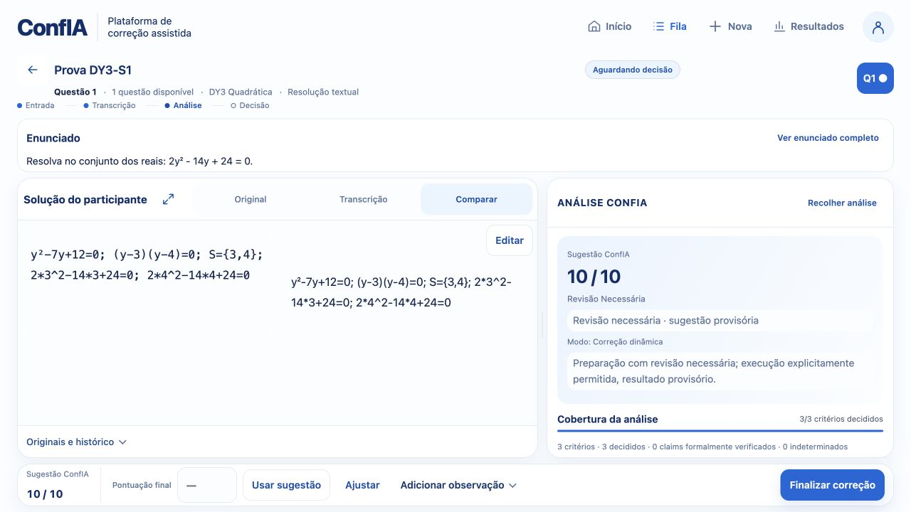

# ConfIA Dynamic — DY3 Grader, implementação 01

## 1. SHA e escopo

Worktree exclusivo: `~/Documents/confia-lean-auditor-dynamic`, branch `feat/dynamic-correction`. HEAD inicial e final: `d1c3485ffa50bb95fd5d27a0082b8bdd21bc804d`; base da linha: `cb1df6e381fd0214092f33afe554ce506da68c78`. Alterações desta entrega permanecem sem stage e sem commit. Não foram consultados ou alterados outros worktrees.

Os [hashes dos arquivos implementados](assets/confia-dynamic-dy3/source-sha256.json) distinguem esta implementação não commitada do HEAD. Os relatórios DY1, DY2 e da convergência UI foram preservados.

## 2. Arquitetura do grader

`DynamicSolutionGrader` recebe a revisão aceita e o contexto aprovado: statement, preparação, rubrica e pacote, com versões e hashes. O fluxo é extração local → binding por critério → verificação exata → suficiência → decisão limitada → soma provisória. Não existe caminho LLM → nota.

Módulos novos: `dynamic/grader.py`, `dynamic/grading_models.py`, `dynamic/grading_context.py` e `submissions/text_source.py`. A v1 é determinística e conservadora: não é um interpretador universal de linguagem matemática. O provider real continua na preparação DY2; o grader não chama LLM. A mesma implementação recebe coeficientes, incógnitas e pontuações diferentes, sem seleção por problem ID.

## 3. Claims e representação da solução

`DynamicStudentSolutionAnalysis` registra transcrição/revisão, hash da fonte, segmentos, claims, estratégia, respostas candidatas, avisos e proveniência. Cada claim preserva texto, offsets `[start,end)`, normalização, tipo, objeto, polaridade, adoção, fidelity, verificador, resultado e componentes.

A segmentação v1 usa linhas e ponto e vírgula. Reconhece conjuntos de raízes, raízes individuais, transformações polinomiais, fórmula quadrática explicitamente substituída e aritmética/substituições. Não inventa desenvolvimento ausente. Dependências de claims ficam vazias quando não são explicitamente estabelecidas: cada checagem implementada se ancora diretamente na equação original. Dependências pedagógicas da rubrica são avaliadas separadamente.

## 4. Reconhecimento de estratégia

Referências candidatas e estratégias alternativas DY2 são usadas somente para classificação diagnóstica: `KNOWN_STRATEGY`, `VALID_ALTERNATIVE_CANDIDATE`, `UNKNOWN_STRATEGY`, `MIXED_INCOMPLETE`. Simplificações que precedem fatoração não tornam, por si sós, a solução incoerente. Conhecer a estratégia não concede pontos. Estratégia desconhecida não produz veto automático.

## 5. Binding com a rubrica aprovada

`RubricBinding` registra criterion ID, claim ID, tipo, evidência, confiança diagnóstica e status. A confiança `EXACT` significa correspondência à política executável, não probabilidade estatística ou confiança de IA.

A linguagem executável de critérios v1 aceita integralmente estas descrições, desconsiderando capitalização, acentos e ponto final:

| Descrição | Obrigação verificada |
| --- | --- |
| Obter todas as raízes reais. / Obter as raízes corretas. / Obter a solução real. | Conjunto completo de soluções reais |
| Justificar a resolução por transformações equivalentes. | Desenvolvimento suficiente e conclusão coerente |
| Justificar a fatoração. | Fatoração efetiva, equivalente, com conclusão completa |
| Simplificar a equação por uma transformação equivalente. | Uma transformação equivalente efetivamente apresentada |
| Verificar as raízes por substituição. | Substituições explícitas na equação original |

Raízes e substituições admitem o complemento **“Crédito parcial proporcional às raízes corretas.”**. Redação diferente, condições adicionais, notas ou orientação docente não vazias ficam `REVIEW_ONLY`. A v1 não elimina condições por reconhecimento de palavras-chave. Uma rubrica livre gerada pelo DY2 pode, portanto, exigir revisão integral; não é silenciosamente convertida em um desses critérios.

## 6. Verificadores disponíveis

Reutiliza os verificadores genéricos DY2 e o parser matemático do próprio worktree. A aritmética usa racionais exatos; transformações usam equivalência polinomial até fator escalar não nulo; raízes são confrontadas com a solução exata da equação original; substituições devem corresponder à expressão original e ao valor alegado. A fórmula quadrática precisa usar os coeficientes efetivos do problema.

O plano de verificadores DY2 é preservado na proveniência. A seleção local registra `EXACT_ARITHMETIC`, `SYMBOLIC_ALGEBRA` e `DETERMINISTIC`, conforme a forma disponível. Não executa Lean, enumeração geral, verificação numérica aproximada nem resíduo semântico. Não chama checkers Specialized por ID. Referências candidatas não são a autoridade matemática: os testes incluem referência controlada divergente para comprovar a independência da checagem do enunciado.

## 7. Fidelity e discurso

Somente `FAITHFUL` e `SUPPORTED_NORMALIZATION`, com adoção clara, podem sustentar automação. Texto não interpretável fica `UNSUPPORTED`/`REVIEW_ONLY`; perguntas e negações explícitas ficam ambíguas; hipóteses permanecem hipotéticas. Prefixos explícitos “Descarto:”, “Abandono:” e “Riscado:” retiram a proposição da evidência adotada sem apagá-la.

Não há resolução semântica geral de correções, hipóteses ou dependências discursivas. Contexto ambíguo retém os critérios para revisão. Condições adicionais no enunciado também bloqueiam automação; não se extrai apenas a equação ignorando uma restrição do problema.

## 8. Automação segura

`AUTO_AWARD` exige binding executável, representação fiel, resultado independente aplicável e suficiência. `AUTO_VETO` exige evidência negativa verificável no critério afetado. `REVIEW_ONLY` recebe zero como **limite inferior provisório**, sem declarar erro matemático. Falha de verificador é `ERROR`, inclusive exceções `ValueError` e `ZeroDivisionError`, e não vira refutação.

Uma identidade correta sem vínculo com o problema não concede pontos. Colocar um polinômio entre parênteses não é considerado fatoração. Modelo e contrato impedem pontuação acima do máximo, decisões duplicadas e score divergente da soma dos critérios.

## 9. Crédito parcial e suficiência

Distingue `COMPLETE`, `PARTIAL`, `NOT_SATISFIED`, `INSUFFICIENT` e `CONFLICT`. Crédito proporcional só existe quando autorizado expressamente no texto do critério. A razão é raízes corretas distintas / raízes reais esperadas, arredondada para baixo a centésimos. Um conjunto incompleto ou com raiz errada é refutado como conjunto completo; seus componentes verificáveis ainda podem sustentar a parcela explicitamente autorizada.

No vertical slice, método vale 4, raízes 3 e substituições 3. “y²−7y+12=0; y=3” recebe 1,5 pelas raízes. A simplificação sozinha não recebe os 4 pontos de um critério que pede justificar a resolução inteira. Uma rubrica que peça somente simplificar tem uma obrigação própria, menos forte.

## 10. Erros, conflitos e follow-through

Erro local afeta os critérios relacionados, preservando créditos independentes. Conclusões adotadas contraditórias não são resolvidas escolhendo silenciosamente a correta. Uma raiz explicitamente descartada não veta uma conclusão adotada correta.

Quando uma dependência pedagógica não está completamente satisfeita, o componente dependente vai para revisão. Essa é a política inicial de follow-through: não concede crédito de continuidade automaticamente, nem aplica segundo veto automático. Crédito de continuidade sem avaliação segura fica para o professor/DY4.

## 11. Método alternativo e resposta final

Fatoração e Bhaskara recebem o mesmo total quando satisfazem a mesma rubrica. Resposta final correta sem desenvolvimento pode satisfazer o critério de raízes, mas não o de justificar a resolução/fatoração. Verificar mais propriedades matemáticas não amplia a exigência pedagógica de um critério menos abrangente.

## 12. AuditRun e persistência compartilhada

A resolução entra como `CorrectionCase`/tentativa e `SubmissionRecord` textual, com original `text-source.v1` imutável. A transcrição usa o histórico e a aceitação já existentes. Não foi criado outro banco ou sistema de submissions.

`AuditSource.dynamic_context` e `AuditRun.engine_mode=DYNAMIC` selam pacote, statement, preparação, rubrica e grader. Reutiliza identidade da execução, replay, hashes de fonte/resultado, manifesto de artefatos e decisão humana. Os campos novos são omitidos de registros antigos quando ausentes, preservando hashes e formas legadas.

Artefatos requeridos: `audit.json`, `analysis.json`, `context.json` e `solution.txt`. O contexto inclui o conteúdo exato do enunciado, rubrica e preparação usados. Alterar a rubrica, enunciado ou preparação bloqueia execução/replay da tentativa antiga e marca a auditoria histórica como stale, sem reescrever seus bytes. Tampering de artefato é rejeitado.

## 13. Orquestração e pré-condições

Roteamento mínimo dentro de `AuditService.execute`: contexto Dynamic aprovado → `DynamicSolutionGrader`; caminhos TME e Specialized existentes continuam seus motores. IDs Dynamic sem contexto selado são rejeitados. Resultado Dynamic incompatível com a fonte é inválido. Um teste instala um motor Specialized que falha caso seja chamado e confirma que a tentativa Dynamic não o utiliza.

Exige preparação vigente, pacote aprovado para o statement atual e última rubrica correspondente. Rascunho mais recente bloqueia correção. Preparação `REVIEW_REQUIRED` exige `allow_preparation_review=true` e mantém revisão no resultado. Autorização deriva do avaliador e da propriedade do problema, nunca de um seletor de motor enviado pelo frontend. Demonstração precisa de configuração Dynamic explícita; texto vazio é rejeitado antes de criar a tentativa.

`POST /dynamic/problems/{id}/attempts` recebe a fonte. A análise é o endpoint compartilhado da transcrição aceita. O antigo `/corrections`, sem essa fonte, responde `409 ACCEPTED_TRANSCRIPTION_REQUIRED`; as duas expectativas DY1/DY2 desse placeholder foram atualizadas. Nenhuma expectativa Specialized foi alterada.

## 14. UI unificada

A preparação aprovada permite receber código pseudônimo e resolução textual; abre o mesmo `/tme?case_id=…`. Mantém **Original | Transcrição | Comparar**, painel ConfIA, critérios, evidências, verificações e decisão do professor. A indicação secundária é “Modo: Correção dinâmica”.

O original textual não usa controles de rotação/OCR. O enunciado exibido corresponde à versão da tentativa. Os claims aparecem no mapa de passos com status exato e offsets, sem fingir destaque de imagem. A fila reconhece “Resolução textual” e mantém sugestão numérica separada de revisão. A nota final continua uma ação humana.



## 15. Eventos e proveniência

Persistidos no trace do resultado dentro do AuditRun compartilhado: `dynamic_grading_started`, `student_claim_extracted`, `rubric_binding_created`, `dynamic_checker_completed`, `dynamic_rubric_decision`, `dynamic_grading_completed`, `dynamic_review_required` quando aplicável.

Cada evento tem identidade derivada da fonte/posição/conteúdo, timestamp e referências de transcrição, pacote, preparação e rubrica. A análise registra versão de extrator, grader, verifier, política, SHA do código e hash do conteúdo Dynamic; `llm_used=false`, `model=null`. Eventos não dependem de um segundo store. `reviewed_components` significa componentes resolvidos pela política automática, não revisão humana independente. A certificação/reprodutibilidade formal legada não é apresentada como certificação Dynamic.

## 16. Testes determinísticos

| Execução | Resultado | Evidência |
| --- | --- | --- |
| DY1 + DY2 + DY3, após ajustes finais | **104 passed** (36 específicos DY3) | [Python Dynamic](assets/confia-dynamic-dy3/python-dynamic.txt) |
| JavaScript completo `node --test tests/js/*.cjs` | **547 passed**, sem falhas | [JavaScript](assets/confia-dynamic-dy3/javascript.txt) |
| Regressão ampla Python | **711 passed, 2 failed** | [Plataforma](assets/confia-dynamic-dy3/python-platform.txt) |
| Contratos compartilhados após ajustes finais | **144 passed, 1 deselected** | [Contratos finais](assets/confia-dynamic-dy3/python-shared-final.txt) |

Os 547 resultados Node incluem os arquivos auxiliares encontrados pelo glob, além dos testes; três testes novos cobrem entrada Dynamic, workspace completo e review. Os 104 testes Python usam providers controlados, sem rede. Cobrem S1–S4, resposta final isolada, fatoração exigida, conflito/retração/ambiguidade, erros do checker, componentes de raízes, condições extras, follow-through conservador, versões, permissões, artefatos, replay, fila, roteamento e decisão humana.

Comandos principais:

```sh
PYTHONPATH=app .venv/bin/python -m pytest tests/test_dynamic_dy1.py tests/test_dynamic_dy2.py tests/test_dynamic_dy3.py -q
node --test tests/js/*.cjs
PYTHONPATH=app .venv/bin/python -m pytest tests/test_submission_audits.py tests/test_teacher_decisions.py tests/test_tme_pilot.py tests/test_tme_home_summary.py tests/test_tme_certification.py -q -k 'not test_real_bridge_preserves_wrong_solution_and_runs_existing_lean_pipeline'
```

A regressão ampla incluiu, adicionalmente: assessments, submissions, transcriptions, submissions UI, reproducibility, TME photo errors/demo auth/navigation/problem catalog/accepted integration/audit view/full exam/question audit/review workspace/human confirmation/reanalysis/finalization/synthetic demo, pauta engine e core auth. A exclusão da última rodada compartilhada é somente o teste Lean já executado e falho na rodada ampla; não foi removido ou alterado.

## 17. Cenários no navegador e provider real

Servidor em `127.0.0.1:8769`; runtime exclusivo `runtime/dy3-browser`. Dois problemas preparados por provider real OpenAI, separados da suíte determinística. Rubricas fornecidas e aprovadas como demonstração técnica. As preparações ficaram `REVIEW_REQUIRED`; prosseguir exigiu consentimento explícito. Os avisos DY2, inclusive uma inferência de domínio desnecessária, permaneceram visíveis.

S1 foi recebido pelo formulário da preparação e analisado pelo navegador. S2–S4, ambíguo e linear foram recebidos pela mesma API e analisados pelo botão do workspace. As seis telas foram reabertas e conferidas, seguidas da fila com seis registros. Após o ajuste final de status de critérios com peso zero, o servidor foi reiniciado e os seis resultados foram novamente confirmados pela API compartilhada, sem mudança nos valores ou estados apresentados nas capturas.

| Caso | Resolução | Sugestão | Evidência |
| --- | --- | --- | --- |
| S1 | Fatoração, raízes 3 e 4, substituições explícitas | 10/10 | [Tela](assets/confia-dynamic-dy3/s1.png) |
| S2 | Bhaskara com coeficientes substituídos e verificações | 10/10 | [Tela](assets/confia-dynamic-dy3/s2.png) |
| S3 | Simplifica e apresenta somente y=3 | 1,5/10 | [Tela](assets/confia-dynamic-dy3/s3.png) |
| S4 | y=9 | 0/10, veto no critério de raízes | [Tela](assets/confia-dynamic-dy3/s4.png) |
| Ambíguo | S={3,4}; não tenho certeza | 0 provisório, REVIEW_ONLY | [Tela](assets/confia-dynamic-dy3/review.png) |
| Linear | 3z+6=0; transformação, z=−2 e substituição | 10/10 | [Tela](assets/confia-dynamic-dy3/linear.png) |

Todos mantêm `review_required=true` nesta prova real pelo estado da preparação; isso não zera créditos sustentados. Nos testes com preparação sem avisos, resultados completos não precisam dessa revisão adicional. [Auditorias públicas completas](assets/confia-dynamic-dy3/browser-audits.json) e [preparações reais](assets/confia-dynamic-dy3/provider-preparations.json). Nenhuma credencial foi copiada para evidências. O servidor foi encerrado ao final.

## 18. Regressão e falhas conhecidas

Duas falhas formais continuam presentes:

- `test_submission_audits.py::test_real_bridge_preserves_wrong_solution_and_runs_existing_lean_pipeline`;
- `test_tme_accepted_integration.py::test_real_local_lean_status_certificates_preserved`.

A execução atual registra `technical_error` e erro de checkout Mathlib na revisão `8f9d9cff6bd728b17a24e163c9402775d9e6a365`, seguido de `external command 'git' exited with code 1`. [Diagnóstico atual](assets/confia-dynamic-dy3/formal-failure-evidence.json). Coincidem com as falhas registradas em DY2/convergência UI. Não foi alterado Lean, gold, expected score ou expectation Specialized para ocultá-las.

Na primeira rodada também houve falha da fila textual, corrigida, e um 409 isolado em `test_observed_rubric_gold_partial_labels`. Este último passou isoladamente e nas duas execuções subsequentes que o abrangem; a causa transitória não foi estabelecida. [Log inicial](assets/confia-dynamic-dy3/python-initial-diagnostic.txt), [reexecução isolada](assets/confia-dynamic-dy3/python-cert-isolated.txt). O caso de critério satisfeito com peso zero recebeu ainda um teste específico: zero pontos não é refutação matemática. Não se declara toda a suíte Python verde.

## 19. Limitações assumidas

- Entrada Dynamic desta etapa: texto. Captura manuscrita/OCR Dynamic e agrupamento de várias questões não foram adicionados.
- Matemática automatizada: uma equação linear ou quadrática univariada, coeficientes e raízes racionais, domínio real explícito e enunciado sem condições adicionais. Raízes irracionais, ausência de raízes reais, sistemas e problemas gerais seguem para revisão.
- Rubricas livres não têm interpretação semântica geral: somente as obrigações completas enumeradas na seção 5 são executáveis. Notas/condições extras não são ignoradas.
- Prosa livre, elipses, inferência de dependências, mudanças de hipótese e correções implícitas não são resolvidas universalmente. A extração v1 não usa LLM; a expansão desse alcance exigirá outro extrator com os mesmos gates de fidelity.
- Follow-through automático não foi implementado: dependências não resolvidas ficam para revisão, conforme a política inicial permitida no escopo.
- Estratégia é uma classificação diagnóstica; completude e suficiência vêm dos checkers e da política pedagógica suportada.
- Não há Independent Reviewer, reconciliação, segunda IA, certificação experimental Dynamic, comparação Dynamic com gold ou prova Lean Dynamic.
- O indicador legado de reprodutibilidade não vira certificação: a proveniência específica está nos artefatos Dynamic e nos hashes do AuditRun.

## 20. Prontidão para DY4

A primeira versão conservadora entrega o vertical slice, um segundo problema, gates de revisão e a infraestrutura compartilhada. DY4 pode receber solução aceita, contexto aprovado completo, claims e spans, bindings, resultados/componentes dos verificadores, decisões provisórias, avisos e eventos; não receberá apenas um score.

A prontidão refere-se a essa superfície auditável, dentro do escopo declarado. Não significa correção automática geral de qualquer enunciado ou rubrica. Revisão independente e reconciliação permanecem fora desta entrega.

**READY_FOR_DYNAMIC_DY4**
