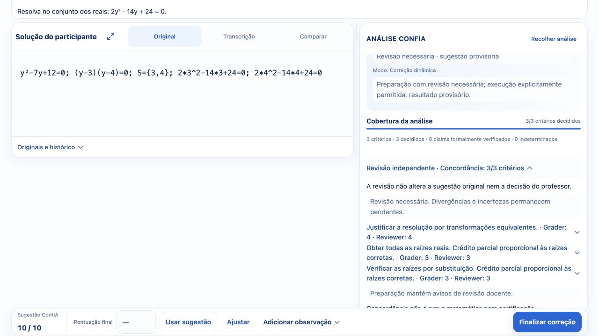
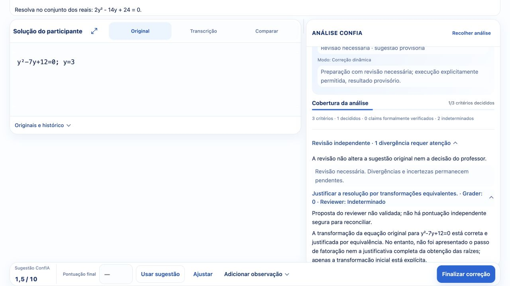
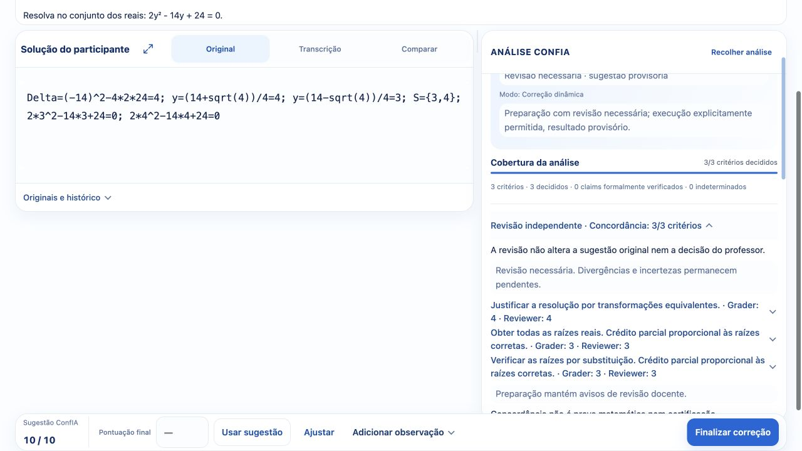

# ConfIA Dynamic — DY4 Independent Reviewer — implementação 01

Data: 12/11/2026. Escopo: revisão independente associada à correção provisória DY3, sem reconciliação e sem nota final automática.

## 1. SHA e isolamento

- Worktree exclusivo: `~/Documents/confia-lean-auditor-dynamic`.
- Branch: `feat/dynamic-correction`.
- HEAD de partida e entrega: `b122bcf1b144dbd1873446faf0d34c6f95937cf4` — Implement ConfIA Dynamic solution grader.
- Base histórica da linha: `cb1df6e381fd0214092f33afe554ce506da68c78`.
- Alterações não commitadas; nenhum `git add` ou commit executado. Nenhuma dependência dos worktrees dezembro/P3.
- [Hashes dos arquivos implementados](assets/confia-dynamic-dy4/source-hashes.json) e [estado Git](assets/confia-dynamic-dy4/git-status.txt) identificam a implementação além do HEAD.

## 2. Arquitetura do reviewer

Cinco módulos novos no pacote Dynamic:

| Módulo | Responsabilidade |
|---|---|
| `review_models.py` | Proposta cega, avaliação por critério, comparação e registro associado |
| `review_provider.py` | Provider independente, opt-in, prompt/schema e provenance |
| `reviewer.py` | Fase A: inventário próprio, validação de claims e cobertura da rubrica |
| `review_comparison.py` | Fase B: comparação determinística após concluir A |
| `review_service.py` | Integridade, versões, idempotência, persistência e eventos |

`IndependentDynamicReviewer.analyze(payload, equation, claims, rubric)` não recebe resultado ou AuditRun do grader. Só depois de finalizar a Fase A o serviço chama `compare_review(run.result, phase, rubric, solution)`.

Rotas GET/POST: `/dynamic/attempts/{case_id}/audits/{run_id}/independent-reviews`. Reutilizam autenticação do avaliador, autorização Dynamic/demo e propriedade do caso. Respostas usam `no-store`.

## 3. Política de independência

A entrada é uma allowlist: enunciado versionado, rubrica APPROVED, preparação, transcrição aceita, contexto, hashes e evidência matemática extraída novamente da fonte. Não contém nota total, decisões, bindings ou suficiência do grader. O teste percorre recursivamente a entrada para verificar essa separação.

O provider recebe uma cópia da entrada; não pode alterar o snapshot persistido. A interpretação e seleção de evidência são próprias. A matemática e a linguagem limitada das obrigações reutilizam funções genéricas de DY3: existe risco de erro comum de parser/política, e não se afirma independência de dois verificadores formais distintos.

As verificações exatas locais são refeitas uma vez por claim e reutilizadas entre critérios. Justificativa: DY3 ainda não oferece recibos independentes de checker ligados à proposição que permitam confiar no resultado sem confiar também na representação/fidelity do grader. Essa política fica no snapshot. Não há reexecução de Lean pelo reviewer.

## 4. Revisão por critério

Cada opinião registra ID, máximo, proposta do provider, proposta validada ou `null`, assessment, sufficiency, claims, evidência textual, referências de checker, explicação e incertezas. Propostas acima do máximo invalidam a geração. IDs ausentes/duplicados, referências inválidas e provenance incoerente são recusados.

A proposta validada precisa corresponder à cobertura verificável da obrigação aprovada. Valor sem sustentação, inclusive desconto/percentual inventado, vira `null` e revisão necessária; o valor bruto do provider permanece auditável. Isso ocorre antes de ler o grader e não é reconciliação DY5. `null` não equivale a zero.

Estados de opinião incluem `SATISFIED`, `PARTIALLY_SATISFIED`, `NOT_SATISFIED` e `REVIEW_REQUIRED`. Concordância/divergência pertence somente à comparação posterior.

## 5. Claims e fidelidade

O inventário próprio usa namespace `review_claim_*`. Claims extras `extra_*` são registradas separadamente das claims extraídas e das propostas rejeitadas. Exigem offsets Unicode e quote exatos, contexto adotado e representação suportada.

Não se admite recortar uma igualdade de hipótese, negação ou retratação para apresentá-la como afirmação adotada. Conectivos locais suportados incluem `Logo,`, `Portanto,`, `Assim,` e `Concluo:`. Contexto ambíguo ou conclusões conflitantes impedem crédito independente seguro. Não há importação de mecanismos específicos P3.

## 6. Estratégias alternativas

Fatoração e fórmula quadrática são reconhecidas por evidência local e objetivos da rubrica. Aritmética auxiliar e raízes podem acompanhar uma justificativa, mas não substituem seu desenvolvimento. Resultado final isolado não satisfaz critério de justificativa.

O ensaio real inicial revelou um desconto inadequado: o modelo exigiu nomes dos coeficientes/explicação adicional da fórmula em S2. A nota original permaneceu 10. A validação foi reforçada para deixar descontos não sustentados indeterminados, e o prompt `dynamic-dy4-blind.v2` explicita que não se inventam obrigações. Um teste controlado reproduz a falha. Na execução final, S2 concordou em 3/3 critérios. [Ensaio inicial](assets/confia-dynamic-dy4/real-reviews-initial.json), [ensaio final](assets/confia-dynamic-dy4/real-reviews-final.json).

## 7. Falso crédito

`FALSE_CREDIT_SUSPECTED` identifica pontos do grader acima da proposta independente validada ou crédito integral incompatível com evidência local refutada. O motivo e critério ficam registrados. Testes incluem resultado correto sem justificativa, desenvolvimento refutado e binding/representação incompatíveis. Discordância de uma proposta bruta ainda não validada é tratada como suficiência, sem acusar automaticamente falso crédito.

## 8. Crédito legítimo perdido e follow-through

`MISSED_CREDIT_SUSPECTED` requer proposta independente validada acima do grader. Estratégia alternativa, equivalências, claims omitidas e crédito proporcional explicitamente permitido são exercitados. S4 não produz missed credit falso.

Dependências ou follow-through sem regra/evidência suficiente permanecem indeterminados. Não foi criada uma regra geral para transportar crédito após erro anterior. Critérios independentes, como raízes verificadas, podem manter sua análise própria sem veto duplicado.

## 9. Comparação estruturada

`DynamicReviewComparison` contém linhas com pontos/status de ambos, agreement, difference, disagreement_types, evidence_overlap, reason e review_required. Globalmente registra exact_agreement, agreement_count, total_point_difference, conflicting_criteria e status.

Diferença só existe com proposta independente validada; total é `null` se algum critério não possui diferença segura. Igualdade numérica com incerteza vira `UNRESOLVED`, não concordância. `AGREEMENT` não é prova matemática ou certificação. Avisos da preparação podem manter revisão necessária mesmo com concordância 3/3.

## 10. Tipos de divergência

São emitidos `FALSE_CREDIT_SUSPECTED`, `MISSED_CREDIT_SUSPECTED`, `STRATEGY_DISAGREEMENT`, `SUFFICIENCY_DISAGREEMENT`, `MATHEMATICAL_DISAGREEMENT` e `BINDING_DISAGREEMENT`. Tipos podem coexistir no mesmo critério. O sistema não escolhe automaticamente a maior ou menor nota.

Representação, trecho-fonte, tipo de claim, obrigação e resultado matemático são comparados; um checker verdadeiro sobre uma representação diferente não basta para justificar crédito.

## 11. Persistência e versões

`DynamicIndependentReview` é um artefato associado imutável em `audits/independent_reviews/drev_*.json`, envelope com digest. Liga review ao AuditRun exato, hash do resultado/fonte, question attempt, transcription version e contexto com versões de problema/rubrica/preparação.

Reutiliza locks, validação de artefatos, publicação atômica e hashes da infraestrutura compartilhada. Caminhos simbólicos são recusados. Execution key fornece replay idempotente. Snapshot da entrada e do contexto permite auditoria histórica; leitura valida vínculos e integridade.

Nova revisão exige auditoria Dynamic concluída e atual. Mudança de transcrição, rubrica, preparação ou fonte durante o provider impede publicação. Histórico pode ser lido como stale. Falha do provider persiste `FAILED`, código seguro e review_required, sem fabricar comparação/concordância.

AuditRun original, score principal, HumanDecision e FinalCorrection não são alterados. Os seis AuditRuns do ensaio real tiveram seus bytes preservados: [hashes anteriores](assets/confia-dynamic-dy4/preserved-audits.json) e [verificação posterior](assets/confia-dynamic-dy4/integrity-check.json).

## 12. Provider e provenance

Configuração separável: `CONFIA_DYNAMIC_REVIEWER_ENABLED=1`, `OPENAI_API_KEY`, `CONFIA_DYNAMIC_REVIEWER_MODEL` (default `gpt-4.1`) e `CONFIA_DYNAMIC_REVIEWER_REASONING_EFFORT` opcional. A suíte principal usa provider controlado e não depende de API.

O adapter real usa Responses com schema estrito, `store=False`, limite 10.000 tokens, timeout 90 s e sem retry automático. Provenance registra provider, modelo solicitado/retornado, esforço, prompt/schema, response ID, timestamps, hashes de input/output, resposta bruta, HEAD e hash de conteúdo dos módulos Dynamic. O hash identifica conteúdo; não constitui assinatura digital.

Ensaio final: `gpt-4.1-2025-04-14`, prompt `dynamic-dy4-blind.v2`, seis soluções sintéticas. Não houve envio de dados reais de estudantes. Falhas de geração preservam metadados quando disponíveis; falhas anteriores à resposta podem não ter response ID/modelo retornado.

## 13. UI compartilhada

Adicionado somente painel expansível “Revisão independente” ao workspace `/tme`. Mostra concordância, divergências, pares de pontos e motivos por critério, avisos, falha/stale e ação explícita de solicitar revisão. A solicitação bloqueia repetição enquanto em andamento. Falha de carregamento é visível.

A sugestão principal e a área de decisão docente permanecem separadas. `review_required` é publicado no envelope da revisão e no painel; não reescreve status/score do AuditRun nem introduz política nova na fila. Specialized não solicita nem apresenta reviewer Dynamic.

Validação visual real: S1 3/3 e 10/10; S2 Bhaskara 3/3 e 10/10; S3 divergência de suficiência com proposta indeterminada e sugestão original 1,5/10. Original, Transcrição, Comparar e retorno à Fila funcionaram. Servidor local de validação encerrado ao concluir.







## 14. Eventos

O registro associado contém `independent_review_started`, `independent_review_completed`, `reviewer_claim_added`, `grader_reviewer_agreement`, `grader_reviewer_disagreement`, `possible_false_credit_detected` e `possible_missed_credit_detected` quando aplicáveis. Incerteza usa `independent_review_uncertain`.

Eventos possuem ID, timestamp e referências a revisão, AuditRun, tentativa e transcrição. São publicados com o artefato usando a infraestrutura compartilhada, sem modificar eventos do AuditRun original e sem novo event store paralelo.

## 15. Testes

| Execução | Resultado |
|---|---|
| DY1–DY4, após os ajustes finais | **138 passed** (34 casos DY4) |
| Suíte JavaScript completa `tests/js/*.cjs` | **552 passed**, zero falhas |
| Regressão ampla Python | **739 passed, 2 failed** ambientais descritas na seção 18 |
| Provider real final | **6 revisões COMPLETED**; AuditRuns preservados |
| `git diff --check` | Sem erros |

[Log Dynamic](assets/confia-dynamic-dy4/dynamic-final.txt), [log JS](assets/confia-dynamic-dy4/javascript.txt), [log regressão](assets/confia-dynamic-dy4/platform.txt), [resumo real](assets/confia-dynamic-dy4/real-final.txt).

```sh
PYTHONPATH=app .venv/bin/python -m pytest tests/test_dynamic_dy1.py tests/test_dynamic_dy2.py tests/test_dynamic_dy3.py tests/test_dynamic_dy4.py -q
node --test tests/js/*.cjs
```

DY4 cobre independência da entrada, concordância, falso/perdido crédito, alternativa, parcial, matemática, binding, inconclusivo, provenance, falha, persistência, adulteração, replay, versões, mudança durante provider, transcrição stale, autorização/proprietário e isolamento Specialized. Os cinco testes JS novos cobrem apresentação, detalhes, requisição/busy, falha/retry, navegação e ausência de reviewer no Specialized.

## 16. Casos adversariais

| Ataque controlado | Evidência esperada/observada |
|---|---|
| Grader dá crédito integral a resposta final sem justificativa | False credit no critério de método |
| Grader perde crédito de Bhaskara válido | Missed credit e divergência de estratégia |
| Claim de raiz ligada a método | Binding disagreement mesmo com pontos iguais |
| Checker/status representa proposição diferente | Binding/mathematical disagreement |
| Provider inventa argumento ou pontos sem evidência | Proposta independente indeterminada |
| Provider inventa desconto de 50% para alternativa completa | Desconto não validado; revisão necessária |
| Claim adicional recorta hipótese, negação ou retratação | Claim recusada |
| Provider altera transcrição durante execução | Publicação rejeitada |

DY3 é determinístico e não possui provider de pontuação para injetar. Em vez de introduzir um LLM no grader, testes usam um test double controlado do grader. Dois testes integrados persistem os resultados adversariais e seus artefatos coerentes, executam reviewer e verificam eventos de falso/perdido crédito e bytes originais intactos. Outros testes comparam bindings/status adulterados diretamente.

## 17. Vertical slice e segundo domínio

Resultados finais do provider real (ordem: método, raízes, substituição):

| Caso | Sugestão DY3 preservada | Pontos independentes validados | Comparação |
|---|---:|---|---|
| S1 fatoração correta | 10/10 | 4; 3; 3 | AGREEMENT, 3/3 |
| S2 Bhaskara correta | 10/10 | 4; 3; 3 | AGREEMENT, 3/3 |
| S3 parcial | 1,5/10 | null; 1,5; 0 | DISAGREEMENT de suficiência; demais pendências explícitas |
| S4 incorreta | 0/10 | null; 0; null | INCONCLUSIVE, 1/3; sem missed credit falso |
| S5 ambígua (DY3-REVIEW) | 0/10 | null; null; null | DISAGREEMENT de suficiência; revisão necessária |
| Equação linear | 10/10 | 4; 3; 3 | AGREEMENT, 3/3 |

A preparação desses casos conserva avisos docentes, por isso o review_required global continua verdadeiro inclusive em S1/S2/linear. Na execução real S3, igualdade de pontos de raiz não virou agreement porque houve incerteza do provider. Isso evita inflar a taxa de concordância. Os fixtures controlados também cobrem parcial proporcional e equação linear, independentemente da API.

## 18. Regressões

A seleção ampla exercitou DY1–DY4, assessments, submissions/transcrições, decisões docentes, audits, UI convergence/navegação/workspace, D1–D7, correction engine/pauta, TME, autorização, reprodução, certificação, finalização e demonstração sintética. Não foram alteradas expectativas Specialized.

As duas falhas são:

- `test_submission_audits.py::test_real_bridge_preserves_wrong_solution_and_runs_existing_lean_pipeline`;
- `test_tme_accepted_integration.py::test_real_local_lean_status_certificates_preserved`.

O checker retorna `technical_error`: checkout de Mathlib na revisão `8f9d9cff6bd728b17a24e163c9402775d9e6a365` falha com `external command 'git' exited with code 1`. [Evidência atual](assets/confia-dynamic-dy4/formal-failure-evidence.json). Mesmo impedimento documentado em DY3; não foi mascarado alterando checker/gold/expectations. Portanto a regressão ampla não está inteiramente verde.

A regressão ampla foi executada antes das últimas dez adições de testes DY4 e do reforço de validação de propostas. Os 138 testes Dynamic foram executados novamente após esses ajustes; os arquivos de plataforma/motor Specialized continuaram intactos. Os números das execuções sobrepostas não devem ser somados como testes únicos.

## 19. Limitações

- Escopo verificável ainda é a gramática conservadora de equações lineares/quadráticas reais com valores suportados e obrigações conhecidas. Não é um reviewer geral de provas matemáticas.
- Parser e semântica local de obrigações são compartilhados com DY3: análise cega reduz ancoragem, mas não elimina falhas comuns.
- Linguagem discursiva, rubricas livres, follow-through complexo e estratégias fora do verificador exigem revisão humana.
- Concordância não certifica correção. O ensaio real é pequeno, sintético e não constitui gold benchmark ou avaliação estatística.
- Eventos são duráveis no artefato associado; não existe transação de eventos de início separada para recuperar chamadas interrompidas por queda de processo.
- Revisão necessária é exposta no artefato/painel. Políticas de reconciliação, agregação de fila, lista/prova e score final ficam para DY5+.
- Persistência local usa digests e operações atômicas, não assinatura contra administrador capaz de reescrever todos os arquivos.
- A validação formal Specialized continua limitada pelo ambiente Mathlib descrito acima.

## 20. Prontidão DY5

O contrato entrega `grader_audit_run_id`, `review`, `stale`, `review_required` e `reconciliation: null`. Fase A e comparação permanecem disponíveis separadamente, com fontes, versões, provenance, propostas validadas/indeterminadas e divergências por critério.

DY5 pode consumir esses artefatos para definir políticas explícitas de reconciliação, preservando a decisão docente. DY4 não implementou reconciliação automática, nota reconciliada, certification experiment ou gold benchmark. A prontidão é para essa próxima etapa dentro do escopo conservador demonstrado, com as duas limitações ambientais de regressão registradas.

READY_FOR_DYNAMIC_DY5
