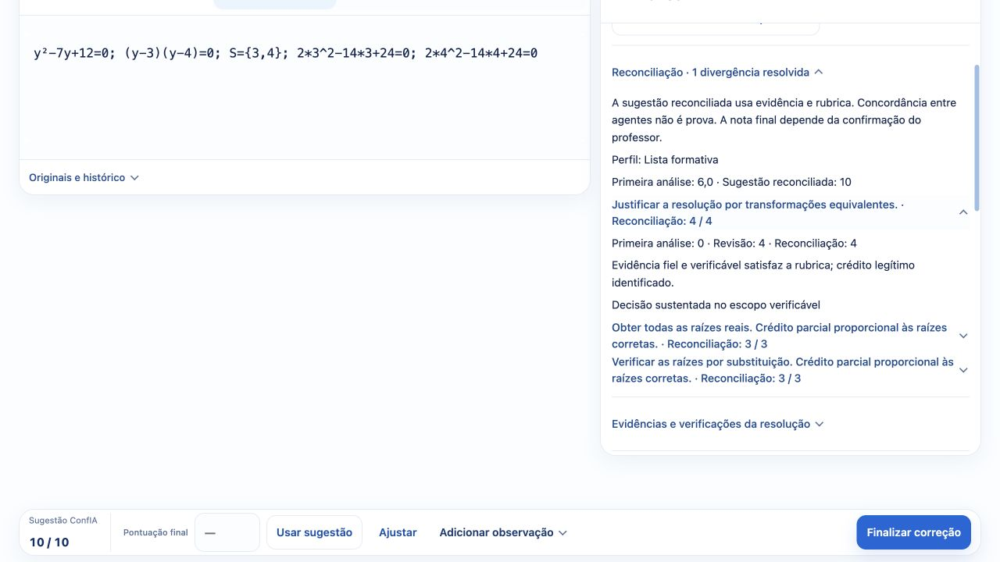
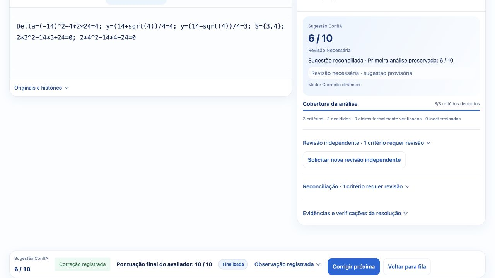

# ConfIA Dynamic — DY5 Reconciliation — implementação 01

Data: 12/11/2026. Implementação da sugestão reconciliada, com política explícita por atividade e confirmação docente rastreável. A autorização explícita para o DY5 completo substituiu a restrição da tarefa anterior; não há aprovação pendente.

## 1. SHA

- Worktree exclusivo: `/Users/LinMarcolino/Documents/confia-lean-auditor-dynamic`.
- Branch: `feat/dynamic-correction`.
- HEAD anterior e mantido: `d9538355c0a854e5a0b24edb5706ed80c43bf4be`.
- Base histórica solicitada: `cb1df6e381fd0214092f33afe554ce506da68c78`.
- Alterações não commitadas; nenhum `git add` ou commit. Nenhum worktree dezembro/P3 foi utilizado.
- O HEAD sozinho não identifica esta implementação: os hashes dos arquivos alterados estão no manifesto de evidências.

## 2. Arquitetura de reconciliação

Quatro módulos novos em `app/confia_lean_auditor/dynamic/`:

| Módulo | Responsabilidade |
|---|---|
| `reconciliation_models.py` | Contratos versionados, invariantes numéricas, estados e política |
| `reconciliation.py` | Decisão determinística por critério, com verificação nova sobre a fonte |
| `reconciliation_service.py` | Assessment explícita, seleção corrente, persistência, integridade e eventos |
| `human_decisions.py` | Referência reconciliada no contrato de decisão compartilhado e histórico imutável |

Fluxo: AuditRun original → IndependentDynamicReview → DynamicReconciliation → confirmação do avaliador. Não há novo grader, chamada de LLM na reconciliação, média de notas ou escolha sistemática da maior/menor pontuação.

A reconciliação reextrai evidências da transcrição e revalida claims adicionais do reviewer. A pontuação proposta pelo reviewer precisa coincidir com a cobertura calculada localmente, respeitar fonte, adoção discursiva, dependências e obrigação aprovada. A comparação DY4 auxilia a identificar divergências; não substitui esses gates.

## 3. Hierarquia de autoridade

1. **O que foi escrito:** offsets, source spans, fidelity, adoção e vínculo dos claims.
2. **Verdade matemática:** verificações locais exatas dentro do domínio suportado, incluindo refutações. Não se trata de certificação formal Lean.
3. **Crédito:** RubricVersion aprovada, obrigação do critério, suficiência e crédito parcial explicitamente permitido.
4. **Grader/reviewer:** interpretações e propostas, nunca prova por concordância.

Confiança do modelo não decide automação. Resultado correto isolado não supre método exigido. Erro técnico não vira refutação.

## 4. Estados por critério

| Estado | Significado operacional |
|---|---|
| AGREEMENT_SUPPORTED | Pontos iguais com todos os gates de evidência satisfeitos |
| AGREEMENT_UNVERIFIED | Igualdade sem base suficiente para automatizar |
| CHECKER_RESOLVED | Divergência interpretativa resolvida com verificação, vínculo e suficiência |
| GRADER_FALSE_CREDIT_CONFIRMED | Evidência não sustenta os pontos originais |
| GRADER_MISSED_CREDIT_CONFIRMED | Evidência legítima sustenta crédito perdido |
| SUFFICIENCY_DISAGREEMENT | Verdade matemática não satisfaz a obrigação pedagógica |
| STRATEGY_DISAGREEMENT | Divergência estratégica ainda não resolvida |
| MATHEMATICAL_CONFLICT | Conclusões adotadas incompatíveis ou consenso contradito pela evidência |
| INSUFFICIENT_EVIDENCE | Evidência/vínculo/cobertura insuficiente |
| TECHNICAL_ERROR | Falha técnica mantém revisão e os pontos provisórios |
| REVIEW_REQUIRED | Outra interpretação relevante não resolvida |

Os testes determinísticos exercitam os onze estados. O estado descreve a evidência; a decisão de automação é separada. Por exemplo, crédito perdido pode estar confirmado matematicamente e continuar REVIEW_ONLY no perfil de prova.

## 5. Política de automação

`dynamic-safe-automation.v1` admite AUTO_ACCEPT, AUTO_ADJUST_UP, AUTO_ADJUST_DOWN e REVIEW_ONLY. Ajustes exigem simultaneamente evidência fiel/adotada, referência sem ambiguidade, checker verificável ou refutação válida, cobertura explícita da obrigação, proposta independente compatível, dependências resolvidas e ausência de incerteza material.

Claims não verificados na fonte e claims adicionais rejeitados impedem automação. Um claim adicional revalidado pode cobrir o trecho antes não suportado; isso não libera outros trechos incertos. Alertas globais de preparação/revisão permanecem no resultado e podem exigir revisão mesmo quando alguns critérios são automatizáveis.

## 6. Lista versus prova

O mesmo núcleo serve aos dois perfis:

| Perfil | Divergência material com evidência suficiente |
|---|---|
| FORMATIVE_LIST | Pode ajustar para cima ou para baixo |
| SCHOOL_EXAM | Mantém pontos originais e exige homologação |

Divergência material inclui diferença de pontos, divergências classificadas na comparação ou revisão pendente do grader. Acordo sustentado pode ser AUTO_ACCEPT em ambos.

O formulário envia o perfil explicitamente; o padrão visível é Prova escolar. A configuração cria uma Assessment publicada de um item, com `dynamic_policy_profile` e `dynamic_policy_version` incluídos no hash da definição. O título não escolhe o perfil. Um vínculo selado associa Assessment e tentativa. Perfil publicado é imutável; mudar a política exige outra atividade.

Tentativas DY3 sem configuração continuam compatíveis na API legada. A UI atual oferece configuração explícita e exige reconciliação; somente a cadeia configurada é considerada DY5 completa.

## 7. Tratamento de pontuação

São preservados separadamente `grader_score_snapshot`, `reviewer_score_snapshot`, `reconciled_suggested_score` e pontuação final humana. O total reconciliado é sempre numérico e corresponde à soma dos critérios.

REVIEW_ONLY mantém exatamente os pontos provisórios do grader naquele critério. Isso não certifica esses pontos nem cria veto; o resultado informa revisão necessária. O snapshot do reviewer pode ser ausente quando sua própria avaliação não fornece total determinável; a sugestão ConfIA não usa `None` como abstenção geral.

A fila mostra a sugestão, enquanto o workspace distingue a nota final docente. A projeção da fila é descartável e reconstruível, nunca autoridade de correção.

## 8. Falso crédito

Claim `y=9` na quadrática preparada é refutada. Com grader controlado atribuindo 3 pontos às raízes e reviewer propondo 0, o perfil formativo remove esses 3 pontos e registra `points_removed=3`. Método e verificação independentes não recebem um veto genérico: continuam com seus próprios estados. No perfil escolar, esses 3 pontos ficam provisórios, exigindo revisão.

## 9. Crédito perdido

Com método correto e grader controlado atribuindo 0/4 ao método, a reconciliação formativa recupera 4 pontos e mantém os outros critérios: total 6→10. `recovered_credit=4` registra o delta efetivamente aplicado. No perfil escolar, identifica-se o crédito legítimo, mas a sugestão permanece 6 e o delta automático é zero.

## 10. Estratégias alternativas

O caso por fórmula quadrática foi confrontado com as obrigações da rubrica e suas verificações locais, sem exigir identidade com a fatoração de referência. Claims adicionais passam por nova validação de offsets, fonte e adoção. Estratégia não verificável fica em revisão.

Follow-through não é concedido por uma regra geral. Dependências não resolvidas bloqueiam automação do critério dependente; créditos independentes permanecem. A implementação é conservadora e não cria um avaliador genérico de raciocínio sob hipóteses erradas.

## 11. Suficiência

O cenário `S={3,4}` possui resultado verdadeiro, mas não apresenta a justificativa exigida pelo critério de método. Mesmo com propostas controladas de crédito integral, a reconciliação marca SUFFICIENCY_DISAGREEMENT e mantém pontos provisórios sob revisão. O critério de raízes pode ser sustentado independentemente.

O teste de consenso incorreto usa fonte realmente refutada e opinião controlada incorreta: a concordância não supera o checker. Há também teste separado de cobertura local incompatível com as duas propostas.

## 12. REVIEW_ONLY

Cobertura negativa inclui: indisponibilidade e erro de checker, ambiguidade discursiva, contradição não resolvida, ausência de vínculo, rubrica não suportada, suficiência incompleta, estratégia incerta e dependência não resolvida. Nenhum desses casos cria crédito ou remove automaticamente pontos por ausência de prova.

O professor pode aceitar a sugestão provisória ou ajustá-la. Diferença entre nota final e sugestão reconciliada exige justificativa; confirmar sem alteração é uma decisão docente explícita, inclusive quando há alertas.

## 13. Persistência e versionamento

`dynamic-reconciliation.v1` é publicado como arquivo novo em `audits/reconciliations/drec_*.json`. O ID deriva de hashes do AuditRun, revisão, atividade e versões. O registro inclui contexto completo de pacote/enunciado/preparação/rubrica, transcrição, política, Assessment, pontos, critérios, razões, horários e provenance. Repetir a mesma seleção devolve o mesmo artefato.

A leitura verifica schema, digest, identidade e vínculos. Auditoria/revisão/transcrição/rubrica originais não são sobrescritas. A confirmação também usa cadeia selada append-only. O ensaio de navegador verificou **12/12 arquivos originais inalterados**: seis AuditRuns e seis IndependentDynamicReviews, incluindo suas comparações. Ver [checagem de integridade](assets/confia-dynamic-dy5/immutability-check.json).

Nova transcrição ou contexto torna a cadeia anterior stale. Novo AuditRun, inclusive falho, exige nova revisão e reconciliação. Nova revisão invalida reconciliação e confirmação anteriores. Histórico permanece consultável. Repetições idempotentes preservam a confirmação corrente.

Rotas de revisão, reconciliação e decisão usam o lock compartilhado da questão; publicação revalida fonte/auditoria sob o lock de submissões. Teste de alteração da transcrição durante a reconciliação impede a publicação desatualizada.

## 14. Integração da decisão humana

A auditoria dos contratos identificou duas estruturas reais: Dynamic individual usa CorrectionCase/EvaluatorDecision; HumanDecision D1–D7 da prova completa requer ExamSubmission/QuestionAttempt. Não foi inventado esse envelope para uma atividade textual individual.

Foi adotada a opção permitida de **estender a referência da sugestão com `reconciliation_id`**, mantendo o AuditRun original. A rota existente `/tme/cases/{id}/decision`, o contrato EvaluatorDecision, o lock de questão e a gravação atômica compartilhada são reutilizados. A decisão armazena ID/hash da reconciliação, revisão independente, versão da transcrição, pontos originais do grader, sugestão reconciliada, nota final, justificativa, autor, horário e snapshot dos alertas.

O histórico específico Dynamic mantém sequência e hash anterior. A confirmação só aceita reconciliação corrente; falta de referência, seleção antiga, máximo divergente ou ajuste sem justificativa são rejeitados. Não há integração alegada com FinalCorrection de prova multiquestão. Os contratos e expectativas Specialized D1–D7 foram preservados.

## 15. UI no workspace

Sem nova tela. O painel unificado apresenta sugestão reconciliada, primeira análise preservada, resumo da revisão e detalhe expansível por critério. Permanecem Original, Transcrição, Comparar, navegação e controles de aceitar/ajustar/justificar/finalizar.

Os detalhes mostram pontos do grader, reviewer e reconciliação, ação e razão. A confirmação fica indisponível antes de uma reconciliação corrente. Histórico informa confirmações invalidadas. Falha ao carregar a cadeia bloqueia confirmação; não usa um valor antigo silenciosamente.

## 16. Eventos

O artefato registra `dynamic_reconciliation_started`, `criterion_auto_accepted`, `criterion_auto_adjusted_up`, `criterion_auto_adjusted_down`, `criterion_review_only`, `dynamic_reconciliation_completed`, `reconciled_score_changed` e `reconciliation_review_required`, conforme o resultado.

Eventos incluem ID estável, horário, reconciliação, auditoria, revisão, tentativa e, quando aplicável, critério/pontos/motivo. São publicados com o artefato completo; não há promessa de journal durável de uma execução abortada antes da publicação.

## 17. Testes determinísticos e JavaScript

- **42 casos DY5**: onze estados, dois perfis, ajustes, consenso errado, erro técnico, estratégia alternativa, suficiência, dependências, isolamento de critérios, versões, invalidation, replay, integridade, concorrência de fonte, Assessment, confirmação, projeção/reconstrução da fila e autorização.
- **316 testes Python passaram** na execução conjunta final de DY1–DY5, transcrições, Home, confirmação humana, finalização e Assessments.
- **557 testes JavaScript passaram**, zero falhas, na suíte completa. Cinco novos testes DY5 cobrem sugestão/detalhes, REVIEW_ONLY, referência na confirmação, bloqueio e idempotência de clique, além de isolamento Specialized. A navegação também foi exercitada no navegador.
- Nenhuma chamada de API real é requisito ou foi usada como evidência nova nesta entrega. Providers e erros de grader dos ensaios são controlados e declarados.

Comando Python final: `PYTHONPATH=app .venv/bin/python -m pytest tests/test_dynamic_dy1.py tests/test_dynamic_dy2.py tests/test_dynamic_dy3.py tests/test_dynamic_dy4.py tests/test_dynamic_dy5.py tests/test_transcriptions.py tests/test_tme_home_summary.py tests/test_tme_human_confirmation.py tests/test_tme_finalization.py tests/test_assessments.py -q`.

Comando JS: `node --test tests/js/*.cjs`. Logs integrais no diretório de evidências.

## 18. Cenários de navegador

Servidor local, dados sintéticos isolados em `runtime/dy5-browser-final`, backend real com opiniões previamente persistidas de providers controlados. Servidor encerrado ao terminar. Cenários e registros: [browser-scenarios.json](assets/confia-dynamic-dy5/browser-scenarios.json).

| Cenário | Original → reconciliado | Resultado observado |
|---|---|---|
| DY5-LISTA-UP | 6→10 | Reconciliação acionada na UI; aceitação de 10; edição posterior da transcrição invalidou reconciliação e confirmação |
| DY5-PROVA-UP | 6→6 | REVIEW_ONLY; avaliador ajustou para 10 com justificativa e confirmou |
| DY5-LISTA-DOWN | 3→0 | Remoção verificada no critério de raízes; outros dois critérios em revisão |
| DY5-SUFICIENCIA | 7→7 | Resultado correto sem justificativa; pontos provisórios preservados e revisão explícita |
| DY5-LINEAR | 10→10 | Segundo domínio, todos os critérios sustentados |
| DY5-ACORDO | 10→10 | Acordo com evidência compatível, sem tratar consenso como prova |

Comparar/Original/Transcrição e retorno à Fila foram verificados. A fila mostra a sugestão escolar 6 e estado finalizado; o workspace mostra separadamente nota final humana 10. O teste de ambos concordarem errados foi determinístico de backend, não um experimento de API real ou um sétimo ensaio de navegador.

## 19. Regressões

Regressão ampla: **696 passaram, 2 falharam**. Incluiu DY1–DY5, plataforma, TME, D1–D7, certificação, pautas/correction engine, autenticação, submissões e reprodutibilidade. Essa rodada antecedeu os últimos testes adicionais e ajustes da projeção; a execução final focada cobre os arquivos afetados. Contagens sobrepostas não devem ser somadas.

As duas falhas são os mesmos testes formais já documentados no DY4:

- `test_submission_audits.py::test_real_bridge_preserves_wrong_solution_and_runs_existing_lean_pipeline`;
- `test_tme_accepted_integration.py::test_real_local_lean_status_certificates_preserved`.

O checker produz `technical_error` porque o checkout de Mathlib `8f9d9cff6bd728b17a24e163c9402775d9e6a365` falha com `external command 'git' exited with code 1`. Ver [evidência formal desta execução](assets/confia-dynamic-dy5/formal-failure-evidence.json). Não houve alteração de checker, gold ou expectativas para esconder isso.

Duas execuções intermediárias focadas registraram conflito no teste concorrente de finalização (310/314 passaram e uma falha). A última coincidiu com edição de código TME durante a execução: `audit_context` inclui hash desses arquivos e rejeitou a fonte alterada antes da publicação. A suíte de finalização isolada passou 9/9. A execução final foi feita sem edições concorrentes em código, preservando os logs intermediários para transparência.

Somente a expectativa Dynamic de criação de tentativa em `test_dynamic_dy3.cjs` recebeu o campo explícito de perfil. Nenhuma expectativa Specialized foi alterada. `git diff --check` passou no fechamento.

## 20. Limitações

- Automação restrita aos domínios e obrigações já suportados pelos verificadores locais Dynamic, exercitados com quadrática e linear. Compartilha extratores/checkers DY3/DY4; não se alega diversidade matemática formal entre eles.
- SCHOOL_EXAM é política de homologação conservadora, não um motor separado nem certificação de prova.
- Assessment Dynamic nesta entrega contém uma questão textual. Agrupamento multiquestão, tipo persistido de documento e integração FinalCorrection de prova completa continuam fora desta implementação.
- Perfil publicado não é editável. Não existe reabertura explícita de confirmação Dynamic: nova análise/revisão/transcrição/contexto invalida a anterior e permite outra confirmação; ajuste antes de confirmar está disponível.
- A API legada DY3 sem perfil ainda existe por compatibilidade; seus registros não são apresentados como reconciliação DY5.
- Hashes locais detectam inconsistência/adulteração comum; não são assinatura externa contra administrador que reescreva todo o armazenamento.
- Criação da Assessment e gravação do vínculo não constituem transação única entre stores; uma interrupção nesse intervalo pode deixar Assessment sem vínculo. Não foi implementada recuperação de falha de processo nesse intervalo.
- Erro ambiental Mathlib impede declarar regressão formal integralmente verde. Não houve reparo de dependências fora do escopo.
- Nenhum benchmark, gold humano Dynamic, certificação Dynamic, análise estatística ou comparação Specialized×Dynamic foi implementado. Isso permanece para DY6/DY7.

## 21. Prontidão DY6

A cadeia individual está implementada e rastreável: política explícita → grader preservado → reviewer independente → reconciliação por evidência/rubrica → sugestão numérica → decisão humana → invalidação com histórico. A autorização DY5 foi atendida; as limitações de domínio, prova multiquestão e ambiente formal estão explicitadas.

READY_FOR_DYNAMIC_DY6
