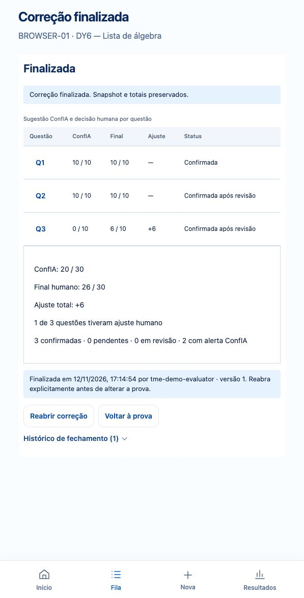

# ConfIA Dynamic — DY6 Multiquestion — implementação 01

12/11/2026. A autorização explícita para o DY6 completo foi recebida; o bloqueio anterior de escopo foi resolvido. Implementação concluída e verificada, com ressalva explícita para quatro falhas de execução formal no ambiente Lean/Mathlib. Captura continua upstream, conforme os dois complementos de escopo.

## 1. SHA

Worktree exclusivo `/Users/LinMarcolino/Documents/confia-lean-auditor-dynamic`, branch `feat/dynamic-correction`, HEAD inicial `29a5155077bd0b59fff239bdef1abcbcdd8da506`, descendente da base oficial `cb1df6e381fd0214092f33afe554ce506da68c78`. Sem git add, commit, outro worktree ou subagente.

## 2. Assessment Dynamic

Reutiliza Assessment/AssessmentItem compartilhados, com `correction_mode`, perfil explícito, feedback_policy e vínculos de sucessão. Serialização de defaults ausentes preserva os hashes anteriores. Criação e edição Dynamic passam por serviço com ownership, revisão otimista e eventos; a publicação genérica não contorna readiness.

## 3. Readiness

DRAFT, PREPARING, READY, ACTIVE, CLOSED e SUPERSEDED são projeções de estados persistidos. Ativação exige itens, preparação READY_FOR_REVIEW, rubrica aprovada e pontuação/contexto coerentes. Preparação em revisão ou falha bloqueia ativação.

## 4. Multiquestion

Cada item gera seu QuestionAttempt e sua transcrição independente. Testes cobrem lista de três questões (quadrática, linear, proporção) e prova de duas questões. Não se transforma a submissão inteira em texto único.

## 5. Bulk preparation

Reutiliza DY2 sequencialmente, com resultado/eventos por questão, isolamento de falha e retry selecionado. Questões bem-sucedidas não perdem preparação quando outra falha. Não há aprovação automática.

## 6. Rubric review

Seleção docente explícita de problema, rubric_id, revisão esperada e reconhecimento de avisos. Editor DY1 reutilizado. A UI exige marcar as rubricas conferidas antes de aprovar em lote.

## 7. Policies

FORMATIVE_LIST e SCHOOL_EXAM são escolhidas explicitamente; o título não determina política. Reutiliza DY5: revisão conservadora mantém sugestão do grader onde a automação não foi autorizada. Feedback WITHHOLD é default. AFTER_CONFIRMATION oferece estrutura curta por critério apenas após decisão corrente, sem solução completa ou envio automático ao aluno.

## 8. Submissions

ExamSubmission, participante pseudônimo e CorrectionCase/QuestionAttempt compartilhados. Adaptador textual mínimo recebe uma solução por questão publicada e cria originais textuais mais revisões NEEDS_REVIEW. Idempotência mantém IDs e rejeita conteúdo diferente para a mesma chave. Captura D1 existente permanece disponível; nenhuma imagem fictícia é gerada.

## 9. Pipeline

DY3 grader → DY4 reviewer → DY5 reconciliation por questão → HumanDecision D1–D7 → FinalCorrection D6. O adapter apenas projeta artefatos persistidos; não recalcula matemática nem altera AuditRun. Homologação exige reconciliação corrente e registra seus IDs/hash, sugestão inicial e sugestão reconciliada. Finalização bloqueia questões pendentes; prova finalizada exige reabertura antes de novas escritas.

## 10. Progress/fila

Usa a lista de submissões e resumo de correção compartilhados, navegação entre tentativas, soma sugerida parcial, contagem de questões analisadas/confirmadas, nota humana e FinalCorrection. A fila comum inclui as avaliações recebidas; não foi criado dashboard corretivo paralelo. Readiness tem tela própria de preparação da avaliação.

## 11. Version pinning

Publicação fixa pacote, enunciado, preparação, rubrica, hashes e pontos em cada AssessmentItem, copiados para a tentativa. A resolução histórica verifica hashes e aprovação. Publicar novo enunciado/rubrica não reinterpreta submissões antigas.

## 12. Updates

Sucessor começa em DRAFT, mantém ligação à avaliação anterior e exige nova readiness/ativação. A ativação do sucessor encerra recebimento na predecessora; submissões históricas continuam fixadas. Não há regrade silencioso. Nova transcrição gera nova revisão e invalida corrente sem apagar histórico.

## 13. UI

Entrada “Nova atividade ou prova” abre Assessment Dynamic; links antigos para problema individual continuam válidos. Preparação por questão, revisão, aprovação, ativação e recebimento de participantes encaminham ao workspace comum Original / Transcrição / Comparar. Revisão e reconciliação antecedem confirmação humana. Navegador validado com navegação Q1/Q2/Q3, enunciados fixados, Original/Transcrição, análise, revisão, reconciliação, homologação, ajuste justificado e finalização.

## 14. Events

Eventos de criação/adição/preparação/aprovação/readiness/ativação e fechamento da avaliação; leitura criada/revisada/aceita/superada/com problemas; grader/review/reconciliation; confirmação humana e finalização. Eventos de leitura são projeções dos registros imutáveis. Recebimento upstream permanece observável pelo manifesto, sem novo barramento ou worker.

## 15. Tests

14 testes DY6 passaram, cobrindo perfis, três questões, ausência de rubrica, pinning, ownership/CAS, preparação com falha isolada, cadeia completa compartilhada, dois participantes, finalização, equivalência de origem, revisão humana/qualidade e vínculo da confirmação ao hash do artefato interno (independente da sanitização pública).

- JavaScript completo: **563 passaram** — [log](assets/confia-dynamic-dy6/javascript-full.txt).
- DY5/DY6 e decisão/finalização compartilhadas, antes do último reforço de integridade: **87 passaram** — [log](assets/confia-dynamic-dy6/python-decisions.txt).
- Última validação após esse reforço, com os 14 testes DY6 e as suítes compartilhadas de confirmação/finalização: **46 passaram** — [log](assets/confia-dynamic-dy6/python-integrity-final.txt).
- Regressão ampliada serial em 35 arquivos, antes desse último reforço: **1.147 passaram, 14 skips, quatro falhas formais** — [log](assets/confia-dynamic-dy6/python-regression-final.txt).

A regressão ampliada abrange DY1–DY5, plataforma D1–D7, TME, correction engine e certificação existente. Os resultados de execuções diferentes não foram somados. `git diff --check` passou. Não houve alteração das expectativas Specialized.

## 16. Browser scenarios

Servidor local isolado em `/private/tmp/confia-dy6-browser`, dados sintéticos, preparação/reviewer controlados e nenhum serviço externo. Verificados prontidão de três questões, ativação, recebimento, análise textual e cadeia completa até FinalCorrection. A lista aparece na fila comum com estado Finalizada e nota humana 26/30. Q1 e Q2 tiveram 10/10; Q3 foi ajustada conscientemente para 6/10, pois o enunciado sintético sem domínio real explícito ficou fora do escopo verificável. A auditoria original manteve 0 provisório com revisão. O cenário automatizado de proporção usa domínio real explícito e verifica 10/10 com passos completos. Não houve expansão do parser para mascarar a limitação. QA detectou e corrigiu numeração/enunciado/ações do workspace; as rotas são transportadas como segmentos para preservar o sanitizador público de caminhos. Captura real não é critério de sucesso.

## 17. Regressions

A regressão ampliada serial final terminou com **1.147 aprovados, 14 skips e quatro falhas**:

- `test_real_bridge_preserves_wrong_solution_and_runs_existing_lean_pipeline`;
- `test_real_local_lean_status_certificates_preserved`;
- `test_wrong_reasoning_correct_final_is_refuted_by_real_lean`;
- `test_real_formal_verified_is_preserved_and_not_semantic`.

Os quatro casos retornaram `technical_error` onde esperavam verificação/refutação formal. A investigação registrou falha de checkout da revisão Mathlib `8f9d9cff6bd728b17a24e163c9402775d9e6a365`, com `external command 'git' exited with code 1`; ver [evidência formal](assets/confia-dynamic-dy6/formal-failure-evidence.json). Não foram migradas dependências, alteradas expectativas ou ocultadas falhas. Portanto, a regressão formal **não está integralmente verde**; a validação com Lean real precisa ser repetida quando o ambiente estiver corrigido.

Na primeira execução, além dessas quatro falhas, `b_equivalent_algebra` falhou. Passou isoladamente, na suíte TME2-P1 completa (74 testes), nas comparações isoladas com HEAD carregado apenas em memória e na execução serial final. A causa da ocorrência inicial não foi determinada; não há evidência suficiente para atribuí-la definitivamente ao DY6 ou ao baseline. Nenhum outro worktree foi usado.

## 18. Limitations

Sem OCR/HTR, segmentação, heurísticas página↔questão, novo storage, fila de captura ou serviço de identidade. Preparação em lote é sequencial. A homologação continua humana. A análise em lote usa operações sequenciais/síncronas; não há novos workers. O interpretador matemático tem o escopo DY3–DY5; Unicode/LaTeX aceitos como texto não significam suporte semântico universal. Não houve validação estatística nem certificação DY7. Feedback é estrutura docente retida/liberável, não canal de entrega ao aluno.

### Capture Integration Boundary

Contrato principal: QuestionAttempt associado + TranscriptionVersion válida/aceita. Provenance, autor, timestamp, predecessor, motivo, segmentos, confidence e referências ao original são compartilhados; `input_issues` é extensão pequena e opcional. Problemas de captura exigem revisão de entrada e não se tornam erro matemático/nota zero. Não há parser OCR ou tecnologia de captura no grader.

Documento operacional: [CAPTURE_TO_CONFIA_CONTRACT.md](../integration/CAPTURE_TO_CONFIA_CONTRACT.md), com sequência REST real, payload, concorrência, idempotência, erros, invalidação e checklist para Rian/Luis. Ainda ficam abertos credenciais e publicação por worker externo, confiança global e destaque visual avançado. O fixture de máquina apenas publica texto/provenance no modelo compartilhado. A equivalência manual/máquina, revisão humana, CAS, bloqueio por entrada ambígua/vazia, vínculo inválido e preservação histórica passaram. Veredito da fronteira: **CAPTURE_INTEGRATION_READY**, limitado aos contratos e testes descritos. Não há declaração CAPTURE_READY ou OCR_READY.

## 19. DY7 readiness

O DY6 entrega avaliação multiquestão, múltiplos participantes, preparação/readiness, políticas explícitas, cadeia por questão e homologação/finalização compartilhadas, com versionamento e fronteira de captura testada. Está pronto para iniciar o trabalho DY7. Isso não representa certificação matemática final, benchmark estatístico ou implementação da captura. A repetição dos quatro testes Lean/Mathlib após reparo do ambiente permanece uma pendência de validação formal a acompanhar no DY7.

Alterações permanecem sem staging e sem commit, exclusivamente na branch autorizada. Estado final: [git status --short](assets/confia-dynamic-dy6/git-status.txt).

READY_FOR_DYNAMIC_DY7
