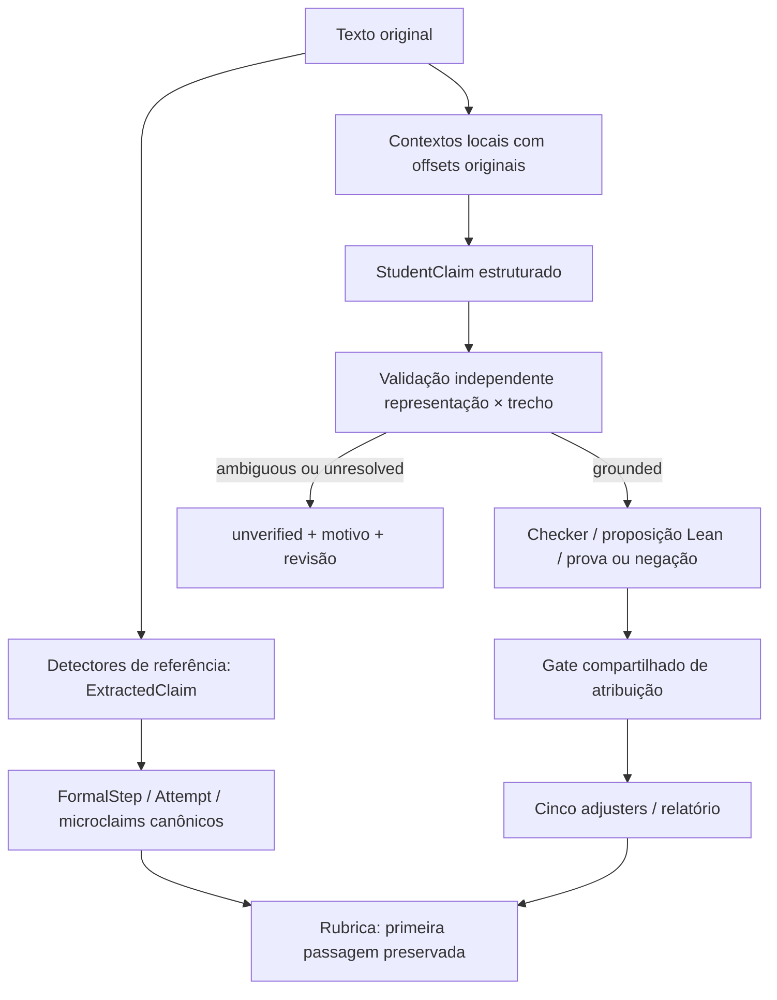

# P0-CLAIM-FIDELITY-01

## Problema e invariante

A extração F2Q1 buscava as últimas atribuições de `a` e `b` separadamente. Na cadeia `b = 2 - a = 3`, truncava a expressão em `b=2` e tratava o termo interno como `a=3`. O checker refutava corretamente uma proposição que não correspondia à conclusão do estudante.

Novo invariante operacional: **um resultado formal só pode verificar ou refutar uma afirmação atribuída ao estudante se houver correspondência validada entre os dados estruturados e um contexto local do texto original**. Falta de grounding não é erro matemático nem falha técnica: produz `unverified`, categoria `CLAIM_NOT_GROUNDED`, e revisão pela política já existente.

O estado inicial, incluindo branch, HEAD, status, diff-check e hashes, foi registrado antes das edições em [before.json](/Users/LinMarcolino/Documents/confia-lean-auditor/artifacts/evaluations/ita1000_v1_2/p0_claim_fidelity/before.json). Não houve troca de branch ou limpeza do working tree.

## Dois pipelines e arquitetura

O [mapa anterior às edições](/Users/LinMarcolino/Documents/confia-lean-auditor/artifacts/evaluations/ita1000_v1_2/p0_claim_fidelity/pipeline_map.txt) identifica produtores, campos e consumidores.

- **ExtractedClaim** continua sendo uma detecção do canal de referência. Seus textos/evidências não passam a ser citações literais automaticamente.
- **FormalStep, LeanCertificate e MicroclaimResult** registram `verification_scope=generated_reference` nas novas execuções. Os teoremas e cálculos de referência foram preservados. O escopo formal não certifica a interpretação textual.
- **StudentClaim** é a afirmação concreta submetida aos checkers dinâmicos. Todos os cinco extractors passam pelo mesmo mecanismo de grounding.
- **StudentClaimCheck** conserva o resultado atribuível ao aluno em `status`; `formal_status` permite preservar separadamente o resultado sobre uma proposição gerada.

## Grounding e correspondência

[grounding.py](/Users/LinMarcolino/Documents/confia-lean-auditor/app/confia_lean_auditor/student_claims/grounding.py) implementa:

1. Contextos delimitados por frases/parágrafos, obtidos diretamente do original. Offsets são índices de caracteres Unicode de Python, intervalo `[start,end)`, não bytes nem índices do texto normalizado.
2. Parsing genérico de bindings locais de símbolos para inteiros completos. Não combina símbolos de frases diferentes nem avalia uma expressão omitida. Prefixos numéricos de frações, decimais e cadeias incompletas são rejeitados.
3. Preferência por conclusão explícita quando única; hipóteses/rejeições reconhecidas são excluídas; candidatos conflitantes ficam ambíguos. Não há decisão baseada no gabarito para escolher o par.
4. Reextração local propõe candidatos; validadores de representação, separados dos detectores, conferem símbolos, sinais, expressões, papéis e valores efetivamente usados pelo checker. Reproduzir o detector, sozinho, não basta.
5. Hash dos dados estruturados e hash da solução vinculam a validação ao payload. O dispatch compara novamente hash e substring com a entrada exata da auditoria; os gates revalidam representação e payload antes de aceitar o resultado.

O objeto opcional `grounding` contém `status` (`grounded`, `ambiguous`, `unresolved`), `reason`, `extraction_method`, versão do validador e hash da solução. Quando há correspondência validada, inclui `source_text`, `source_start`, `source_end` e `payload_sha256`. Não são fabricados offsets para casos não resolvidos. O texto do span é limitado pelo contexto local; normalização nunca fornece offsets.

Os hashes detectam inconsistência acidental e troca de payload; não são assinatura criptográfica de um emissor confiável. A API pública não aceita um StudentClaim arbitrário como entrada de auditoria.

## Gates, provas e penalização

- `grounded_checker` protege as entradas diretas dos checkers, antes de renderizar ou executar prova/negação. `evaluate_student_proof` repete a condição como defesa adicional.
- Sem grounding válido, nenhum job Lean dinâmico é iniciado. A geração dinâmica e os estados `verified/refuted/unverified/technical_error` permanecem.
- `is_mathematically_refuted`, compartilhado pelos cinco adjusters e pelo relatório, exige agora **prova da negação + grounding validado**. Um path de prova e uma flag isolados não autorizam zero.
- `reconcile_attribution` permite ler/reconciliar um resultado sem grounding: conserva os artifacts, `compiled`/`refutation_verified` e `formal_status`, mas converte a atribuição a `unverified`. Não reescreve artifacts históricos.
- O manifesto continua exigindo o testemunho quando a prova é formalmente válida, mesmo se sua atribuição ao aluno tiver sido bloqueada.
- Relatórios usam o trecho original validado para afirmações dinâmicas. Interpretações não fundamentadas aparecem como pendentes de revisão, sem dizer que o aluno afirmou a proposição sintética.

A rubrica não foi redesenhada: deteções positivas do canal de referência continuam operacionais, com escopo explicitado. Isso não equivale a transformar todas essas deteções em afirmações textualmente grounded.

## Antes/depois e regressão offline

| Situação | Comportamento novo |
|---|---|
| Par claro, inclusive ordem invertida e outros números | Binding local validado |
| Tentativa explicitamente rejeitada seguida de conclusão única | Conclusão selecionada e rastreada |
| Dois pares plausíveis sem conclusão única | `ambiguous`; nenhum par é adivinhado |
| Valores apenas em frases separadas | Não monta um par artificial |
| Dados alterados após extração ou span inconsistente | Bloqueio antes do Lean e dos adjusters |
| Histórico com refutação e sem grounding | Proposição formal preservada; penalização não autorizada |

No texto original de **ITA2025F2Q1_S001_L04**, a nova extração produz `a=-1,b=3`, vinculados à conclusão original. O teste offline confirma a proposição entregue ao checker e que o registro antigo `a=3,b=2` não passa pelo gate. O teste do fluxo usa runner local simulado para inspecionar a entrada; as provas Lean reais são exercitadas pela suíte existente, separadamente.

A evidência offline está em [offline_f2q1.json](/Users/LinMarcolino/Documents/confia-lean-auditor/artifacts/evaluations/ita1000_v1_2/p0_claim_fidelity/offline_f2q1.json): trecho `a vale -1 e b vale 3`, offsets `[541,561)`, proposição `candidateA = (-1 : ℤ) ∧ candidateB = (3 : ℤ)`.

A [fixture portátil](/Users/LinMarcolino/Documents/confia-lean-auditor/tests/fixtures/f2q1_claim_fidelity.txt) preserva o texto da regressão. O teste adicional sobre o artifact histórico é executado quando esse artifact está presente; nenhum histórico foi modificado.

## Compatibilidade, escopo e limitações

Campos novos são opcionais. A serialização dos modelos de referência omite o novo campo quando ausente no documento histórico, preservando a forma anterior e os hashes. Ausência de grounding permite leitura, mas não nova atribuição de confiança a resultados antigos. Fixtures de adjusters passaram a construir inputs grounded a partir de texto real, em vez de fabricar apenas `status=refuted` e um path.

Limitações explícitas:

- Não é NLP geral nem certificação de entendimento de qualquer frase. O mecanismo reconhece gramáticas delimitadas e alguns sinais de conclusão/hipótese. Ironia, discurso citado, correferência e negações indiretas continuam exigindo avaliação e expansão controlada.
- Há adaptações de representação por tipo de claim, além do núcleo genérico. Formas não suportadas, relações dispersas ou contexto longo ficam sem verificação atribuída; isso pode reduzir cobertura e aumentar revisão.
- Provas canônicas e crédito heurístico da primeira passagem não foram convertidos em um novo motor semântico. O relatório distingue esse canal do verificador de StudentClaim.
- A validação não altera o domínio dos teoremas nem amplia o escopo dos checkers finitos.
- O adjudicador futuro pode consumir o objeto de grounding. Nesta tarefa seu código/prompt e a política de score permaneceram intactos; checks bloqueados já chegam como `unverified`, sem flag de refutação atribuída.
- F2Q5 final_digit, zero claims, canonicalização trigonométrica, timeout e interface permanecem follow-ups.

## Validação e preservação

As execuções finais usam o runner [offline](/Users/LinMarcolino/Documents/confia-lean-auditor/artifacts/evaluations/ita1000_v1_2/p0_claim_fidelity/run_tests_offline.py), que remove chaves de provedores e bloqueia sockets IPv4/IPv6. Os testes iniciais de claims/pipeline também usaram o conftest existente, que remove a chave OpenAI. Não houve chamadas externas nem reexecução do lote de 18 soluções.

Os 101 claims das 29 fixtures existentes de student checkers mantêm grounding válido: [inventário](/Users/LinMarcolino/Documents/confia-lean-auditor/artifacts/evaluations/ita1000_v1_2/p0_claim_fidelity/existing_fixture_grounding.json). É verificação de cobertura dessas fixtures, não medição de precisão geral.

A suíte ampla final, executada depois de todos os grupos de motor, registrou **846 aprovados, 3 falhas, 3 deselecionados**. As três falhas estão em áreas preservadas:

- `test_hmer_audit_parity::test_projection_preserves_falsehoods_signs_and_general_fractions`: expectativa de ausência de beta_difference na fixture alterada.
- `test_ui_01_shell::test_central_product_vocabulary_is_preserved_without_contract_renames`: frase esperada ausente nos arquivos consultados.
- `test_ui_02_workspace::test_parent_statement_is_compact_and_sticky_through_notebook_and_submission`: expectativa antiga sobre sticky no CSS do tablet.

Foram reproduzidas isoladamente e os nove arquivos de código/teste envolvidos conservam os hashes iniciais: [comparação](/Users/LinMarcolino/Documents/confia-lean-auditor/artifacts/evaluations/ita1000_v1_2/p0_claim_fidelity/unrelated_file_hashes.json). Não foram corrigidas porque canonicalização e UI estão explicitamente fora do escopo. Os três testes deselecionados são execuções reais de paridade, executadas e aprovadas separadamente.

Na primeira rodada ampla, o teste de imutabilidade da UI detectou corretamente escritas concorrentes de outra suíte de checkers. Não houve alteração de UI; ele passou na rodada final, sem outra suíte escrevendo artifacts. Testes de paridade foram atualizados para recomputar também a política SCORE-POLICY-02 já existente, em vez de comparar a primeira passagem com o resultado final; assertions de resumo foram alinhadas ao contrato atual e à ausência de grounding.

Falhas intermediárias do grounding foram corrigidas: o sinal de pontuação no fim da frase não pode invalidar um numeral completo no F2Q8, e trechos não grounded não podem apagar o sinal de indisponibilidade técnica. As reexecuções relevantes estão listadas abaixo. Nenhuma regra Lean foi afrouxada. A comparação AST confirmou que as 13 funções construtoras de proposições permaneceram idênticas: [registro](/Users/LinMarcolino/Documents/confia-lean-auditor/artifacts/evaluations/ita1000_v1_2/p0_claim_fidelity/proposition_builders_unchanged.json).

Resultados consolidados (há sobreposição entre grupos; não somar como casos únicos):

| Grupo | Resultado |
|---|---|
| Fidelidade, binding, ambiguidades, adulteração, histórico e manifesto | 46 aprovados |
| Gates/adjusters e semântica/paridade controladas | 132 aprovados; 13 testes de paridade deselecionados nesse comando e cobertos nos demais grupos |
| Cinco student checkers com Lean real | 29 testes aprovados considerando reexecução do F2Q8: 20 dos outros quatro checkers + 9 F2Q8 |
| Semântica de provas, relatório e paridade real | 85 aprovados na rodada; o único teste de texto do relatório passou na reexecução isolada, totalizando os 86 casos validados |
| Demais testes de motor, certificados fortes e dez questões MVP | 103 aprovados, 1 xfail preexistente; sem falhas inesperadas |
| Suíte ampla final, incluindo imutabilidade da UI | 846 aprovados, 3 falhas fora do escopo, 3 deselecionados aprovados separadamente |

Logs: [fidelity_tests.log](/Users/LinMarcolino/Documents/confia-lean-auditor/artifacts/evaluations/ita1000_v1_2/p0_claim_fidelity/fidelity_tests.log), [final_controlled_tests.log](/Users/LinMarcolino/Documents/confia-lean-auditor/artifacts/evaluations/ita1000_v1_2/p0_claim_fidelity/final_controlled_tests.log), [checker_tests.log](/Users/LinMarcolino/Documents/confia-lean-auditor/artifacts/evaluations/ita1000_v1_2/p0_claim_fidelity/checker_tests.log), [checker_f2q8_final.log](/Users/LinMarcolino/Documents/confia-lean-auditor/artifacts/evaluations/ita1000_v1_2/p0_claim_fidelity/checker_f2q8_final.log), [final_real_pipeline.log](/Users/LinMarcolino/Documents/confia-lean-auditor/artifacts/evaluations/ita1000_v1_2/p0_claim_fidelity/final_real_pipeline.log), [report_final.log](/Users/LinMarcolino/Documents/confia-lean-auditor/artifacts/evaluations/ita1000_v1_2/p0_claim_fidelity/report_final.log), [broad_final.log](/Users/LinMarcolino/Documents/confia-lean-auditor/artifacts/evaluations/ita1000_v1_2/p0_claim_fidelity/broad_final.log).

A rodada adicional de motor está em [remaining_engine_tests.log](/Users/LinMarcolino/Documents/confia-lean-auditor/artifacts/evaluations/ita1000_v1_2/p0_claim_fidelity/remaining_engine_tests.log), e a rodada ampla de fechamento em [broad_after_engine.log](/Users/LinMarcolino/Documents/confia-lean-auditor/artifacts/evaluations/ita1000_v1_2/p0_claim_fidelity/broad_after_engine.log). O `xfail` já existia em `test_f2q6_correct_solution_includes_strong_certificate`: aquela formulação não detecta `maximizers_identification`; o teste verifica subtotal 8/8, ausência de nota global e os três StudentClaimChecks verificados antes de registrar a limitação conhecida. O arquivo desse teste não foi alterado.

## Arquivos desta implementação

Modificações sobre o snapshot inicial, preservando os diffs anteriores:

- [app/confia_lean_auditor/core/schemas.py](/Users/LinMarcolino/Documents/confia-lean-auditor/app/confia_lean_auditor/core/schemas.py)
- [app/confia_lean_auditor/lean/formal_step_evaluator.py](/Users/LinMarcolino/Documents/confia-lean-auditor/app/confia_lean_auditor/lean/formal_step_evaluator.py)
- [app/confia_lean_auditor/lean/microclaim_evaluator.py](/Users/LinMarcolino/Documents/confia-lean-auditor/app/confia_lean_auditor/lean/microclaim_evaluator.py)
- [app/confia_lean_auditor/lean/student_claim_checker.py](/Users/LinMarcolino/Documents/confia-lean-auditor/app/confia_lean_auditor/lean/student_claim_checker.py)
- [app/confia_lean_auditor/lean/student_claim_checkers/ita2025f2q1.py](/Users/LinMarcolino/Documents/confia-lean-auditor/app/confia_lean_auditor/lean/student_claim_checkers/ita2025f2q1.py)
- [app/confia_lean_auditor/lean/student_claim_checkers/ita2025f2q3.py](/Users/LinMarcolino/Documents/confia-lean-auditor/app/confia_lean_auditor/lean/student_claim_checkers/ita2025f2q3.py)
- [app/confia_lean_auditor/lean/student_claim_checkers/ita2025f2q5.py](/Users/LinMarcolino/Documents/confia-lean-auditor/app/confia_lean_auditor/lean/student_claim_checkers/ita2025f2q5.py)
- [app/confia_lean_auditor/lean/student_claim_checkers/ita2025f2q6.py](/Users/LinMarcolino/Documents/confia-lean-auditor/app/confia_lean_auditor/lean/student_claim_checkers/ita2025f2q6.py)
- [app/confia_lean_auditor/lean/student_claim_checkers/registry.py](/Users/LinMarcolino/Documents/confia-lean-auditor/app/confia_lean_auditor/lean/student_claim_checkers/registry.py)
- [app/confia_lean_auditor/lean/student_proof.py](/Users/LinMarcolino/Documents/confia-lean-auditor/app/confia_lean_auditor/lean/student_proof.py)
- [app/confia_lean_auditor/main.py](/Users/LinMarcolino/Documents/confia-lean-auditor/app/confia_lean_auditor/main.py)
- [app/confia_lean_auditor/reports/report_builder.py](/Users/LinMarcolino/Documents/confia-lean-auditor/app/confia_lean_auditor/reports/report_builder.py)
- [app/confia_lean_auditor/student_claims/extract_f2q1_student_claims.py](/Users/LinMarcolino/Documents/confia-lean-auditor/app/confia_lean_auditor/student_claims/extract_f2q1_student_claims.py)
- [app/confia_lean_auditor/student_claims/extract_f2q3_student_claims.py](/Users/LinMarcolino/Documents/confia-lean-auditor/app/confia_lean_auditor/student_claims/extract_f2q3_student_claims.py)
- [app/confia_lean_auditor/student_claims/extract_f2q5_student_claims.py](/Users/LinMarcolino/Documents/confia-lean-auditor/app/confia_lean_auditor/student_claims/extract_f2q5_student_claims.py)
- [app/confia_lean_auditor/student_claims/extract_f2q6_student_claims.py](/Users/LinMarcolino/Documents/confia-lean-auditor/app/confia_lean_auditor/student_claims/extract_f2q6_student_claims.py)
- [app/confia_lean_auditor/student_claims/extract_f2q8_student_claims.py](/Users/LinMarcolino/Documents/confia-lean-auditor/app/confia_lean_auditor/student_claims/extract_f2q8_student_claims.py)
- [app/confia_lean_auditor/student_claims/schemas.py](/Users/LinMarcolino/Documents/confia-lean-auditor/app/confia_lean_auditor/student_claims/schemas.py)
- [app/confia_lean_auditor/submission_audits/artifacts.py](/Users/LinMarcolino/Documents/confia-lean-auditor/app/confia_lean_auditor/submission_audits/artifacts.py)
- [tests/test_cap04_global_semantics.py](/Users/LinMarcolino/Documents/confia-lean-auditor/tests/test_cap04_global_semantics.py)
- [tests/test_cap04_parity.py](/Users/LinMarcolino/Documents/confia-lean-auditor/tests/test_cap04_parity.py)
- [tests/test_f2q1_rubric_adjustments.py](/Users/LinMarcolino/Documents/confia-lean-auditor/tests/test_f2q1_rubric_adjustments.py)
- [tests/test_f2q3_rubric_adjustments.py](/Users/LinMarcolino/Documents/confia-lean-auditor/tests/test_f2q3_rubric_adjustments.py)
- [tests/test_f2q5_rubric_adjustments.py](/Users/LinMarcolino/Documents/confia-lean-auditor/tests/test_f2q5_rubric_adjustments.py)
- [tests/test_f2q6_rubric_adjustments.py](/Users/LinMarcolino/Documents/confia-lean-auditor/tests/test_f2q6_rubric_adjustments.py)
- [tests/test_f2q8_rubric_adjustments.py](/Users/LinMarcolino/Documents/confia-lean-auditor/tests/test_f2q8_rubric_adjustments.py)
- [tests/test_student_proof_semantics.py](/Users/LinMarcolino/Documents/confia-lean-auditor/tests/test_student_proof_semantics.py)

Novos arquivos de implementação/teste/documentação:

- [app/confia_lean_auditor/student_claims/grounding.py](/Users/LinMarcolino/Documents/confia-lean-auditor/app/confia_lean_auditor/student_claims/grounding.py)
- [tests/claim_fixtures.py](/Users/LinMarcolino/Documents/confia-lean-auditor/tests/claim_fixtures.py)
- [tests/test_claim_fidelity.py](/Users/LinMarcolino/Documents/confia-lean-auditor/tests/test_claim_fidelity.py)
- [tests/fixtures/f2q1_claim_fidelity.txt](/Users/LinMarcolino/Documents/confia-lean-auditor/tests/fixtures/f2q1_claim_fidelity.txt)
- [docs/audits/P0_CLAIM_FIDELITY_01.md](/Users/LinMarcolino/Documents/confia-lean-auditor/docs/audits/P0_CLAIM_FIDELITY_01.md)

Snapshots, logs, inventários e resultado offline ficam no diretório de evidências solicitado. Os cinco adjusters não exigiram patches individuais: todos já chamavam o predicado compartilhado que agora valida grounding.

## Fechamento Git

Branch preservada: `feat/tme-dual-input`. HEAD preservado: `f607bf5691d9f0472b68287a1b88c11d993a937e`. `git diff --check`: aprovado, sem saída. O hash do diff staged permanece o hash vazio inicial; não houve staging, commit ou push.

O [snapshot final](/Users/LinMarcolino/Documents/confia-lean-auditor/artifacts/evaluations/ita1000_v1_2/p0_claim_fidelity/after.json) registra os 27 arquivos preexistentes alterados nesta tarefa, os cinco novos arquivos principais e os hashes de preservação. Os 210 arquivos protegidos conferidos, incluindo score, adjudicador, canonicalização, interface, problemas, fontes/configuração Lean e o relatório da auditoria anterior, permanecem idênticos ao snapshot inicial.

O [git status --short integral](/Users/LinMarcolino/Documents/confia-lean-auditor/artifacts/evaluations/ita1000_v1_2/p0_claim_fidelity/git_status_short.txt) contém 52 entradas modificadas e 26 entradas não rastreadas. Inclui alterações anteriores: o estado inicial já tinha 29 modificadas e 22 não rastreadas. Diretórios não rastreados aparecem agrupados pelo Git; esses números não representam apenas arquivos desta implementação.
