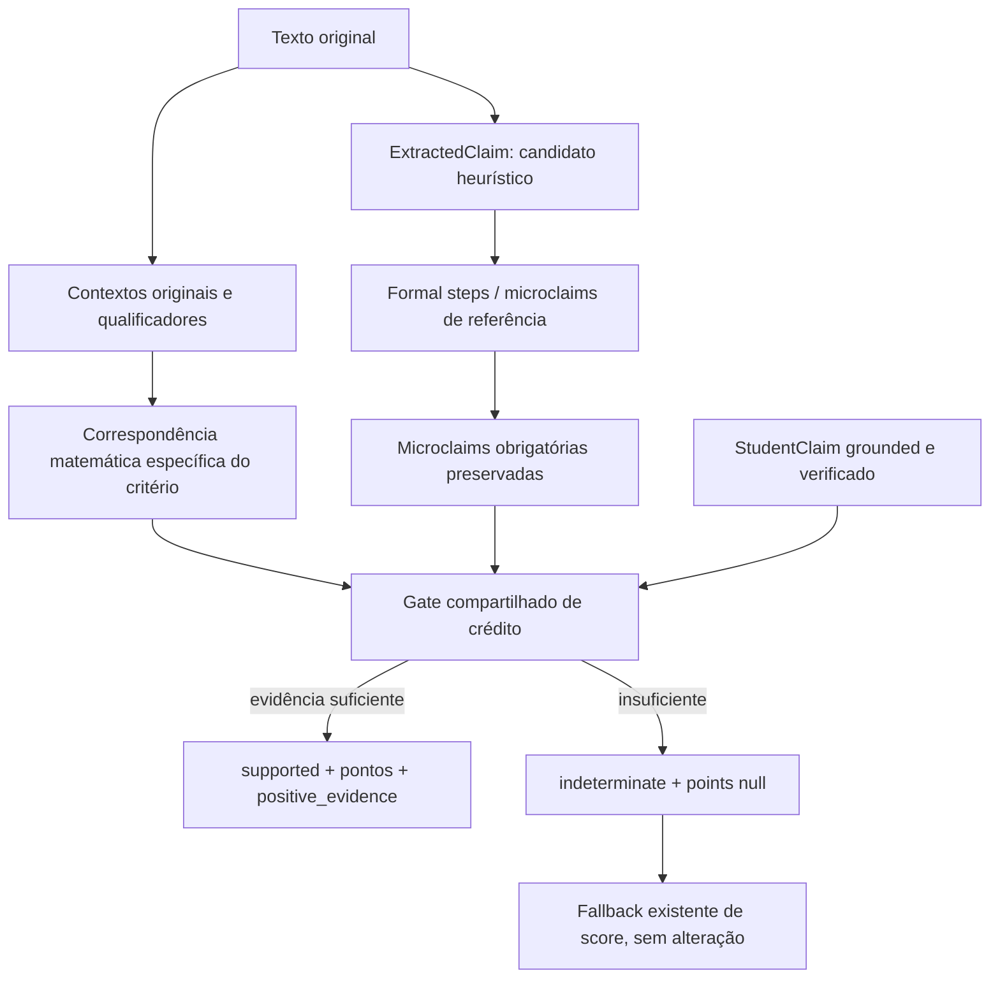

# P0-CLAIM-FIDELITY-02 — crédito positivo atribuível

## Risco e mapa anterior

O avaliador anterior concedia o valor integral do critério quando encontrava seu `claim_type` e as microclaims obrigatórias verificadas. O caso sem microclaims exigia apenas o claim. `evidence` era uma frase sintética escrita pelo extractor; não era um trecho literal. Uma prova canônica correta não resolvia essa lacuna de atribuição.

O mapa foi salvo antes das edições em [positive_pipeline_before.txt](/Users/LinMarcolino/Documents/confia-lean-auditor/artifacts/evaluations/ita1000_v1_2/p0_claim_fidelity_02/positive_pipeline_before.txt). O [inventário individual dos 46 tipos](/Users/LinMarcolino/Documents/confia-lean-auditor/artifacts/evaluations/ita1000_v1_2/p0_claim_fidelity_02/claim_inventory_before.json) identifica produtor, linha, texto derivado e classificação:

- **A — trecho literal:** nenhum `ExtractedClaim` o fornecia como provenance verificável.
- **B — evidência derivada localizável:** requer voltar à solução; a simples descrição `evidence` não basta. O formal step Q1 que contém uma linha normalizada é distinto do ExtractedClaim.
- **C — referência/modelo:** os payloads `text` e `normalized` descrevem os resultados esperados.
- **D — detecção heurística:** os 46 candidatos são emitidos por combinações de substrings, regex e palavras-chave. O inventário classifica individualmente esse mecanismo como D e o payload de referência como C.

Exemplos efetivamente reproduzidos: `a=15` dentro de uma negativa; a igualdade de beta seguida de “essa igualdade é falsa”; os números `1/8` e `3/8` sem atribuições a testemunhas; “estudo de sinais” sem análise; resposta `1013` seguida de rejeição. Esses detectores produzem candidatos, mas o novo gate não concede pontos.

## Arquitetura



`can_support_rubric_credit` em [positive_evidence.py](/Users/LinMarcolino/Documents/confia-lean-auditor/app/confia_lean_auditor/rubric/positive_evidence.py) centraliza atribuição, contexto, microclaims, precedência e provenance. [positive_rules.py](/Users/LinMarcolino/Documents/confia-lean-auditor/app/confia_lean_auditor/rubric/positive_rules.py) descreve as representações matemáticas dos 46 tipos atuais. Não altera nem cria ExtractedClaims, teoremas ou assets.

O gate recebe o texto original explicitamente. Chamadas sem esse texto permanecem indeterminadas; um artifact antigo não passa a ser confiável por apresentar `detected=true`. Reconhecer uma afirmação completa, com símbolos, relações, sinais e papéis corretos, é diferente de encontrar um número ou palavra esperada. O reconhecimento continua sendo de gramáticas delimitadas: não é um novo motor simbólico.

As regras de conteúdo são independentes das condições que geram os candidatos heurísticos. Por exemplo, testemunhas exigem atribuições a `x1` e `x2`; análise de sinais exige intervalos efetivamente apresentados; equações não aceitam prefixos truncados como `a=15+1`. Cadeias de igualdade aceitam apenas tokens matemáticos reconhecidos entre os membros. Bindings de conclusões são resolvidos contra a solução inteira, para detectar conflitos.

O gate percorre também as dependências **já declaradas** das microclaims exigidas e valida a atribuição de seus `claim_types`. Sem isso, testemunhas encontradas apenas como números poderiam sustentar uma prova canônica e conceder crédito nos critérios seguintes. A falta de atribuição dessas premissas agora bloqueia o crédito derivado; não acrescenta dependências ao grafo nem altera os teoremas. Conclusões sem microclaims obrigatórias continuam independentes desse grafo.

A expansão do determinante de Q1 precisa estar efetivamente escrita: a referência correta não substitui uma expansão com outro coeficiente. O critério de razão de F2Q6 exige também a análise mencionada na pauta; escrever apenas a fórmula não afirma que a análise foi feita. As representações LaTeX reconhecidas reutilizam a projeção já existente, sem editar a canonicalização; os spans continuam apontando para o original.

## Evidência e precedência

A ordem operacional é:

1. **formal_verification:** StudentClaim verificado, compilado, grounded na mesma solução e mapeado a um critério que ele cobre integralmente;
2. **deterministic_check:** binding local validado e confrontado com a conclusão desse critério;
3. **grounded_text:** afirmação/estrutura matemática explícita reconhecida e atribuível;
4. **reference_heuristic:** candidato sem comprovação de atribuição; não autoriza crédito.

`secondary_adjudication` continua sendo a origem já prevista na política existente; seu código e prompt não foram alterados. Não foi criada uma categoria fictícia de equivalência simbólica nem introduzido um novo CAS.

Um StudentClaim formal pode fortalecer a evidência do critério correspondente. Não dispensa conteúdo exigido pela pauta, não dispensa microclaims obrigatórias, não gera crédito para os outros critérios e não expande detectores ausentes. Critérios compostos não são promovidos a “formalmente verificados” por um único componente verificado. O gate reutiliza os mapas existentes dos adjusters para respeitar também os componentes ambíguos ou refutados desses critérios, sem alterar os adjusters. A ambiguidade mantém `points=null`; não é convertida em erro ou zero. Essa restrição também se propaga pelas dependências de referência já declaradas.

Formal steps e microclaims com `verification_scope=generated_reference` continuam provando matemática de referência. O relatório deixou de contar uma referência verificada, isoladamente, como verificação atribuída ao estudante.

## Contexto e observabilidade

Os spans são índices Unicode de Python `[start,end)` sobre o texto original. Normalização é usada apenas para correspondência, nunca para fabricar offsets. Contextos preservam álgebra em várias linhas; qualificadores de negação, rejeição, hipótese e citação não podem ser descartados por uma divisão em frases. Citações em vários parágrafos são bloqueadas como origem de crédito, incluindo aspas duplas, simples, curvas e angulares. Apóstrofo após identificador matemático não é tratado como abertura de citação. Perguntas também não são tratadas como conclusões.

Negações que constituem a própria matemática são tratadas explicitamente: não injetividade, impossibilidade de expoente zero, exclusão da raiz negativa e restrição do denominador. Isso evita confundir “g não é injetora” com “não podemos concluir que g não é injetora”.

Uma conclusão textual isolada em Q4/Q5 continua podendo receber o ponto previsto nos assets, sem Lean adicional. Repetir “Prove que…” ou copiar o enunciado integral não constitui essa conclusão. Sem marcas de citação, uma resposta curta literalmente igual ao resultado pedido é indistinguível de uma afirmação do aluno; nesses dois critérios a própria pauta autoriza esse reconhecimento mínimo.

Em Q5, “se b_n é PG, então a_n também é PG” é a implicação que a pauta permite reconhecer como conclusão. Isso difere de assumir provisoriamente que a_n é PG. As dez fixtures de resposta curta foram testadas com essa distinção e com suas microclaims quando exigidas.

Cada item novo registra `positive_evidence`: versão do gate, claim/critério, microclaims exigidas, motivo, tipo de verificação, hash da solução, spans e IDs dos checks pertinentes. O campo existente `scoring_basis` continua com sua semântica anterior. Quando o gate aprova, `evidence` contém texto original; quando bloqueia, não reutiliza a descrição sintética como evidência do aluno.

Exemplo de integração real: [artifact F2Q3 com score 10](/Users/LinMarcolino/Documents/confia-lean-auditor/artifacts/runs/20261029T001810_636171/audit.json). Os 2 pontos de `beta_difference` e os 2 da resposta final possuem `formal_verification`; os 3 de candidatos e os 3 do cálculo da soma possuem `grounded_text`, com quatro e dois trechos/requisitos respectivamente. A referência Lean permanece registrada separadamente.

A [checagem estrutural de observabilidade](/Users/LinMarcolino/Documents/confia-lean-auditor/artifacts/evaluations/ita1000_v1_2/p0_claim_fidelity_02/observability_checks.json) percorreu 119 artifacts das execuções e reexecuções locais com `positive-source-v1`: 228 critérios supported, sendo 82 com `formal_verification`, 141 com `grounded_text` e 5 com `deterministic_check`. Todos apresentaram hash compatível, spans iguais ao texto original e premissas de referência atribuídas. Essa verificação mede rastreabilidade estrutural; não é benchmark de acurácia nem reavaliação dos artifacts.

O novo campo é opcional e omitido na serialização de documentos históricos que não o possuíam. O teste de roundtrip confirma igualdade integral do artifact histórico sem regravação.

## Regressões e limites

As dez fixtures corretas preservam seus créditos em um perfil controlado de microclaims verificadas, inclusive após reflow em um único parágrafo. Os testes adversariais exercitam candidatos realmente emitidos pelos detectores e a diferença entre verdade formal de referência e atribuição textual.

Na fixture parcial Q8, o conteúdo “o numerador pode ser fatorado como…” e a exclusão de `cos(x)=0` a partir do denominador escrito foram reconhecidos sem exigir que o aluno repita palavras específicas da descrição. Seus 8 pontos sustentados foram preservados; análise de sinais continua pendente. Uma tentativa explicitamente abandonada pode preceder uma conclusão nova, mas rejeições posteriores permanecem no escopo do trecho. A variante existente de F2Q3 com `-(sqrt(7)+1)/4` foi reconhecida explicitamente como equivalente a `-(1+sqrt(7))/4`. A resposta curta `Portanto, resposta = (5+sqrt(7))/8.` preserva somente os 2 pontos finais, com a microclaim obrigatória mantida; o teste novo executa o motor real, exige `formal_verification` e confirma que não há crédito pela derivação nem certificado forte. Conclusões numéricas exigem expressão completa: `0+1`, `5-1` e `1013-1` não são truncados para conceder os pontos da resposta esperada.

Limites: gramáticas finitas e contextos de até 4.000 caracteres, não interpretação geral de português; equivalências ou argumentos alternativos não reconhecidos ficam indeterminados para o fallback já existente. Não se promete resolver ironia, toda forma de citação indireta ou contradições arbitrárias. Qualificadores conservadores podem aumentar revisão. Validade de uma referência não certifica a leitura semântica de texto livre.

Um candidato ausente continua ausente: o gate não transforma StudentClaims em novos ExtractedClaims nem amplia o detector F2Q5 final_digit. Isso preserva o escopo desta tarefa e pode deixar uma conclusão sem crédito de primeira passagem quando o detector legado não a reconhece. As classificações A/B/C/D são sobre a origem da evidência; não equivalem a uma taxa de acerto medida no dataset.

Não foram alterados score policy, secondary adjudicator, UI, assets, proposições/táticas Lean, timeout, canonicalização trigonométrica ou o detector F2Q5 final_digit. Nenhum dataset batch foi executado.

## Arquivos da implementação

Alterados sobre o snapshot inicial:

- [core/schemas.py](/Users/LinMarcolino/Documents/confia-lean-auditor/app/confia_lean_auditor/core/schemas.py): campo opcional e compatibilidade histórica.
- [main.py](/Users/LinMarcolino/Documents/confia-lean-auditor/app/confia_lean_auditor/main.py): entrega da solução original, checks e enunciado ao avaliador.
- [rubric/rubric_evaluator.py](/Users/LinMarcolino/Documents/confia-lean-auditor/app/confia_lean_auditor/rubric/rubric_evaluator.py): gate antes de `supported`/pontos.
- [reports/report_builder.py](/Users/LinMarcolino/Documents/confia-lean-auditor/app/confia_lean_auditor/reports/report_builder.py): origem real do crédito e distinção de prova de referência.
- [tests/test_cap04_parity.py](/Users/LinMarcolino/Documents/confia-lean-auditor/tests/test_cap04_parity.py): replay fornece o mesmo texto, checks e enunciado do fluxo real.

- [tests/test_pedagogical_report.py](/Users/LinMarcolino/Documents/confia-lean-auditor/tests/test_pedagogical_report.py): substitui palavras de descrições sintéticas por verificação da sugestão estruturada e correspondência literal de cada evidência com a solução correta.

Novos: os dois módulos do gate listados acima, [tests/test_positive_credit_evidence.py](/Users/LinMarcolino/Documents/confia-lean-auditor/tests/test_positive_credit_evidence.py) e este relatório. Snapshots, inventários e logs ficam em `artifacts/evaluations/ita1000_v1_2/p0_claim_fidelity_02/`.

## Validação

**Resultado consolidado: 1.172 aprovados, 3 falhas preexistentes fora do escopo e 1 xfail preexistente, em 1.176 casos únicos.** A [coleta final](/Users/LinMarcolino/Documents/confia-lean-auditor/artifacts/evaluations/ita1000_v1_2/p0_claim_fidelity_02/full_collection_final.log) e o [resumo de validação](/Users/LinMarcolino/Documents/confia-lean-auditor/artifacts/evaluations/ita1000_v1_2/p0_claim_fidelity_02/validation_summary.json) registram as contagens. São resultados consolidados de execuções e reexecuções, não uma única invocação. Dos 108 testes novos, 102 já estavam na rodada ampla; somente os 6 acrescentados depois da coleta entram novamente no total.

As execuções usam um runner offline: sem chave OpenAI e com conexões IPv4/IPv6 bloqueadas. Os perfis controlados de microclaims são identificados como tais nos testes; não são apresentados como provas Lean reais.

- [Testes novos de crédito positivo](/Users/LinMarcolino/Documents/confia-lean-auditor/artifacts/evaluations/ita1000_v1_2/p0_claim_fidelity_02/positive_tests.log): 108 aprovados (107 testes sem executar Lean e 1 com motor real), incluindo fixtures completas/curtas, reflow, negação, hipótese, citação, tentativas rejeitadas, referências sem fonte, dependências, representação incorreta, precedência, reports e roundtrip histórico.
- [Primeira suíte ampla](/Users/LinMarcolino/Documents/confia-lean-auditor/artifacts/evaluations/ita1000_v1_2/p0_claim_fidelity_02/broad_tests.log): 891 aprovados, 3 falhas conhecidas fora do escopo e 3 testes reais de paridade separados. Essa rodada precedeu os últimos testes adicionais e o fechamento do gate.
- [Rodada ampla de fechamento](/Users/LinMarcolino/Documents/confia-lean-auditor/artifacts/evaluations/ita1000_v1_2/p0_claim_fidelity_02/broad_final.log): 947 aprovados, as mesmas 3 falhas e 4 verificações separadas (3 de paridade real e 1 de imutabilidade). Os seis casos finais de truncamento numérico, aspas simples e resposta curta F2Q3 foram acrescentados depois da coleta dessa rodada e passaram na execução final dos 108 testes do gate.
- [Paridade real](/Users/LinMarcolino/Documents/confia-lean-auditor/artifacts/evaluations/ita1000_v1_2/p0_claim_fidelity_02/real_parity.log): 3 aprovados, com replay do mesmo texto original, checks e enunciado.
- Integração: **215 aprovados e 1 xfail**, em 216 casos únicos. As etapas aprovaram [43 casos](/Users/LinMarcolino/Documents/confia-lean-auditor/artifacts/evaluations/ita1000_v1_2/p0_claim_fidelity_02/real_engine_stable.log), [14 casos](/Users/LinMarcolino/Documents/confia-lean-auditor/artifacts/evaluations/ita1000_v1_2/p0_claim_fidelity_02/real_engine_resume.log), [157 casos](/Users/LinMarcolino/Documents/confia-lean-auditor/artifacts/evaluations/ita1000_v1_2/p0_claim_fidelity_02/real_engine_remaining.log) e [o teste de relatório reexecutado após sua atualização](/Users/LinMarcolino/Documents/confia-lean-auditor/artifacts/evaluations/ita1000_v1_2/p0_claim_fidelity_02/report_final.log). As falhas intermediárias de Q8, da variante F2Q3 e da antiga expectativa textual do relatório estão resolvidas nas reexecuções.
- [Imutabilidade da UI](/Users/LinMarcolino/Documents/confia-lean-auditor/artifacts/evaluations/ita1000_v1_2/p0_claim_fidelity_02/static_immutability.log): 1 aprovado, executado isoladamente depois dos processos que escrevem artifacts.

As rodadas intermediárias não são somadas ao total final. Uma [rodada exploratória](/Users/LinMarcolino/Documents/confia-lean-auditor/artifacts/evaluations/ita1000_v1_2/p0_claim_fidelity_02/real_engine_tests.log), executada enquanto os módulos ainda estavam sendo editados, apresentou três respostas HTTP 500 e foi interrompida; seus casos foram repetidos e aprovados depois. Nas rodadas seguintes, as regressões de Q8 e da variante equivalente de F2Q3 foram corrigidas e reexecutadas. O teste de relatório também exigia as palavras “solução”, “correta” e “evidências”, presentes nas descrições sintéticas anteriores. Com os trechos originais deduplicados contra os checks, essas frases deixaram de aparecer; o teste foi atualizado para verificar a sugestão estruturada e a origem literal de todas as evidências, preservando as verificações de confiabilidade e checagem automática. Os logs intermediários permanecem disponíveis para auditoria.

O `xfail` existente de `test_f2q6_correct_solution_includes_strong_certificate` foi preservado: essa formulação não produz `maximizers_identification` no extractor legado, mantém subtotal decidido de 8/8 e não emite nota global. O teste, seu tratamento de falha esperada e o detector não foram alterados.

As falhas amplas monitoradas são `test_projection_preserves_falsehoods_signs_and_general_fractions`, `test_central_product_vocabulary_is_preserved_without_contract_renames` e `test_parent_statement_is_compact_and_sticky_through_notebook_and_submission`. Nenhum de seus arquivos foi alterado; a [comparação de hashes](/Users/LinMarcolino/Documents/confia-lean-auditor/artifacts/evaluations/ita1000_v1_2/p0_claim_fidelity_02/unrelated_file_hashes.json) registra a preservação dos testes e dos módulos relacionados. Um teste novo confirma que o falso candidato HMER continua observável no extractor, mas não basta para conceder crédito positivo.

## Preservação do worktree

A tarefa começou em `feat/tme-dual-input`, HEAD `f607bf5691d9f0472b68287a1b88c11d993a937e`, com 52 entradas modificadas e 26 não rastreadas no status. O [snapshot anterior](/Users/LinMarcolino/Documents/confia-lean-auditor/artifacts/evaluations/ita1000_v1_2/p0_claim_fidelity_02/before.json) contém hashes de 3.057 arquivos. Desses, apenas os seis arquivos preexistentes listados nesta implementação mudaram; 3.051 mantiveram seus hashes. Os quatro novos arquivos principais foram acrescentados sem substituir trabalho anterior.

O [snapshot posterior](/Users/LinMarcolino/Documents/confia-lean-auditor/artifacts/evaluations/ita1000_v1_2/p0_claim_fidelity_02/after.json) registra a comparação. O [diff incremental desta tarefa](/Users/LinMarcolino/Documents/confia-lean-auditor/artifacts/evaluations/ita1000_v1_2/p0_claim_fidelity_02/implementation.diff) foi reconstruído contra o snapshot inicial e não mistura alterações anteriores.

`git diff --check`: sem saída, código 0. Branch, HEAD e digest do índice permanecem iguais. Não houve staging, commit ou push. O [status integral](/Users/LinMarcolino/Documents/confia-lean-auditor/artifacts/evaluations/ita1000_v1_2/p0_claim_fidelity_02/git_status_short.txt) contém 54 entradas `M` e 29 `??`; essas contagens incluem o trabalho que já existia antes desta tarefa.

```text
 M .gitignore
 M README.md
 M app/confia_lean_auditor/auth/dependencies.py
 M app/confia_lean_auditor/claims/extractors/ita2025f2q3.py
 M app/confia_lean_auditor/core/audit_math_projection.py
 M app/confia_lean_auditor/core/schemas.py
 M app/confia_lean_auditor/lean/formal_step_evaluator.py
 M app/confia_lean_auditor/lean/microclaim_evaluator.py
 M app/confia_lean_auditor/lean/student_claim_checker.py
 M app/confia_lean_auditor/lean/student_claim_checkers/ita2025f2q1.py
 M app/confia_lean_auditor/lean/student_claim_checkers/ita2025f2q3.py
 M app/confia_lean_auditor/lean/student_claim_checkers/ita2025f2q5.py
 M app/confia_lean_auditor/lean/student_claim_checkers/ita2025f2q6.py
 M app/confia_lean_auditor/lean/student_claim_checkers/registry.py
 M app/confia_lean_auditor/lean/student_proof.py
 M app/confia_lean_auditor/main.py
 M app/confia_lean_auditor/recognition/README.md
 M app/confia_lean_auditor/recognition/execution.py
 M app/confia_lean_auditor/recognition/registry.py
 M app/confia_lean_auditor/recognition/schemas.py
 M app/confia_lean_auditor/recognition/service.py
 M app/confia_lean_auditor/reports/report_builder.py
 M app/confia_lean_auditor/rubric/rubric_evaluator.py
 M app/confia_lean_auditor/static/app.js
 M app/confia_lean_auditor/static/capture/problem-math.js
 M app/confia_lean_auditor/static/capture/submission-client.js
 M app/confia_lean_auditor/static/capture/tablet.css
 M app/confia_lean_auditor/static/capture/tablet.html
 M app/confia_lean_auditor/static/capture/tablet.js
 M app/confia_lean_auditor/static/index.html
 M app/confia_lean_auditor/static/submissions/teacher.js
 M app/confia_lean_auditor/student_claims/extract_f2q1_student_claims.py
 M app/confia_lean_auditor/student_claims/extract_f2q3_student_claims.py
 M app/confia_lean_auditor/student_claims/extract_f2q5_student_claims.py
 M app/confia_lean_auditor/student_claims/extract_f2q6_student_claims.py
 M app/confia_lean_auditor/student_claims/extract_f2q8_student_claims.py
 M app/confia_lean_auditor/student_claims/schemas.py
 M app/confia_lean_auditor/submission_audits/artifacts.py
 M app/confia_lean_auditor/submission_audits/service.py
 M app/confia_lean_auditor/submission_audits/source.py
 M app/confia_lean_auditor/submissions/router.py
 M app/confia_lean_auditor/submissions/schemas.py
 M app/confia_lean_auditor/submissions/store.py
 M tests/audit_contract.py
 M tests/conftest.py
 M tests/test_cap04_global_semantics.py
 M tests/test_cap04_parity.py
 M tests/test_f2q1_rubric_adjustments.py
 M tests/test_f2q3_rubric_adjustments.py
 M tests/test_f2q5_rubric_adjustments.py
 M tests/test_f2q6_rubric_adjustments.py
 M tests/test_f2q8_rubric_adjustments.py
 M tests/test_pedagogical_report.py
 M tests/test_student_proof_semantics.py
?? app/confia_lean_auditor/recognition/errors.py
?? app/confia_lean_auditor/recognition/mathpix_image.py
?? app/confia_lean_auditor/rubric/positive_evidence.py
?? app/confia_lean_auditor/rubric/positive_rules.py
?? app/confia_lean_auditor/rubric/scoring_policy.py
?? app/confia_lean_auditor/rubric/secondary_adjudicator.py
?? app/confia_lean_auditor/static/audit-view.css
?? app/confia_lean_auditor/static/audit-view.js
?? app/confia_lean_auditor/student_claims/grounding.py
?? app/confia_lean_auditor/tme/
?? benchmarks/tme_input_modes/
?? dataset_1000_v1.2/
?? docs/TME_MAC_01.md
?? docs/TME_NAV_01.md
?? docs/TME_WORKSPACE_01.md
?? docs/TME_WORKSPACE_01A.md
?? docs/TME_WORKSPACE_01B.md
?? docs/TME_WORKSPACE_01C.md
?? docs/TME_WORKSPACE_01D.md
?? docs/TME_WORKSPACE_02.md
?? docs/TME_WORKSPACE_03.md
?? docs/audits/
?? scripts/evaluation/
?? tests/claim_fixtures.py
?? tests/fixtures/f2q1_claim_fidelity.txt
?? tests/test_claim_fidelity.py
?? tests/test_positive_credit_evidence.py
?? tests/test_score_policy.py
?? tests/test_score_policy_api.py
```
