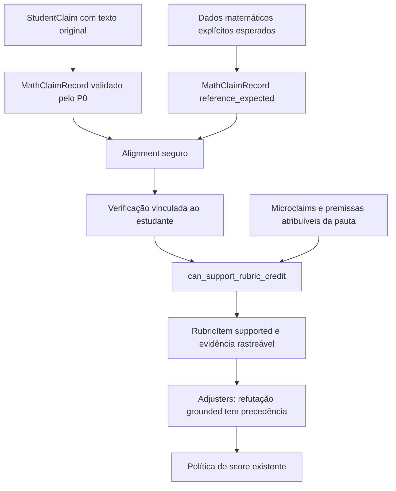

# P0-RUBRIC-BRIDGE-01 — Claims do estudante como evidência de rubrica

## Resultado e escopo

A rubrica pode consumir um `MathClaimRecord` atribuível ao estudante, alinhado a uma obrigação matemática explícita e verificado, mesmo quando o detector legado não produziu o `ExtractedClaim` correspondente. A decisão passa por `can_support_rubric_credit`; microclaims e evidência das premissas continuam obrigatórias. Não há concessão geral de pontos por `Lean verified`.

No replay offline do Smoke V2, `ITA2025F2Q1_S001_L04` recupera **2 pontos primários em final_answer**, com o par correto `a=-1,b=3`, a fonte literal e a prova Lean já salva. Os outros três critérios permanecem indeterminados. Não foi chamado o pipeline completo dos 18, Lean ou adjudicação durante esse replay. As notas finais V2 não foram recalculadas.

A implementação não altera extractors, canonicalização, alignment, proposições/checkers Lean, adjusters, assets, score policy, secondary adjudicator ou UI. Não foram chamados OpenAI ou Mathpix. A suíte executa testes reais de Lean sobre fixtures de regressão, separadamente do replay do dataset.

## Diagnóstico anterior à alteração

[diagnosis_before.md](../../artifacts/evaluations/ita1000_v1_2/p0_rubric_bridge_01/diagnosis_before.md) e [unmatched_before.json](../../artifacts/evaluations/ita1000_v1_2/p0_rubric_bridge_01/unmatched_before.json) foram produzidos antes de editar o motor. [before.json](../../artifacts/evaluations/ita1000_v1_2/p0_rubric_bridge_01/before.json) e `baseline_sources.tar.gz` preservam hashes e fontes do estado inicial, incluindo alterações preexistentes que não pertencem a esta tarefa.

O fluxo F2Q1 era:

1. Texto original, offsets de caracteres `[541:561]`: `a vale -1 e b vale 3`.
2. `StudentClaim student_claim_1`, `data={a:-1,b:3}`, grounding P0 válido.
3. `MathClaimRecord student:student_claim_1`: `student_explicit`, `attributable=true`, forma `integer_bindings`, mesmos valores.
4. Checker grounded verifica `candidateA = (-1 : ℤ) ∧ candidateB = (3 : ℤ)` por `norm_num [candidateA,candidateB]`.
5. O único ExtractedClaim da solução era `coefficient_system`; não existia candidato legado `final_answer`.
6. `positive_credit_from_record` projetava somente referências. `can_support_rubric_credit` recusava `claim=None` antes de aproveitar a evidência student. `evaluate_rubric` também exigia `has_claim` para `detected`.
7. O adjuster F2Q1 apenas reduzia pontos por refutação. Um check positivo não recuperava esse critério.
8. O catálogo/alignment era publicado depois da rubrica e do score, sem alimentar a decisão.

A canonicalização já acontecia antes de `align_claims`. O problema de ordem era a indisponibilidade da representação comum durante a decisão da rubrica, não a execução do alignment antes de canonicalizar.

## Os 37 unmatched

As contagens são por referência original; cada uma tinha no máximo um candidato semanticamente relacionado nesta amostra. “Relacionado” usa o contrato existente checker→critério, não semelhança textual.

| Causa/condição | Referências |
|---|---:|
| Sem StudentClaim correspondente ao conteúdo do critério | 26 |
| Candidato semanticamente relacionado, mas sem par registrado e sem canonical_form em ambos | 5 |
| Ambos com canonical_form comparável, mas StudentClaim unresolved | 6 |
| Somente student com canonical_form | 0 |
| Somente reference com canonical_form, havendo candidato student | 0 |
| Equivalência unknown efetivamente alcançada pelo alignment | 0 |
| Alignment executado antes da canonicalização | 0 |
| Perda do payload legado pelo adapter | 0 |

Incluindo também os casos sem candidato student, a disponibilidade absoluta de formas nos 37 registros é: **6 ambos, 12 somente reference, 0 somente student e 19 nenhum**. Nessa contagem, estudante ausente conta como lado sem forma; a tabela acima distingue essa ausência de um adapter sem representação. Detalhes em `unmatched_form_availability.json`.

As razões de saída originais foram 31 `No supported cross-channel representation pair` e seis `No attributable grounded student content`.

Os cinco sem tradução comum são dois sistemas de coeficientes F2Q1, um intervalo ordenado F2Q5 e duas relações critério/razão F2Q6. O último grupo inclui um critério composto de identificação dos maximizadores: verificar somente a fórmula da razão não cumpre esse critério. Os tipos textuais reference/student diferem por projeto; faltava uma tradução segura nesses cinco pares. Não foram adicionados aliases ou traduções por adivinhação.

Os seis com formas comparáveis são decomposição logarítmica, mantissa e limites logarítmicos em dois casos F2Q5. Seus valores canônicos estruturados coincidem; o bloqueio é grounding unresolved. Os campos brutos usam nomes e escalas diferentes (`total_log` versus `total_log_scaled`, por exemplo), já traduzidos pelos adapters existentes. Não existe divergência numérica comprovada nesses seis. Nos outros cinco, não há representação comum suficiente para decidir equivalência; payloads completos continuam preservados em `legacy_payload`. Ausência de forma canônica não foi confundida com perda de informação ou falsidade matemática.

A resposta final F2Q1 não fazia parte dos 37 alignments: faltava justamente a referência correspondente. Portanto, criar sua obrigação não pode ser contado como converter um dos 37 unmatched.

## Ponte e fluxo de evidência

`claims/common/rubric_bridge.py` introduz `RubricClaimContext`, um contexto local de uma execução, não um novo modelo de nota. O contexto é construído em `execute_audit` depois dos checks student e antes do avaliador. Os adapters continuam validando representação, provenance, offsets, hash, qualificadores e atribuição. O catálogo final reutiliza as projeções e alignments do contexto.

As bases de matching continuam sendo as existentes: `structured_values` e `canonical_equivalence`, com os mesmos resultados aligned/conflicting/ambiguous/unmatched. Somente aligned pode sustentar a ponte. Nenhum matcher por similaridade, substring ou regex isolada foi adicionado.

A obrigação esperada é construída apenas quando há contrato atômico explícito: par em `PAIRS`, tipo completo em `Rule.formal_types` e vínculo checker→critério existente. Fontes matemáticas permitidas:

- bindings inteiros completos em `problem.correct_answer`, confirmados contra `positive_rules.binding`;
- uma única equação matemática explicitamente declarada na regra existente, sem condições textuais adicionais ou alternativas ambíguas.

A descrição textual do critério não é interpretada para inventar uma expressão. Obrigações compostas ou não representáveis continuam recusadas. A construção atualmente recupera o par F2Q1 e permite a rota canônica da relação beta F2Q3; não transforma isso em suporte universal às famílias restantes.

O objeto esperado usa `origin=reference_expected`, `channel=extracted`, ID separado `extracted:expected:<criterion_id>` e `attributable=false`. Não altera o ID de nenhum ExtractedClaim ou StudentClaim existente, não é anexado à extração legada e não vira uma citação do estudante. A pauta e os assets não foram reescritos. O campo legado `RubricItem.claim_id` continua null quando realmente não há candidato legado; `student_bridge.expected_claim_id` identifica a nova obrigação sem falsificar esse campo.

## Evidência e verificação

A representação já disponível `RubricItem.positive_evidence` recebe `student_bridge`, sem criar outro schema público. Ela contém criterion_id, expected_claim_id, student_claim_ids, student_check_ids, alignment completo/base, grounding, spans literais, digest e verification_basis. `CriterionTrace` aponta para a obrigação usada e para a evidência da rubrica; `math_claims.json` preserva todos os objetos e suas provenances.

As bases de verificação são:

| Base | Condição |
|---|---|
| formal_lean_verified | Check student com ID, problema, tipo e dados correspondentes ao record, source_matches, status verified, compilação positiva e caminho de prova; não generated_reference |
| deterministic_expected_value | Valor grounded coincide exatamente com a resposta explícita e a binding conhecida da pauta |
| deterministic_expected_relation | Relação grounded é canonicamente equivalente à obrigação matemática atômica explicitamente declarada; todas as microclaims adicionais continuam necessárias |

A rota determinística não prova identidades arbitrárias por equivalência. Confirma uma resposta/relação contra uma obrigação correta já declarada no sistema. Essa distinção permite verificação sem exigir um processo Lean universal, como requerido. Se um check estiver ligado ao ID, tipo, problema ou payload errado, não é rotulado como evidência Lean; eventual decisão determinística precisa satisfazer seu próprio contrato independente.

Uma prova generated_reference sem fonte student não passa por esta ponte. O caminho textual P0 preexistente continua disponível sob suas próprias exigências; não foi removido nem relaxado.

## Microclaims, conflitos e adjusters

`can_support_rubric_credit` continua sendo a autoridade final. Mesmo com student_bridge aligned/verified, ele exige todos os `required_microclaim_ids` verificados e todas as premissas do grafo de referência atribuíveis. A ponte não fabrica microclaims, não altera dependências e não transforma um valor final correto em crédito integral do desenvolvimento.

Grounding ambíguo, alinhamento ambíguo/conflitante ou refutação grounded pertinente bloqueiam crédito e preservam `conflict`/`needs_review` na evidência. Os adjusters permanecem intactos: refutação válida pode atribuir zero e mantém precedência. Depois da política de score, `execute_audit` preserva `needs_review=true` quando houver conflito registrado, inclusive se todos os critérios já estiverem decididos; a nota e sua fórmula não mudam por esse marcador.

## F2Q1 e F2Q3

F2Q1 no replay histórico:

| Campo | Resultado |
|---|---|
| Fonte | `a vale -1 e b vale 3`, `[541:561]` |
| Student record | `student:student_claim_1` |
| Valores | a=-1, b=3 |
| Obrigação | `extracted:expected:final_answer` |
| Matching | structured_values / aligned |
| Verificação | formal_lean_verified, reutilizando check salvo |
| Microclaims requeridas para final_answer | nenhuma, conforme asset original |
| Critério final_answer | indeterminate/null → supported/2 |
| Demais critérios | continuam indeterminate |
| Coverage primária desse caso | 0% → 20% |

A expressão F2Q3 `cos beta = sen beta + 1/2` continua equivalente a `cos beta - sen beta = 1/2`. Há teste do gate com verificação determinística e perfil controlado de microclaims, além da regressão existente com Lean real. Remover a microclaim exigida impede os pontos, mesmo mantendo o alinhamento canônico.

## Replay offline e comparação de fixtures

[replay_summary.json](../../artifacts/evaluations/ita1000_v1_2/p0_rubric_bridge_01/replay_summary.json) registra:

| Métrica | Antes | Depois no replay |
|---|---:|---:|
| 37 alignments originais: aligned | 0 | 0 |
| 37 alignments originais: unmatched | 37 | 37 |
| Novas obrigações explícitas avaliadas | — | 3 |
| Novas obrigações: aligned | — | 1 |
| Novas obrigações: unmatched | — | 2 |
| Critérios supported | 3 | 4 |
| Critérios refuted | 2 | 2 |
| Critérios indeterminate | 79 | 78 |
| Coverage primária média | 4,44% | 5,56% |

A única mudança primária é final_answer no F2Q1 prioritário. As duas novas obrigações sem alinhamento correspondem aos outros dois casos F2Q1. Estes números são **replay de rubrica com provas salvas**, não um Smoke V3, nem resultados de novas chamadas ao adjudicador. Os 17 erros do adjudicador continuam fora do escopo. Os três casos zero ExtractedClaims não ganharam novos extractors.

[baseline_parity.json](../../artifacts/evaluations/ita1000_v1_2/p0_rubric_bridge_01/baseline_parity.json) compara 44 fixtures com dois perfis controlados de microclaims: as 88 rubricas legadas permanecem integralmente idênticas ao snapshot anterior. Uma segunda comparação ativa o contexto student nas mesmas 88 combinações: zero mudanças em pontos, status e subtotais; 12 alterações apenas de evidência/rastreabilidade. Não há mudança silenciosa de nota nas fixtures preservadas.

## Limitações restantes

A maioria dos bloqueios V2 é anterior à ponte: ausência de claims, grounding insuficiente e representações não comparáveis. Não seria seguro obter 37 aligned nesta tarefa. Sistemas compostos, intervalos ordenados e relações racionais gerais continuam dependendo de adapters/microclaims adequados. A melhoria corrige o acesso à evidência forte que já existe; não resolve a baixa cobertura de todo o motor.

O contexto mantém canonicalização antes do alignment e cache local por referência. O catálogo final reutiliza os resultados, sem reexecutar checkers ou provas. Revalidações nas fronteiras de projeção continuam necessárias para recusar records serializados inconsistentes.

## Validação

A validação usa `run_tests_offline.py`, que remove credenciais de OpenAI/Mathpix, desabilita extração LLM opcional e bloqueia conexões IP. Não há testes com provedores reais.

Os 23 testes unitários novos cobrem os oito cenários solicitados, IDs/payloads/problemas errados, referência confundida com student, fonte ambígua/não atribuível, conflitos e reuso do catálogo. Um teste novo de pipeline usa Lean real para a classe `Logo a vale -1 e b vale 3.`: o detector legado permanece vazio, mas a prova student pode dar os dois pontos do critério final. O restante permanece pendente e a política sem API retorna ADJUDICATOR_UNAVAILABLE.

Resultados consolidados, preservação de arquivos e diff incremental são registrados nos artifacts da tarefa e na entrega final. As três falhas do grupo amplo já estavam presentes na validação de P1-MATH-CANONICAL-01:

- `test_hmer_audit_parity.py::test_projection_preserves_falsehoods_signs_and_general_fractions`;
- `test_ui_01_shell.py::test_central_product_vocabulary_is_preserved_without_contract_renames`;
- `test_ui_02_workspace.py::test_parent_statement_is_compact_and_sticky_through_notebook_and_submission`.

O `xfail` conhecido de F2Q6 é contabilizado separadamente. A regressão de equivalência F2Q3 em `test_math_canonical_pipeline.py` passou com Lean real.

O grupo de provas/checkers terminou com **148 passed e 1 xfailed**. Inclui o teste novo de ponte com Lean real: apenas o critério final de F2Q1 recebe dois pontos; os critérios restantes permanecem indeterminados e o score global fica pendente pela política existente sem adjudicador externo.

O teste de replay de paridade CAP04 foi atualizado para reconstruir o mesmo contexto a partir dos StudentClaims persistidos. A comparação integral de rubrica e relatório continua ativa; nenhuma asserção foi removida ou flexibilizada. As 12 falhas iniciais desse helper, que ainda usava apenas a entrada legada, passaram após a atualização (12 passed em `parity_bridge.log`).

Resultado final: **1.433 casos únicos: 1.429 passed, três failed preexistentes e um xfailed esperado**. Os 24 testes novos passaram. A contagem considera o resultado corrigido dos 12 testes de paridade, sem somá-los duas vezes. Distribuição final:

| Grupo | Passed | Failed | Xfailed |
|---|---:|---:|---:|
| Amplo, após correção do helper de replay | 1.205 | 3 preexistentes | 0 |
| Provas/checkers | 148 | 0 | 1 esperado |
| Regressões por problema/pipeline | 75 | 0 | 0 |
| Imutabilidade, execução isolada | 1 | 0 | 0 |

O teste de imutabilidade rodou após ambos os grupos de pipeline terminarem, com stdout em `/tmp` e sem outros escritores de artifacts. O log foi copiado para a pasta desta tarefa somente depois de seu encerramento. Os grupos `proof_pipeline` e `reference_pipeline` usaram diretórios de artifacts independentes; casos com run IDs fixos ficaram no mesmo grupo.

O fechamento verificou os 321 arquivos históricos do Smoke V2 por SHA-256: nenhum foi alterado. Dos 3.079 arquivos preexistentes monitorados, 3.074 permaneceram idênticos; os cinco alterados são os listados abaixo. `git diff --check` retornou zero; HEAD e índice permaneceram idênticos ao snapshot inicial, sem arquivos staged. O estado completo da branch inclui mudanças anteriores e está preservado em `git_status_short.txt`.

## Arquivos e entrega incremental

Alterados em relação ao snapshot desta tarefa:

- `app/confia_lean_auditor/main.py`: contexto antes da rubrica, reuso no catálogo e revisão de conflitos;
- `app/confia_lean_auditor/rubric/rubric_evaluator.py`: passagem do contexto e decisão baseada no gate, sem exigir candidato legado adicional;
- `app/confia_lean_auditor/rubric/positive_evidence.py`: consumo explícito da ponte dentro do gate, com microclaims e premissas preservadas;
- `app/confia_lean_auditor/claims/common/catalog.py`: reuso das projeções/alignments e trace da obrigação esperada;
- `tests/test_cap04_parity.py`: replay independente com os novos dados de entrada, preservando igualdade integral.

Novos: `claims/common/rubric_bridge.py`, `tests/test_rubric_bridge.py`, `tests/test_rubric_bridge_pipeline.py` e este documento.

O [diff incremental](../../artifacts/evaluations/ita1000_v1_2/p0_rubric_bridge_01/implementation.diff) usa o snapshot anterior à tarefa, não o HEAD antigo da branch. [validation_summary.json](../../artifacts/evaluations/ita1000_v1_2/p0_rubric_bridge_01/validation_summary.json) consolida testes, preservação dos arquivos históricos e verificações Git; [git_status_short.txt](../../artifacts/evaluations/ita1000_v1_2/p0_rubric_bridge_01/git_status_short.txt) registra o estado completo.

Não houve staging, commit, push, batch 18/502/1000 ou alteração dos artifacts históricos do Smoke V2.
