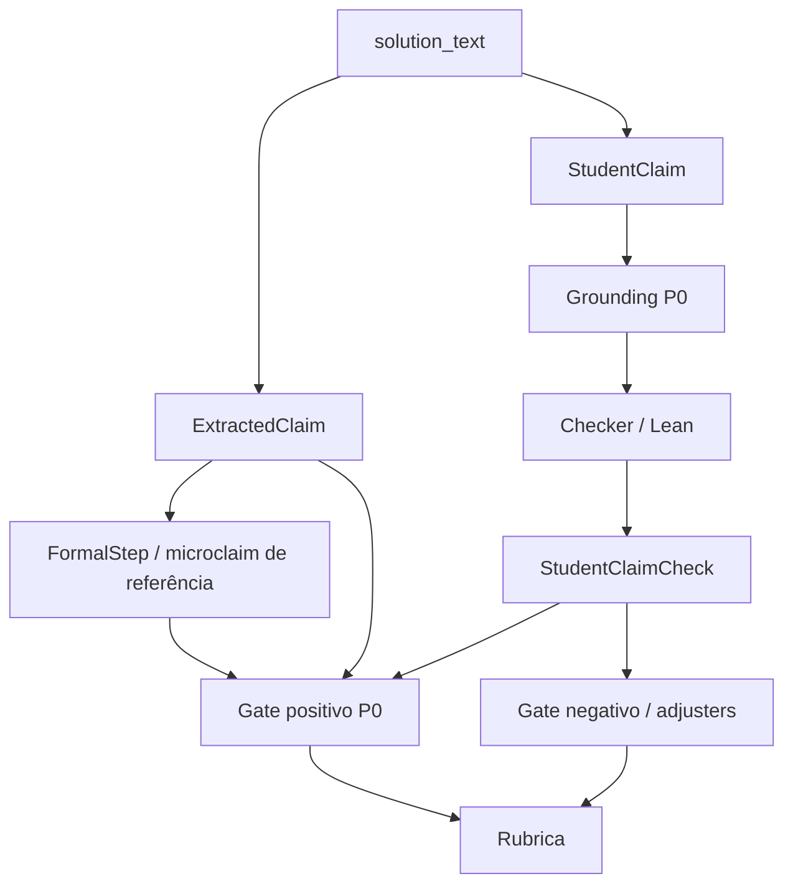
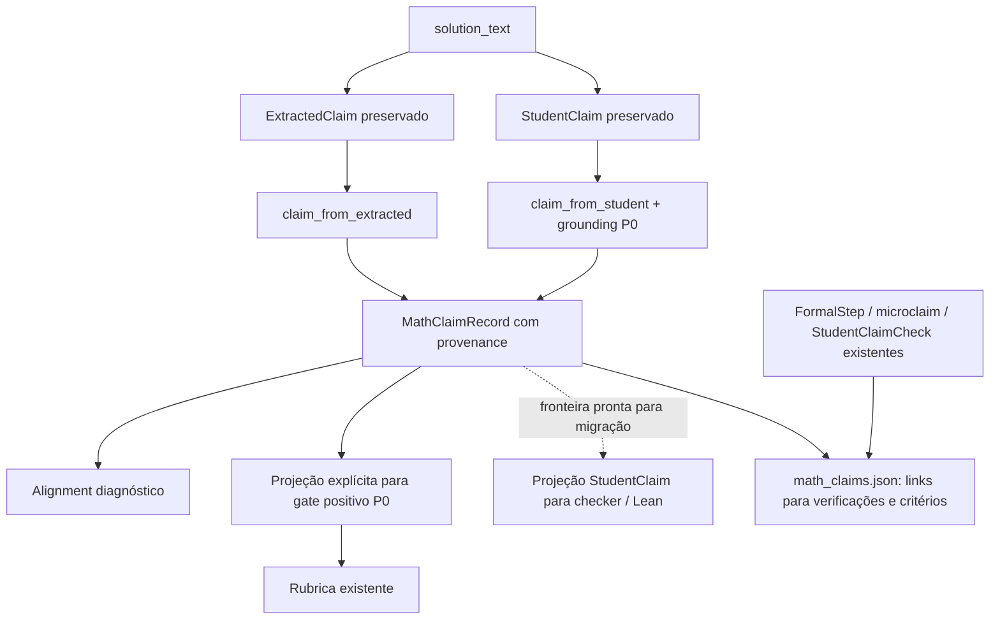

# P1-CLAIM-MODEL-01 — Representação matemática comum

## Resultado e escopo

Foi criada `MathClaimRecord`, uma representação versionada que preserva fonte, origem, conteúdo estruturado, papel semântico e vínculos com verificações e critérios. `ExtractedClaim` e `StudentClaim` continuam existindo. O primeiro consumidor migrado é a fronteira do gate positivo da rubrica; o pipeline também publica o artifact adicional `math_claims.json`.

O alinhamento é uma observação sobre correspondência de conteúdo. Não atribui pontos, não comprova verdade matemática, não refuta e não substitui os gates P0. A política de score, o secondary adjudicator, a UI, os extractors, a canonicalização existente, os checkers e a semântica Lean permanecem iguais ao snapshot anterior a esta tarefa.

Snapshot: [before.json](../../artifacts/evaluations/ita1000_v1_2/p1_claim_model_01/before.json), [fontes anteriores](../../artifacts/evaluations/ita1000_v1_2/p1_claim_model_01/baseline_sources.tar.gz), [mapa anterior](../../artifacts/evaluations/ita1000_v1_2/p1_claim_model_01/architecture_before.md). Branch inicial: `feat/tme-dual-input`; HEAD: `f607bf5691d9f0472b68287a1b88c11d993a937e`. O working tree já tinha 54 entradas modificadas e 29 não rastreadas. O snapshot registra hashes de 3.061 arquivos preexistentes.

## Arquitetura anterior

| Estrutura | Campos relevantes | Produtores | Consumidores atuais |
|---|---|---|---|
| `ExtractedClaim` (Pydantic) | `id`, `type`, `text`, `evidence`, `confidence`, `normalized`, `verification_scope` | `claims/extract_claims.py`, registry e dez extractors | formal steps, microclaims, rubrica, gate positivo, política e relatórios |
| `StudentClaim` (dataclass) | `id`, `problem_id`, `claim_type`, `raw_text`, `normalized_text`, `context`, `data`, `method`, `confidence`, `grounding` | `student_claims/registry.py` e cinco extractors F2 | grounding, registry de checkers e renderizadores Lean |
| `StudentClaimCheck` | identidade, dados, grounding, proposição, método, status formal, compilação, refutação e erros | checkers e reconciliação de atribuição | gate negativo, adjusters, gate positivo e relatório |

Os canais se sobrepõem, mas seus IDs não representam uma identidade matemática compartilhada. Em F2Q1, o par final aparece como strings em `normalized` e inteiros em `data`. Há sobreposição também na diferença de seno/cosseno em F2Q3 e nos logs, mantissa, limites e algarismo em F2Q5. Outros conteúdos não possuem tradução canônica comum suportada.

`ExtractedClaim.text/evidence` e até `StudentClaim.raw_text` podem ser sintéticos. Não são automaticamente citações literais. O P0 fornece o grounding verificável. Q1, Q3 e Q4 atualmente não produzem `StudentClaim`; essa ausência é preservada. Antes desta tarefa, as conversões eram `model_dump`/`asdict`, sem adapter comum entre os dois canais.

## Arquitetura após a alteração

As duas entradas geram registros do mesmo schema, mas não são fundidas destrutivamente. Um alinhamento liga identidades distintas e conserva seus conteúdos e origens. A trilha da rubrica registra o candidato de referência, os candidatos do estudante, obrigações formais e referências à decisão efetiva.

## Modelo e campos

Implementação em [claims/common](../../app/confia_lean_auditor/claims/common/).

| Informação solicitada | Campo comum e significado |
|---|---|
| Identidade | `record_id` com namespace `extracted:` ou `student:`; ID legado em `provenance.legacy_id`; escopo do catálogo/auditoria e `problem_id` |
| Tipo | `claim_type` preserva o nome original |
| Sujeito/variáveis | `canonical_form.subject` e `.variables`, quando disponíveis |
| Texto e offsets | `source.raw_text`, `.source_start`, `.source_end`; offsets sobre o texto original, intervalo semiaberto |
| Grounding | `source.grounding_status`, `.source_sha256`, `.attributable` |
| Método de extração | `provenance.extraction_method`, ausente quando a origem não o fornece |
| Conteúdo canônico | `canonical_form`: família, sujeito, variáveis, valor e método; `null` quando indisponível |
| Papel | `semantic_role`: assumption, intermediate, conclusion, rejected_attempt, quoted_statement ou unknown |
| Origem | `provenance.origin` e canal extracted/student/native |
| Verificações | `verification_results`: mecanismo, ID, status, origem, atribuição e ponteiro para artifact existente |
| Critérios | `rubric_links`, mantendo IDs existentes |
| Compatibilidade sem perda | `legacy_payload`, cópia integral do payload original, opcional para registros nativos |

Versões: `math-claim-v1` e `math-claim-catalog-v1`. Os schemas rejeitam campos desconhecidos e são congelados no nível do modelo. Dicionários internos ainda podem ser mutados; por isso, as projeções reconstroem e validam os campos derivados contra o payload e a fonte antes de execução/alinhamento. Serialização não é autenticação nem prova matemática.

O canal `native` permite representar um claim sem um payload legado. Sua projeção de execução ainda não está definida e é rejeitada explicitamente. Não é necessário inventar um `ExtractedClaim` ou `StudentClaim` para construir o schema comum.

## Adapters, grounding e origem

`claim_from_extracted` conserva integralmente o payload e marca `reference_expected`. Mantém ausentes os offsets e a citação literal, pois o modelo original não fornece grounding suficiente. `normalized` continua sendo informação do canal heurístico. Compilar um teorema associado nunca promove esse registro a `student_explicit`.

`reference_expected` identifica a origem/função do candidato, não um certificado de correção do seu valor. A verificação continua sendo um resultado separado.

`claim_from_student` reutiliza `source_matches` do P0 para verificar digest, trecho literal, offsets e compatibilidade matemática com o payload. Um grounding declarado como grounded que não corresponde à fonte atual torna-se unresolved na projeção comum; o grounding original continua preservado no payload. Apenas fonte validada e contexto atribuível recebem `student_explicit`; os demais ficam `student_candidate`.

O contexto usa as funções e o léxico já existentes do gate positivo P0, inclusive parágrafo e citações, sem novos extractors ou regexes. Hipótese, tentativa abandonada, citação e negação não viram afirmação confirmada por alinhamento. As classificações semânticas são parciais; `unknown` é explícito. `student_derived` e `secondary_adjudication` estão preparados como origens, sem produtores novos nesta tarefa.

`project_extracted_claim` restaura o objeto legado para o gate positivo. `project_student_claim`/`checker_input_from_record` restauram o input exato do checker somente após validar a fonte e a atribuição. Valores do estudante não são substituídos pela resposta esperada.

## Canonicalização e alinhamento

A arquitetura aceita tipos genéricos, mas o registry inicial de traduções entre canais é deliberadamente parcial: seis pares de tipos, sem CAS novo.

| Família atual | Reuso existente |
|---|---|
| Par final F2Q1 | `local_integer_bindings`, valores inteiros exatos de a e b |
| Diferença beta F2Q3 | `canonicalize_equality`, equivalência afim já suportada |
| Log, mantissa e limites F2Q5 | `_scaled` do grounding existente, representação decimal inteira escalada |
| Algarismo F2Q5 | extração local de inteiro já existente |

Não foram acrescentadas identidades trigonométricas, radicais, polinômios gerais, SymPy ou aproximações numéricas. Conteúdo sem tradução confiável permanece `canonical_form=null`. O registry de pares pode crescer quando houver uma canonicalização suportada e testada; não é necessário mudar o schema.

`align_claims` exige mesmo problema, par de tipos conhecido, projeções coerentes e estudante grounded/atribuível. Não usa similaridade textual, score ou coincidência de IDs como prova.

| Estado | Condição |
|---|---|
| aligned | formas estruturadas/canônicas suportadas iguais |
| conflicting | conteúdo grounded diverge da referência |
| ambiguous | grounding ambíguo, identidades duplicadas, projeção inconsistente ou candidatos grounded divergentes |
| unmatched | falta de candidato, par suportado, atribuição ou forma canônica |

Exemplo: `a=-1,b=3` nos dois canais fica aligned. Referência `a=-1,b=3` e estudante grounded `a=3,b=2` ficam conflicting; ambos os registros permanecem. `preferred_attribution_ids` aponta para o estudante grounded, inclusive no conflito. Essa precedência identifica **o que o aluno disse**; não declara que esteja certo. Havendo vários candidatos divergentes, nenhum é escolhido silenciosamente.

## Integração, rubrica e verificações

Em `rubric_evaluator.evaluate_rubric`, cada candidato passa pelo adapter comum e por `positive_credit_from_record`. A bridge valida a projeção e chama o mesmo `can_support_rubric_credit` com os mesmos argumentos. Não há segunda implementação do gate nem novo veto derivado de alinhamento.

A bridge negativa `record_is_mathematically_refuted` combina a projeção grounded, a correspondência exata do check e o `is_mathematically_refuted` existente. Está disponível e testada; os adjusters de produção continuam no caminho P0 atual. `checker_input_from_record` define a fronteira comum → input estruturado → renderizador existente, sem trocar registry, tática, proposição ou timeout.

`main.execute_audit` publica `math_claims.json` antes da publicação atômica final de `audit.json`. O catálogo contém ambos os canais, alinhamentos e `criterion_traces`. Vínculos de estudante com rubrica reutilizam `related_check_types` do P0; vínculos de referência usam a configuração existente da rubrica. Os links são relações de candidatura, não confirmação automática.

Para responder “por qual claim este critério recebeu pontos?”, seguir `criterion_traces` → `reference_record_id`/`student_record_ids` → `decision_ref` e `evidence_ref` em `audit.json`. A decisão mantém pontos, status, `scoring_basis` e evidência positiva do motor. Para saber “qual mecanismo verificou este claim?”, seguir `verification_results[].artifact_ref`. Os testes de pipeline resolvem esses ponteiros no artifact real.

Não são copiados stdout, provas ou payloads completos de checks. A cópia de `legacy_payload` é intencional e restrita à compatibilidade sem perda dos claims. Checks associados exigem igualdade de identidade/tipo/dados; `attributed_to_student` exige também a validação P0 da fonte. Status técnico ou formal, por si só, não muda a origem.

`MathClaimRecord` representa conteúdo e autoria. Uma microclaim continua sendo uma obrigação formal exigida pela rubrica, com suas dependências. `FormalStep` continua sendo um passo/resultado formal. Ambos aparecem como verificações `generated_reference`, nunca como prova de que o estudante escreveu a afirmação. A evidência textual P0 é a ligação necessária com a fonte.

## Compatibilidade e limitações

`AuditResponse` não ganhou campos obrigatórios nem mudou seu contrato. Os artifacts legados continuam legíveis; nenhum artifact histórico é reescrito pela integração. O novo arquivo é adicional para novas auditorias. IDs e payloads dos dois canais, microclaims e formal steps permanecem disponíveis.

Limitações: cobertura parcial dos pares canônicos; sem NLP geral; Q1/Q3/Q4 sem canal StudentClaim; registros nativos sem execução; IDs com escopo local à auditoria; dicionários internos exigem revalidação; dependência explícita de helpers P0 internos. Alguns StudentClaims F2Q5 de fixtures existentes permanecem unresolved pela gramática atual de grounding. Isso é registrado na comparação de fixtures e não foi corrigido por novas regexes. A integração não reduz nem amplia essa cobertura.

Na fixture correta F2Q5, esses tipos são `f2q5_student_mantissa` e `f2q5_student_digit_log_bounds`. O gate positivo P0 ainda pode apoiar seus critérios com a própria evidência textual validada e obrigações de referência. O alignment comum não substitui essa decisão por uma exigência nova de StudentClaim; a evidência efetivamente usada está no ponteiro `positive_evidence`. Unificar também esses produtores será uma migração posterior.

Alinhamento não decide pontos, não prova equivalência fora da linguagem suportada e não corrige falhas dos extractors. O futuro grafo poderá usar os IDs versionados para arestas `depends_on`, `supports`, `contradicts` e `derived_from`, com origem e justificativa de cada aresta. Nenhum grafo completo foi implementado.

## Migração futura

1. Fazer o registry de checkers consumir `checker_input_from_record`, preservando proposições e resultados por comparação de fixtures. Migrar por família, sem parsing paralelo adicional.
2. Fazer adjusters consumir a bridge negativa comum, mantendo a exigência de refutação formal grounded.
3. Fazer relatórios e ferramentas de depuração lerem `criterion_traces` e verificações por referência, preservando contratos públicos.
4. Associar obrigações de microclaims e FormalStep a registros comuns sem promover referências a autoria.
5. Fazer o secondary adjudicator receber registros, spans e verificações já resolvidos; eventual saída deve ter origem `secondary_adjudication` e não reescrever evidência do estudante. Essa etapa não foi implementada.
6. Ampliar canonicalização em P1-MATH-CANONICAL-01; só depois aumentar pares de alignment e migrar produtores nativos. Remoção dos legados depende de paridade e migração de todos os consumidores.

## Validação e entrega

Os novos testes cobrem igualdade, equivalências já suportadas, conflito, precedência grounded, ausência de grounding/canonicalização, ambiguidade, origem de referência, adulteração, serialização, projeções e adversariais. A amostra estrutural inclui Q1, Q3, Q4, F2Q1, F2Q3 e F2Q5; roundtrips e gates são exercitados nos dez problemas.

Os resultados consolidados, contagens e preservação de arquivos estão em [validation_summary.json](../../artifacts/evaluations/ita1000_v1_2/p1_claim_model_01/validation_summary.json). A comparação contra a fonte anterior da rubrica está em [baseline_parity.json](../../artifacts/evaluations/ita1000_v1_2/p1_claim_model_01/baseline_parity.json); ela usa perfis controlados de microclaims e não se apresenta como execução Lean. Os testes de pipeline separados executam Lean real offline.

As 44 fixtures existentes tiveram igualdade integral da rubrica em dois perfis (sem microclaims verificadas e com verificação de referência controlada): 88 comparações. Os 63 testes novos estruturais passaram. Os dois testes novos com Lean real preservaram a solução correta F2Q1 em 10/10 e a resposta errada `a=3,b=2` com critério final refutado/zero, score global null e verdict inconclusivo, conforme o comportamento anterior. Os [exemplos reais](../../artifacts/evaluations/ita1000_v1_2/p1_claim_model_01/real_pipeline_examples.json) registram os respectivos artifacts, spans literais, valores e vínculos de verificação.

A suíte completa reuniu **1.241 casos únicos: 1.237 passaram, três falharam e um ficou xfailed**. As três falhas são exclusivamente as preexistentes:

- `test_hmer_audit_parity.py::test_projection_preserves_falsehoods_signs_and_general_fractions`;
- `test_ui_01_shell.py::test_central_product_vocabulary_is_preserved_without_contract_renames`;
- `test_ui_02_workspace.py::test_parent_statement_is_compact_and_sticky_through_notebook_and_submission`.

O xfail conhecido de F2Q6 foi preservado. Não foi detectada regressão adicional. O grupo amplo terminou com 1.015 passed/3 failed; rubrica e pipeline com 75 passed; provas/checkers com 146 passed/1 xfailed; imutabilidade com 1 passed. Este último rodou isoladamente, sem outros escritores de artifacts e com stdout temporário fora da pasta observada. As execuções focadas dos 65 testes novos não são somadas novamente ao total de casos únicos.

Os grupos disjuntos da suíte estão em `groups.json`, com logs `broad.log`, `reference_pipeline.log`, `proof_pipeline.log` e `immutability.log` na pasta desta tarefa. O runner remove credenciais de OpenAI/Mathpix, desabilita formal steps LLM e bloqueia conexões de rede Python. Não houve chamadas externas nem execução de batch 18/502/1000.

Arquivos preexistentes alterados por esta tarefa: somente `main.py` e `rubric/rubric_evaluator.py`. Novos: sete módulos `claims/common`, dois arquivos de testes e este relatório. Snapshot, scripts de verificação, logs e manifestos ficam na pasta de artifacts solicitada.

Entrega revisável: [diff incremental](../../artifacts/evaluations/ita1000_v1_2/p1_claim_model_01/implementation.diff), [snapshot final](../../artifacts/evaluations/ita1000_v1_2/p1_claim_model_01/after.json) e [git status --short](../../artifacts/evaluations/ita1000_v1_2/p1_claim_model_01/git_status_short.txt). O diff incremental usa o snapshot imediatamente anterior à tarefa, não HEAD, para separar as alterações anteriores. Não houve staging, commit, push, reset, limpeza ou troca de branch.
