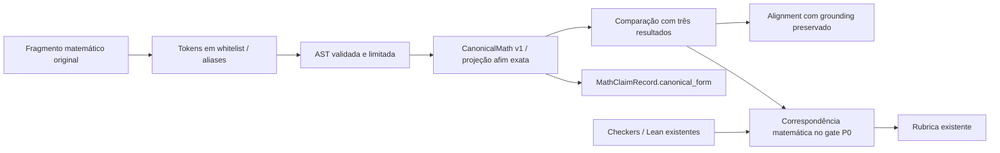

# P1-MATH-CANONICAL-01 — Canonicalização matemática limitada

## Resultado e fronteira

A nova API `core.math_canonical` recebe **um fragmento matemático**, faz parsing estrito e produz uma árvore serializável e, quando possível, uma forma afim racional exata. A comparação retorna `equivalent`, `not_equivalent` ou `unknown`. A camada não resolve problemas, não substitui Lean e não transforma falha de parsing em refutação.

Os modelos legados, a política de pontuação, o adjudicator, a UI, os assets e os renderizadores/proposições Lean foram preservados. Não houve instalação de dependências nem chamadas externas.

## Inspeção e infraestrutura reaproveitada

Antes das alterações, [before.json](../../artifacts/evaluations/ita1000_v1_2/p1_math_canonical_01/before.json) registrou branch `feat/tme-dual-input`, HEAD `f607bf5691d9f0472b68287a1b88c11d993a937e`, estado Git, staging, `git diff --check` e hashes de 3.071 arquivos. As fontes anteriores estão em [baseline_sources.tar.gz](../../artifacts/evaluations/ita1000_v1_2/p1_math_canonical_01/baseline_sources.tar.gz). O [mapa anterior](../../artifacts/evaluations/ita1000_v1_2/p1_math_canonical_01/architecture_before.md) foi escrito antes da implementação.

Foi reaproveitado:

- `core/audit_math_projection.py`: `ast`, `Fraction`, `_affine`, `_add`, `_scale`, leitura de grupos LaTeX e os introdutores de equações já usados pelo motor;
- grounding P0: spans, digests, dados estruturados, contexto atribuível e gates de refutação;
- `MathClaimRecord`, adapters e seis traduções legadas do P1 anterior;
- regras matemáticas já declaradas em `positive_rules.py`, sem inventar requisitos de rubrica;
- checkers e Lean, com seus inputs e métodos atuais.

`canonicalize_equality` agora delega o parsing limitado à nova API e mantém o retorno legado `tuple`/`None`. A projeção tolerante `project_audit_math` permanece para seus consumidores existentes. Ela não é usada como parser estrito de entrada da nova API. `_affine` ganhou apenas um orçamento opcional durante a recursão; continua sendo o único coletor algébrico afim.

O pyproject não declara SymPy ou biblioteca equivalente; SymPy, Lark e pyparsing também não estão no venv. A decisão registrada previamente foi **não adicionar dependência**: a biblioteca padrão e a álgebra afim existente permitem o escopo seguro inicial. Expansão/coleta polinomial geral foi adiada, evitando construir um CAS próprio nesta tarefa.

## Parser e representação

`parse_math(text, expected_kind=None)` retorna `ParseResult`:

| Estado | Significado |
|---|---|
| parsed | Fragmento admitido pela gramática e limites; não significa que uma igualdade seja verdadeira |
| unsupported | Operação, função, domínio, token ou complexidade não suportados |
| ambiguous | Mais de uma leitura relevante: relações encadeadas, separador decimal/lista, escopo de função etc. |
| invalid | Expressão incompleta, agrupamento quebrado, divisão por zero ou outra forma malformada |

`CanonicalMath` usa `schema_version=canonical-math-v1`, domínio `real_total`, `kind`, `tree`, projeção `affine` opcional, relação e variáveis. `MathNode` representa racionais, variáveis, constante pi, soma, diferença, produto, quociente, potência, função, relação e intervalo. Coeficientes e números são strings racionais exatas; nenhum float aproxima `1/3`. A árvore não é código executável.

As variáveis são reais. A representação de inteiros/racionais não permite inferir que uma variável é inteira ou natural. Em particular, a camada não prova paridade em Q3.

Aliases são aplicados a tokens matemáticos reconhecidos: `sen`/`seno` → `sin`, letras gregas e comandos correspondentes, `π` → `pi`, menos Unicode e sinais de multiplicação. `tg` é reconhecido como alias de `tan`, mas o parsing retorna unsupported por exigir domínio sem polos. Palavras de prosa como “senhora” não são alteradas nem aceitas como função.

São aceitas formas como `2x`, `2(x+1)` e `(a+b)x`; produtos ambíguos em denominadores, como `1/2x`, são recusados. `sin beta` e `\sin\beta` são aceitos; `sin x^2` exige parênteses por ambiguidade de escopo. `x^2`, `x²` e `x^{2}` produzem a mesma árvore. Expoentes simbólicos não são admitidos.

Intervalos preservam abertura/fechamento. `(a,b)` requer `expected_kind='interval'` para não adivinhar entre intervalo e par ordenado. Não se simplificam uniões, conjuntos ou intervalos vazios, nem se presume a ordem dos extremos simbólicos.

## API de equivalência

`equivalent(left, right, expected_kind=None)` faz parsing dos dois textos. `compare_canonical` compara representações já produzidas/validadas pelo parser. Os resultados incluem razão e base da decisão.

- `equivalent`: árvores validadas iguais ou formas afins exatas coincidentes;
- `not_equivalent`: formas afins distintas sobre variáveis reais independentes, com justificativa algébrica;
- `unknown`: parsing não admitido, domínio distinto, álgebra não suportada ou ausência de demonstração suficiente.

Igualdades afins são levadas a `lhs-rhs=0`, com remoção de fator racional não zero, inclusive sinal global. Assim, `x=y+1/2`, `x-y=1/2` e `2x-2y=1` coincidem. Nas desigualdades, `>`/`>=` trocam os lados e a normalização só divide por fator racional **positivo**. Não se multiplica por expressão de sinal desconhecido.

Funções seno/cosseno são átomos simbólicos sobre argumentos normalizáveis. É seguro comparar `cos(beta)=sin(beta)+1/2` com `cos(beta)-sin(beta)=1/2`; isso não comprova a igualdade nem uma identidade trigonométrica. Termos de função ou pi não são tratados como variáveis independentes para declarar não equivalência.

Exemplos conservadores:

| Comparação | Resultado |
|---|---|
| `2x+3y=5` / `x=(5-3y)/2` | equivalent |
| `x=y-1/2` / `x-y=1/2` | not_equivalent |
| `x>3` / `3<x` | equivalent |
| `x²=4` / `x=2` | unknown; nenhuma raiz é descartada |
| `(x+1)^2` / `x²+2x+1` | unknown; sem expansão polinomial |
| `sin(x)=0` / `x=0` | unknown; não se presume inversão de seno |
| `sin(x)^2+cos(x)^2` / `1` | unknown; Lean/checker continua responsável |
| `x/x` / `1` | unknown; divisão por variável recusada |
| `log10(3^100)` / `100*log10(3)` | unknown; sem álgebra de logaritmos |

## Matriz de suporte

| Estrutura matemática | Suportada | Observação |
|---|---|---|
| Inteiros e racionais | Sim | Fraction; decimais com ponto são exatos |
| Decimal com vírgula | Não no parser genérico | Ambiguous; traduções legadas escaladas permanecem |
| Variáveis gregas/latinas | Sim, léxico delimitado | Variáveis simples, gregas e identificadores indexados; a projeção afim conserva os limites do coletor existente |
| Constantes simbólicas | Parcial | pi; não se presume valor racional ou independência |
| Soma/subtração | Sim | Coleta afim exata quando admitida |
| Produto | Parcial | Árvore; álgebra afim quando um fator é racional |
| Divisão | Parcial | Denominador racional não zero; sem cancelamento de variáveis |
| Potência inteira | Parcial | Expoente explícito limitado; potências de variáveis não negativas; negativas só de base racional não zero |
| Igualdade | Sim | Equivalência afim e identidade de árvore; sem solver geral |
| Inequação simples | Parcial | Troca de lados e escala racional positiva; sem inferir sinais desconhecidos |
| Intervalos | Sintaxe | Extremos e abertura/fechamento preservados; contexto explícito para parênteses abertos |
| sin/cos | Sintaxe/átomos | Sem identidades trigonométricas |
| tan/tg | Não | Domínio com polos não modelado nesta etapa |
| Polinômios | Sintaxe parcial | Sem expansão, fatoração ou coleta geral; comparação pode retornar unknown |
| log | Sintaxe limitada | Base 10 explícita e argumento racional positivo; sem avaliar log ou usar identidades |
| Radicais | Não | Unsupported; verificações existentes continuam disponíveis |
| Geometria | Não | Claims estruturados preservados; sem equivalência de argumentos geométricos |

## Integração com MathClaimRecord e alignment

Foram adicionados os campos opcionais `canonicalization_status` e `canonicalization_reason`. Se o parser recusa um conteúdo sem tradução estruturada existente, `canonical_form` permanece ausente. Registros históricos sem os campos continuam legíveis.

Os seis formatos estruturados anteriores são preservados. Para a forma afim legada, `CanonicalForm.mathematical_form` acrescenta a representação genérica sem remover o valor antigo. Novos campos matemáticos explícitos usam `family=mathematical`, com a representação em `value`. O adapter não busca uma expressão favorável na prosa: usa um campo matemático explícito ou um payload de valor único. Payloads compostos sem tradução definida permanecem unsupported/ambiguous.

`raw_text`, offsets, digest e provenance são preservados no modelo comum. A canonicalização não transforma referência em afirmação do estudante. Os adapters reconstroem e validam o conteúdo antes de projeções executáveis; campos novos também são revalidados. A projeção histórica é reconstruída no formato antigo quando os novos campos estão ausentes.

O alignment continua exigindo problema/tipo compatível, grounding, atribuição e identidade coerentes. Primeiro usa equivalência matemática disponível; depois, valores estruturados exatos. Não usa similaridade textual. Registra `alignment_basis=canonical_equivalence` ou `structured_values`.

Ambiguidade de grounding tem precedência sobre correspondência canônica. Resultado matemático unknown não vira conflicting: fica unmatched, mantendo o conteúdo grounded preferido para atribuição. Conflitos comprovados entre valores estruturados continuam explícitos. Nenhum resultado sobrescreve silenciosamente o claim do estudante.

`math_claims.json` passa a mostrar os estados novos automaticamente pela serialização do catálogo existente. Não foi necessário alterar `main.py` nem o contrato público `AuditResponse`.

## Rubrica, checkers e Lean

As equações declaradas por `equation(lhs,rhs)` passam a carregar seus alvos matemáticos. `Requirement` mantém primeiro o reconhecimento existente; apenas quando ele falha pode comparar uma cláusula inteira com um desses alvos. Alternativas compostas com prosa não ganham um atalho canônico. Outros padrões da mesma Requirement continuam obrigatórios.

A fronteira de cláusula reutiliza introdutores de equações já existentes; não procura substrings arbitrárias dentro de expressões. Ela recebe contextos previamente filtrados pelo P0. Negação, hipótese, tentativa abandonada, citação, número irrelevante, cópia do enunciado, microclaims ausentes, grounding ambíguo e refutação formal continuam bloqueando crédito. O span original fica na evidência, com `alignment_basis` quando o fallback canônico foi necessário.

Não há atribuição direta nova a `score`, `verdict`, `suggested_points`, `coverage` ou `estimated_points`, nem alteração de suas fórmulas/políticas. Uma forma equivalente antes recusada por sintaxe pode agora satisfazer a evidência do mesmo critério e recuperar o crédito pela política existente. Isso é uma mudança deliberada de interpretação, não uma promessa de que toda entrada possível manterá a mesma nota.

`canonical_input_from_record` oferece uma consulta matemática validada para consumidores futuros. Ela não executa prova nem substitui `checker_input_from_record`, que mantém o input legado exato e a exigência de atribuição. Não foram migrados os checkers em massa nem alterados táticas, timeouts ou proposições Lean. O secondary adjudicator permanece intacto.

## Casos reais e compatibilidade

- **F2Q3:** a fixture correta reescrita com `cos beta = sen beta + 1/2` é reconhecida pelo gate canônico. A fonte original, os checks e a distinção referência/estudante permanecem. O caso é testado com Lean real.
- **F2Q1:** relações de coeficientes podem ser comparadas pela API/regra genérica (`a+b=2` / `b+a-2=0`), sem um novo solver do problema. Sistemas compostos não são divididos silenciosamente. Não se reescreveu o extractor para encontrar todas as variantes.
- **F2Q5:** valores decimais escalados existentes são preservados; notações de log com base 10 explícita podem ter árvore comum, sem provar identidades logarítmicas ou exatidão de tabelas aproximadas.
- **Q3:** expressões de expoentes recebem forma afim; “odd exponent” permanece unsupported e nenhuma propriedade de paridade é inventada.

A [comparação com o snapshot](../../artifacts/evaluations/ita1000_v1_2/p1_math_canonical_01/baseline_parity.json) executa todo o app anterior em uma pasta temporária isolada. As 44 fixtures existentes produzem rubricas integralmente idênticas em 88 comparações com perfis controlados de microclaims. A variante nova F2Q3 está registrada separadamente: com microclaims verificadas, o score controlado passa de null para 10; sem elas, continua null. Nenhuma verificação canônica substitui essas obrigações.

Artifacts históricos não são reescritos nem têm hashes recalculados por migração. Há teste de leitura/projeção de um `math_claims.json` anterior, sem os campos novos. O working tree anterior é preservado por comparação dos hashes do snapshot.

## Segurança, complexidade e performance

Não há `eval`, `exec`, sympify, importação comandada por texto, funções arbitrárias ou execução de AST. O parser rejeita atributos, indexing, compreensões, lambdas, código e comandos LaTeX desconhecidos. As únicas funções admitidas com domínio total nesta etapa são sin/cos e log10 de argumento racional positivo.

Limites: 2.048 caracteres; 256 tokens/visitas orçamentadas; profundidade 32; até 128 termos afins; literal de até 64 caracteres; numerador/denominador de até 512 bits; módulo do expoente até 128; orçamento cooperativo de 50 ms. Potências numéricas são dimensionadas antes do cálculo. Limites são checados no parsing e na coleta afim, sem simplificador externo de custo imprevisível. Não é um timeout preemptivo de sistema operacional: o trabalho entre checagens também é limitado por tamanho/estrutura.

O [microbenchmark offline](../../artifacts/evaluations/ita1000_v1_2/p1_math_canonical_01/microbenchmark.json) mediu 2.000 parses, incluindo recusas. Os tempos são observações locais, não SLA. Não foi adicionada otimização/caching prematura.

Riscos/limitações: cobertura sintática deliberadamente finita; aliases e multiplicações implícitas só em casos delimitados; distinção entre real e inteiro; canonicalização incompleta de polinômios/funções; acoplamento de compatibilidade com o coletor afim legado. O resultado unknown deve continuar explícito nos consumidores futuros. Canonicalização de uma relação não demonstra sua verdade no problema.

## Validação e entrega

Há 167 testes novos focados de equivalência, notação, falhas, segurança, complexidade, integração e compatibilidade, mais um novo teste de pipeline com Lean real. A rodada focada com os testes existentes de canonicalização, MathClaimRecord e gate positivo teve 360 passed, excluindo somente o teste real que roda no grupo formal.

Na primeira execução real da variante F2Q3, o passo de referência `f2q3_s1_beta_difference` teve `lean_timeout` (exit code 124). O gate manteve a microclaim pendente e não concedeu crédito por canonicalização sozinha. A repetição **sem alteração de código, timeout ou proposição** passou em 77,80 s, com 10/10 e verdict correto. Evidências: [timeout inicial](../../artifacts/evaluations/ita1000_v1_2/p1_math_canonical_01/initial_lean_timeout.json), `canonical_pipeline.log` e [repetição](../../artifacts/evaluations/ita1000_v1_2/p1_math_canonical_01/canonical_pipeline_retry.log). Esse evento operacional não foi omitido nem convertido em falha matemática.

Os resultados completos e a preservação de arquivos estão em [validation_summary.json](../../artifacts/evaluations/ita1000_v1_2/p1_math_canonical_01/validation_summary.json). Os grupos disjuntos e logs ficam em `groups.json`, `broad.log`, `reference_pipeline.log`, `proof_pipeline.log` e `immutability.log`. As falhas preexistentes HMER/UI vocabulary/tablet sticky e o xfail F2Q6 são identificados separadamente; não fazem parte do escopo de correção.

A suíte final reuniu **1.409 casos únicos: 1.405 passed, três failed preexistentes e um xfailed esperado**. Distribuição: amplo 1.182 passed/3 failed; rubrica/pipeline 75 passed; provas/checkers 147 passed/1 xfailed; imutabilidade 1 passed. O teste de imutabilidade rodou isoladamente, com stdout fora da pasta observada e sem outros escritores de artifacts. Os 168 testes novos passaram; suas execuções focadas/repetidas não são somadas novamente ao total único.

As três falhas são `test_projection_preserves_falsehoods_signs_and_general_fractions`, `test_central_product_vocabulary_is_preserved_without_contract_renames` e `test_parent_statement_is_compact_and_sticky_through_notebook_and_submission`. Não foi detectada regressão funcional adicional. A variante nova F2Q3 passou novamente dentro da suíte ampla; o timeout inicial continua registrado acima.

Arquivos preexistentes modificados: `core/audit_math_projection.py`; cinco módulos de `claims/common` (schemas, canonical, adapters, alignment, bridges); `rubric/positive_evidence.py` e `rubric/positive_rules.py`. Novos: pacote `core/math_canonical` com cinco módulos, dois arquivos de testes e este relatório. Scripts, snapshots e evidências estão na pasta solicitada.

Entrega: [diff incremental](../../artifacts/evaluations/ita1000_v1_2/p1_math_canonical_01/implementation.diff), [snapshot final](../../artifacts/evaluations/ita1000_v1_2/p1_math_canonical_01/after.json) e [git status --short](../../artifacts/evaluations/ita1000_v1_2/p1_math_canonical_01/git_status_short.txt). O diff usa o snapshot anterior à tarefa, sem incorporar indevidamente alterações dos P0/P1 anteriores. Não houve batch 18/502/1000, chamadas externas, staging, commit, push, reset, limpeza ou troca de branch.
