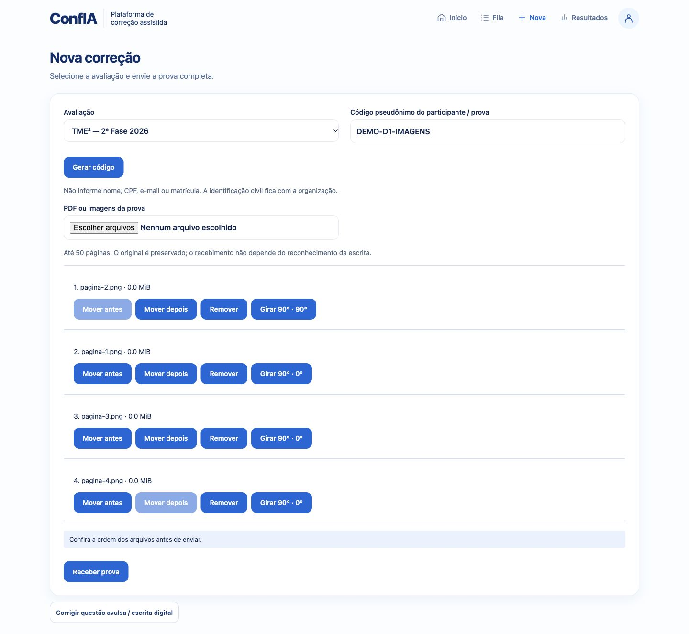
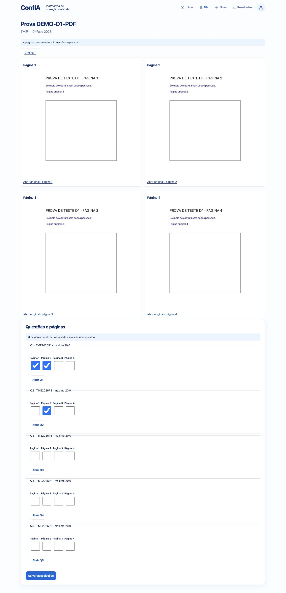
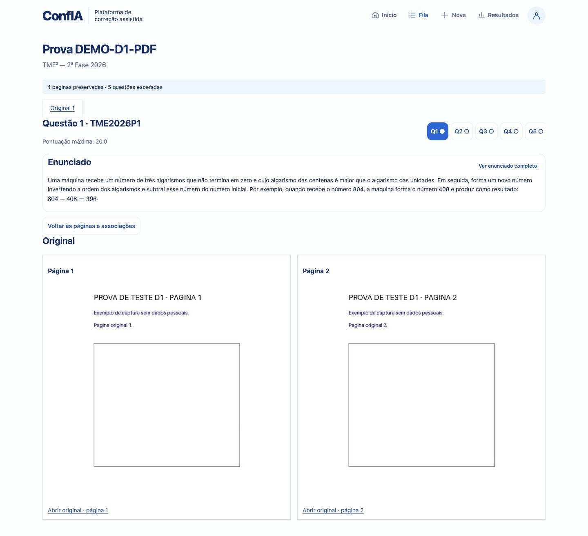
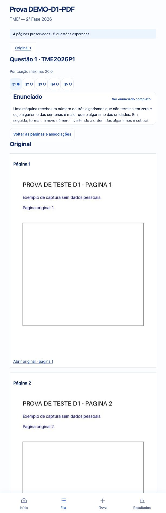
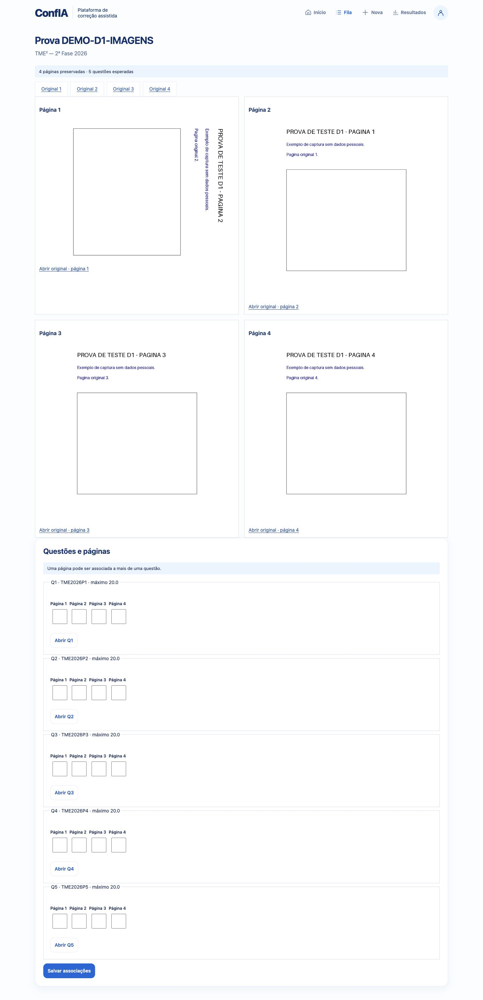

# TME dezembro — D1: fundação da prova completa

## Baseline e arqueologia anterior às alterações

SHA inicial: `1b3daea41ba4ce31c0cfd35dd07907da3d03669f`.
Branch: `feat/tme-december-integration`. Worktree oficial: `~/Documents/confia-lean-auditor-tme-december-integration`.
Já existia, não rastreado, `docs/audits/TME_DECEMBER_DEMO_GAP_ANALYSIS_01.md`; deve ser preservado.

| Conceito | Código existente e decisão D1 |
|---|---|
| Avaliação | **EXTENDED**: `assessments/models.py` e `AssessmentStore`; preservar escopo institucional e hashes históricos, acrescentar escopo TME explícito |
| Usuário/aluno | **REUSED**: `AuthUser`, autorização e contexto escolar; nenhum participante pseudônimo vira usuário |
| Participante | **NEW**: não existe equivalente entre `AuthUser`, matrícula e `external_candidate_ref`; `AssessmentParticipant` distingue usuário registrado e pseudônimo externo |
| Submissão por questão | **REUSED**: `SubmissionRecord` e `SubmissionStore`, mantidos para ink/foto/transcrição/auditoria legados |
| Entrega completa | **NEW**: `ExamSubmission`, agregando referências a casos e documentos/páginas |
| Questão/tentativa | **EXTENDED**: `CorrectionCase` é a unidade de tentativa; não criar outro sistema concorrente de notas/revisão |
| Questões esperadas | **REUSED**: `AssessmentItem`, catálogo de problemas, ordem e pontuação |
| Arquivos/páginas | **EXTENDED**: semântica de artefatos imutáveis/hash, com manifesto `ExamPage` para PDF e múltiplas imagens; manter formatos legados limitados a três páginas intactos |
| Transcrição | **REUSED**, sem implementação D2: `TranscriptionRevision`, acceptance/receipt, RecognitionService |
| Auditoria/score | **REUSED**, sem alteração: AuditService/AuditRun, TMEAuditResult/PautaDecision |
| Decisão humana | **REUSED**, sem expansão D5: EvaluatorDecision/TeacherDecision |
| Persistência | **REUSED**: arquivos JSON/binários, locks, staging/publicação atômica; nenhum banco novo |
| UI | **EXTENDED**: `static/tme/tme.js`, `Views.Page`, cards/botões e `CorrectionHeader`/`ProblemStatement`; header, paleta, tipografia e shell preservados |

Implementação, validações e comandos registrados nas seções seguintes.

## 1. Identidade da entrega

Implementação local sobre o SHA e branch acima; sem `git add` e sem commit. O diagnóstico anterior foi mantido. Escopo exclusivamente D1: receber prova completa, preservar, ordenar, associar e abrir uma tentativa. Nenhum arquivo Lean, checker, PautaEngine, experimental P3, benchmark, gold ou fixture matemática foi alterado.

## 2. Arquitetura encontrada e preservada

FastAPI serve o shell `/tme` e scripts estáticos. `CorrectionCase` é o envelope operacional por questão; `SubmissionRecord` representa uma fonte por problema; revisões, acceptances, auditorias e decisões humanas já possuem armazenamento próprio. `Assessment`/`AssessmentItem` usam JSON local, locks e hash de definição publicada. Não existia envelope de prova inteira nem participante independente de usuário.

A tabela de arqueologia acima foi registrada antes dos modelos. A extensão agora implementada segue essas decisões. `QuestionAttempt` é o próprio `CorrectionCase`, acessível por uma nova projeção de API com as páginas associadas. Não foi criado um segundo sistema de pontuação ou auditoria.

## 3. Participante e pseudonimização

`AssessmentParticipant` admite `REGISTERED_USER` (exige `user_id`, proíbe código/namespace externos) e `EXTERNAL_PSEUDONYM` (exige código, proíbe `user_id`). O piloto cria somente o segundo tipo. Não há campos de nome, CPF, e-mail ou matrícula e campos desconhecidos são rejeitados. Códigos são sensíveis a maiúsculas/minúsculas; espaços são rejeitados pelo domínio, e a UI remove espaços nas extremidades antes do envio.

`ParticipantStore` cria ID determinístico e usa lock + arquivo imutável para garantir unicidade de `(assessment_id, external_namespace, external_code)`, inclusive sob concorrência. O mesmo código em outro namespace é outra participação. Não cria nem altera `AuthUser`. A organização mantém externamente a correspondência civil. Os documentos originais são preservados integralmente: o sistema não remove informações que já estejam escritas dentro deles. Nomes de arquivo enviados pelo navegador não são persistidos.

## 4. Demo sem login

Reutiliza `require_tme_evaluator` e `CONFIA_TME_DEMO_NO_AUTH=1`; nenhuma mudança em autenticação, sessão ou login institucional. O avaliador demo continua sendo uma identidade de proveniência TME, não um usuário/aluno fabricado. `/assessments` e demais rotas institucionais continuam protegidas. A configuração em `CONFIA_ENV=production` permanece rejeitada pelo comportamento existente, coberto por `test_tme_demo_auth.py`. Cada nova rota exige o mesmo avaliador; prova e avaliação pertencem ao seu proprietário.

## 5. Modelos reutilizados e estendidos

- `Assessment`: acrescenta escopo explícito `TME`, schema `2.0`, sem escola/rede/turma artificiais. No escopo institucional, esses três vínculos continuam obrigatórios.
- `AssessmentItem`: conserva catálogo, ordem e pontos. A avaliação é publicada atomicamente com a lista completa e hash de definição.
- `CorrectionCase`: recebe `exam_submission_id`, `assessment_item_id`, `question_order`, `max_score`; os quatro campos devem aparecer juntos. Mantém status, referência futura à Submission, revisões, auditorias e decisão existentes.
- `SubmissionStore`: reutiliza helpers de escrita/fsync/publicação. `CaseStore` passa a aceitar IDs internos determinísticos para recuperar tentativas após interrupção.
- Catálogo de problemas: continua fornecendo enunciados, figuras e identificação dos problemas. Nenhuma pauta foi duplicada.

## 6. Modelos novos

`ExamSubmission` registra avaliação e hash publicado, participante, proprietário, estado `RECEIVED`, data, origem PDF/IMAGES, metadados, originais/previews, páginas e IDs das tentativas. Congela snapshots da avaliação e participação no manifesto.

`ExamPage` registra ID, prova, número da página começando em 1, referência ao original, número dentro do PDF original, referência ao preview, dimensões, rotação e transformação. MIME, tamanho e SHA-256 ficam nos objetos `ExamAsset` referenciados pelo manifesto. Estado `PREVIEW_READY` significa apenas que há imagem de visualização.

`QuestionAttemptPage` é a relação muitos-para-muitos com ordem local à questão. `PageMapping` conserva versões e autoria. `ExamCapturePackage` é a entrada de captura documentada na seção de APIs.

## 7. Persistência e mudança de schema

Sem novo banco e sem migration destrutiva. Diretórios novos padrão: `runtime/assessment_participants` e `runtime/tme_exams`; configuráveis com `CONFIA_ASSESSMENT_PARTICIPANTS_DIR` e `CONFIA_TME_EXAMS_DIR`. Avaliações continuam em `CONFIA_ASSESSMENTS_DIR`; tentativas continuam em `CONFIA_TME_CASES_DIR`.

Uma prova contém `exam.json` selado com SHA-256, `original_0001...`, `preview_0001...` e `mapping_000001.json...`. Originais/previews e manifesto são imutáveis. Mapeamentos são arquivos adicionais, nunca sobrescritos. O recebimento prepara em diretório temporário, escreve com fsync e publica por rename, sob lock. Chave idempotente é por avaliador: repetição idêntica retorna 200 com os mesmos IDs; conteúdo diferente após publicação retorna 409. A primeira recepção retorna 201. Teste injeta falha entre duas tentativas e comprova recuperação sem duplicá-las.

Registros institucionais antigos são lidos sem `scope`; serializers preservam sua forma anterior e o hash histórico não inclui o novo campo. Há teste com serialização e hash calculados pelo SHA inicial. Casos antigos sem vínculo de prova também mantêm o formato anterior. Registros TME novos exigem a aplicação atual; reverter para binário antigo não é uma migration suportada para esses registros.

## 8. APIs e fronteira Luis/Rian

Todas abaixo usam autorização TME, resposta `no-store` e proveniência do avaliador:

| Método e rota | Contrato |
|---|---|
| `GET /tme/assessments` | Avaliações TME publicadas do avaliador |
| `POST /tme/assessments` | Configura avaliação com título, ano, instruções e itens `{problem_id, points}` |
| `POST /tme/exam-submissions` | Recebe `ExamCapturePackage`, cria páginas e tentativas; 201/200 idempotente |
| `GET /tme/exam-submissions` | Lista provas recebidas do avaliador |
| `GET /tme/exam-submissions/{id}` | Manifesto, avaliação, participação, tentativas e mapeamento atual |
| `GET /tme/exam-submissions/{id}/pages` | Páginas ordenadas |
| `GET /tme/exam-submissions/{id}/assets/{asset_id}` | Bytes verificados contra tamanho/SHA-256; MIME e `nosniff` |
| `PUT /tme/exam-submissions/{id}/page-mapping` | `{expected_version, bindings}`; concorrência detectada por 409 |
| `GET /tme/exam-submissions/{id}/question-attempts` | Tentativas e suas páginas |
| `GET /tme/question-attempts/{case_id}` | Uma tentativa, páginas, versão e estado de associação |

Pacote concreto, sem dependência de Lean ou de OCR:

```json
{
  "schema_version": "exam-capture-package.v1",
  "assessment_identifier": "asmt_dec20260000000000000000000000001",
  "external_participant_code": "PROVA-2026-001",
  "external_namespace": "tme",
  "idempotency_key": "capture-2026-001",
  "original_documents": [
    {"media_type": "application/pdf", "content_base64": "BASE64_DO_PDF", "rotation_degrees": 0}
  ],
  "capture_metadata": {"producer": "captura-luis-rian", "producer_version": "1.0"},
  "pages": [
    {"page_number": 1, "question_hint": "TME2026P1", "transcription_candidate": "rascunho opcional",
     "transcription_provider": "provedor", "transcription_version": "1", "confidence": 0.8}
  ]
}
```

`original_documents` contém um PDF ou uma lista de imagens em ordem. Os bytes entram no próprio pacote; não se buscam URLs externas. O servidor produz IDs e previews autoritativos. `pages` é metadado opcional por página real e não substitui os originais. Hints e candidatos ficam armazenados, mas não geram associação aceita, transcrição aceita, auditoria nem nota. `captured_at` opcional pertence a `capture_metadata`. Erros de entrada retornam mensagem segura sem ecoar base64 ou dados pessoais.

No demo, `GET /tme/assessments` publica uma única vez a definição real de `examples/assessments/tme_2026_phase2.json`, usando os cinco problemas e pontuações do catálogo existente. Não é mock no frontend. Fora do demo, usa-se `POST /tme/assessments` com sessão do avaliador. Datas delimitam o ano da avaliação; D1 permite receber correções de uma avaliação publicada sem impor janela de realização escolar.

Fronteira futura do motor, **não implementada em D1**:

```text
CorrectionEngine.audit_question(question_attempt_id, transcription_version_id, ...)
  -> audit_run_id, suggested_score, max_score, rubric_items, evidence,
     checker_status, review_required, review_reasons, warnings, trace_reference
```

D2 deverá congelar a fonte/transcrição da tentativa e vincular à Submission existente, mantendo versões e IDs de auditoria. Uma revisão/reauditoria pertence a uma tentativa; não deve invalidar auditorias das demais apenas por mudar a versão global de associação. O frontend D1 não conhece P1/P2/P3 nem chama auditoria.

## 9. PDF multipágina

`pypdfium2` determina o número real de páginas e renderiza previews PNG. PDF original permanece idêntico aos bytes enviados, com hash e link para abrir. Limite 1–50 páginas, 20 MiB por documento. PDF inválido, ilegível ou protegido por senha é recusado. PDFium usa lock de processo porque sua API nativa não é segura entre threads. Recursos são fechados explicitamente via `contextlib.closing` para compatibilidade com a versão 4 instalada.

Previews têm dimensão máxima de 2048 pixels e identificação de transformação. Não há OCR no recebimento. Testes e navegador exercitaram PDF real de quatro páginas, conferindo ordem, dimensões distintas e preservação byte a byte.

## 10. Múltiplas imagens

JPEG, PNG e WebP estáticos, até 50 arquivos/páginas, 20 MiB cada, total de originais até 40 MiB. Pillow valida o formato real, restringe a 24 megapixels por imagem, considera EXIF e aplica rotação ao preview. Originais nunca são girados/sobrescritos. Requisição JSON tem limite de 60 MiB para acomodar base64.

UI permite adicionar arquivos, remover, mover antes/depois e girar antes do envio. A ordem final da lista define as páginas. O caminho converge para a mesma `ExamSubmission`, com uma página por imagem. Captura legada por fotos e escrita digital seguem acessíveis em “Corrigir questão avulsa / escrita digital”.

## 11. Associação página–questão

Relação muitos-para-muitos: Q1 pode usar páginas 1 e 2, e Q2 também usar a página 2. API suporta ordem específica por questão, inclusive diferente da ordem global; UI D1 seleciona páginas na ordem global. Não implementa crop porque o fluxo existente não oferece infraestrutura adequada para reutilizar.

Valida IDs da mesma prova, ausência de duplicatas e ordens contíguas. Atualizações usam versão esperada e histórico imutável. Alteração é recusada quando uma tentativa afetada já possui Submission congelada ou decisão. Associação vazia é válida (`UNASSIGNED`); `READY` significa páginas associadas, não correção concluída. Mudanças não salvas impedem abrir a questão pela UI.

## 12. UI D1 e preservação visual

Novo módulo `static/tme/full-exam.js`, carregado pelo HTML existente, estende a orquestração de `tme.js`. Reutiliza `Views.Page`, estados Loading/Error/Empty, `QuestionNavigator`, `ProblemStatement`, `case-context`, cards, ações, `photo`, `scan-grid`, navegação e shell. Nenhum CSS, framework, paleta, fonte ou dashboard novo foi criado.

Nova correção carrega avaliações por API, pede código pseudônimo (ou gera), recebe PDF/imagens e abre as páginas. A fila existente mostra “Provas recebidas”; ao abrir, aparecem questões esperadas e checkboxes de associação. A tentativa mostra enunciado existente, pontuação máxima e somente páginas associadas. URLs com `exam_submission_id` e `question_attempt_id` suportam reload e histórico. Estados de processamento bloqueiam alterações concorrentes no formulário. Erro preserva os arquivos e a chave para retry.

QA visual encontrou e resolveu dois problemas antes da entrega: previews precisavam da classe existente `photo`; o navegador de questões precisava do contêiner `case-context` para seu posicionamento desktop. Verificados largura compacta de 613px (sem overflow horizontal) e desktop de 1440px. O vídeo não foi fornecido nesta conversa; a preservação foi verificada contra componentes/layout existentes, sem alegar comparação pixel a pixel com o vídeo.

## 13. Compatibilidade e limites de integração

Alunos, professores, avaliações institucionais, submissions, auditorias, transcrição, reconhecimento, decisões e TME legado foram cobertos pela regressão. Casos de prova completa não são duplicados na fila/índice de questões avulsas. A reconstrução do índice legado os ignora. PDFs novos não passam pelo contrato antigo de scan de até três páginas; tentativa nova recusa upload legado que substituiria sua origem. Escrita digital e foto legadas mantêm seus contratos.

Home, filtros e métricas de resultados continuam representando os casos legados; o bloco “Provas recebidas” apresenta D1 separadamente dentro da fila existente. Não há totalização de notas, finalização de prova ou workspace completo de análise. D1 não certifica a execução de Lean neste ambiente.

## 14. Testes Python

Sempre usado o venv compartilhado e `PYTHONPATH=app` para importar este worktree.

| Execução | Resultado observado |
|---|---|
| Baseline antes de D1: assessments + demo_auth + navigation | 26 PASS, 21,37s |
| Regressão ampliada de 17 arquivos, incluindo D1 então com 11 casos | 305 PASS, 2 FAIL, 219,46s |
| Foco final D1 (então 13 casos) + assessments + demo_auth + navigation | 39 PASS, 21,00s |
| Arquivo D1 final após acrescentar hash histórico | 14 PASS, 1,09s |

Não somar as linhas: há sobreposição. Testes novos cobrem tipos de participante, unicidade concorrente, ausência/rejeição de campos civis, PDF real, originais/hash, ordem, previews, quatro imagens/rotação, hints não aceitos, muitas páginas/questões, APIs, idempotência, configuração de avaliação, autorização, entradas inválidas/limites, corrupção, recuperação de publicação interrompida, congelamento e hash institucional histórico.

As duas falhas da regressão ampliada:

1. `test_submission_audits.py::test_real_bridge_preserves_wrong_solution_and_runs_existing_lean_pipeline` — faltou resultado `refuted`.
2. `test_tme_accepted_integration.py::test_real_local_lean_status_certificates_preserved` — recebeu `technical_error`, esperava `verified/refuted`.

Os artefatos registram `mathlib: cloning https://github.com/leanprover-community/mathlib4` e `external command 'git' exited with code 128`. As mesmas duas assertions falharam usando uma exportação completa do SHA inicial em `/tmp/confia-d1-baseline` (2 FAIL em 2,38s). Não são regressões introduzidas por D1. Não foram alterados testes/expectations Lean, dependências do motor ou checkers para tornar o resultado verde. O ambiente precisa ter mathlib disponível para executar esses dois testes reais.

## 15. Testes JavaScript

Suíte completa: `/usr/local/bin/node --test tests/js/test_*.cjs`.

Antes das alterações: 489 testes, 487 PASS, 2 FAIL. Após D1: **493 PASS, 0 FAIL**, 1,32s. Quatro testes novos carregam o módulo de produção e cobrem PDF/payload original, associação M:N, navegação/reload/histórico, imagens reordenadas/rotacionadas, caminho digital legado, retry idempotente e proteção contra respostas atrasadas após navegação. O harness legado permanece disponível para os testes dos componentes anteriores; os novos testes carregam explicitamente `full-exam.js`, como o HTML real.

## 16. Falhas JS pré-existentes

O diagnóstico anterior executara subconjunto com 177 PASS e 1 FAIL. A falha era `test_correction_workspace.cjs`, teste “queue filters survive modern results navigation independently of workspace state”: procurava “Abrir” após preencher filtros por posição, presumindo três selects. O layout já tinha cinco (`origin`, `sample`, `question`, `status`, `source`). Corrigida a interação para identificar `dataset.filter`, verificando que todos os cinco valores persistem ao navegar. A assertion de preservação continua exigida.

A execução completa revelou uma segunda falha anterior em `test_ui_02_workspace.cjs`, “every catalog question shows only its ID above its complete statement in the parent notebook”: o fixture do próprio teste lia `problem.statement` diretamente dos JSON TME, mas esses arquivos possuem `statement_blocks`. A API existente projeta os blocos textuais para `statement`; o teste passou a reproduzir essa projeção e exige string antes de conferir o enunciado completo. Não houve alteração em problemas, fixtures matemáticas ou comportamento de produção para acomodar o teste.

## 17. Arquivos modificados e novos

O snapshot de `git status --short` consta ao final. `M` identifica arquivo rastreado alterado; `??` identifica arquivo não rastreado. O gap analysis já era não rastreado antes desta etapa. Novos artefatos de QA ficam apenas em `docs/audits/assets/tme-december-d1/` (cinco screenshots). Dados de captura do teste real ficaram isolados em `/tmp/confia-d1-browser`, fora dos stores normais do projeto.

## 18. Riscos e próximos passos

- Protótipo local com JSON/locks, sem transação entre múltiplos diretórios. Retry determinístico recupera interrupção testada; interrupção abrupta pode deixar `.pending-*` ou participantes/tentativas órfãos invisíveis à fila, a inspecionar antes de limpeza operacional.
- Processamento de PDF/imagens é síncrono no worker, limitado em quantidade/tamanho, sem fila distribuída, antivírus ou sandbox de renderização. Não foi testada carga produtiva ou coleção extensiva de PDFs patológicos.
- Dependências novas: `pypdfium2>=4.30,<5` e `Pillow>=10.4,<12`; verificadas neste venv em 4.30.0 e 11.3.0. Documentação técnica consultada: https://pypdfium2.readthedocs.io/en/v4/python_api.html .
- Demo sem login compartilha a identidade do avaliador demo; só deve ser usado no ambiente local/demonstrativo autorizado. Não armazena cadastro civil de participante.
- Associação manual é por página inteira e pode mostrar trechos de outra questão quando a página é compartilhada. Transcrição/recorte por região e aceitação pertencem à etapa seguinte.
- Reabrir uma prova resolve conflito de versão de associação; a UI não faz merge automático de duas edições concorrentes.
- Arquivos originais persistem, previews são derivados. SHA-256 detecta corrupção; não é assinatura contra administrador capaz de reescrever todos os arquivos e hashes.
- Não implementados D2–D7, Semantic Formal, pontuação humana completa, fechamento global ou certificações. A limitação ambiental de Lean permanece explícita.

## 19. Comandos exatos de execução

No worktree oficial, instalar somente as dependências novas no ambiente compartilhado, se necessário:

```bash
cd /Users/LinMarcolino/Documents/confia-lean-auditor-tme-december-integration
/Users/LinMarcolino/Documents/confia-lean-auditor/.venv/bin/python -m pip install 'pypdfium2==4.30.0' 'Pillow==11.3.0'
```

Executar o agente web/demo com dados dedicados (não mistura dados institucionais existentes):

```bash
cd /Users/LinMarcolino/Documents/confia-lean-auditor-tme-december-integration
export PYTHONPATH=app
export CONFIA_ENV=development
export CONFIA_AUTH_ENABLED=1
export CONFIA_TME_DEMO_NO_AUTH=1
export CONFIA_AUTH_DIR=/tmp/confia-d1-browser/auth
export CONFIA_INSTITUTIONAL_DIR=/tmp/confia-d1-browser/institutional
export CONFIA_ASSESSMENTS_DIR=/tmp/confia-d1-browser/assessments
export CONFIA_ASSESSMENT_PARTICIPANTS_DIR=/tmp/confia-d1-browser/participants
export CONFIA_TME_EXAMS_DIR=/tmp/confia-d1-browser/exams
export CONFIA_TME_CASES_DIR=/tmp/confia-d1-browser/cases
export CONFIA_SUBMISSIONS_DIR=/tmp/confia-d1-browser/submissions
export CONFIA_SUBMISSION_AUDITS_DIR=/tmp/confia-d1-browser/audits
/Users/LinMarcolino/Documents/confia-lean-auditor/.venv/bin/python -m uvicorn confia_lean_auditor.main:app --host 127.0.0.1 --port 8765
```

Abrir `http://127.0.0.1:8765/tme`. A avaliação demo aparece ao abrir Nova correção. O servidor de QA foi executado nessa porta e encerrado após verificação. Para dados duráveis de apresentação, substituir os diretórios `/tmp` por uma pasta dedicada com backup. A variável `CONFIA_LEAN_AUDITOR_ROOT`, se configurada externamente, deve apontar para este worktree, não para outro checkout.

Testes focados e JS:

```bash
PYTHONPATH=app /Users/LinMarcolino/Documents/confia-lean-auditor/.venv/bin/python -m pytest -q tests/test_tme_full_exam.py tests/test_assessments.py tests/test_tme_demo_auth.py tests/test_tme_navigation.py
/usr/local/bin/node --test tests/js/test_*.cjs
git diff --check
```

Regressão ampliada executada:

```bash
PYTHONPATH=app /Users/LinMarcolino/Documents/confia-lean-auditor/.venv/bin/python -m pytest -q tests/test_tme_full_exam.py tests/test_assessments.py tests/test_core_auth.py tests/test_core_institutional.py tests/test_teacher_decisions.py tests/test_submissions.py tests/test_submission_audits.py tests/test_recognition_preview.py tests/test_recognition_preview_auth.py tests/test_tme_demo_auth.py tests/test_tme_navigation.py tests/test_tme_pilot.py tests/test_tme_photo_errors.py tests/test_tme_home_summary.py tests/test_tme_accepted_integration.py tests/test_tme_synthetic_demo.py tests/test_tme_problem_catalog.py
```

Reprodução independente das duas falhas anteriores (exportação sem tocar no checkout):

```bash
mkdir -p /tmp/confia-d1-baseline
git archive 1b3daea41ba4ce31c0cfd35dd07907da3d03669f | tar -x -C /tmp/confia-d1-baseline
PYTHONPATH=/tmp/confia-d1-baseline/app /Users/LinMarcolino/Documents/confia-lean-auditor/.venv/bin/python -m pytest -q tests/test_submission_audits.py::test_real_bridge_preserves_wrong_solution_and_runs_existing_lean_pipeline tests/test_tme_accepted_integration.py::test_real_local_lean_status_certificates_preserved
```

Logs desta sessão: `/tmp/confia-d1-python-before.log`, `/tmp/confia-d1-python-regression.log`, `/tmp/confia-d1-python-final.log`, `/tmp/confia-d1-python-new-final.log`, `/tmp/confia-d1-python-baseline-lean.log`, `/tmp/confia-d1-js-before.log`, `/tmp/confia-d1-js-final.log`. São temporários; resultados essenciais foram transcritos aqui.

## 20. Verificação manual e screenshots

Executado no navegador real contra FastAPI local, sem mocks de API:

1. `/tme` abre diretamente, sem login. Nova correção lista TME² 2ª Fase 2026.
2. Código `DEMO-D1-PDF`; upload do PDF real de quatro páginas; API 201; quatro previews e cinco questões esperadas.
3. Associar páginas 1+2 à Q1 e página 2 à Q2; salvar; abrir Q1 e verificar somente páginas 1+2 e enunciado existente.
4. Reload, retorno à fila, reabertura da prova e Q1: associações persistidas.
5. Código `DEMO-D1-IMAGENS`; upload de quatro PNGs; mover imagem 1 depois da 2 e girar a primeira em 90°; receber e conferir previews na ordem 2,1,3,4.
6. Comparação dos originais publicados em ambos os envios com arquivos locais: bytes idênticos e hashes válidos. Nenhum erro de console capturado na verificação final.
7. Conferir layouts compacto/desktop. Resta à equipe comparar diretamente com o vídeo institucional externo antes da apresentação; o código mantém o sistema visual existente.











## Estado final de Git

```text
 M app/confia_lean_auditor/assessments/models.py
 M app/confia_lean_auditor/assessments/router.py
 M app/confia_lean_auditor/assessments/store.py
 M app/confia_lean_auditor/static/tme/correction-workspace.js
 M app/confia_lean_auditor/static/tme/index.html
 M app/confia_lean_auditor/static/tme/tme.js
 M app/confia_lean_auditor/tme/home_summary.py
 M app/confia_lean_auditor/tme/models.py
 M app/confia_lean_auditor/tme/router.py
 M app/confia_lean_auditor/tme/store.py
 M pyproject.toml
 M tests/js/test_correction_workspace.cjs
 M tests/js/test_ui_02_workspace.cjs
 M tests/js/tme-dom.cjs
?? app/confia_lean_auditor/assessments/participants.py
?? app/confia_lean_auditor/static/tme/full-exam.js
?? app/confia_lean_auditor/tme/exam_capture.py
?? app/confia_lean_auditor/tme/exam_models.py
?? app/confia_lean_auditor/tme/exam_router.py
?? app/confia_lean_auditor/tme/exam_store.py
?? docs/audits/TME_DECEMBER_D1_FULL_EXAM_IMPLEMENTACAO_01.md
?? docs/audits/TME_DECEMBER_DEMO_GAP_ANALYSIS_01.md
?? docs/audits/assets/
?? examples/assessments/
?? tests/js/test_full_exam.cjs
?? tests/test_tme_full_exam.py
```

`git diff --check`: PASS. Nenhum arquivo staged; sem commit automático.

Critérios funcionais D1 verificados por API, testes de UI e navegador real. As duas falhas ambientais de Lean são anteriores ao D1 e não afetam captura, preservação ou associação.

READY_FOR_DECEMBER_D2
