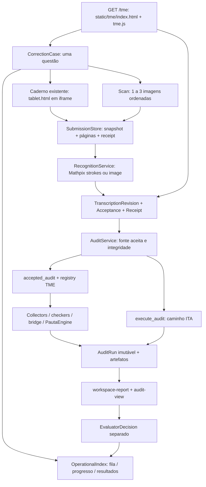
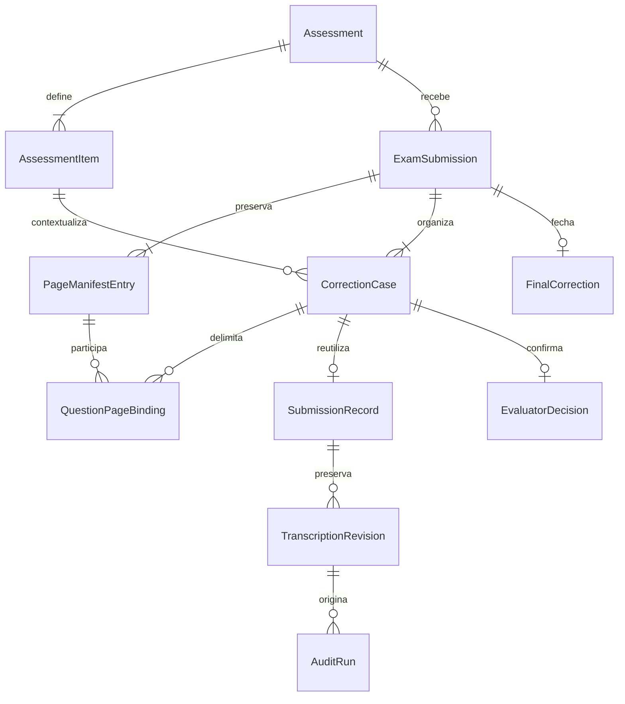

# TME December Demo — arqueologia funcional e gap analysis 01

Data: 09/11/2026, America/Fortaleza. Worktree: `~/Documents/confia-lean-auditor-tme-december-integration`. Branch conferida: `feat/tme-december-integration`. HEAD/base conferido: `1b3daea41ba4ce31c0cfd35dd07907da3d03669f`. Estado inicial: limpo.

## 1. Resultado da auditoria

**O ConfIA já possui um fluxo funcional de correção por questão. O trabalho de dezembro é integrar a prova completa ao redor desse fluxo, corrigir suas lacunas de rastreabilidade e completar o fechamento.** Não há justificativa para um frontend paralelo, outro motor ou outra implementação de transcrições/auditorias.

O caminho `/tme` já conecta captura digital ou até três fotos, armazenamento dos originais, reconhecimento, transcrição editável/versionada, auditoria da revisão aceita, pauta/evidências, sugestão e decisão humana persistida separadamente. As abas Original/Transcrição/Comparar, o navegador de questões e os controles de ajuste já existem. O backend conserva revisões e auditorias anteriores.

As lacunas determinantes são:

1. Cada `CorrectionCase` e `SubmissionRecord` corresponde a **uma questão**. “Prova” no piloto é agrupamento por código, sem manifesto das questões esperadas, entrega completa nem identidade própria de tentativa da prova.
2. Não existe ingestão PDF. O limite de três páginas está distribuído entre modelos, nomes de artefatos e frontend; não basta mudar um seletor de arquivo.
3. Não existe associação explícita, versionada e potencialmente muitos-para-muitos entre páginas/regiões e questões. `tme_item_id=a/b/c/d` identifica subitens da mesma questão, não Q1/Q2/Q3.
4. O aceite existente no `/tme` é registrado automaticamente ao analisar/finalizar. Ele vincula uma revisão exata, mas **não demonstra que houve conferência humana**.
5. A reanálise versionada já funciona por caso. Falta colocá-la sob o domínio de prova, preservar metadados ao editar e tornar o histórico de sugestões acessível ao avaliador.
6. A decisão humana já preserva a sugestão. Falta um fechamento imutável da prova, com totais, pendências e comparação ConfIA × humano.
7. Há rastros detalhados nos artefatos, mas não uma trilha estruturada de eventos que cubra o processo inteiro, com tempos, ator, IDs e versões.

**Conclusão de arquitetura:** falta decidir como o domínio de prova existente (`Assessment`/`AssessmentItem`, hoje institucional) passa a atender o piloto pseudônimo. A recomendação concreta está na seção 10. Esse é o motivo do parecer final, não a necessidade de reescrever o produto.

### Método e limites da evidência

- Foram lidos HTML carregado pela rota, scripts efetivamente incluídos, handlers de cliques, chamadas HTTP, autorização, serviços, modelos, persistência e testes. As conclusões não derivam somente de nomes de arquivos ou documentos históricos.
- O comportamento-alvo foi tomado da sequência descrita no pedido. O arquivo de vídeo não foi disponibilizado nesta tarefa; não se afirma ter inspecionado frames. O vídeo é tratado como materialização desejada do próprio ConfIA.
- Foram executados 178 testes JavaScript existentes, com DOM/HTTP simulados: 177 passaram e 1 falhou. Detalhes e comando na seção 15. Isso não equivale a um ensaio visual em navegador nem a OCR/Lean reais.
- Os testes Python foram inspecionados, mas não executados: não há `.venv` neste worktree e o Python disponível, 3.9.6, não possui `pytest`. Não foram instaladas dependências, usados serviços externos, iniciada a aplicação ou acionados seeds.
- Não foram modificados código, motor, Lean, pautas, fixtures, frontend, dados operacionais ou banco. Este documento é a única alteração pretendida no repositório. Nenhum commit automático.

## 2. Índice de evidências do código atual

Os caminhos abaixo são relativos ao repositório. As linhas referem-se ao HEAD auditado. As referências E01–E25 são usadas nas matrizes; os testes T01–T12 estão detalhados na seção 15.

| Ref. | Fonte e ponto de entrada | Evidência principal |
|---|---|---|
| E01 | [main.py](../../app/confia_lean_auditor/main.py), linhas 64–169 | Mount `/static`, routers, startup, rotas `/`, `/capture`, `/audit` e middleware de origem |
| E02 | [tme/router.py](../../app/confia_lean_auditor/tme/router.py), `home` L228, `create_case` L234, demais handlers | `/tme` serve o HTML existente; APIs escopadas por caso |
| E03 | [static/tme/index.html](../../app/confia_lean_auditor/static/tme/index.html), L7–43 | CSS, shell e ordem real de carregamento dos scripts |
| E04 | [static/tme/tme.js](../../app/confia_lean_auditor/static/tme/tme.js), `newCase` L178, `renderInk` L239, `uploadScan` L304 | Navegação, criação de caso, entrada e chamadas HTTP |
| E05 | [static/tme/tme.js](../../app/confia_lean_auditor/static/tme/tme.js), `renderCorrection` L400, `saveRevision` L548, `audit` L563, `ensureAcceptance` L576, `decisionPanel` L590 | Workspace conectado, editor, aceite automático, análise e decisão |
| E06 | [correction-workspace.js](../../app/confia_lean_auditor/static/tme/correction-workspace.js), L11–38; [secondary-views.js](../../app/confia_lean_auditor/static/tme/secondary-views.js), L24–42 | Questões relacionadas por código/família; fila, progresso e resultados |
| E07 | [scan-model.js](../../app/confia_lean_auditor/static/tme/scan-model.js), L8–49; [capture/schemas.py](../../app/confia_lean_auditor/capture/schemas.py), L11, L106 | Limites, ordem, rotação, PNG derivado; modelo de strokes |
| E08 | [tme/models.py](../../app/confia_lean_auditor/tme/models.py), L12–89; [tme/store.py](../../app/confia_lean_auditor/tme/store.py), `bind`, `decide` | Caso de uma questão, scan e decisão do avaliador |
| E09 | [submissions/schemas.py](../../app/confia_lean_auditor/submissions/schemas.py), `ArtifactReference`, `SubmissionRecord`, `TranscriptionRevision`, `TranscriptionAcceptance` | Artefatos, origem, versões, aceite e provenance |
| E10 | [submissions/store.py](../../app/confia_lean_auditor/submissions/store.py), `receive` L141, `receive_scan` L204, `create_transcription_revision` L610, `accept_transcription` L636 | Escrita atômica, originais, hashes, revisões e recibos preservados |
| E11 | [recognition/service.py](../../app/confia_lean_auditor/recognition/service.py), `recognize` L103; [recognition/schemas.py](../../app/confia_lean_auditor/recognition/schemas.py) | Runs de OCR/HMER, input/output hash, latência, candidatos `NEEDS_REVIEW` |
| E12 | [recognition/mathpix.py](../../app/confia_lean_auditor/recognition/mathpix.py), L141–172; [mathpix_image.py](../../app/confia_lean_auditor/recognition/mathpix_image.py), L124–145; [registry.py](../../app/confia_lean_auditor/recognition/registry.py), L62 | Providers configurados; diferenças entre confidence de strokes e imagem |
| E13 | [submission_audits/service.py](../../app/confia_lean_auditor/submission_audits/service.py), `_validated_source`, `_identity`, `execute`, `view`; [schemas.py](../../app/confia_lean_auditor/submission_audits/schemas.py) | Fonte aceita exata, deduplicação, integridade, histórico e `stale` |
| E14 | [tme/accepted_audit.py](../../app/confia_lean_auditor/tme/accepted_audit.py), L26–120; [tme/registry.py](../../app/confia_lean_auditor/tme/registry.py), L18 | Dispatch TME, divisão explícita de subitens, contexto/versionamento |
| E15 | [tme/audit_models.py](../../app/confia_lean_auditor/tme/audit_models.py), L18; [tme/audit_artifacts.py](../../app/confia_lean_auditor/tme/audit_artifacts.py) | Resultado TME persistido, score, pauta, bridge e certificados |
| E16 | [rubric/pauta/models.py](../../app/confia_lean_auditor/rubric/pauta/models.py), `PautaDecision`, `PautaAssessment`; [engine.py](../../app/confia_lean_auditor/rubric/pauta/engine.py); [bridge.py](../../app/confia_lean_auditor/rubric/pauta/bridge.py) | Obrigações, fatos, evidências, razões e decisões por critério |
| E17 | [workspace-report.js](../../app/confia_lean_auditor/static/tme/workspace-report.js), `renderTME`; [audit-view.js](../../app/confia_lean_auditor/static/audit-view.js) | Renderização real de pauta, evidências, revisão e verificações |
| E18 | [assessments/models.py](../../app/confia_lean_auditor/assessments/models.py); [router.py](../../app/confia_lean_auditor/assessments/router.py), `_catalog_ids`, `availability`, `assessment_progress`, envio por item | Exame institucional com itens; não entrega única de prova |
| E19 | [teacher_decisions/models.py](../../app/confia_lean_auditor/teacher_decisions/models.py); [service.py](../../app/confia_lean_auditor/teacher_decisions/service.py), `audit_snapshot` L51, `finalize` L142; [store.py](../../app/confia_lean_auditor/teacher_decisions/store.py) | Sugestão normalizada, nota humana, justificativa, freeze, liberação |
| E20 | [static/index.html](../../app/confia_lean_auditor/static/index.html), [shell.js](../../app/confia_lean_auditor/static/shell.js), [assessments.js](../../app/confia_lean_auditor/static/assessments.js), [submissions/teacher.js](../../app/confia_lean_auditor/static/submissions/teacher.js), [submissions/decisions.js](../../app/confia_lean_auditor/static/submissions/decisions.js) | Componentes aluno/professor do shell institucional, conferência explícita e decisão |
| E21 | [tme/auth.py](../../app/confia_lean_auditor/tme/auth.py); [auth/dependencies.py](../../app/confia_lean_auditor/auth/dependencies.py) | Professor dono do caso ou identidade TME demo; sem papel escolar concedido pelo demo |
| E22 | [tme/home_summary.py](../../app/confia_lean_auditor/tme/home_summary.py), `apply_audit`, `listing`, `known_questions`, `summarize` | Projeção descartável, questões conhecidas e contagens; sem fechamento de prova |
| E23 | [claims/common/schemas.py](../../app/confia_lean_auditor/claims/common/schemas.py); [student_claims/digital_items.py](../../app/confia_lean_auditor/student_claims/digital_items.py), L17–52; [semantic.py](../../app/confia_lean_auditor/student_claims/semantic.py), `enabled`, `supplement` | Claims com vínculo textual; suplemento semântico opcional e telemetria em memória |
| E24 | [tme/hybrid_grader.py](../../app/confia_lean_auditor/tme/hybrid_grader.py), L196–216; [core/public_audit.py](../../app/confia_lean_auditor/core/public_audit.py) | Hybrid shadow separado; projeção pública esconde caminhos/diagnósticos locais |
| E25 | [capture/tablet.js](../../app/confia_lean_auditor/static/capture/tablet.js), L587–614, L849–925; [draft-store.js](../../app/confia_lean_auditor/static/capture/draft-store.js); [submission-client.js](../../app/confia_lean_auditor/static/capture/submission-client.js) | Reuso do caderno no iframe, rascunho IndexedDB, envio congelado e reconhecimento |

## 3. Arquitetura e mapa real do `/tme`



### HTML, CSS e navegação

- `GET /tme` exige `require_tme_evaluator` e serve `static/tme/index.html`. O caminho estático direto redireciona para `/tme` (E01–E03).
- O shell TME é o que já existe no produto: Início, Correções, Nova correção e Resultados; há visão de progresso por prova acessível na navegação. Query strings preservam rota/filtros: `?view=queue`, `?view=new`, `?view=results`, `?view=exams`, `?case_id=...`.
- CSS carregado: `design-system.css`, `audit-view.css`, `tme-theme.css`, `tme.css`, `home.css`, `correction-workspace.css`, `secondary-views.css` e KaTeX local. Layout e controles são implementados nesses arquivos, não por um framework novo.
- Scripts compartilhados: KaTeX, `problem-math.js`, `recognition-view.js`, `audit-view.js`; scripts TME: `workspace-controls.js`, `workspace-report.js`, `scan-model.js`, `home.js`, `correction-workspace.js`, `secondary-views.js`, `tme.js`.
- Estado por caso em `Map`: aba, zoom, página, edição, histórico, auditorias e rascunho da decisão. Recarregar a página perde rascunhos do workspace ainda não enviados. Preferência do splitter usa localStorage. O caderno digital possui persistência própria de rascunhos em IndexedDB (E25).

### APIs realmente chamadas pelo frontend TME

Em todas as linhas abaixo, `{c}` é `case_id` e `{t}` é `transcription_id`. São rotas existentes, não propostas.

| Etapa | API / recurso | Consumidor |
|---|---|---|
| Sessão | `GET /auth/me`, `POST /auth/logout` | `tme.js`; demo tolera ausência de sessão escolar |
| Home/fila/progresso | `GET /tme/home-summary?period=...`; `GET /tme/cases?view=queue|exams|results&...` | `home.js`, `secondary-views.js`, orquestrados por `tme.js` |
| Criação/contexto | `GET /tme/problems`; `GET /tme/cases`; `POST /tme/cases`; `GET /tme/cases/{c}` | `newCase`, `loadWorkspaceContext`, `openCase` |
| Enunciado/figuras | `/static/problem-presentations/registry.json` e assets locais do catálogo | `ProblemStatement` / `problem-math.js` |
| Caderno | `GET /tme/cases/{c}/capture?...`; `POST .../digital-submission`; `POST .../recognition-preview` | iframe de `tablet.html` e `tablet.js` |
| Fotos | `POST /tme/cases/{c}/scan`; `GET .../scan-manifest`; `GET .../originals/{page_index}` | upload, revisão de fotos e restauração para ajuste |
| Fonte preservada | `GET /tme/cases/{c}/submission`; `GET .../pages/{page_index}` | metadados e PNG; original scan tem rota separada |
| Reconhecimento | `POST .../recognize`; `GET .../recognition-status`; `GET .../recognitions/{run_id}` | workspace; detalhe também usado pelo caderno |
| Transcrição | `GET .../transcriptions`; `GET .../transcriptions/{t}` | lista e histórico; UI abre a transcrição mais recente |
| Revisão/aceite | `POST .../transcriptions/{t}/revisions`; `POST .../transcriptions/{t}/accept` | `saveRevision`, `ensureAcceptance` |
| Análise | `GET/POST /tme/cases/{c}/audits` | `loadCaseData`, `audit`; não faz HTTP para `/audit` |
| Decisão | `GET/POST /tme/cases/{c}/decision` | `decisionPanel` |

Não há API TME de criação inicial de transcrição manual, de ingestão PDF, de manifesto da prova ou de finalização global. A criação manual existe em `POST /submissions/{id}/transcriptions` e na UI do professor do shell institucional. Não se pode presumir que o avaliador demo tenha acesso a essa rota: o flag TME não concede a autenticação geral.

### Aluno/professor existentes fora do shell TME

O shell `/` usa `static/index.html`, `shell.js`, `resolution-workspace.js`, `assessments.js`, `submissions/teacher.js` e `submissions/decisions.js`. O aluno acessa exames, responde/envia **um item por vez** pelo caderno e vê resultados liberados. O professor cria/publica exames, acompanha itens por aluno, confere o original/transcrição, solicita análise e finaliza/libera `TeacherDecision` (E18–E20).

Isso oferece peças reutilizáveis, não um fluxo de prova já integrado ao `/tme`. O piloto não carrega `shell.js`, não consulta `/assessments` e não usa `TeacherDecision` diretamente. `Assessment` exige escola/turma/ano/professor; seu catálogo atual usa `list_problem_catalog` (ITA), enquanto `/tme/problems` adiciona o catálogo TME. Conectar somente o componente visual não resolve essas diferenças.

### Autenticação e persistência

- Por padrão, professor autenticado e proprietário do caso. Aluno autenticado é recusado no TME. `CONFIA_TME_DEMO_NO_AUTH=1` permite identidade local `tme-demo-evaluator` sem escola, quando não há sessão; é proibido em produção. Uma sessão válida de professor prevalece sobre essa identidade (E21).
- `CONFIA_AUTH_ENABLED=0` é outro modo, legado/global; não é sinônimo do flag TME. O controle same-origin depende da autenticação global estar habilitada. Não apresentar o demo como identidade humana certificada.
- Persistência primária é em arquivos JSON/binários locais, com locks e publicações atômicas em vários stores. Não foi encontrada implementação SQL ativa nesses domínios; a menção a PostgreSQL no store de decisões é possibilidade futura.

| Domínio | Local padrão | Conteúdo |
|---|---|---|
| Casos | `runtime/tme_cases`, override `CONFIA_TME_CASES_DIR` | `case.json`, `decision.json` por caso |
| Submissões | `runtime/submissions`, override `CONFIA_SUBMISSIONS_DIR` | `submission.json`, `receipt.json`, `snapshot.json`, `page_1..3.png`, `original_1..3.bin` no scan |
| Transcrições/OCR | Dentro da submissão | `transcriptions/tr_*/revisions/revision_*.json`, aceites, recibos de aceite, recognition; falhas em `recognitions/run_*.json` |
| Auditorias | `runtime/submission_audits`, override `CONFIA_SUBMISSION_AUDITS_DIR` | `aud_*.json`, locks e artefatos TME por run |
| Institucional | `runtime/assessments`, `runtime/teacher_decisions`, `runtime/institutional`, `runtime/auth` | Stores existentes, com overrides próprios `CONFIA_*_DIR` |
| Projeção operacional | `.home-summary.json` sob o store TME | Índice descartável, reconstruído no startup/offline; não é fonte de notas nem event log |

Os bytes das revisões permanecem imutáveis. `ACCEPTED` é projetado na leitura a partir do evento/recibo de aceite; não reescreve a revisão como se aquele fosse seu status original. O `case.json` é envelope operacional mutável. `EvaluatorDecision` é gravado uma vez, separado dos runs; não tem todas as garantias de hash/lifecycle do `TeacherDecision` institucional.

## 4. Fluxo real de entrada, transcrição e reanálise

### Entrada digital e fotos

1. Avaliador escolhe uma questão do catálogo, informa código pseudônimo e escolhe foto/scan ou escrita digital. O rótulo “Código da prova” grava `external_candidate_ref`; não cria uma entidade de prova.
2. Digital: iframe reutiliza o caderno; strokes/ops são congelados em snapshot e enviados com páginas PNG. Não há entrada de texto digitado na criação TME; texto pode ser editado depois do reconhecimento. O shell institucional possui solução textual, mas isso não está conectado à criação do caso TME.
3. Scan: usuário adiciona imagens **uma por vez** pelo seletor/câmera, até três; confirma, gira, reordena, substitui ou remove antes de enviar. Não há `multiple` no input nem seleção em lote de vários arquivos, embora a submissão aceite uma lista de fotos.
4. Upload preserva bytes originais, MIME, tamanho e SHA-256, mais PNG derivado orientado/normalizado até 2048 px no maior lado. Limite de 8 MiB por original e por derivada; JSON de entrada até 64 MiB. HEIC/HEIF depende de decodificação pelo navegador; há mensagem de fallback para JPEG/PNG.
5. Backend confirma os índices contíguos e cria uma submissão de **um problem_id**. OCR de todas as páginas desse caso produz segmentos com `page_index`/`order`.
6. “Voltar e ajustar páginas” recupera os originais; ao enviar, cria **outro caso**. Preserva o anterior, mas não registra `supersedes_case_id` ou linhagem explícita da substituição (E04 L304–317).

Um arquivo PDF não é aceito no input, nos Literals MIME de `ScanPageUpload`/`ArtifactReference` nem em `receive_scan`. Não há renderizador/splitter de PDF no caminho. Referências a PDF no catálogo descrevem a fonte oficial do enunciado, não suporte de ingestão.

### Transcrição: o que já existe e suas ressalvas

| Capacidade | Implementação observada | Limite relevante para dezembro |
|---|---|---|
| Criação automática | `RecognitionService` publica `RecognitionRun` e revisão 1 `NEEDS_REVIEW` | Depende de provider configurado e serviço disponível |
| Criação manual | `SubmissionStore.create_transcription`, API genérica e editor institucional | Falta ação/rota TME equivalente para quando OCR não gerar candidato |
| Armazenamento | Arquivos de revisão numerados, source/provenance e hashes de aceite | Reutilizar; não criar outra entidade de transcrição |
| Correção humana | “Editar” → “Salvar nova revisão”, `based_on_revision_number` | No TME, agrega uma página em um único segmento `text`, aplica `trim`, não envia motivo |
| Preservação anterior | Escrita nova e controle de predecessor; aceite separado | Sim; versões anteriores não são apagadas |
| Aprovação humana | Endpoint de aceite existe; UI institucional tem “Conferir transcrição” | TME usa aceite automático ao analisar/decidir; não atesta inspeção humana |
| Vínculo com original | `submission_id`, artefatos/hash, página; região/strokes opcionais | Mathpix normalmente retorna página, não alinhamento fino; não inventar highlight |
| Confidence/quality | Campo opcional por segmento; strokes registra confidence se retornada | Adapter imagem não atribui confidence; não há quality gate/calibração comum |
| Reprocessamento | “Reprocessar” cria outro recognition/transcription; histórico permanece | Muda a transcrição corrente; não é uma nova revisão humana da anterior |
| Histórico visual | Detalhes técnicos contêm histórico; APIs listam versões/runs | Falta seletor/diff legível entre transcrições e sugestões anteriores |

**Risco específico do editor TME:** `saveRevision` substitui segmentos por `{segment_id: tme-page:N, page_index, order:0, kind:text, text:...}`. A nova versão perde `confidence`, `source_region`, `source_stroke_refs`, `tme_item_id`, `tme_diagrams` e divisão em segmentos. A versão anterior continua intacta, mas uma edição textual pode retirar evidência estruturada da próxima análise. Se a versão original usava apenas `tme_item_id`, sem cabeçalho textual `[a]`, a atribuição de subitens pode desaparecer. O editor institucional preserva segmentos não alterados; essa lógica é referência de reuso, não prova de que o TME já a execute (E05, E20).

### Reanálise: caminho existente, não funcionalidade a reconstruir

```text
revisão N aceita → AuditRun A
  → salvar revisão N+1 (NEEDS_REVIEW)
  → GET audits projeta A.stale = true, sem modificar A
  → Analisar com ConfIA registra/obtém aceite de N+1
  → AuditService valida fonte, aceite, hash e contexto
  → novo AuditRun B com nova sugestão
  → A e sua sugestão permanecem persistidos
```

`AuditService.view` também marca um run antigo como stale quando surge uma transcrição mais recente. A invalidação é lógica, não destruição do resultado. `OperationalIndex.apply_transcription` remove apenas a projeção da auditoria corrente. Mesma fonte/aceite/contexto/`execution_key` deduplica; nova revisão, novo contexto TME ou nova chave produz outro run (E13).

Esse caminho reanalisa a questão do caso; não reexecuta todos os outros casos. Ainda não há isolamento por questão dentro de uma entrega de prova única. Para isso, a fonte da auditoria deve ser a projeção aceita e versionada da questão, com seu próprio mapeamento, não um texto global de todas as páginas.

**Retry incompleto:** a UI TME oferece análise novamente quando o run é `FAILED`, mas `audit()` não envia uma nova `execution_key`. Se a fonte/contexto não mudou, o serviço retorna o mesmo run terminal falho, sem nova execução. A capacidade de rerun existe no backend e no fluxo institucional; falta conectá-la corretamente no TME. Diferenciar retry de transporte (mesma chave) de nova tentativa deliberada (nova chave).

## 5. Prova completa, workspace e decisão humana

### Prova e questões

`AssessmentDocument` já descreve exame institucional com até 100 `AssessmentItem`, ordem, `problem_id` e pontos. `SubmissionRecord.assessment_id/assessment_item_id/assessment_definition_sha256` vincula **uma submissão a um item**. O progresso escolar reúne submissões por aluno/item. Não há `ExamSubmission` que represente a entrega integral de um candidato.

No TME, `relatedCases` agrupa por `external_candidate_ref` + família do `problem_id`, deduplicando questão e priorizando o caso aberto. `known_questions` do índice agrupa pelo código e escolhe o caso mais recente por problema. São regras diferentes para selecionar casos concorrentes; o índice também não separa famílias no agrupamento. Não há roster de questões esperadas, tentativa/sessão da prova ou unicidade garantida por candidato/exame/questão. “5/5 questões conhecidas” não comprova que a prova tinha exatamente cinco questões (E06, E22).

### Comparação com o workspace-alvo

| Elemento-alvo | Situação atual | Delta mínimo |
|---|---|---|
| Q1, Q2, Q3… no topo | Existe para casos relacionados reais | Dirigir por manifesto de prova; incluir questões esperadas ainda sem material |
| Sugestão em cada questão no topo | Não existe; fila exibe sugestão | Projeção de score por questão, sem carregar todos os artefatos |
| Pronta / revisar / confirmada | Há símbolos e status operacionais, parcialmente em cache | Estado canônico vindo do backend e consistente com `needs_review`, stale e decisão |
| Original / Transcrição / Comparar | Implementado e conectado | Alimentar com páginas/regiões da questão e PDF derivado; manter original completo acessível |
| Sugestão e pauta por critério | Implementado para ITA e TME; TME usa `assessment.items` recursivo | Expor contrato estável e preservar incerteza/null |
| Evidência textual | Implementada a partir dos records vinculados | Mapear à versão/página; highlight somente quando houver offsets válidos |
| Verificação | Distingue apoiado/refutado/indeterminado/erro técnico, Lean local | Unificar DTO; não chamar uma solução inteira de formalmente provada |
| Alertas / revisão / motivo | `needs_review`, `input_warnings`, razões nas decisões persistidas; UI mostra revisão e estados | Consolidar `review_reasons` e torná-los visíveis/acionáveis; hoje não há fila uniforme de motivos |
| Corrigir leitura / salvar | “Editar” e “Salvar nova revisão” conectados | Preservar metadados e escopo da questão; registrar motivo quando cabível |
| Reanalisar questão | “Analisar com ConfIA” após stale | Expor histórico A/B e resolver retry terminal |
| Ajustar / justificar / confirmar | Ajuste e “Finalizar correção” persistem decisão por caso | Tratar como confirmação de questão dentro da prova; fixar versão da fonte |
| Avançar | “Corrigir próxima” escolhe fila global prioritária | Avançar à próxima questão pendente da mesma entrega, com retorno à fila opcional |

**Status divergentes:** `caseStatus` no workspace trata run com score numérico como “Aguardando decisão”, mesmo que `needs_review=true`; o índice usa `verdict=inconclusivo`. Questões não carregadas no navegador podem aparecer apenas como “Disponível”. Isso impede usar os chips atuais como estado confiável de revisão da prova.

### Sugestão versus pontuação humana

O TME já grava `EvaluatorDecision` com `suggested_points`, `final_points`, `max_points`, `override_reason`, `feedback`, `decided_by_user_id`, `decided_at`, `audit_run_id`, `audit_source_sha256` e `audit_result_sha256`. O helper compartilhado `audit_snapshot` normaliza a sugestão à escala humana, preservando o run original. Divergência com sugestão determinada exige motivo na UI e no endpoint. Não há overwrite do score do motor (E08, E19).

| Campo requerido | Equivalente existente | Complemento necessário |
|---|---|---|
| `suggested_score` | `AuditRun.result.score`; `EvaluatorDecision.suggested_points` normalizado | Expor escala bruta e normalizada claramente |
| `final_score` | `final_points` / `teacher_final_points` | Reutilizar decisão; total de prova separado |
| `adjustment` | Diferença derivável | Projetar `final - suggested` na mesma escala; `null` se não há sugestão |
| `adjustment_reason` | `override_reason` | Validação backend de texto não vazio após trim; TME atual aceita string só de espaços via API |
| `reviewer` | `decided_by_user_id` / `teacher_user_id` | Distinguir usuário autenticado de identidade demo compartilhada |
| `timestamp` | `decided_at` / `finalized_at` | Incluir na projeção e eventos |

Há diferenças importantes: `TeacherDecision` já tem versão otimista, rascunho/finalização/liberação e hash final; o TME grava uma decisão única sem edição posterior. Não criar um terceiro sistema de ajuste. Reutilizar `EvaluatorDecision` no piloto e harmonizar seu contrato/lifecycle com as garantias já existentes no institucional, sem gravar ambos para a mesma decisão.

Uma decisão manual TME sem `audit_run_id` verifica se existe transcrição aceita, mas não persiste `transcription_id/revision_number/acceptance_id`. Seu vínculo exato com a leitura é insuficiente. Além disso, a UI continua oferecendo edição/reprocessamento após decisão, e as rotas de revisão/recognize/audit não bloqueiam `DECIDED`; não há reabertura formal. A decisão antiga fica preservada, mas a fonte corrente pode mudar enquanto o caso continua finalizado. Deve haver freeze ou reabertura versionada explícita.

### Finalização da prova

Não há tela/endpoint que publique tabela por questão com sugestão, nota humana e ajuste, totais sugerido/final, número de questões revisadas, alertas pendentes e confirmação global. `Results` exibe contagens/distribuição por questão e status; `ExamProgress` mostra concluídas/conhecidas. `Assessment.close` encerra a janela do exame institucional, não congela a correção individual do candidato.

## 6. Gap matrix consolidada

Classificação relativa ao fluxo-alvo no `/tme`:

- `ALREADY_IMPLEMENTED`: caminho conectado no escopo explicitado; não significa certificação nem validação em produção.
- `PARTIALLY_IMPLEMENTED`: parte do fluxo/garantia existe, mas o requisito não está completo.
- `IMPLEMENTED_BUT_NOT_CONNECTED`: peça funcional em outra rota/componente/backend, sem ligação necessária ao TME.
- `MISSING`: não foi encontrado equivalente no caminho auditado. Ausências foram verificadas cruzando contratos, routers, consumidores e stores.

Na coluna testes, “código” identifica testes Python lidos; “JS” identifica suites executadas. Nenhuma cobertura específica futura é presumida.

| Funcionalidade | Status | Frontend | Backend | Persistência | Testes | Gap |
|---|---|---|---|---|---|---|
| Shell `/tme`, fila e deep link | ALREADY_IMPLEMENTED | E03–E06 | E02 | E08/E22 | T01/T02 JS | Uma falha de teste de filtros; ver §15 |
| Escrita digital com caneta | ALREADY_IMPLEMENTED | Caderno E25 | digital-submission | Snapshot/strokes/PNG E10 | T03 JS; T04 código | Até 3 páginas por questão |
| Texto digitado como entrada TME | IMPLEMENTED_BUT_NOT_CONNECTED | Existe no shell institucional | Auditor textual/manual existente | Transcrição manual possível | T07/T08 | Sem entrada inicial equivalente TME |
| Uma foto | ALREADY_IMPLEMENTED | E04/E07 | scan E02 | Original + derivada E10 | T03 JS; T04 código | Confirmar formato no dispositivo do ensaio |
| Múltiplas fotos | ALREADY_IMPLEMENTED | Adicionar/reordenar até 3 | Lista de páginas | Índices/hashes | T03 JS; T04 código | Implementado somente nesse limite e por questão |
| Seleção de múltiplos arquivos em lote | MISSING | Input lê `files[0]` | Lista já suportada | Reutilizável | Sem teste específico | Adição atual é individual |
| PDF multipágina | MISSING | Input image apenas | Sem ingestão/renderização PDF | MIME/artefato PDF ausente | Sem teste | Preservar PDF + derivar páginas |
| Original de imagem/digital preservado | ALREADY_IMPLEMENTED | Original + links; PNG do ink | Leitura com integridade | Bytes/snapshot/receipt/hashes | T04/T05 código | Não estender esta conclusão a PDF |
| Ordem e rotação de páginas | ALREADY_IMPLEMENTED | Scan.move/rotate | Índices contíguos | ScanSnapshot | T03 JS; T04 código | Falta ordem global da prova |
| Identificar questão manualmente | ALREADY_IMPLEMENTED | Catálogo obrigatório | `problem_id` validado | Caso + submissão | T01 JS; T06 código | Sem inferência automática por conteúdo |
| Associação página ↔ questão | PARTIALLY_IMPLEMENTED | Todas páginas do caso | Um problem_id por submission | page_index e segmentos | T04/T06 código | Falta mapa M:N/regiões em prova integral |
| Upload de prova inteira | MISSING | Criação por questão | Sem aggregate de entrega | Sem ExamSubmission | Sem teste | Pacote único e manifesto |
| OCR/HMER → candidato | ALREADY_IMPLEMENTED | Reconhecer/Reprocessar | RecognitionService | Run + revisão inicial | T03 JS; T04/T05 código | Provider externo não exercitado nesta auditoria |
| Transcrição manual sem OCR no TME | IMPLEMENTED_BUT_NOT_CONNECTED | Professor institucional E20 | POST genérico existente | Store reutilizável | T07 JS; T05 código | Rota/ação TME autorizada |
| Exibir transcrição | ALREADY_IMPLEMENTED | E05 | Histórico de transcrição | E09/E10 | T01/T07 JS | Versão corrente |
| Conferência humana explícita | IMPLEMENTED_BUT_NOT_CONNECTED | Botão no professor institucional | Endpoint de aceite | Acceptance/receipt | T07 JS; T05 código | TME autoaceita; evidenciar ato humano |
| Correção e nova versão | ALREADY_IMPLEMENTED | Editar/salvar | Predecessor validado | Revisão anterior preservada | T01 JS; T05 código | Fluxo existente no caso |
| Preservar metadados ao editar | PARTIALLY_IMPLEMENTED | TME achata página | Modelo aceita campos ricos | Versão antiga intacta | T07 JS para institucional | Preservar campos/segmentos não alterados no TME |
| Confidence/quality comum | PARTIALLY_IMPLEMENTED | Detalhes técnicos | Confidence opcional; scan não preenche | RecognitionResult | T05 código | Qualidade da captura e calibração ausentes |
| Histórico legível de transcrição | PARTIALLY_IMPLEMENTED | JSON técnico TME | Histórico completo | Revisões/aceites | T01/T07 JS | Seletor/diff de versões |
| Reprocessar reconhecimento | ALREADY_IMPLEMENTED | Reprocessar | Novo recognition/transcription | Antigas preservadas | T03 JS; T05 código | Sem linhagem explícita entre reconhecimentos |
| Exame com roster/ordem/pontos | IMPLEMENTED_BUT_NOT_CONNECTED | Exames institucionais | Assessment/Item | AssessmentDocument | T08 JS/código | Escopo institucional e catálogo a adaptar |
| Tentativa/entrega da prova | MISSING | Agrupamento por código | Sem aggregate | Sem ID estável global | Sem teste | Candidate code não substitui ID |
| Tentativa por questão | PARTIALLY_IMPLEMENTED | Caso operacional | CorrectionCase + SubmissionRecord | Já existentes | T04/T06 código | Vincular ao pai/roster, não duplicar |
| Várias questões na mesma entrega | PARTIALLY_IMPLEMENTED | Chips por código | Agrupamento de casos | Sem vínculo obrigatório | T01/T02 JS; T09 código | Manifesto e integridade do conjunto |
| Score sugerido por questão | ALREADY_IMPLEMENTED | Painel/fila | TMEAuditResult / AuditResponse | AuditRun | T06 JS/código | Null é indeterminado, nunca zero fictício |
| Score total da prova | MISSING | Sem total | Sem agregação de notas finais | Sem snapshot global | Sem teste | Somar mesma escala, preservar null |
| Status canônico por questão | PARTIALLY_IMPLEMENTED | Cache/chips/status divergentes | Índice e `needs_review` | Caso/run/decisão | T01/T09 | Unificar pronta/revisar/confirmada |
| Navegação entre questões | PARTIALLY_IMPLEMENTED | Qn por casos reais | Lista de casos | Grupo por código | T01/T02 JS | Incluir ausentes/ordem do roster |
| Score no chip superior | MISSING | Chip sem score | Score existe na fila | Reusar projeção | Sem teste específico | Exibir sugestão e estado atuais |
| Abas Original/Transcrição/Comparar | ALREADY_IMPLEMENTED | E05 + CSS existente | Rotas da fonte | E10 | T01 JS | Adaptar conteúdo à prova, sem reconstrução |
| Pauta por critério e evidência | ALREADY_IMPLEMENTED | renderTME | Pauta/bridge | Result completo | T06 JS; T10 código | Contrato público ainda específico |
| Estado de checker/Lean | ALREADY_IMPLEMENTED | Rótulos locais e técnicos | Facts/checks | Certificados/manifest | T06 JS/código | Não representa prova global |
| review_required e motivos uniformes | PARTIALLY_IMPLEMENTED | Revisão/avisos parciais | needs_review/reason por nó | PautaDecision | T06/T10 | DTO consolidado + resolução de alertas |
| Correção → stale → nova análise | ALREADY_IMPLEMENTED | Salvar + analisar | AuditService | A e B imutáveis | T01 JS; T05/T06 código | Por caso/questão atual |
| Reanalisar só Q alterada de prova única | PARTIALLY_IMPLEMENTED | Casos isolados | Fonte por submission | Runs existentes | T05/T06 código | Manifesto/mapeamento por questão |
| Rerun deliberado da mesma revisão | IMPLEMENTED_BUT_NOT_CONNECTED | TME omite execution_key | Backend suporta nova chave | Run novo quando chave muda | T05 código | Falha terminal pode ser só reproduzida |
| Comparar sugestões anterior/atual | PARTIALLY_IMPLEMENTED | Usa run corrente/decidido | Lista todos os runs | Resultados preservados | T05/T06 | Seletor A/B e vínculo à versão |
| Ajuste humano separado | ALREADY_IMPLEMENTED | Ajustar/Usar sugestão | EvaluatorDecision | decision.json separado | T01 JS; T06 código | Sem alteração da nota do agente |
| Justificativa e identidade do ajuste | PARTIALLY_IMPLEMENTED | Motivo obrigatório na divergência | Ator/timestamp; trim incompleto | Sugestão/final/motivo | T01 JS; T06/T08 código | Ator demo e fonte manual sem versão exata |
| Confirmação por questão | PARTIALLY_IMPLEMENTED | Finalizar caso | Decisão única | DECIDED | T01 JS; T06 código | Freeze/reabertura após mudança de fonte |
| Avançar na mesma prova | PARTIALLY_IMPLEMENTED | Próxima correção global | Prioridades do índice | Não guarda cursor da prova | T01/T02 JS | Restringir avanço à entrega atual |
| Resumo ConfIA × humano por questão | MISSING | Results é distribuição | Sem DTO global | Decisões já têm valores | Sem teste | Tabela e totais rastreáveis |
| Quantidade revisada/alertas pendentes | PARTIALLY_IMPLEMENTED | Contagens operacionais | Sem definição de “revisada” | Há revisões/decisões | T09 | Métricas inequívocas por questão |
| Confirmação final da prova | MISSING | Sem ação | Sem endpoint/transação | Sem FinalCorrection | Sem teste | Freeze com referências e hash |
| Contrato de captura externo | PARTIALLY_IMPLEMENTED | Fluxos próprios | Capture/Scan/Recognition existentes | Artefatos e provenance | T03/T04/T05 | ExamCapturePackage versionado |
| Contrato CorrectionEngine uniforme | PARTIALLY_IMPLEMENTED | Conhece pauta/bridge e labels P5 | AuditService + dois resultados | AuditRun existente | T06 | DTO estável, sem recalcular matemática |
| Semantic claims | PARTIALLY_IMPLEMENTED | Sem controle de configuração | Supplement opcional E23 | Claims salvos; telemetria em memória | T10 código | Declarar/configurar modo e selar versão |
| Hybrid grading | IMPLEMENTED_BUT_NOT_CONNECTED | Não consumido | Shadow/activate separado | Artefatos experimentais fora do fluxo | T10 código | Não integrar nesta etapa/branch |
| Rastros claim → checker → award | ALREADY_IMPLEMENTED | Evidências e detalhes | Records/facts/obligations/decisions | Bridge/assessment no run | T06/T10 código | Não é ainda event log temporal |
| Eventos de certificação ponta a ponta | MISSING | Sem consumidor específico | Sem envelope comum | Não há ledger completo | Sem teste | Emitir eventos com versões/IDs |
| Auth/demo TME | ALREADY_IMPLEMENTED | Sessão/demonstração | Escopo do dono e flag explícito | Auth e owner do caso | T11 código | Demo não verifica pessoa física |
| Integridade e run/artifact IDs | ALREADY_IMPLEMENTED | Detalhes públicos | Verificações e projeção pública | Hashes + manifest | T05/T06/T12 código | DTO público não deve virar fonte de hash |

## 7. Auditoria matemática existente e contrato estável proposto

### Caminhos efetivamente conectados

`POST /audit` usa `execute_audit(AuditRequest)` para soluções textuais do caminho ITA: assets, extração, checkers, Lean, rubrica, política de score e relatórios. O endpoint não oferece o fluxo de aceite/versionamento por si só.

No `/tme`, a UI chama `POST /tme/cases/{case}/audits` → `AuditService.execute`. Para ITA, o serviço chama o mesmo `execute_audit` **diretamente**, sem HTTP para si. Para TME2026P1…P5, a fonte recebe `TMEAuditContext` e o serviço chama `audit_accepted_tme_transcription` → registry → collector/checker/bridge específicos → **PautaEngine existente**. P1 tem alias interno `TME2_P1_PILOT`. Não enviar problemas TME arbitrariamente ao `/audit` textual supondo equivalência (E01, E13–E16).

`TMEAuditResult` inclui revisão aceita/hash, contexto, cópia da pauta, bridge com `MathClaimRecord`/`FactResult`, `PautaAssessment`, avisos e score projetado. O engine decide estratégias additive/banded/max_of/all_of/any_of/carry_forward; frontend não deve somar todos os filhos alternativos como se fossem cumulativos. `score=null`, intervalos conhecidos/possíveis, `needs_review`, erro técnico e refutação são estados distintos.

Artefatos obrigatórios TME: `audit.json`, `solution.txt`, `accepted_revision.json`, `input_mapping.json`, certificados reais quando existentes. `AuditRun` sela fonte, resultado e manifesto de artefatos. A API esconde diretórios locais/diagnósticos e expõe `artifact_ref` como `audit-run:<id>`. `reproducibility=null` no resultado TME e `legacy_unversioned` no campo legado não significam ausência de hashes TME: sua rastreabilidade usa contexto/pauta/fonte/resultado/manifest próprios.

### Semantic claims e hybrid: distinção necessária

O collector compartilhado `collect_digital_items` chama `semantic.supplement`. Por padrão, `CONFIA_TME_SEMANTIC_ENABLED=0`; com valor `1`, pode solicitar candidatos semânticos e passar os registros retidos aos checkers. Portanto, não é correto declarar que o fluxo TME nunca pode usar semântica só porque `accepted_audit.py` não importa um cliente LLM diretamente. A cadeia real precisa ser considerada (E23).

Já `run_hybrid_shadow`/`activate_hybrid` pertencem à trilha experimental e não são chamados por `AuditService`/`accepted_audit`/registry público. A ativação exige `gate_passed=True`. O Semantic Formal experimental não será implementado/ativado nesta tarefa. Para a demo mínima, a recomendação é manter a configuração semântica padrão desligada, declarando o modo usado no ensaio, sem alterar motor ou fixtures.

**Lacuna de reprodução:** `audit_context` sela digest de arquivos Python/toolchain declarada, hash da pauta e `use_lean`; não inclui explicitamente flag semântico/modelo/configuração runtime. `supplement` guarda telemetria em `_OBSERVATIONS` em memória, e `collect_digital_items` descarta seu segundo retorno. Alterar configuração externa sem alterar fonte/código pode não alterar a identidade do run. O contrato de aplicação deve selar essa configuração antes de qualquer uso futuro; não inferir que a configuração instalada foi medida nesta auditoria.

### `CorrectionEngine.audit_question(...)` — proposta, não código implementado

Fachada de aplicação sobre o `AuditService` existente. A escolha de pauta/checker continua no backend. Reutilizar `AuditRun` como registro canônico; um novo DTO é uma projeção, não outro resultado persistido independente.

```text
audit_question(
  exam_submission_id,
  question_attempt_id,          # identidade do CorrectionCase existente
  transcription_id,
  revision_number,
  acceptance_id,
  question_mapping_version,
  expected_question_version,
  execution_key                # retry mantém; rerun deliberado troca
) -> QuestionAuditView.v1
```

O servidor resolve `problem_id`, identidade do avaliador, escala, revisão, hashes, engine/config e fonte; não aceita texto/nota/pauta arbitrários do frontend. Confere que a versão pertence à questão e à entrega e que sua aceitação corresponde ao mapeamento atual. O DTO proposto:

```text
QuestionAuditView.v1 {
  schema_version, exam_submission_id, question_attempt_id, problem_id,
  audit_run_id, run_status: COMPLETED | FAILED, stale,
  transcription: { id, revision_number, acceptance_id, sha256 },
  mapping: { version, question_source_sha256 },
  engine: { version, config_sha256, rubric_version, rubric_sha256 },
  suggested_score: decimal-string | null,
  max_score: decimal-string,
  rubric_items: [{
    criterion_id, label, max_score, suggested_score,
    known_points, possible_points, status, reason,
    selected_method_path, evidence_ids, checker_ids,
    review_required, children: [...]
  }],
  evidence: [{
    evidence_id, claim_id, transcription_revision_id,
    page_id, source_span_or_region: object | null,
    quote: string | null, origin, grounding_status
  }],
  checker_status: [{
    checker_id, mechanism, status, evidence_ids, certificate_reference
  }],
  review_required: boolean,
  review_reasons: [{ code, criterion_id?, evidence_id?, message }],
  warnings: [{ code, message, page_id?, criterion_id? }],
  trace_reference: "audit-run:<id>", created_at
}
```

Mapeamento: `suggested_score ← result.score`; `rubric_items ← assessment.items` com descrições da pauta; `evidence ← bridge.auditor.records` + mapeamento de entrada; `checker_status ← facts.verification/student_check`; `review_required ← assessment.needs_review` mais condições operacionais explícitas; razões ← motivos persistidos e avisos de fonte. O adapter ITA projeta `rubric_assessment`, checks e relatório equivalentes. Não reinterpretar matemática nem preencher evidência ausente.

O retorno de falha mantém `suggested_score=null`, revisão requerida e diagnóstico operacional seguro. `max_score` pode vir da definição/pauta conhecida, nunca de score inventado. Manter status originais de cada checker (`verified`, `refuted`, `indeterminate`, `technical_error`, `not_submitted` conforme a fonte) distinguindo status de execução da auditoria.

O frontend atual ainda conhece estruturas `data.pauta`, `data.bridge`, rótulos específicos `p5Labels` e regex dos problemas; remover progressivamente esse acoplamento de apresentação por meio do DTO. O servidor fornece labels e capabilities. P1/P2/P3 continuam detalhes internos, sem nova implementação matemática.

## 8. Contrato com Luis/Rian — captura e leitura

Luis/Rian devem entregar documentos, páginas, metadados de captura e candidatos de leitura. Não precisam conhecer PautaEngine, Lean, obrigações, score ou os checkers. Identificar uma questão é atribuir contexto de captura, não determinar sua nota.

### `ExamCapturePackage.v1` proposto

```text
{
  schema_version: "exam-capture-package.v1",
  capture_package_id, idempotency_key,
  exam_id,                         # alias contratual de assessment_id
  submission_id: null | id,         # ID da entrega de prova, atribuído pelo servidor
  external_candidate_code,         # pseudônimo; não é chave primária nem prova de identidade
  original_document: {
    kind: pdf | image_set | digital_ink,
    original_files: [{ file_id, file_reference, mime_type, byte_size, sha256 }],
    manifest_sha256
  },
  pages: [{
    page_id,
    page_number,                   # 1-based no intercâmbio, contíguo e explícito
    original_file_id,
    original_page_number: integer | null,  # página dentro do PDF
    image_or_file_reference,
    derived_sha256, width, height, rotation_degrees,
    transformations: [{ name, version, parameters }],
    question_hint: { problem_id?, label?, confidence? } | null,
    capture_metadata: { captured_at, device?, application_version?, quality_flags? },
    transcription_candidate: {
      candidate_id, source: automatic | manual,
      segments: [{ segment_id, order, kind, text?, latex?, confidence?, source_region? }]
    } | null,
    transcription_metadata: {
      provider?, provider_version?, provider_request_id?, adapter_version?,
      created_at?, input_hash?, output_hash?, latency_ms?, warnings: []
    }
  }],
  capture_metadata: { producer, producer_version, created_at, capture_mode }
}
```

Para múltiplas fotos, `original_document` é um manifesto de arquivos; para PDF, preserva-se o PDF completo e suas páginas são derivadas com referência à página de origem. Para ink, reutiliza-se `CaptureSnapshot`, com strokes/operações e renderização. `file_reference` é identificador de upload/artefato sob controle do servidor, não caminho arbitrário de filesystem. Não exige uma tecnologia de upload nova: pode começar como endpoint limitado do protótipo com staging e publicação do pacote.

### Responsabilidades e garantias da fronteira

| Luis/Rian: captura/leitura | Aplicação ConfIA principal |
|---|---|
| Preservar bytes originais e enumerar páginas | Validar bytes/MIME/hash, limites, dono e idempotência; armazenar artefatos |
| Informar ordem, rotação e transformações realizadas | Validar numeração; atribuir IDs definitivos e criar recibo íntegro |
| Entregar candidato de transcrição e metadados | Criar `TranscriptionRevision` candidata; nunca aceitar automaticamente por origem externa |
| Sugerir questão opcionalmente | Resolver hint contra roster e obter confirmação humana da associação |
| Informar qualidade/confidence quando medida | Expor ausência de medida sem inventar valores; tratar avisos e retries |
| Sinalizar falha de leitura mantendo o original | Permitir transcrição manual e continuidade do fluxo |
| Não emitir notas/veredictos matemáticos | Extrair claims, mapear obrigações, auditar, revisar e finalizar |

O payload externo não pode declarar `ACCEPTED`, `reviewer_identity_verified=true`, `audit_run_id`, `suggested_score`, `final_score` ou sucesso de checker. O servidor confirma o revisor a partir da sessão; ator de sistema/provider e ator humano são distintos. Reenvio com mesma chave e mesmos hashes retorna o mesmo recibo; mesma chave com conteúdo diferente deve gerar conflito, preservando o pacote anterior. Upload interrompido não publica entrega parcialmente recebida.

### Reuso dos contratos atuais e deltas

- `CaptureDocument/CaptureSnapshot`, `CapturePage`, `CaptureStroke`: reutilizar para digital. Limite 3 e `problem_id` único não representam o pacote de prova.
- `ScanPage/ScanSnapshot/ScanUpload`: reutilizar semântica de ordem, original/derivada, rotação e transformações. Ampliar/versionar para PDF/páginas da prova; preservar leitura de snapshots antigos.
- `ArtifactReference`, `SubmissionReceipt` e validação de integridade: reutilizar, evoluindo referências para múltiplos arquivos e páginas além de 3. O regex `page_[123].png|original_[123].bin` é uma dependência explícita a migrar, não só `MAX_PAGES`.
- `RecognitionInput/ProviderOutput/RecognitionRun`, `RecognitionPageMetadata`: fronteira existente mais próxima para leitura externa. Se o produtor externo trouxer proveniência de provider, recebê-la por adapter validado ou ingestão específica; não usar `CreateTranscriptionRequest.source=manual` para fingir OCR com proveniência automática.
- `TranscriptionSegment`: reutilizar texto/LaTeX/order/confidence/região; acrescentar vínculo inequívoco à página global. Converter base 1 do pacote para `page_index` base 0 de maneira explícita.
- `POST /tme/cases/{id}/scan` e `/digital-submission` permanecem entrada legada por questão. Propor `POST /tme/exam-submissions/capture-packages` e leitura do recibo/manifesto, **rotas novas ainda inexistentes**, apoiadas nos stores atuais e no domínio da seção 10.

O mapeamento confirmado é separado do hint: `{question_attempt_id, mapping_version, page_id, region?, segment_ids?, assigned_by, assigned_at, source_hash}`. Deve admitir uma questão em várias páginas e uma página contendo várias questões. Não exigir segmentação automática para dezembro: atribuição humana explícita é suficiente. Uma região usa coordenadas e versão da imagem declaradas; a referência ao original integral nunca é descartada por um recorte.

## 9. Certificação Levi/Mykael — o que é mensurável hoje

Esta seção define instrumentação para tornar o protótipo auditável. Não declara certificação concluída nem atribui qualidade estatística a contagens de cobertura ou confidence do provider.

| Etapa de medição | Registro já existente | Falta para medir de forma reproduzível |
|---|---|---|
| 1. Captura | snapshot, timestamps de scan, receipt, páginas e hashes | ID da entrega completa, falhas/duração da captura, qualidade medida e lineage PDF/derivadas |
| 2. Transcrição | RecognitionRun, provider/adapter, input/output hash, latência no resultado bem-sucedido, revision 1 | Evento uniforme, duração também das falhas, mapa global de páginas; confidence não garantida em scan |
| 3. Correção humana | revisões/predecessor/change_type/reviewer; change_reason opcional | Ato humano explícito no TME, tempo ativo, diff e campos preservados; separar autoaceite de revisão humana |
| 4. Claim extraction | `MathClaimRecord`: ID, origem, método, texto/span/hash | Evento/tempo por execução; config do extrator; telemetria semântica hoje em memória |
| 5. Obligation mapping | `PautaBridgeResult`, mapa versionado nos bridges, source_claim_ids | Evento com mapping version e ligação questão/revisão; export consistente |
| 6. Checker result | `FactResult`, verification IDs, status, student_check, certificados | Eventos/tempos uniformes, configuração de execução e falhas completas sem confundir erro com refutação |
| 7. Award | `PautaDecision` recursiva: pontos, razão, método/banda, evidências | Evento por decisão e versão da pauta; não contar alternativas descartadas como award adicional |
| 8. Suggested score | AuditRun/result/hash/context e instante de criação | audit_started/completed persistidos separadamente; duração total; escala da prova |
| 9. Human adjustment | EvaluatorDecision/TeacherDecision com sugestão e final separadas | Evento com delta, fonte aceita exata e ID/hash de decisão; motivo normalizado |
| 10. Final score | Nota por caso/item | Snapshot de fechamento da prova, totais, alertas resolvidos/pendentes, confirmação global |

### Envelope de evento proposto

```text
AuditEvent.v1 {
  event_id, event_type, event_schema_version,
  occurred_at, recorded_at, sequence,
  actor: { kind: human | system | provider, user_id?, demo_identity?, provider? },
  correlation_id, causation_id, idempotency_key,
  exam_id, exam_definition_version, exam_submission_id,
  question_attempt_id?, question_mapping_version?,
  capture_package_id?, page_ids: [],
  transcription_id?, transcription_revision_number?, transcription_sha256?, acceptance_id?,
  audit_run_id?, engine_version?, engine_config_sha256?,
  rubric_version?, rubric_sha256?,
  claim_ids: [], obligation_ids: [], checker_ids: [],
  decision_id?, decision_version?, final_correction_id?,
  payload, payload_sha256,
  artifact_references: [{ reference, sha256 }]
}
```

IDs não aplicáveis ficam ausentes/nulos, nunca inventados. `sequence` é ordenação por entrega para eventos locais, sem exigir relógios perfeitamente sincronizados. `occurred_at` do produtor não substitui `recorded_at` do servidor. Referências de texto precisam de versão/hash; IDs de claims são escopados pelo run. O pseudônimo do candidato fica no domínio de entrega; eventos referenciam a entrega e não precisam repetir identificação pessoal.

### Eventos requeridos e pontos de emissão

| Evento | Momento / fonte de verdade | IDs/versões mínimos além do envelope | Dados para medição |
|---|---|---|---|
| `capture_received` | Após publicar pacote e recibo | package, entrega, documento/páginas e hashes | Origem, quantidades, formatos, duração quando medida, quality flags |
| `transcription_created` | Após publicação de RecognitionRun/transcrição inicial | recognition_run, transcription/revision 1, input/output hash | Provider, adapter, latência, warnings, confidence disponível |
| `transcription_corrected` | Após publicação de nova revisão humana | predecessor + revisão nova + hashes, question mapping | Ator, motivo, segmentos/páginas alterados, diff referenciado |
| `audit_started` | Após validar fonte e registrar execução efetiva | audit_run, aceite, revisão, mapping, contexto | Modo de engine, instante inicial; não duplicar em retry deduplicado |
| `audit_completed` | Após publicar sucesso ou falha terminal | Mesmo audit_run; result/manifest hash quando houver | Status, duração, score/max ou null, revisão requerida e motivos |
| `claim_extracted` | A partir dos records do run | claim IDs, método/versão, source revision/hash | Tipo, origem, grounding, span/region quando real |
| `obligation_mapped` | Bridge da mesma execução | claim IDs, obligation IDs, mapping version | Relação e justificativa, sem inferência a partir do score |
| `checker_completed` | Verificação registrada | verification/checker ID, versão/config, claims | Status, duração se medida, certificado/hash quando existente |
| `award_decided` | Decisão de critério da pauta | criterion/obligation IDs, rubric hash, evidências | Pontos/intervalo, razão, método/banda, carry-forward |
| `human_adjustment` | Decisão humana divergente publicada | decision ID/versão, audit/revision, reviewer | Sugestão bruta e normalizada, final, delta, motivo, timestamp |
| `question_confirmed` | Freeze da decisão de questão | case/question, decisão/hash, fonte/aceite selecionados | Score final, alertas reconhecidos/resolvidos, ator |
| `correction_finalized` | Publicação do fechamento da entrega | final correction/hash, roster/versão e decisões referenciadas | Totais, número revisado, estado dos alertas, confirmação |

Acrescentar `transcription_accepted` para distinguir conferência visual de vinculação automática; caso contrário, a certificação confunde dois atos diferentes. Se reconhecimento falhar sem criar transcrição, emitir evento operacional de falha de reconhecimento, sem fabricar `transcription_created`.

Para dezembro, eventos de claim/mapping/checker/award podem ser **projetados dos artefatos imutáveis**, com ID determinístico por run/tipo/entidade e `emission_mode=artifact_projection`. Seu horário é de registro/projeção; não alegar duração individual não medida. Eventos start/end reais devem ser gravados no serviço. Usar ledger append-only/outbox local e reconciliação por IDs com os records primários; não exigir broker ou escala produtiva. Reexecução e retry não podem duplicar contagens. Não usar `.home-summary.json`, que é reconstruível e sobrescrito, como evidência primária.

Métricas recomendadas: sucesso/falha por modalidade, tempo de leitura, taxa de revisões humanas, delta de transcrição, proporção de questões com revisão requerida, razões de revisão, disponibilidade/refutação/falha dos checkers, distribuição de ajustes humanos e tempo até fechamento. Acurácia de transcrição e validade matemática exigem amostras rotuladas e protocolo externo; o ledger sozinho não as prova.

## 10. Modelo de dados: reaproveitar antes de acrescentar

### Inventário de equivalências

| Entidade conceitual solicitada | Equivalente atual | Decisão proposta |
|---|---|---|
| Definição de exame | `Assessment` + `AssessmentItem` + `AssessmentDocument` | Reutilizar conceito/IDs/ordem/pontos/hash; adaptar escopo para piloto, sem segundo catálogo de exames |
| `ExamSubmission` | Não existe; código do caso/agrupamento é insuficiente | Novo aggregate de entrega por candidato e tentativa, referenciando definição e casos existentes |
| `ExamPage` | `CapturePage`, `ScanPage`, `ArtifactReference` | Evoluir manifesto/referências para páginas globais; não criar cópia concorrente da mesma imagem |
| `QuestionAttempt` | `CorrectionCase` + `SubmissionRecord` | Tratar o caso como tentativa da questão; acrescentar pai, item/ordem e mapping version. Não criar outra entidade com o mesmo lifecycle |
| `TranscriptionVersion` | `TranscriptionRevision` + Acceptance/Receipt | Reutilizar diretamente; ligar ao recorte/projeção da questão |
| `AuditRun` | Já existe exatamente | Reutilizar; DTO da seção 7 projeta seu resultado |
| `RubricDecision` | `PautaDecision`/`PautaAssessment` dentro do resultado TME; `rubric_assessment` no ITA | Reutilizar conteúdo do run, sem tabela espelho de notas do motor |
| `HumanAdjustment` | `EvaluatorDecision` no TME; `TeacherDecision` institucional | Ajuste é a decisão + delta, não uma terceira tabela de score; eventos podem registrar o ato |
| `FinalCorrection` | Não existe em nível de entrega da prova | Novo snapshot imutável do conjunto de decisões e totais |

### Desenho mínimo recomendado



`PageManifestEntry` e `QuestionPageBinding` no desenho são papéis do manifesto evoluído, não exigência de tabelas/serviços independentes. O armazenamento local pode permanecer. Os originais são registrados uma vez no aggregate de captura; a submissão por questão referencia as páginas/derivadas e o mapa, com verificação de integridade equivalente à atual. Registros legados continuam com sua estrutura e seus hashes, sem migração destrutiva.

Campos mínimos novos do aggregate de entrega: ID, `assessment_id`/hash da definição, código externo, tentativa, owner, captura/manifesto/hash, conjunto de questões esperadas e IDs de seus casos, estado e versão otimista. `submission_id` em `ExamCapturePackage` significa esse aggregate; internamente usar `exam_submission_id` para não colidir com o `sub_*` de uma questão. O recibo deve expor claramente ambos quando criar as projeções por questão.

O `FinalCorrection` contém ID, versão/hash do manifesto/definição, lista ordenada `{assessment_item_id, case_id, transcription_revision_id, acceptance_id, audit_run_id?, decision_reference, decision_hash, suggested_score, final_score, max_score, adjustment}`, totais, métricas de revisão, alertas resolvidos/pendentes, ator, instante e hash. Congela referências; não reavalia pauta nem reescreve AuditRuns.

### Invariantes de integração

1. Uma tentativa da prova tem roster fechado/versionado. Questão sem entrega é visível como pendente, não desaparece do denominador.
2. Uma questão corrente por item/tentativa; substituições preservam lineage e selecionam explicitamente a corrente. Não deduplicar por regex/código externo para decidir nota.
3. Originais e versões aceitas são imutáveis. Paginação/recorte referencia origem e transformação, sem substituí-la.
4. A fonte da auditoria contém somente segmentos explicitamente atribuídos à questão. Mudança do mapa daquela questão invalida seus runs correntes. Alteração em Q2 não deve stale Q1 apenas por mudar um contador global da prova; usar digest do subconjunto de fonte/mapping de cada questão.
5. Status de execução (`FAILED/COMPLETED`), estado de conferência e estado matemático são dimensões separadas. Zero válido e indeterminado nunca se equivalem.
6. Confirmação humana referencia fonte/aceite e run exatos, inclusive quando não há run ou sugestão determinada. Nova revisão após confirmação bloqueia escrita ou exige reabertura explícita, preservando a confirmação anterior.
7. Nota máxima da questão vem da definição server-side; não pode depender livremente do campo `max` enviado pelo navegador. Sugestão bruta e normalizada permanecem distinguíveis; totais usam Decimal e mesma política de arredondamento do helper existente.
8. Se alguma sugestão for null, `total_suggested` não deve ser apresentado como total completo: expor null + subtotal conhecido e quantidade indeterminada. Final humano pode existir nesses casos mediante decisão manual explícita.
9. Finalizar valida, sob controle de concorrência, roster, versões correntes, decisões confirmadas e resolução de alertas bloqueantes. Não basta contar casos `DECIDED` em um índice possivelmente desatualizado.
10. Para dezembro, recomenda-se freeze definitivo após fechamento; retificação fica fora do fluxo mínimo. Se for necessária depois, cria nova versão de fechamento, nunca overwrite silencioso.

### Decisões de arquitetura a registrar antes de D1

| Decisão | Alternativas reais | Recomendação para dezembro |
|---|---|---|
| A1 — Definição de prova sem instituição | Usar Assessment institucional com turma/alunos de demo; ou evoluir o domínio Assessment para um escopo TME pseudônimo | **Evoluir Assessment com escopo versionado TME**, mantendo validação institucional para os documentos legados. Não inventar escola/aluno nem criar outro catálogo/engine. É a decisão central ainda não implementada |
| A2 — Unidade de revisão/análise | Revisão global da prova com invalidação geral; ou projeções por questão vinculadas ao manifesto original | **Projeções por questão reutilizando CorrectionCase/SubmissionRecord**, mapa versionado e identidade da fonte por questão. Atende reanálise seletiva |
| A3 — Alterações após confirmação | Edição livre; reabertura versionada; ou freeze explícito | **Freeze no protótipo**, com revisão/ajuste antes de confirmar. Reabertura só se incluída como requisito adicional |

Essas recomendações tornam a implementação delimitada e revisável. A1 implica uma mudança de contrato/autorização que não deve ser escondida como simples ligação de telas. Não é necessário decidir infraestrutura de produção, broker, banco SQL ou certificação para começar depois de registrar A1–A3.

## 11. Plano mínimo de implementação para dezembro

O plano abaixo é proposta para a próxima etapa. Nenhuma fase foi implementada nesta auditoria. D2/D3/D4/D5 aproveitam funcionalidades existentes; não são reconstruções. D7 começa com o contrato em D0 e recebe eventos em cada fase, em vez de tentar recuperar tudo apenas no final.

| Fase | Trabalho mínimo | Reuso e dependência | Critério de saída verificável |
|---|---|---|---|
| D0 — Decisões e contratos | Registrar A1–A3; definir IDs/escopos, fonte por questão, limites do ensaio, envelope de eventos | §7–10; inventário atual | Uma especificação aprovada de manifesto, mapping e lifecycle; sem alteração matemática |
| D1 — Prova multipágina e domínio | Evoluir Assessment/Item para o escopo escolhido; aggregate de entrega; ingestão PDF/fotos/ink; originais; mapa página/questão; receipt idempotente | E07–E11/E18; não duplicar casos/submissões | Prova com ≥4 páginas e ≥3 questões recebida uma vez; original recuperável; ordem e mapa persistem após reinício |
| D2 — Workspace da prova | Conectar roster aos chips, status/sugestão por questão e conteúdo mapeado nas abas existentes; entrada manual se OCR falhar | E03–E06/E20 | Navegação inclui pendentes e preserva estado; original/transcrição/comparar exibem a mesma questão |
| D3 — Auditoria por questão/pauta | Fachada/DTO estável sobre AuditService; score/critério/evidências/motivos no painel; IDs/config selados | E13–E17, sem mudanças no PautaEngine/checkers | Run vinculado à questão e versão aceita; null/refutação/erro técnico corretamente distintos |
| D4 — Correção e reanálise versionada | Editor preserva segmentos/metadados; aceite humano explícito; reanálise somente da fonte alterada; histórico A/B; retry com chave correta | Revisões/aceites/stale/runs existentes | Editar Q2 gera B e conserva A; Q1/Q3 não são reexecutadas nem invalidadas sem motivo |
| D5 — Ajuste e confirmação | Usar decisão existente, fonte exata mesmo manual, escala server-side, motivo normalizado e confirmação/freeze por questão | E08/E19; vincular ao aggregate | Suggested permanece intacto; final/delta/motivo/ator/instante recuperáveis; alteração após confirmação bloqueada ou explicitamente reaberta |
| D6 — Resumo/fechamento | Tabela ConfIA × humano, totais/indeterminados, contagem de revisão, alertas, FinalCorrection idempotente | Decisões confirmadas + manifesto; sem usar índice como autoridade | Conjunto consistente fechado uma vez, recuperado após reinício; concorrência/version mismatch bloqueia fechamento incorreto |
| D7 — Consolidação de certificação | Completar ledger/export por etapa; ligar eventos aos artefatos; conferir medição e proveniência do ensaio | Eventos emitidos desde D1; §9 | Uma linha temporal rastreia captura → transcrição → runs A/B → ajuste → fechamento, sem lacunas apresentadas como sucesso |

Manter a sequência funcional solicitada, mas iniciar a projeção estável D3 antes do refinamento de estados D2 quando estes dependerem dela. Não condicionar a demonstração a detecção automática de questões, highlight por pixel, nova matemática, hybrid, treinamento OCR, escalabilidade ou certificação final.

Entrega visual: modificar os componentes em `static/tme`, o caderno compartilhado quando necessário e as APIs existentes por adapters/extensões. Nenhum segundo frontend. Fixtures adicionais futuras de integração devem ser próprias do fluxo, sem alterar benchmarks matemáticos para acomodar divergências.

## 12. Riscos concretos e medidas mínimas

| Prioridade | Evidência / risco | Impacto no ensaio | Medida na etapa de implementação |
|---|---|---|---|
| Alta | A1: Assessment depende de instituição e catálogo diferente | Uma ligação superficial não cria a prova TME | Decidir escopo e preservar compatibilidade dos registros legados |
| Alta | Código externo usado como agrupamento; regras diferentes na UI/índice | Mistura de provas/famílias ou seleção de tentativa divergente | IDs de entrega/item/caso corrente e roster explícitos |
| Alta | MAX_PAGES=3, regex de nomes e MIME sem PDF | Entrada da prova inteira rejeitada/truncada | Versionar contratos e validar todas as referências/limites; testar ≥4 páginas |
| Alta | `ensureAcceptance` registra aceite automático | Certificação pode atribuir conferência humana inexistente | Distinguir vínculo automático de conferência explícita e medir o ato real |
| Alta | `saveRevision` achata segmentos e elimina metadados | Correção de leitura remove mapeamento/diagrama aceito | Preservar campos inalterados e revisitar mapping explicitamente |
| Alta | Retry TME sem `execution_key` nova após FAILED | “Analisar” repete falha já persistida | Nova chave só para rerun deliberado; conservar retry idempotente |
| Alta | Revisão/OCR ainda permitidos após DECIDED | Status finalizado não acompanha fonte corrente | Freeze/reabertura coerente, fonte da decisão explicitamente selada |
| Alta | Decisão manual sem referência exata à revisão aceita | Não se prova qual leitura sustentou a nota | Vincular revisão/aceite/hash também sem run |
| Média | `.home-summary.json` é projeção descartável | Contagens não asseguram fechamento consistente | Validar stores primários e versões no fechamento |
| Média | Sugestão numérica pode coexistir com needs_review | Chip pode esconder necessidade de revisão | DTO canônico de estado e motivos; não derivar só de score != null |
| Média | Configuração semântica runtime fora do TMEAuditContext | Mesma identidade pode ocultar mudança de configuração | Fixar modo do ensaio e selar config no contrato de execução; não ativar experimental |
| Média | OCR depende de provider; HEIC depende de navegador | Falha antes de gerar qualquer transcrição | Ensaio real com fotos/JPEG; manual via TME como caminho explícito; não usar resultado sintético como OCR ao vivo |
| Média | Lean/checkers verificam escopos limitados; P2 exige diagrama confirmado para certas evidências | Promessa de verificação total ou resultado indevido | Exibir alcance/status reais e revisão humana; preservar representação de diagrama existente |
| Média | Fonte digital de itens limitada a 20.000 caracteres em `collect_digital_items` | Prova inteira concatenada falha ou perde escopo | Projetar texto por questão e validar tamanho antes da análise |
| Média | `EvaluatorDecision.max_points` vem do request | Totais incomparáveis se usuário mudar escala livremente | Usar pontuação do item da definição e normalização rastreável |
| Média | Scan publish e CaseStore.bind são operações distintas; criação scan usa IDs novos | Interrupção/concorrência pode deixar entrega órfã ou duplicada | Idempotência do pacote e recuperação de vínculo; não exigir banco de produção |
| Média | Rascunhos do workspace só em memória | Recarregar perde edição/nota não enviada | Sinalizar estado salvo/não salvo e proteger mudança de contexto; decidir persistência mínima |
| Média | Teste JS de filtros quebrado; backend não executado neste ambiente | Não há base para declarar todas as regressões verdes | Reparar teste/seletores na próxima etapa e rodar suites Python/ensaio real em ambiente preparado |

## 13. Critérios de aceite da demonstração ao vivo

Preparar uma prova com pelo menos três questões e quatro páginas, incluindo uma questão em duas páginas e uma página com material de duas questões. Demonstrar PDF multipágina e conjunto de fotos; manter uma execução curta do caderno digital para comprovar reuso. Usar erro de leitura conhecido que possa ser corrigido em uma única questão e pelo menos um caso que produza revisão requerida. Dados sintéticos, se usados para outras telas, devem continuar identificados como sintéticos.

| # | Ação exigida | Evidência de aceite objetiva | Situação neste HEAD |
|---|---|---|---|
| 1 | Receber prova em folha/PDF/fotos | Folha fotografada/escaneada; PDF ou conjunto recebido como uma entrega, recibo e ordem completos | Fotos por questão existem; PDF/entrega integral faltam |
| 2 | Preservar original | Download do PDF/fotos/snapshot original com bytes/hash iguais aos recebidos; derivadas vinculadas | Já existe para fontes atuais; estender PDF/aggregate |
| 3 | Mostrar transcrição | Candidato exibido com provider/versão ou indicação manual e páginas correspondentes | Existe por caso |
| 4 | Navegar entre questões | Q1…Qn refletem roster, inclusive faltantes, com status e sugestão disponíveis | Navegação parcial por casos/código |
| 5 | Executar ConfIA | Run autenticado/escopado, fonte aceita exata, contexto e artefatos registrados | Existe por caso |
| 6 | Mostrar critério a critério | Pontos, máximo, estado e evidência da pauta; alternativas não somadas indevidamente | Existe no painel TME |
| 7 | Marcar questão para revisão | Badge/reason explícito derivado do resultado/alerta; não esconder por ter score numérico | Parcial |
| 8 | Corrigir transcrição | Nova revisão humana identificada, anterior acessível, segmentos não editados preservados | Versionamento existe; editor precisa ajustes |
| 9 | Reanalisar só aquela questão | Novo run em Q2; nenhum novo run em Q1/Q3; hashes/IDs demonstram isolamento | Existe por casos; falta integração ao aggregate |
| 10 | Preservar sugestão anterior | A e B recuperáveis lado a lado, ligados às revisões; arquivo/hash A inalterado | Persistência existe; comparação visual falta |
| 11 | Ajustar pontuação humana | Sugestão original intacta; final/delta/motivo/ator/instante registrados | Existe por caso com lacunas de vínculo manual |
| 12 | Confirmar questões | Cada decisão vinculada à fonte vigente; UI e API impedem mudança silenciosa depois | Finalização de caso existe; freeze de fonte falta |
| 13 | Finalizar prova | Só fecha com roster consistente, confirmações completas e alertas bloqueantes resolvidos | Falta |
| 14 | Exibir resumo ConfIA × humano | Tabela por questão, total sugerido/final, subtotal conhecido se necessário, ajustes e revisões; confirmação persistida | Falta |

Checks adicionais do aceite, limitados ao protótipo:

- Recarregar/reiniciar e recuperar a mesma entrega, originais, versões, runs e fechamento.
- Retry de upload/audit/finalização não duplica records nem eventos. Rerun deliberado gera novo run.
- Fonte/revisão/mapeamento alterados concorrentemente impedem confirmar/fechar sobre versão antiga sem escolha explícita.
- Erro de OCR e erro de Lean/checker aparecem como falha/indeterminação, nunca nota zero fabricada ou refutação automática.
- Revisar após edição exige ato explícito; ledger diferencia correção humana, aceite e análise.
- A entrega produz export de eventos e referências/hash dos artefatos suficiente para Levi/Mykael seguirem as dez etapas. Não se exige certificação concluída.

Definições para o resumo: `reviewed_question_count` conta questões distintas com conferência humana explícita; `transcription_corrected_question_count` conta questões com revisão de leitura humana; `adjusted_question_count` conta notas finais divergentes da sugestão comparável. Não usar esses três conceitos como sinônimos. Alertas resolvidos conservam ID, decisão/motivo e autor; avisos informativos podem permanecer visíveis após fechamento, mas pendências bloqueantes não podem sumir silenciosamente.

## 14. Parecer de prontidão

Há base suficiente para executar D1–D7 **sem refazer o frontend ou o motor**. Workspace, pauta, transcrição versionada, auditoria por caso e ajuste humano já resolvem parte substancial do fluxo. O esforço principal é domínio/ingestão da prova, mapeamento de fonte, consistência das confirmações e fechamento auditável.

Ainda não é adequado declarar a arquitetura pronta para implementar a prova inteira sem registrar a decisão A1. O código mantém dois contextos reais: Assessment escolar e piloto pseudônimo. Recomenda-se a evolução versionada de Assessment para o escopo TME, com `ExamSubmission` novo somente para o aggregate ausente, `CorrectionCase` como tentativa de questão e manifesto compartilhado de originais. A2/A3 delimitam o comportamento de reanálise e confirmação. Depois desse registro, o plano mínimo está definido; escala produtiva e Semantic Formal experimental permanecem fora dele.

## 15. Verificação realizada e cobertura rastreável

### Execução nesta auditoria

Node utilizado: `/usr/local/bin/node`, versão `v24.15.0`. Suites executadas sem alteração de testes/fixtures:

```sh
/usr/local/bin/node --test \
  tests/js/test_tme_scan.cjs \
  tests/js/test_correction_workspace.cjs \
  tests/js/test_tme_workspace_01.cjs \
  tests/js/test_tme_workspace_02.cjs \
  tests/js/test_tme_workspace_03.cjs \
  tests/js/test_tme_accepted_integration.cjs \
  tests/js/test_tme_navigation.cjs \
  tests/js/test_tme_home.cjs \
  tests/js/test_teacher_transcription_view.cjs \
  tests/js/test_submission_audits.cjs \
  tests/js/test_teacher_decisions.cjs \
  tests/js/test_assessments_ui.cjs \
  tests/js/test_capture_persistence_ui.cjs \
  tests/js/test_student_tutor_exams.cjs \
  tests/js/test_submission_client.cjs
```

Resultado: **178 testes; 177 aprovados; 1 falha; 0 ignorados**. Log local temporário: `/tmp/confia-december-audit-node-tests.log` (não é artefato versionado).

Falha: `tests/js/test_correction_workspace.cjs:158`, “queue filters survive modern results navigation independently of workspace state”, com `Missing button Abrir` na linha 163. Reprodução isolada:

```sh
/usr/local/bin/node --test --test-name-pattern='queue filters survive' \
  tests/js/test_correction_workspace.cjs
```

A inspeção explica a falha: o teste pressupõe três selects `[question,status,source]`; `secondary-views.js::Filters` agora gera cinco `[origin,sample,question,status,source]`. O teste atribui `ITA2025F2Q1` ao primeiro e `IMAGE_SCAN` ao terceiro; o terceiro filtra a questão com valor de origem e remove a linha esperada. Trata-se de evidência de teste desatualizado, não comprovação de falha da navegação real. Os testes específicos de navegação incluídos passaram. Não corrigido aqui por ser tarefa somente de análise.

Python: `python3 -c 'import sys; print(sys.version); import pytest; print(pytest.__version__)'` retornou Python 3.9.6 e `ModuleNotFoundError: No module named 'pytest'`. Não há `.venv` no worktree. Nenhum teste Python, engine real, OCR real ou Lean real foi executado nesta auditoria. As pipelines CI existentes especificam Python 3.11 e Lean; resultados históricos em docs não foram tratados como resultado atual.

### Índice de cobertura existente

| Ref. | Testes existentes inspecionados | O que sustentam / limite |
|---|---|---|
| T01 | `tests/js/test_correction_workspace.cjs`, `test_tme_workspace_01.cjs`, `test_tme_workspace_02.cjs`, `test_tme_workspace_03.cjs` | Abas, editor, aceite automático, decisão, next, layout; executados; uma falha de filtros acima |
| T02 | `tests/js/test_tme_navigation.cjs`, `test_tme_home.cjs` | Rotas, deep links, fila, progresso, chamadas de metadados; executados |
| T03 | `tests/js/test_tme_scan.cjs`, `test_capture_persistence_ui.cjs`, `test_submission_client.cjs` | Fotos/ordem/rotação/limites, caderno e envio; executados, com serviços simulados |
| T04 | `tests/test_tme_pilot.py`, `test_tme_photo_errors.py`, `test_submissions.py`, `test_capture_contracts.py` | Originais/hash, multipágina atual, integridade, falha/retry de OCR; código inspecionado |
| T05 | `tests/test_transcriptions.py`, `test_recognition.py`, `test_submission_audits.py`; `tests/js/test_submission_audits.cjs` | Revisões preservadas, acceptance, provenance, stale, execução idempotente, source/hash; Python inspecionado, JS executado |
| T06 | `tests/test_tme_accepted_integration.py`, `test_tme_audit_view.py`; `tests/js/test_tme_accepted_integration.cjs` | Cinco problemas, revisão aceita, artefatos, score null, decisão, versões de engine; Python inspecionado, JS executado |
| T07 | `tests/js/test_teacher_transcription_view.cjs`; trechos de `tests/test_transcriptions.py` | Conferência humana explícita e preservação no editor institucional; JS executado; não transferir conclusão automaticamente ao editor TME |
| T08 | `tests/test_assessments.py`, `test_teacher_decisions.py`; `tests/js/test_assessments_ui.cjs`, `test_teacher_decisions.cjs`, `test_student_tutor_exams.cjs` | Exame institucional, envio por item, decisão/freeze/release, aluno; Python inspecionado, JS executado |
| T09 | `tests/test_tme_home_summary.py`, `test_tme_navigation.py` | Questões conhecidas, seleção de caso recente, índice e rebuild; código inspecionado |
| T10 | `tests/test_pauta_engine.py`, `test_tme2_p1_pauta_bridge.py` a `test_tme2_p5_pauta_bridge.py`, `test_semantic_claims.py`, `test_tme_hybrid_grader.py` | Contracts, roteamento matemático e trilhas experimentais; cobertura identificada no código, não executada |
| T11 | `tests/test_tme_demo_auth.py`, `test_core_auth.py` | Escopo, flag demo, restrição de produção, proteção de rotas; código inspecionado |
| T12 | `tests/test_public_audit_boundary.py`, `test_gov01_public_api.py`, `test_reproducibility.py` | Projeção pública e integridade; código inspecionado; manifest ITA não equivale ao contexto TME |

Antes da implementação: preparar ambiente Python/Lean de teste isolado dos dados reais. Durante D1–D7, acrescentar testes de pacote/manifesto, mapa M:N, reanálise seletiva, metadados preservados, freeze, totalling/null, finalização concorrente e eventos idempotentes. São lacunas de testes do novo fluxo, não motivo para reescrever fixtures matemáticas existentes.

ARCHITECTURE_GAP_REQUIRES_DECISION

