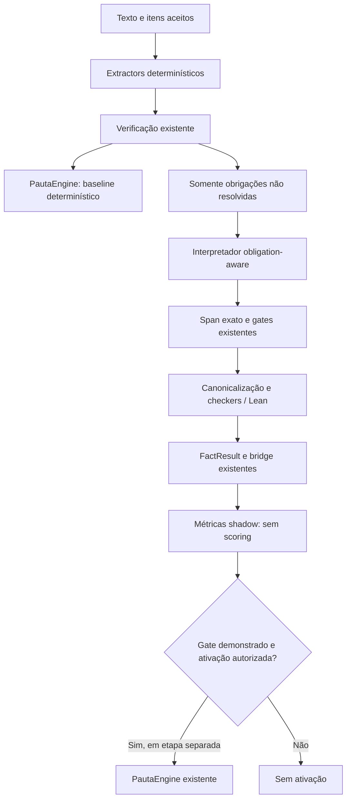

# TME_OBLIGATION_AWARE_01

Data: 2026-11-02.

**Implementação e validação locais. Interpretação DEV por modelo externo não executada, conforme decisão explícita do usuário: “Manter somente análise local”.** Nenhuma chamada real ao modelo, nenhum semantic fact novo aplicado às notas DEV, nenhuma HOLDOUT aberta ou executada e nenhum commit.

**Decisão para avançar às HOLDOUT: NO_GO por evidência experimental insuficiente.** Não é uma conclusão de que a arquitetura foi medida e falhou. O gate shadow não pôde ser demonstrado porque não existem respostas obligation-aware do modelo. Os resultados não medidos são `null`, jamais zeros apresentados como taxa de sucesso.

## O que foi implementado

O novo experimento usa uma visão matemática das 146 obrigações existentes (21/23/13/31/58 para P1–P5). Cada entrada tem ID, item, descrição matemática, evidência esperada e representações da ontologia já consumida pelos producers. Obrigações compostas descrevem seus ingredientes. Não foi criado checker, tipo de FactResult, regra de pontuação ou novo domínio Lean.

A visão não transmite pontos, máximos, notas, labels sintéticos, resultados de correção humana, bandas ou caminho de pontuação. As descrições de P5 deixam de ser apenas a repetição do identificador. Os valores numéricos esperados da resposta não são fornecidos como template. O enunciado continua contexto, nunca evidência do estudante. Alguns IDs históricos contêm números; continuam sendo os identificadores existentes das obrigações matemáticas, não campos de pontuação.

O primeiro estágio executa o caminho determinístico com Unicode e a verificação existentes, com o antigo suplemento semântico desabilitado dentro de um escopo local. Somente obrigações `indeterminate`/não resolvidas podem ser alvo do novo interpretador. `supported` e `refuted` já decididos não são consultados novamente. Nesta preparação são **704 alvos em 25 payloads**, agrupados por solução para evitar repetir o texto integral em uma chamada por obrigação. O schema restringe cada resposta aos IDs efetivamente solicitados e aos subjects/tipos permitidos para aquele alvo.

A entrada do modelo é uma allowlist: `problem_id`, enunciado, `solution_text` integral, obrigações matemáticas alvo e linhas da própria fonte com índices Unicode exatos. O índice de linhas auxilia a escolha de spans; não reescreve o texto nem completa matemática. A inspeção recursiva dos 25 payloads confirmou ausência dos campos proibidos. Os dados vêm exclusivamente dos casos DEV já congelados no diagnóstico, sem leitor do arquivo geral de dataset ou de resultados HOLDOUT.

A resposta transitória `ObligationEvidenceCandidate` contém:

- `obligation_id`, `candidate_id`, `evidence_present`;
- `source_text`, `source_start`, `source_end`;
- `assertion_mode`;
- `mathematical_payload` (`subject` e expressão);
- `representation_kind`, `reason_code`.

Objetos são estritos, com campos extras proibidos. Os seis modos de afirmação são preservados. A resposta negativa exige fonte/payload vazios e `representation_kind=none`; não gera record e não significa erro do aluno. Presença é pertinente à obrigação, inclusive quando a conta escrita está errada. Um argumento pertinente que não cabe nos tipos matemáticos existentes fica como evidence_present=true, subject=unmapped e representation_kind=qualitative, com razão unsupported_representation; permanece sem forma canônica e sem autoridade. O tipo matemático existente é prioritário sempre que representar fielmente o texto. Limitação de representação não é registrada como ausência. O modelo não pode retornar campos `supported`, `refuted`, `points`, `score`, `award` ou `deny`.

## Origem, contexto e projeção

O vínculo inicial exige literalmente `solution_text[start:end] == source_text`. Índices errados são `unresolved`; não há relocação por trecho único, busca aproximada nem correção silenciosa. O texto integral é conservado mesmo quando há caracteres Unicode.

Para reutilizar os checkers existentes, o span correto é traduzido para as coordenadas da fonte por itens já aceita. Essa tradução exige que o texto do item exista uma única vez na fonte integral e que o span pertença àquela extensão exata. Ela não corrige índices do modelo nem reatribui um trecho a outro item. Fonte sem item aceito ou item divergente produz bloqueio explícito. Portanto o experimento não corrige o roteamento diagnosticado nos quatro casos com fonte mapeada vazia; seus textos integrais estão nos payloads, mas não ganham autoridade de scoring por isso.

Após esse vínculo, são reutilizados os gates antigos de contexto, assunto, fidelidade numérica/representacional e canonicalização. A projeção continua usando o adaptador comum `semantic-claims.v1`, ABI que os checkers atuais revalidam. A versão do novo interpretador é `obligation-evidence.v1`, registrada separadamente na configuração/telemetria, com obrigação alvo e offsets da fonte integral. Reextrações feitas por checkers usam os mesmos candidatos imutáveis, sem nova chamada ao modelo.

Um controle revelou que “João disse que...” sem aspas podia passar pelo caminho legado quando o modelo mentia sobre `assertion_mode`. Foi acrescentada **uma restrição de atribuição na entrada do novo interpretador**: discurso reportado no parágrafo recebe modo efetivo de citação. O modo originalmente retornado permanece no candidato; a intervenção aparece como `reported_speech` na telemetria. Os gates existentes não foram relaxados nem alterados. Depois da restrição, esse controle e os demais passaram.

Claims conflitantes são bloqueados antes da verificação semântica. Duplicatas preservam o record determinístico como principal e registram confirmação semântica com `retained_record_id`. Um mesmo candidato não pode criar dois records de identidade igual. Nenhum desenho é inferido e `placement` não integra as representações semânticas permitidas em P2.

A canonicalização não concede autoridade: um candidato ainda precisa passar pelo producer/checker. Provas e refutações usam os verificadores existentes e seus estados `verified/refuted/unverified/technical_error`. O teste com perímetro calculado por expressão falsa, embora terminando no número correto, continua refutado por Lean e sem crédito.

## Shadow e ativação



`run_shadow` devolve a avaliação primária intacta. A rota de candidatos chama os collectors, checkers e bridge diretamente e termina antes do engine. Um teste intercepta o PautaEngine e comprova que ele recebe apenas a evidência primária durante shadow. Outro teste mostra candidato verificado no bundle potencial com nota shadow ainda zero; a ativação explícita do fixture, separada, obtém os pontos da pauta existente. Isso valida a mecânica em controles locais, não a eficácia nos 25 DEV.

A nova entrada é experimental e explícita. Nenhuma rota HTTP, revisão aceita, TeacherDecision, UI ou flag padrão passou a ativá-la. O experimento genérico anterior foi preservado para comparação e regressão. O novo runner o substitui como caminho experimental desta iteração; não se sobrepõem as duas interpretações.

## Preparação local dos 25 DEV

As 25 verificações determinísticas foram executadas com Lean disponível. Resultado: **24 supported, 2 refuted, 704 indeterminate**, 25 notas numéricas e 24 pontos totais. Isso coincide com a fase Unicode-only congelada. Nenhuma auditoria publicada/revisão aceita foi sobrescrita; a preparação produziu arquivos novos isolados.

É indispensável distinguir os baselines:

- **43/409 = 10,51%** é a referência do experimento semântico genérico anterior e a métrica principal solicitada.
- **24/409 = 5,87%** é a cobertura das aparentemente satisfeitas pela verificação determinística com Unicode usada como primeiro estágio nesta implementação.
- O resultado **obligation-aware depois** não foi medido. Não se compara24 com 43 como se isso fosse queda do novo interpretador; ele não rodou.

Os 25 payloads já preparados apontam apenas para as 704 obrigações sem decisão primária. Não foram enviados. O modelo/destino preparados eram `gpt-4o-mini`, `https://api.openai.com/v1`, `temperature=0`, `store=false`, sem retries automáticos. Prompt, catálogo, schema, código, IDs DEV e política receberam hashes antes da preparação.

## Funil principal por problema

| Problema | Aparentemente satisfeitas | Antes: genérico verificado | Primário determinístico | Depois: obligation-aware |
| --- | --- | --- | --- | --- |
| P1 | 77 | 29 | 20 | Não medido |
| P2 | 91 | 7 | 0 | Não medido |
| P3 | 50 | 4 | 4 | Não medido |
| P4 | 97 | 1 | 0 | Não medido |
| P5 | 94 | 2 | 0 | Não medido |
| Total | 409 | 43 | 24 | Não medido |

Entre os 366 misses anteriores, candidatos, grounding, FactResult, verificados e potencialmente mapeáveis permanecem **não medidos**. Não há inferência de ganho a partir da hipótese diagnóstica de 121 recuperáveis. O schema e os testes locais mostram uma possibilidade de representação; não demonstram quantas respostas reais o modelo produzirá corretamente.

Os 43 supported anteriores e 33 obrigações participantes do crédito continuam distintos. As dez diferenças já documentadas incluem bandas parciais superadas, requisitos conjuntos e componentes auxiliares sem crédito isolado: P1_12 `a.constructs_subtraction`/`d.equation`; P1_13 `d.difference_six`; P1_15/P1_17 `c.several_correct`/`c.some_correct`; P4_16 `b.apqr`; P5_02 `c.max_product`; P5_24 `a.normal_list`. Não foi alterado scoring para compensá-las.

## Gates previamente fixados

A política foi escrita antes de qualquer chamada obligation-aware — e nenhuma chamada ocorreu.

Para liberar scoring ativo DEV: pelo menos 64 verificadas entre 409 aparentemente satisfeitas (ganho de 21 sobre 43, aproximadamente 5 pontos percentuais), pelo menos 20 novas verificadas sobre o primário determinístico, controles sem regressões, nenhuma falsa origem/atribuição conhecida e camadas protegidas intactas.

Para eventual GO à HOLDOUT: pelo menos 84/409 verificadas, no máximo 612 indeterminate (redução de ao menos 10% sobre 681), ganho em pelo menos quatro problemas, zero novo falso crédito/atribuição conhecida e regressões aprovadas. MAE sintético não determina nenhum gate.

A execução ativa depende de gate registrado como aprovado e replay do bundle shadow congelado. O runner não executa HOLDOUT em nenhum modo. Não se produziu métricas sintéticas “depois”, porque essa etapa só seria pertinente após ativação, que não ocorreu.

## Verificações locais e preservação

A suíte do interpretador novo e do legado terminou com **84 passed**. Os controles incluem negação, hipótese, tentativa rejeitada, citação/discurso reportado, conflito, menção incidental, método errado com resultado final correto, spans incorretos mesmo com citação única, tipo incompatível com obrigação, campos proibidos, ausência explícita, reextração adulterada, deduplicação e isolamento shadow. Foram exercitadas verificação e refutação Lean reais nos fixtures.

- Regressão core: **1288 passed, 0 skipped, 0 xfailed, 0 failures, 0 errors**, 362.46s.
- Regressão ita: **263 passed, 0 skipped, 1 xfailed, 0 failures, 0 errors**, 4089.22s.

Os casos marcados como `xfail` são expectativas preexistentes registradas pela suíte: P2 preexistente: maximizers_identification ausente nesta formulação; subtotal 8/8, sem nota global. Não são contabilizados como testes aprovados.

Os manifests registram os arquivos de teste executados. A suíte core cobre grounding, formas canônicas, claims, facts, semântica, P1–P5, Lean/checkers, PautaEngine e integração accepted transcription; a suíte ITA cobre os caminhos e certificados relevantes, incluindo regressões cap04. Nenhuma execução de avaliação HOLDOUT ou chamada de modelo é necessária nesses testes.

PautaEngine, pautas P1–P5, pesos, banded/max_of/carry-forward, bridge, scoring, TeacherDecision, UI, OCR/HMER/Mathpix, normalização Unicode e checkers/Lean mantêm os hashes preexistentes. A única alteração em arquivo preexistente desta tarefa é o hook de escopo local em `student_claims/semantic.py`; os demais componentes são novos arquivos experimentais/testes/documentação. O snapshot também preserva as alterações que já estavam na árvore antes desta tarefa. HEAD e os 64 artefatos anteriores do experimento/diagnóstico permanecem protegidos. Nenhum commit foi feito.

## Limite de autorização e HOLDOUT

A revisão automática rejeitou o comando que enviaria os textos DEV à API, citando autorização insuficientemente explícita para esse destino externo. Depois de preparar os payloads locais, foi solicitada autorização específica para OpenAI/gpt-4o-mini com os 25 DEV, sem HOLDOUT. O usuário escolheu **“Manter somente análise local”**. A escolha foi respeitada: nenhuma chamada externa foi executada, nenhuma alternativa indireta de envio foi usada e nenhuma nova autorização foi solicitada.

**Nenhum texto das 100 HOLDOUT foi aberto, nenhum resultado individual foi inspecionado e nenhuma execução/fixture foi derivada desse conjunto.** Os dados carregados para preparação vieram exclusivamente do diagnóstico DEV e de resultados já separados para DEV. HOLDOUT continua utilizável em tarefa futura explícita, após autorização da etapa de modelo, validação DEV e congelamento.

## Arquivos e reprodução local

- [Catálogo matemático](/Users/LinMarcolino/Documents/confia-lean-auditor/app/confia_lean_auditor/student_claims/obligation_catalog.py)
- [Schema, provider e projeção](/Users/LinMarcolino/Documents/confia-lean-auditor/app/confia_lean_auditor/student_claims/obligation_semantic.py)
- [Orquestração shadow](/Users/LinMarcolino/Documents/confia-lean-auditor/app/confia_lean_auditor/tme/obligation_experiment.py)
- [Runner DEV](/Users/LinMarcolino/Documents/confia-lean-auditor/scripts/evaluation/evaluate_tme_obligation_aware.py)
- [Testes](/Users/LinMarcolino/Documents/confia-lean-auditor/tests/test_obligation_semantic.py)
- [Diff incremental](/Users/LinMarcolino/Documents/confia-lean-auditor/artifacts/evaluations/tme_obligation_aware_01/implementation.diff)

- [shadow_candidates.jsonl](/Users/LinMarcolino/Documents/confia-lean-auditor/artifacts/evaluations/tme_obligation_aware_01/shadow_candidates.jsonl)
- [shadow_summary.json](/Users/LinMarcolino/Documents/confia-lean-auditor/artifacts/evaluations/tme_obligation_aware_01/shadow_summary.json)
- [dev_active_results.jsonl](/Users/LinMarcolino/Documents/confia-lean-auditor/artifacts/evaluations/tme_obligation_aware_01/dev_active_results.jsonl)
- [dev_before_after.json](/Users/LinMarcolino/Documents/confia-lean-auditor/artifacts/evaluations/tme_obligation_aware_01/dev_before_after.json)
- [false_credit_controls.json](/Users/LinMarcolino/Documents/confia-lean-auditor/artifacts/evaluations/tme_obligation_aware_01/false_credit_controls.json)
- [funnel_before_after.json](/Users/LinMarcolino/Documents/confia-lean-auditor/artifacts/evaluations/tme_obligation_aware_01/funnel_before_after.json)
- [summary_by_problem.json](/Users/LinMarcolino/Documents/confia-lean-auditor/artifacts/evaluations/tme_obligation_aware_01/summary_by_problem.json)
- [GO_NO_GO.json](/Users/LinMarcolino/Documents/confia-lean-auditor/artifacts/evaluations/tme_obligation_aware_01/GO_NO_GO.json)
- [promotion_policy.json](/Users/LinMarcolino/Documents/confia-lean-auditor/artifacts/evaluations/tme_obligation_aware_01/promotion_policy.json)
- [experiment_freeze.json](/Users/LinMarcolino/Documents/confia-lean-auditor/artifacts/evaluations/tme_obligation_aware_01/experiment_freeze.json)
- [preparation_summary.json](/Users/LinMarcolino/Documents/confia-lean-auditor/artifacts/evaluations/tme_obligation_aware_01/preparation_summary.json)
- [authorization_review.json](/Users/LinMarcolino/Documents/confia-lean-auditor/artifacts/evaluations/tme_obligation_aware_01/authorization_review.json)
- [validation.json](/Users/LinMarcolino/Documents/confia-lean-auditor/artifacts/evaluations/tme_obligation_aware_01/validation.json)

Os dois JSONL de candidatos/ativação estão vazios intencionalmente. Os JSON de resumo registram a não execução e deixam métricas semânticas posteriores como `null`. Não são arquivos de uma execução com rendimento zero.

Reprodução **somente local**, usando a árvore congelada:

```sh
PYTHONDONTWRITEBYTECODE=1 PYTHONPATH=app .venv/bin/python scripts/evaluation/evaluate_tme_obligation_aware.py --prepare-only
PYTHONDONTWRITEBYTECODE=1 PYTHONPATH=app .venv/bin/python -m pytest -q -p no:cacheprovider tests/test_obligation_semantic.py tests/test_semantic_claims.py
```

A execução sem `--prepare-only` faria solicitações ao provider e **não está autorizada nesta tarefa**. Não deve ser usada como continuação automática. O modo `--activate` exige aprovação do gate shadow; essa aprovação não existe. Não há modo HOLDOUT.
