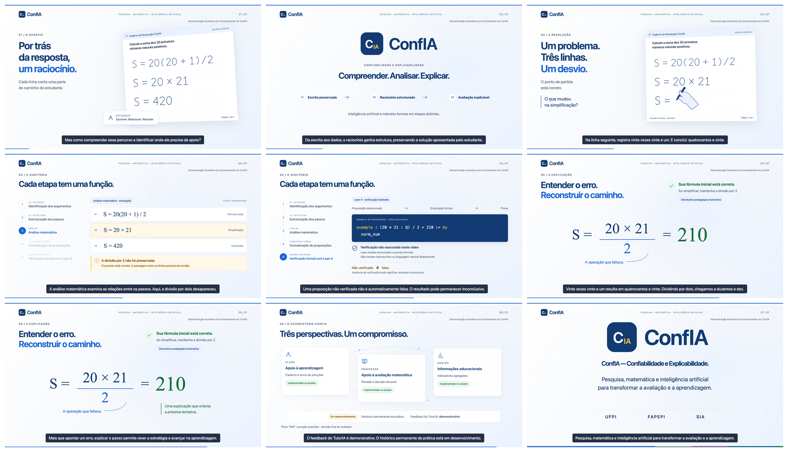

# Storyboard — ConfIA, 180 segundos

Formato: 1920 × 1080, 16:9, 30 fps, 5.400 quadros. Narrativa para apresentação institucional da FAPEPI à SIA. Narração completa: `narracao.md`; fonte temporal: `src/narration.json`.

| Cena / tempo | Ação e composição | Movimento e sincronização | Informação essencial |
|---|---|---|---|
| 1 · 00:00–00:25 | Mesa digital abstrata, caderno em perspectiva, mão com caneta e três linhas matemáticas | Plano aproxima lentamente. Escrita traçada a partir de 2s, 8s e 13s. Pergunta ganha destaque em 18s | Avaliar exige compreender o raciocínio, além do resultado |
| 2 · 00:25–00:45 | A escrita se converte em partículas; surge a marca ConfIA do projeto | Partículas convergem em arco. Marca revela entre 26,5–28,5s; três nós entre 33–38s | Escrita preservada → raciocínio estruturado → avaliação explicável |
| 3 · 00:45–01:10 | Caderno com enunciado completo e solução incorreta solicitada | Traçado de `S = 20(20 + 1)/2`, `S = 20 × 21`, `S = 420`. Indicador de envio em 65–67s | O erro não é a multiplicação: é perder a divisão |
| 4 · 01:10–01:55 | Fluxo vertical ligado ao painel de afirmações; depois proposição formal | 70s identificação; 77s estruturação; 83s análise; 87s formalização; 93s Lean. Avisos em 100s e 107s | IA, matemática, formalização e verificação são etapas distintas. Lean não lê manuscritos. Não verificado ≠ falso. Nada está sendo executado |
| 5 · 01:55–02:25 | Devolutiva pedagógica e grande equação no centro | Fórmula inicial reconhecida; denominador reaparece em 124–126s; resultado 210 em 132–134s. Linha guia conecta à operação recuperada | Preservar o que está correto e explicar como corrigir o passo |
| 6 · 02:25–02:45 | Aluno, professor e gestão em rede de três nós, sem métricas inventadas | Nós entram em sequência com movimento orbital discreto. Faixa de maturidade aparece a partir de 157,5s | Caderno, fluxo docente e agregados implementados; feedback TutorIA demonstrativo; histórico permanente em desenvolvimento |
| 7 · 02:45–03:00 | Marca ConfIA, mensagem institucional e nomes UFPI / FAPEPI / SIA | Aproximação tipográfica lenta, revelação da frase e faixa de cores | “ConfIA — Confiabilidade e Explicabilidade.” / “Pesquisa, matemática e inteligência artificial para transformar a avaliação e a aprendizagem.” |

## Linguagem audiovisual

A câmera e os elementos de cada cena se movem em função do quadro, sem temporizadores ou aleatoriedade. Transições curtas de dissolução e deslocamento sobre um fundo contínuo conectam as etapas. A mão e a escrita são SVG, com traços progressivos e ponta acompanhando a geometria. Não há captura de dados pessoais nem gravação da aplicação real.

O aviso “Demonstração ilustrativa do funcionamento do ConfIA” permanece no alto à direita. Legendas abertas em português são renderizadas na margem inferior; arquivos SRT e VTT acompanham o filme. A prévia corresponde aos primeiros 30 segundos do filme, com o mesmo áudio e a mesma composição.

## Áudio

Narração sintética brasileira local, Luciana (macOS), gerada por fala com janela reservada. A trilha é uma composição ambiente original sintetizada por código: acordes suaves e notas espaçadas, com redução de nível durante as falas. O roteiro permite substituição por locução humana sem mudar as sete cenas. Não são usadas gravações, loops ou samples externos.

## Folha de contato

